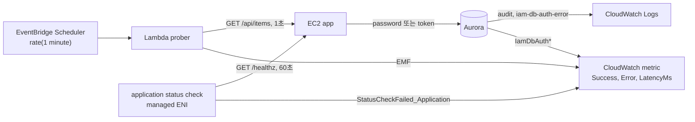

# 시나리오 3. 전환 전에 "끊기지 않았다"를 증명할 장치부터 단다

## 이 시나리오의 목표

| 항목 | 내용 |
| --- | --- |
| 기능 | 인증 전환 중 클라이언트 오류, DB 로그인 사용자, IAM 인증 실패, 애플리케이션 생존을 관측 |
| 쓰는 도구 | EventBridge Scheduler + Lambda prober(EMF), RDS `IamDbAuth*` metric, Aurora `audit` 로그, EC2 application status check |
| 입력 | password 모드로 동작하는 앱과 1초 간격 트래픽 |
| 작업 | 실습 1~4 |
| 달성할 것 | 분 단위 성공·실패 수와 인증 방식별 지연을 쿼리 한 번으로 보고, 앱을 멈췄을 때 EC2 상태 검사가 `impaired`가 되는 것을 확인 |

## 무중단은 주장이 아니라 측정값이다

"무중단으로 바꿨다"는 말은 같은 기간에 실패한 요청이 0건이었다는 측정값이 있어야 성립합니다. 그리고 그 측정은 서버가 아니라 **클라이언트 쪽**에서 해야 합니다. DB는 들어오지 못한 연결을 모르고, 앱은 자기가 받지 못한 요청을 모릅니다.

이 핸즈온은 관측 지점을 네 층으로 나눕니다. 각 층은 다른 질문에 답합니다.

| 층 | 도구 | 답하는 질문 |
| --- | --- | --- |
| 클라이언트 | Lambda prober의 `Success`, `Error`, `LatencyMs` metric(`AuthMode` 차원) | 사용자가 오류를 봤는가, 지연이 늘었는가 |
| DB 접속 | Aurora `audit` 로그 `CONNECT`, `FAILED_CONNECT` | 어떤 DB 사용자로 누가 들어왔고 누가 거절됐는가 |
| IAM 인증 | RDS `IamDbAuthConnectionRequests`, `Success`, `Failure*` metric과 `iam-db-auth-error` 로그 | IAM 인증이 몇 번 시도됐고 왜 실패했는가 |
| 인스턴스 | EC2 application status check, `StatusCheckFailed_Application` | 앱 프로세스가 살아서 응답하는가 |

### 용어

| 용어 | 뜻 | 이 실습의 예 |
| --- | --- | --- |
| prober | 실제 사용자 대신 주기적으로 API를 호출하는 합성 클라이언트 | Lambda `aurora-iam-lab-prober`, 1초 간격 약 56회/분 |
| EMF(Embedded Metric Format) | 로그 한 줄에 metric 정의를 넣으면 CloudWatch가 metric으로 바꾸는 형식 | namespace `aurora-iam-lab`, 차원 `AuthMode` |
| audit 로그 | Aurora MySQL Advanced Auditing이 남기는 접속, 쿼리 기록 | `server_audit_events=CONNECT` |
| application status check | EC2가 managed ENI에서 인스턴스의 HTTP 경로를 60초마다 호출하는 상태 검사 | `GET :8080/healthz`, 기대 코드 `200` |
| managed ENI | application status check가 probe를 보내려고 VPC에 만드는 네트워크 인터페이스 | source security group `aurora-iam-lab-healthcheck` |

## 앱 헬스체크는 DB를 보지 않는다

EC2 application status check는 2026년 8월에 나온 기능입니다. 기존 EC2 상태 검사(system, instance, EBS)는 하이퍼바이저와 OS까지만 보므로, 웹 서버 프로세스가 죽어도 `ok`로 남았습니다. application status check는 지정한 포트와 경로로 HTTP 요청을 보내 응답 코드를 비교하고, 그 결과를 인스턴스 상태와 Auto Scaling의 교체 판단에 더합니다.

이 실습의 `/healthz`는 DB를 조회하지 않고 프로세스가 응답하는지만 봅니다. AWS 문서도 health 경로가 공유 의존성(DB)에 기대면 DB 문제 하나로 모든 인스턴스가 동시에 `impaired`가 되고 Auto Scaling이 모든 인스턴스를 교체할 수 있다고 경고합니다. 인증 전환에 적용하면 의미가 더 분명합니다. DB 인증이 실패한다고 인스턴스를 갈아도 인증은 고쳐지지 않습니다. DB까지 확인하는 경로는 `/readyz`로 따로 두고, 그 결과는 prober와 metric이 봅니다.

## 대안 비교

| 방식 | 앱 수준 확인 | 비용 | 이 실습에서 고르지 않은 이유 |
| --- | --- | --- | --- |
| EC2 application status check | HTTP 응답 코드 | managed ENI당 $0.01/h + metric | 선택 |
| ALB target group health check | HTTP 응답 코드 | ALB 시간당 과금 | 로드 밸런서를 쓰지 않는 구성 |
| Route 53 health check | 공인 endpoint의 HTTP | health check당 월 과금 | 공인 IP에서 오는 probe를 security group에 열어야 함 |
| Auto Scaling `set-instance-health` | 직접 구현한 검사 결과 | 무료 | 검사 주체와 스크립트를 직접 운영 |

prober도 같은 방식으로 골랐습니다. EventBridge Scheduler의 최소 주기는 1분이라 1초 간격 트래픽을 직접 만들 수 없습니다. Scheduler는 1분마다 Lambda를 깨우고, Lambda가 그 안에서 1초 간격으로 호출합니다. Lambda를 VPC에 넣었으므로 EC2의 security group은 IP 대역이 아니라 Lambda의 security group을 허용합니다.

## 컴포넌트 역할

| 컴포넌트 | 역할 |
| --- | --- |
| EventBridge Scheduler | `rate(1 minute)`로 prober 실행 |
| Lambda prober | `/api/items`를 1초마다 호출하고 요청마다 EMF 로그 한 줄 기록 |
| EC2 app | `/healthz`(프로세스), `/api/items`와 `/readyz`(DB 조회) |
| Aurora `audit` 로그 | `CONNECT`, `FAILED_CONNECT`와 DB 사용자, 오류 코드 기록 |
| EC2 application status check | managed ENI에서 `/healthz` 호출, `StatusCheckFailed_Application` 발행 |

## 흐름

트래픽 경로와, 각 지점에서 CloudWatch로 나가는 관측 데이터입니다.



## 실습

### 1. prober 로그 한 줄 확인

최근 2분의 prober 로그에서 성공한 요청 하나를 꺼냅니다.

```bash
aws logs filter-log-events --log-group-name /aws/lambda/aurora-iam-lab-prober \
  --start-time $(( ($(date +%s)-120)*1000 )) --filter-pattern '{ $.Success = 1 }' \
  --max-items 1 --query 'events[0].message' --output text
```

```text
{"_aws":{"CloudWatchMetrics":[{"Namespace":"aurora-iam-lab","Dimensions":[["AuthMode"],[]],"Metrics":[...]}]},"AuthMode":"password","Success":1,"Error":0,"LatencyMs":26.4,"status":200,"db_user":"app_pw@%","error":null}
```

- Lambda 한 번 실행은 `Duration: 56008 ms`, `Max Memory Used: 50 MB`였습니다. 1분에 약 56개 요청이 나갑니다.

### 2. 분 단위 성공·실패 집계 쿼리

CloudWatch Logs Insights에서 prober log group에 실행합니다. 마이그레이션 내내 이 쿼리 하나로 결과를 판정합니다.

```text
filter ispresent(AuthMode)
| stats sum(Success) as ok, sum(Error) as err, avg(LatencyMs) as avg_ms, pct(LatencyMs, 99) as p99_ms
  by bin(1m) as t, AuthMode
| sort t asc
```

```text
t                    AuthMode  ok  err  avg_ms  p99_ms
2026-11-07 04:50:00  password  57  0    49.0    230.2
2026-11-07 04:51:00  password  56  0    48.1    223.6
```

- 첫 apply 직후에는 오류가 보입니다. EC2가 Aurora보다 먼저 떴고(`2003 Can't connect`), 그 뒤 `db-init.sh`가 `app_pw`를 만들기 전까지 `1045`가 났습니다. 실습 판정은 오류가 0이 된 뒤부터 합니다([troubleshooting.md](./troubleshooting.md)).

### 3. audit 로그에서 DB 사용자별 접속 집계

audit 로그 한 줄은 `시각(us),서버,DB 사용자,client,연결 ID,쿼리 ID,동작,DB,객체,반환 코드` 순서입니다. `/aws/rds/cluster/aurora-iam-lab/audit`에 실행합니다.

```text
parse @message "*,*,*,*,*,*,*,*,*,*" as ts, server, db_user, client, conn_id, query_id, op, db, obj, retcode
| filter op in ["CONNECT", "FAILED_CONNECT"]
| stats count() as n, max(@timestamp) as last by db_user, op, retcode
```

```text
db_user  op       retcode  n    last
app_pw   CONNECT  0        215  2026-11-07 04:55:20.983
```

- audit 로그는 CloudWatch에 약 2분 늦게 도착했습니다. "옛 사용자 접속이 0건"을 판정할 때는 마지막 전환 시각에서 몇 분 지난 뒤에 조회합니다.

### 4. 앱을 멈춰 application status check 상태 변화 확인

EC2에서 앱만 멈춥니다.

```bash
INSTANCE_ID=$(terraform -chdir=terraform output -raw instance_id)
aws ssm send-command --instance-ids $INSTANCE_ID --document-name AWS-RunShellScript \
  --parameters 'commands=["systemctl stop app"]'
```

10초마다 상태를 조회합니다.

```bash
aws ec2 describe-application-status --instance-ids $INSTANCE_ID --output json \
  | jq -r '.ApplicationStatuses.Instances[0].ApplicationStatus | "\(.Status) \(.Details[0].Status) \(.Details[0].Reason.Code)"'
```

| 시각(UTC) | 상태 |
| --- | --- |
| 04:59:10 | `systemctl stop app` |
| 05:01:06 | `ok passed ConnectionRefused` |
| 05:02:10 | `impaired failed ConnectionRefused` |
| 05:02:19 | `systemctl start app` |
| 05:03:02 | `impaired failed ResponseCodeMatched` |
| 05:04:05 | `ok passed ResponseCodeMatched` |

같은 시각의 기존 상태 검사는 그대로입니다.

```bash
aws ec2 describe-instance-status --instance-ids $INSTANCE_ID --output json \
  | jq -c '.InstanceStatuses[0] | {system: .SystemStatus.Status, instance: .InstanceStatus.Status, app: .ApplicationStatus}'
```

```text
{"system":"ok","instance":"ok","app":{"Status":"impaired","ImpairedSince":"2026-11-07T05:01:08.787000+00:00"}}
```

- 앱이 멈추고 `impaired`가 되기까지 약 2~3분, 다시 `ok`가 되기까지 약 2분 걸렸습니다. 검사 주기가 60초이고 `failure_threshold`와 `success_threshold`가 모두 2이기 때문입니다. 초 단위 장애 판정은 이 검사로 할 수 없어 prober를 함께 둡니다.
- `StatusCheckFailed_Application` metric은 05:01, 05:02(UTC) 두 구간에 `1`이었습니다.
- 응답 JSON은 공식 문서 예시(`ApplicationStatuses[]`)와 달리 `ApplicationStatuses.Instances[]` 아래에 있었습니다. CLI 2.36 기준입니다.

## 부록. 실무에서 얻는 것

- **application status check는 Terraform `hashicorp/aws` provider에 아직 없습니다**(2026-11 기준, 리소스 PR이 열려 있는 상태). 이 실습은 `awscc_ec2_application_status_check`로 검사를 만들고, 인스턴스 연결은 CloudFormation에도 리소스가 없어 `terraform_data`의 `local-exec`로 `associate-application-status-check`를 호출합니다.
- **source security group을 지정해야 inbound를 좁힐 수 있습니다.** `health_check_paths`를 생략하면 AWS가 source를 정해 주지만, 그 경우 app security group에 무엇을 허용할지 미리 알 수 없습니다. 이 실습은 전용 security group을 source로 지정하고 app security group이 그 security group만 허용합니다.
- **배포처럼 예정된 중단은 suppression으로 덮습니다.** `enable-application-status-check-suppression --duration-seconds`로 그 시간 동안 `suppressed` 상태가 되고 Auto Scaling이 교체하지 않습니다.
- **prober를 상시로 돌리면 Lambda 무료 구간을 대부분 씁니다.** 1분에 한 번, 128 MB로 56초 실행이면 한 달 약 30만 GB-초입니다. 계정 무료 구간 40만 GB-초 안이지만 다른 Lambda와 나눠 씁니다. 상시 감시가 목적이면 CloudWatch Synthetics나 기존 모니터링 도구가 맞고, 이 prober는 전환 작업 기간에만 켭니다.

## 참고 문서

1. [Application status checks - Amazon EC2](https://docs.aws.amazon.com/AWSEC2/latest/UserGuide/application-status-checks.html)
2. [Amazon EC2 introduces application status checks (2026-08)](https://aws.amazon.com/about-aws/whats-new/2026/08/amazon-ec2-application-status-checks/)
3. [Implementing health checks - Amazon Builders' Library](https://aws.amazon.com/builders-library/implementing-health-checks/)
4. [Using Advanced Auditing with an Amazon Aurora MySQL DB cluster](https://docs.aws.amazon.com/AmazonRDS/latest/AuroraUserGuide/AuroraMySQL.Auditing.html)
5. [Specification: Embedded metric format](https://docs.aws.amazon.com/AmazonCloudWatch/latest/monitoring/CloudWatch_Embedded_Metric_Format_Specification.html)
