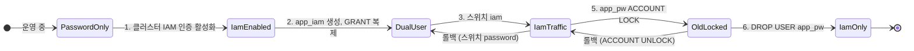

# 시나리오 4. password에서 IAM 인증으로 무중단 전환은 사용자를 바꾸지 않고 하나 더 만들어서 한다

## 이 시나리오의 목표

| 항목 | 내용 |
| --- | --- |
| 기능 | 운영 중인 앱의 DB 인증을 password에서 IAM으로 무중단 전환 |
| 쓰는 도구 | `iam_database_authentication_enabled`, IAM 사용자 `app_iam`, SSM 인증 방식 스위치, `ALTER USER ... ACCOUNT LOCK` |
| 입력 | `app_pw`로 1초마다 조회하는 앱과 prober, [시나리오 3](./3-observability.md)의 관측 장치 |
| 작업 | 실습 1~6 |
| 달성할 것 | 활성화, 전환, 롤백, 재전환, 옛 사용자 잠금까지 prober 오류 0건, 그리고 옛 사용자 접속 0건을 audit 로그로 확인한 뒤 삭제 |

## 결론: 무중단 전환은 가능하다

조건은 하나입니다. **기존 password 사용자를 IAM 사용자로 바꾸지 않고, IAM 사용자를 새로 만들어 두 자격증명이 공존하는 기간을 둡니다.** 실습에서 아래 다섯 작업 동안 prober가 보낸 527개 요청이 모두 성공했습니다.

| 시각(UTC) | 작업 | prober 오류 |
| --- | --- | --- |
| 04:49:16~04:49:51 | 클러스터 IAM DB 인증 활성화(apply 전체 35초, 클러스터 수정 31초) | 0 |
| 04:52:35 | 인증 방식 스위치 `password` → `iam` | 0 |
| 04:54:08 | 롤백 `iam` → `password` | 0 |
| 04:55:18 | 재전환 `password` → `iam` | 0 |
| 04:57:56 | `app_pw` 잠금(`ACCOUNT LOCK`) | 0 |

무중단이 가능한 근거는 Aurora MySQL의 세 가지 동작입니다.

1. **IAM DB 인증 활성화는 password 인증을 끄지 않습니다.** 클러스터 설정은 "password와 IAM을 함께 허용"으로 바뀔 뿐이고, 어떤 방식으로 인증할지는 DB 사용자마다 정해집니다. 활성화 31초 동안 재시작 이벤트가 없었고 기존 `app_pw` 로그인도 계속 성공했습니다.
2. **인증 방식은 DB 사용자 단위입니다.** `app_pw`는 `mysql_native_password`, `app_iam`은 `AWSAuthenticationPlugin`으로 동시에 존재할 수 있습니다. 반대로 한 사용자가 두 방식을 함께 가질 수는 없어서, 같은 사용자를 바꾸면 그 순간 password 로그인이 끊깁니다([시나리오 5](./5-downtime-migration.md)).
3. **인증은 연결을 맺을 때만 일어납니다.** 이미 열린 세션은 사용자를 잠그거나 인증 방식을 바꿔도 끊기지 않습니다. 전환은 "새 연결이 어느 사용자를 쓰느냐"의 문제로 줄어듭니다.

### 용어

| 용어 | 뜻 | 이 실습의 예 |
| --- | --- | --- |
| 이중 자격증명 기간 | 옛 사용자와 새 사용자가 같은 권한으로 함께 존재하는 기간 | `app_pw`, `app_iam` 모두 `GRANT SELECT ON labdb.*` |
| 인증 방식 스위치 | 앱이 새 연결에 쓸 사용자를 고르는 설정값. 재배포 없이 바꿈 | SSM `/aurora-iam-lab/db-auth-mode`, 앱이 5초마다 읽음 |
| 관찰 기간(bake time) | 전환 후 롤백 가능성을 남겨 두고 지표를 지켜보는 기간 | 실습은 수 분, 운영은 배치 작업 주기 이상 |
| 계정 잠금 | 사용자를 지우지 않고 새 로그인만 막음. `ACCOUNT UNLOCK`으로 되돌림 | `ALTER USER 'app_pw'@'%' ACCOUNT LOCK` |
| 낙오 클라이언트 | 전환을 놓치고 옛 자격증명을 계속 쓰는 클라이언트 | 잠금 뒤 audit 로그 `FAILED_CONNECT` 반환 코드 `3118` |

## 단계별 절차와 되돌리는 방법

6단계 삭제를 제외한 모든 단계는 되돌릴 수 있습니다.

| 단계 | 작업 | 트래픽 영향 | 확인 신호 | 되돌리기 |
| --- | --- | --- | --- | --- |
| 0 | 관측 장치 준비, `iam-db-auth-error` 로그 내보내기 | 없음 | prober 오류 0 기준선 | - |
| 1 | 클러스터 IAM DB 인증 활성화 | 없음(실측) | 클러스터 `available`, prober 오류 0 | 비활성화 |
| 2 | IAM 사용자 생성, 권한 복제, IAM policy 부여 | 없음 | `SHOW GRANTS` 두 사용자 동일, 수동 token 로그인 성공 | `DROP USER app_iam` |
| 3 | 앱 전환(스위치 또는 배포) | 새 연결부터 | prober `AuthMode=iam`, `IamDbAuthConnectionSuccess` 증가, `Failure*` 0 | 스위치 원복 |
| 4 | 관찰 기간 | 없음 | audit 로그에서 `app_pw` `CONNECT` 0건 | 스위치 원복 |
| 5 | 옛 사용자 잠금 | 낙오 클라이언트만 실패 | audit 로그 `FAILED_CONNECT 3118` 0건 | `ACCOUNT UNLOCK` |
| 6 | 옛 사용자 삭제, 비밀번호 저장소 정리 | 없음 | - | 되돌릴 수 없음 |

## 앱을 전환하는 방법 비교

3단계는 앱 구조에 따라 고릅니다.

| 방법 | 동작 | 롤백 속도 | 적합한 경우 |
| --- | --- | --- | --- |
| 설정 스위치(이 실습) | 앱이 두 자격증명을 모두 처리하고 설정값으로 고름 | 수 초 | 코드 배포를 한 번 먼저 할 수 있는 앱 |
| 롤링 배포 | 새 버전 인스턴스가 하나씩 IAM 사용자로 접속 | 배포 1회 | 스위치 코드를 넣기 어려운 앱. 배포 중 두 사용자가 섞임 |
| 블루/그린 배포 | 새 환경 전체가 IAM 사용자로 접속한 뒤 트래픽 이동 | 트래픽 원복 | 앱 환경을 통째로 복제할 수 있을 때 |

어느 방법이든 2단계의 이중 자격증명 기간이 무중단의 전제입니다. RDS Blue/Green Deployments는 DB 엔진 변경을 위한 기능이라 인증 방식 전환에는 쓰지 않습니다.

## 컴포넌트 역할

| 컴포넌트 | 역할 |
| --- | --- |
| Terraform `iam_auth_enabled` | 클러스터 IAM 인증과 EC2 role의 `rds-db:connect`를 함께 켬 |
| `sql/create-iam-user.sql` | `app_iam` 생성과 `app_pw`와 같은 `GRANT` |
| SSM `/aurora-iam-lab/db-auth-mode` | 앱이 새 연결에 쓸 사용자 선택 |
| EC2 app | 스위치 값을 5초 캐시, token은 10분 캐시, 요청마다 새 연결 |
| `sql/retire-password-user.sql` | 잠금, 확인 뒤 삭제 |

## 흐름

전환 단계를 상태로 그리고, 상태마다 되돌아가는 경로를 함께 표시했습니다.



## 실습

1단계와 2단계는 [시나리오 2](./2-iam-db-auth.md)의 실습 1, 2에서 이미 실행했습니다. 그 두 단계 동안의 prober 결과는 실습 4에서 함께 봅니다.

```bash
cd aws/rds/aurora-iam-auth
HOST=$(terraform -chdir=terraform output -raw cluster_endpoint)
SECRET=$(terraform -chdir=terraform output -raw master_secret_arn)
APP_URL=$(terraform -chdir=terraform output -raw app_url)
```

### 1. 전환 직전 두 사용자의 권한이 같은지 확인

권한이 다르면 전환 순간 로그인은 성공하고 쿼리가 실패합니다. 인증 오류가 아니라서 `iam-db-auth-error`에 남지 않습니다.

```bash
export MYSQL_PWD=$(aws secretsmanager get-secret-value --secret-id "$SECRET" --query SecretString --output text | jq -r .password)
mysql -h $HOST -u admin --ssl-mode=REQUIRED -e "SHOW GRANTS FOR 'app_pw'@'%'; SHOW GRANTS FOR 'app_iam'@'%';"
unset MYSQL_PWD
```

```text
GRANT USAGE ON *.* TO `app_pw`@`%`
GRANT SELECT ON `labdb`.* TO `app_pw`@`%`
GRANT USAGE ON *.* TO `app_iam`@`%`
GRANT SELECT ON `labdb`.* TO `app_iam`@`%`
```

### 2. 인증 방식 스위치를 iam으로 전환

스위치를 바꾸고 1초 간격으로 API 응답의 `db_user`가 바뀌는 시점을 봅니다.

```bash
aws ssm put-parameter --name /aurora-iam-lab/db-auth-mode --value iam --overwrite
for i in $(seq 1 6); do curl -s $APP_URL/api/items; echo; sleep 1; done
```

```text
{"mode": "password", "db_user": "app_pw@%", "items": 3, "connect_ms": 11.2}
{"mode": "password", "db_user": "app_pw@%", "items": 3, "connect_ms": 8.7}
{"mode": "password", "db_user": "app_pw@%", "items": 3, "connect_ms": 38.0}
{"mode": "iam", "db_user": "app_iam@%", "items": 3, "connect_ms": 54.6}
{"mode": "iam", "db_user": "app_iam@%", "items": 3, "connect_ms": 18.4}
{"mode": "iam", "db_user": "app_iam@%", "items": 3, "connect_ms": 17.7}
```

- 스위치가 캐시 주기(5초) 안인 4초 만에 반영됐습니다. 첫 IAM 연결(54.6 ms)은 token 생성을 포함하고, 이후 연결 시간은 password의 9~11 ms에서 17~20 ms로 늘었습니다.

### 3. 롤백과 재전환

스위치만 되돌리면 롤백입니다. `app_pw`가 살아 있는 동안은 언제든 가능합니다.

```bash
aws ssm put-parameter --name /aurora-iam-lab/db-auth-mode --value password --overwrite
# 1분 정도 지켜본 뒤
aws ssm put-parameter --name /aurora-iam-lab/db-auth-mode --value iam --overwrite
```

### 4. prober로 전체 구간 판정

[시나리오 3](./3-observability.md) 실습 2의 쿼리를 활성화 직전(04:49)부터 실행합니다.

```text
t                    AuthMode  ok  err  avg_ms  p99_ms
2026-11-07 04:49:00  password  55  0    116.6   612.7
2026-11-07 04:50:00  password  57  0    49.0    230.2
2026-11-07 04:51:00  password  56  0    48.1    223.6
2026-11-07 04:52:00  password  34  0    44.2    221.0
2026-11-07 04:52:00  iam       21  0    96.2    229.6
2026-11-07 04:53:00  iam       56  0    71.0    229.4
2026-11-07 04:54:00  iam       13  0    46.4    134.5
2026-11-07 04:54:00  password  44  0    36.0    135.7
2026-11-07 04:55:00  password  21  0    39.5    142.9
2026-11-07 04:55:00  iam       35  0    46.0    235.6
2026-11-07 04:56:00  iam       56  0    41.2    153.3
2026-11-07 04:57:00  iam       55  0    43.8    145.7
2026-11-07 04:58:00  iam       24  0    39.1    70.3
```

- 오류는 모든 구간에서 0입니다. 04:49의 p99 612.7 ms는 IAM 인증 활성화 중 한 번 늘어난 지연입니다.
- 인증 방식별 p50은 password 26.5 ms, iam 41.5 ms였습니다. 요청마다 새 연결을 맺는 이 앱에서 IAM 인증은 요청 지연을 약 15 ms 늘렸습니다.

RDS의 IAM 인증 metric으로도 확인합니다.

```bash
for m in IamDbAuthConnectionRequests IamDbAuthConnectionSuccess IamDbAuthConnectionFailure; do
  printf "%-30s" $m
  aws cloudwatch get-metric-statistics --namespace AWS/RDS --metric-name $m \
    --dimensions Name=DBInstanceIdentifier,Value=aurora-iam-lab-writer \
    --start-time <전환 시각> --end-time <현재 시각> --period 60 --statistics Sum \
    --query 'sort_by(Datapoints,&Timestamp)[].Sum' --output text
done
```

```text
IamDbAuthConnectionRequests   56.0  56.0  57.0
IamDbAuthConnectionSuccess    56.0  56.0  57.0
IamDbAuthConnectionFailure    0.0   0.0   0.0
```

- `Requests`와 `Success`가 prober의 분당 요청 수와 같고 `Failure`가 0이면 IAM 경로가 정상입니다. `Failure`가 오르면 `IamDbAuthConnectionFailureInvalidToken`, `...InsufficientPermissions`, `...Throttling`, `...ServerError` 중 어느 것인지로 원인을 가릅니다.

### 5. 옛 사용자 접속이 0건인지 확인한 뒤 잠금

audit 로그가 약 2분 늦게 도착하므로 마지막 전환에서 몇 분 지난 뒤 [시나리오 3](./3-observability.md) 실습 3의 쿼리를 실행합니다.

```text
db_user  op       retcode  n    last
app_iam  CONNECT  0        108  2026-11-07 04:55:33.005
app_pw   CONNECT  0        215  2026-11-07 04:55:20.983
```

- `app_pw`의 마지막 접속은 재전환(04:55:18) 2초 뒤입니다. 그 뒤로는 `app_iam`만 접속했습니다.

잠금은 삭제와 달리 되돌릴 수 있습니다.

```bash
export MYSQL_PWD=$(aws secretsmanager get-secret-value --secret-id "$SECRET" --query SecretString --output text | jq -r .password)
mysql -h $HOST -u admin --ssl-mode=REQUIRED < sql/retire-password-user.sql
mysql -h $HOST -u admin --ssl-mode=REQUIRED -t -e "SELECT user, account_locked FROM mysql.user WHERE user LIKE 'app%'"
unset MYSQL_PWD
```

```text
+---------+----------------+
| user    | account_locked |
+---------+----------------+
| app_iam | N              |
| app_pw  | Y              |
+---------+----------------+
```

낙오 클라이언트가 있으면 어떻게 보이는지 내 PC에서 `app_pw`로 로그인해 확인합니다.

```bash
PW=$(aws ssm get-parameter --name /aurora-iam-lab/app-password --with-decryption --query Parameter.Value --output text)
mysql -h $HOST -u app_pw --password="$PW" --ssl-mode=REQUIRED -e 'select 1'
```

```text
ERROR 3118 (HY000): Access denied for user 'app_pw'@'<내 IP>'. Account is locked.
```

- 같은 시각 앱은 `app_iam`으로 계속 응답했습니다. audit 로그에서 `FAILED_CONNECT` 반환 코드 `3118`을 찾으면 낙오 클라이언트의 IP가 나옵니다.

### 6. 옛 사용자 삭제

관찰 기간 동안 `3118`이 없으면 삭제합니다. 되돌릴 수 없는 유일한 단계입니다.

```bash
export MYSQL_PWD=$(aws secretsmanager get-secret-value --secret-id "$SECRET" --query SecretString --output text | jq -r .password)
mysql -h $HOST -u admin --ssl-mode=REQUIRED -e "DROP USER 'app_pw'@'%'"
unset MYSQL_PWD
curl -s $APP_URL/api/items
```

```text
{"mode": "iam", "db_user": "app_iam@%", "items": 3, "connect_ms": 17.8}
```

- 운영에서는 이 뒤에 비밀번호 저장소(SSM parameter, Secrets Manager secret)와 앱의 password 코드 경로를 지우고, 앱 role에서 비밀번호 읽기 권한(`ssm:GetParameter`)을 회수합니다. 실습 환경은 `terraform destroy`로 함께 지웁니다.

## 부록. 실무에서 얻는 것

- **커넥션 풀은 전환을 늦춥니다.** 이 실습의 앱은 요청마다 새 연결을 맺어 스위치가 캐시 주기(5초) 안에 반영됐습니다. 풀을 쓰는 앱은 기존 연결이 `app_pw`로 남아 있다가 풀의 최대 수명(HikariCP `maxLifetime` 등)이 지나야 교체됩니다. 잠금 전에 `information_schema.processlist`에서 `app_pw` 세션이 남았는지 보고, 남았으면 풀 수명을 기다리거나 앱을 재시작합니다. 잠금도 열린 세션은 끊지 않습니다.
- **풀을 쓰면 token 만료는 문제가 되지 않습니다.** token은 연결을 맺을 때만 검사되므로 15분 넘게 사는 연결도 정상입니다. 단, 풀이 새 연결을 만들 때마다 새 token(또는 15분 안쪽 캐시)을 써야 합니다. 풀에 비밀번호 문자열을 한 번만 넣는 설정은 15분 뒤 새 연결부터 실패합니다.
- **권한 복제가 가장 흔한 누락입니다.** `GRANT`뿐 아니라 `DEFINER`가 옛 사용자인 view, procedure, event가 있으면 옛 사용자를 지운 순간 그 객체가 실패합니다. 삭제 전에 `information_schema.routines`, `views`, `events`의 `DEFINER`를 확인합니다.
- **스위치를 두면 전환 시점과 배포 시점이 분리됩니다.** 스위치 코드를 담은 배포는 평소처럼 하고, 인증 전환은 metric을 보며 사람이 켭니다. 롤백이 배포가 아니라 설정 변경이 되므로 수 초 안에 끝납니다.

## 참고 문서

1. [Enabling and disabling IAM database authentication](https://docs.aws.amazon.com/AmazonRDS/latest/AuroraUserGuide/UsingWithRDS.IAMDBAuth.Enabling.html)
2. [Creating and using an IAM policy for IAM database access](https://docs.aws.amazon.com/AmazonRDS/latest/AuroraUserGuide/UsingWithRDS.IAMDBAuth.IAMPolicy.html)
3. [MySQL 8.0 Reference Manual - ALTER USER (Account Locking)](https://dev.mysql.com/doc/refman/8.0/en/account-locking.html)
