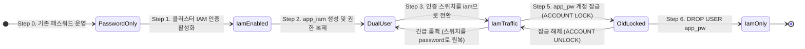

# 시나리오 4. 비밀번호에서 IAM 인증으로의 무중단 전환 (Zero-Downtime Migration)

## 시나리오 개요 및 핵심 목표

| 항목 | 상세 내용 |
| --- | --- |
| **핵심 기능** | 실시간 트래픽을 처리 중인 운영 데이터베이스의 인증 방식을 패스워드에서 IAM 토큰 인증으로 무중단 마이그레이션 |
| **활용 도구** | `iam_database_authentication_enabled`, 신규 DB 계정 `app_iam`, SSM Parameter Store 인증 스위치, MySQL `ACCOUNT LOCK` |
| **입력 자원** | `app_pw` 계정으로 1초마다 조회를 수행 중인 EC2 웹 애플리케이션 및 [시나리오 3](./3-observability.md)의 4계층 Observability 체계 |
| **실습 작업** | 단계별 핸즈온 실습 1~6 |
| **최종 달성 목표** | 클러스터 IAM 활성화, 스위치 전환, 롤백, 재전환, 구 계정 잠금 전 과정에서 Prober 에러 0건 달성 및 Audit 로그 기반 안전 삭제 검증 |

## 무중단 전환의 핵심 조건과 원리

무중단 마이그레이션이 성공하기 위한 단 하나의 필수 조건은 다음과 같습니다.

> **기존 비밀번호 사용자(`app_pw`)를 직접 수정하지 않고, IAM 인증 전용 사용자(`app_iam`)를 별도로 신규 생성하여 두 자격증명이 공존하는 '이중 자격증명 기간(Dual Credentials Period)'을 유지하는 것입니다.**

실제 실습 진행 중 아래 다섯 단계의 작업이 수행되는 동안 Lambda Prober가 전송한 527건의 API 호출 전체에서 단 1건의 실패도 발생하지 않았습니다.

| 작업 시각 (UTC) | 수행 작업 내용 | Prober 집계 에러 수 |
| --- | --- | --- |
| **04:49:16 ~ 04:49:51** | 클러스터 레벨의 IAM DB 인증 활성화 (`terraform apply` 35초 소요) | **0건** |
| **04:52:35** | Parameter Store 인증 스위치 전환 (`password` → `iam`) | **0건** |
| **04:54:08** | 즉시 롤백 검증 (`iam` → `password`) | **0건** |
| **04:55:18** | 재전환 적용 (`password` → `iam`) | **0건** |
| **04:57:56** | 레거시 계정 잠금 (`ALTER USER 'app_pw'@'%' ACCOUNT LOCK`) | **0건** |

이러한 무중단 전환이 기술적으로 가능한 근거는 Aurora MySQL 엔진의 세 가지 핵심 동작 특성에 기인합니다.

1. **클러스터 IAM 활성화는 기존 패스워드 인증을 차단하지 않습니다.** 클러스터 옵션을 켜더라도 엔진은 "비밀번호와 IAM 토큰을 모두 수용 가능한 상태"로 전환될 뿐이며, 인스턴스 재부팅이 일어나지 않습니다.
2. **인증 플러그인은 개별 DB 사용자 계정 단위로 바인딩됩니다.** `app_pw`는 `mysql_native_password`, `app_iam`은 `AWSAuthenticationPlugin`을 각자 독립적으로 사용하므로 두 계정이 완벽히 공존할 수 있습니다. 반대로 단일 계정의 플러그인을 직접 변경하면 즉시 패스워드 로그인이 차단됩니다 ([시나리오 5](./5-downtime-migration.md)).
3. **인증 검사는 오직 세션 수립 시점에만 발생합니다.** 이미 열려 있는 기존 커넥션은 계정을 잠그거나 설정을 바꾸더라도 즉시 끊어지지 않습니다. 따라서 전환 작업은 "새로 맺어지는 연결이 언제부터 새 계정을 바라보는가"의 제어 문제로 단순화됩니다.

### 핵심 용어 정의

| 용어 | 정의 | 실습 적용 사례 |
| --- | --- | --- |
| **이중 자격증명 기간 (Dual Credentials)** | 구 계정과 신규 계정이 동일한 데이터베이스 권한을 부여받은 채 병행 운영되는 완충 기간 | `app_pw`와 `app_iam` 모두 `GRANT SELECT ON labdb.*` 보유 |
| **동적 인증 스위치 (Auth Mode Switch)** | 애플리케이션의 재배포 없이 런타임에 접속 계정을 전환할 수 있도록 제어하는 설정 플래그 | SSM `/aurora-iam-lab/db-auth-mode` (앱이 5초 간격으로 폴링) |
| **관찰 기간 (Bake Time)** | 전환 후 즉시 옛 계정을 삭제하지 않고, 이상 징후나 미전환 클라이언트 여부를 모니터링하는 안정화 기간 | 실습 기준 수 분, 프로덕션 환경에서는 며칠 또는 배치 주기 이상 |
| **계정 잠금 (Account Lock)** | 계정 객체를 삭제하지 않고 신규 로그인만 차단하는 기능 (`ACCOUNT UNLOCK`으로 즉시 원복 가능) | `ALTER USER 'app_pw'@'%' ACCOUNT LOCK` |
| **낙오 클라이언트 (Lagging Clients)** | 설정 동기화가 누락되어 여전히 구형 패스워드로 접속을 시도하는 잔여 클라이언트 | 잠금 후 Audit 로그에서 `FAILED_CONNECT 3118` 에러 코드로 감지 |

## 단계별 마이그레이션 절차 및 롤백 전략

마지막 6단계(계정 삭제)를 제외한 모든 단계는 문제가 발생할 경우 즉시 이전 상태로 되돌릴 수 있습니다.

| 단계 | 수행 작업 | 트래픽 영향도 | 검증 신호 및 성공 지표 | 롤백(Rollback) 절차 |
| --- | --- | --- | --- | --- |
| **Step 0** | 4계층 Observability 체계 구축 및 에러 로그 내보내기 | 영향 없음 | Prober 트래픽 에러 0건 기준선 확보 | - |
| **Step 1** | Aurora 클러스터 IAM DB 인증 활성화 | 영향 없음 (실측 증명) | 클러스터 상태 `available`, Prober 에러 0건 유지 | 클러스터 옵션 비활성화 |
| **Step 2** | 신규 IAM 계정 생성, 권한 복제, IAM Role 정책 부여 | 영향 없음 | `SHOW GRANTS` 권한 동일, 수동 토큰 접속 성공 | `DROP USER app_iam` |
| **Step 3** | 애플리케이션 인증 스위치 전환 (`iam`) | 신규 연결부터 즉시 적용 | Prober `AuthMode=iam`, `IamDbAuthConnectionSuccess` 증가 | 스위치를 `password`로 원복 |
| **Step 4** | 안정화 관찰 기간 (Bake Time) | 영향 없음 | Audit 로그상 `app_pw`의 `CONNECT` 0건 도달 | 스위치를 `password`로 원복 |
| **Step 5** | 구 패스워드 사용자 계정 잠금 (`ACCOUNT LOCK`) | 낙오 클라이언트만 선별 차단 | Audit 로그상 `FAILED_CONNECT 3118` 발생 여부 확인 | `ACCOUNT UNLOCK` |
| **Step 6** | 레거시 계정 삭제 및 비밀번호 저장소 정리 | 영향 없음 | 최종 IAM 단독 운영 확인 | 불가 (사전 백업 필수) |

## 애플리케이션 전환 방식별 비교

3단계에서 애플리케이션의 접속 계정을 전환하는 방식은 시스템 아키텍처에 따라 선택할 수 있습니다.

| 전환 방식 | 동작 메커니즘 | 롤백 소요 시간 | 적합한 시스템 환경 |
| --- | --- | --- | --- |
| **동적 설정 스위치 (본 핸즈온)** | 앱이 두 인증 로직을 모두 내장하고 중앙 설정 저장소(SSM)를 폴링하여 즉시 전환 | **수 초 이내** | 코드 사전 배포가 가능하고 빠른 롤백이 필요한 핵심 운영 서비스 |
| **롤링 배포 (Rolling Update)** | 인스턴스를 하나씩 순차적으로 새 버전(IAM 적용 버전)으로 교체 배포 | 롤링 배포 1회 시간 | 설정 스위치를 코드에 넣기 어렵거나 컨테이너 기반 환경 |
| **블루/그린 배포 (Blue/Green)** | 신규 IAM 환경 전체를 별도 기동한 뒤 로드 밸런서 트래픽을 일괄 전환 | 트래픽 라우팅 원복 시간 | 스테이징 환경 전체를 복제할 수 있는 대규모 서비스 |

어떤 방식을 선택하든 데이터베이스 레벨에서 `app_iam`과 `app_pw`가 공존하는 **이중 자격증명 기간(Step 2)**이 확보되어야만 무중단이 성립합니다.

## 마이그레이션 구성 요소별 역할

| 구성 요소 | 주요 역할 |
| --- | --- |
| **Terraform `iam_auth_enabled`** | Aurora 클러스터 플래그 활성화 및 EC2 Role의 `rds-db:connect` 권한 바인딩 |
| `sql/create-iam-user.sql` | `app_iam` 계정 생성 및 기존 `app_pw`와 동일한 테이블 읽기 권한 복제 |
| **SSM `/aurora-iam-lab/db-auth-mode`** | 애플리케이션이 연결 시 사용할 자격증명 모드를 지정하는 런타임 플래그 |
| **EC2 애플리케이션** | 스위치 값(5초 캐시), 인증 토큰(10분 캐시)을 관리하며 새 연결 수립 |
| `sql/retire-password-user.sql` | 사용이 중단된 `app_pw` 계정을 잠금 처리 |

## 무중단 전환 상태 전이도

마이그레이션 진행 단계별 상태 전이와 각 단계에서의 롤백 경로를 나타낸 다이어그램입니다.



## 실습 진행: 무중단 전환 및 검증

[시나리오 2](./2-iam-db-auth.md) 실습을 통해 Step 1(클러스터 IAM 활성화)과 Step 2(`app_iam` 계정 생성)가 이미 완료된 상태에서 이어서 진행합니다.

실습에 필요한 엔드포인트와 시크릿 ARN 정보를 확인합니다.

```bash
cd aws/rds/aurora-iam-auth
HOST=$(terraform -chdir=terraform output -raw cluster_endpoint)
SECRET=$(terraform -chdir=terraform output -raw master_secret_arn)
APP_URL=$(terraform -chdir=terraform output -raw app_url)
```

### 1. 전환 전 사용자 권한 정합성 확인

두 사용자의 권한이 완전히 일치하지 않으면, 계정 전환 시 로그인은 성공하지만 애플리케이션의 특정 비즈니스 쿼리가 권한 부족으로 실패하게 됩니다.

두 사용자 계정(`app_pw`, `app_iam`)의 권한 목록을 조회하여 동일성을 검증합니다.

```bash
export MYSQL_PWD=$(aws secretsmanager get-secret-value --secret-id "$SECRET" --query SecretString --output text | jq -r .password)
mysql -h $HOST -u admin --ssl-mode=REQUIRED -e "SHOW GRANTS FOR 'app_pw'@'%'; SHOW GRANTS FOR 'app_iam'@'%';"
unset MYSQL_PWD
```

두 계정 모두 동일한 테이블 권한(`labdb.*`에 대한 `SELECT`)을 보유하고 있음을 확인합니다.

```text
GRANT USAGE ON *.* TO `app_pw`@`%`
GRANT SELECT ON `labdb`.* TO `app_pw`@`%`
GRANT USAGE ON *.* TO `app_iam`@`%`
GRANT SELECT ON `labdb`.* TO `app_iam`@`%`
```

### 2. Parameter Store 스위치를 통한 IAM 인증 전환

SSM Parameter Store의 인증 모드 값을 `iam`으로 업데이트하고, 1초 간격으로 API를 호출하여 접속 계정이 패스워드에서 IAM으로 자연스럽게 전환되는지 관찰합니다.

인증 모드를 iam으로 변경하고 연속 API 응답을 확인합니다.

```bash
aws ssm put-parameter --name /aurora-iam-lab/db-auth-mode --value iam --overwrite
for i in $(seq 1 6); do curl -s $APP_URL/api/items; echo; sleep 1; done
```

출력 결과, 애플리케이션의 캐시 주기(5초) 내에 무중단으로 계정이 교체됩니다.

```text
{"mode": "password", "db_user": "app_pw@%", "items": 3, "connect_ms": 11.2}
{"mode": "password", "db_user": "app_pw@%", "items": 3, "connect_ms": 8.7}
{"mode": "password", "db_user": "app_pw@%", "items": 3, "connect_ms": 38.0}
{"mode": "iam", "db_user": "app_iam@%", "items": 3, "connect_ms": 54.6}
{"mode": "iam", "db_user": "app_iam@%", "items": 3, "connect_ms": 18.4}
{"mode": "iam", "db_user": "app_iam@%", "items": 3, "connect_ms": 17.7}
```

- 스위치 변경 후 4초 시점에 `mode: iam` 및 `db_user: app_iam@%`로 안전하게 전환되었습니다.
- 최초 IAM 연결 시점(54.6 ms)에는 Boto3 SDK의 토큰 서명 오버헤드가 포함되며, 이후 안정적인 연결 시간은 약 17~20 ms 수준을 유지합니다.

### 3. 즉시 롤백 및 재전환 검증

스위치를 다시 `password`로 되돌려 장애 상황 시 즉시 롤백이 동작하는지 확인한 후, 다시 `iam`으로 전환합니다.

스위치를 password로 되돌렸다가 다시 iam으로 재전환합니다.

```bash
aws ssm put-parameter --name /aurora-iam-lab/db-auth-mode --value password --overwrite
# 1분간 트래픽을 관찰한 후 다시 IAM으로 전환합니다.
aws ssm put-parameter --name /aurora-iam-lab/db-auth-mode --value iam --overwrite
```

### 4. Prober 지표를 통한 전 구간 무중단 검증

[시나리오 3](./3-observability.md)의 CloudWatch Logs Insights 집계 쿼리를 클러스터 활성화 시점(04:49)부터 현재까지 실행하여 전체 작업 구간의 에러 발생 여부를 확인합니다.

Logs Insights 콘솔에서 분 단위 집계 쿼리를 실행한 결과입니다.

```text
t                    AuthMode  ok  err  avg_ms  p99_ms
2026-11-07 04:49:00  password  55  0    116.6   612.7
2026-11-07 04:50:00  password  57  0    49.0    230.2
2026-11-07 04:51:00  password  56  0    48.1    223.6
2026-11-07 04:52:00  password  34  0    44.2    221.0
2026-11-07 04:52:00  iam       21  0    96.2    229.6
2026-11-07 04:53:00  iam       56  0    71.0    229.4
2026-11-07 04:54:00  iam       13  0    46.4    134.5
2026-11-07 04:54:00  password  44  0    36.0    135.7
2026-11-07 04:55:00  password  21  0    39.5    142.9
2026-11-07 04:55:00  iam       35  0    46.0    235.6
2026-11-07 04:56:00  iam       56  0    41.2    153.3
2026-11-07 04:57:00  iam       55  0    43.8    145.7
2026-11-07 04:58:00  iam       24  0    39.1    70.3
```

- 클러스터 설정 변경, 1차 전환(04:52), 롤백(04:54), 재전환(04:55)의 전 구간에서 **`err`는 완벽히 0**을 기록했습니다.
- 04:49 구간의 p99 지연(612.7 ms)은 Aurora 클러스터에 IAM 플러그인이 로드되는 과정에서 일시적으로 발생한 지연입니다.

동일 기간의 RDS CloudWatch 네이티브 메트릭을 함께 조회합니다.

RDS CloudWatch 네이티브 메트릭 통계를 조회합니다.

```bash
for m in IamDbAuthConnectionRequests IamDbAuthConnectionSuccess IamDbAuthConnectionFailure; do
  printf "%-30s" $m
  aws cloudwatch get-metric-statistics --namespace AWS/RDS --metric-name $m \
    --dimensions Name=DBInstanceIdentifier,Value=aurora-iam-lab-writer \
    --start-time $(( ($(date +%s)-600)*1000 )) --end-time $(( $(date +%s)*1000 )) --period 60 --statistics Sum \
    --query 'sort_by(Datapoints,&Timestamp)[].Sum' --output text
done
```

조회 결과, 요청 수와 성공 수가 일치하며 실패는 0건입니다.

```text
IamDbAuthConnectionRequests   56.0  56.0  57.0
IamDbAuthConnectionSuccess    56.0  56.0  57.0
IamDbAuthConnectionFailure    0.0   0.0   0.0
```

### 5. 레거시 사용자 잔여 트래픽 확인 및 계정 잠금 (Account Lock)

Aurora 감사(Audit) 로그를 조회하여 구 계정(`app_pw`)의 접속이 완전히 중단되었는지 확인한 후 계정을 잠급니다. (감사 로그 전송 지연을 감안하여 전환 후 2분 이상 경과한 시점에 조회합니다.)

CloudWatch Logs Insights에서 감사 로그 접속 이벤트를 집계합니다.

```text
db_user  op       retcode  n    last
app_iam  CONNECT  0        108  2026-11-07 04:55:33.005
app_pw   CONNECT  0        215  2026-11-07 04:55:20.983
```

- `app_pw`의 마지막 접속 기록이 재전환 시각(04:55:18) 직후로 멈춰 있고, 이후에는 `app_iam`으로만 연결되고 있습니다.

이제 안전하게 `app_pw` 계정을 잠금(`ACCOUNT LOCK`) 처리합니다.

구 패스워드 계정을 잠그고 잠금 상태를 확인합니다.

```bash
export MYSQL_PWD=$(aws secretsmanager get-secret-value --secret-id "$SECRET" --query SecretString --output text | jq -r .password)
mysql -h $HOST -u admin --ssl-mode=REQUIRED < sql/retire-password-user.sql
mysql -h $HOST -u admin --ssl-mode=REQUIRED -t -e "SELECT user, account_locked FROM mysql.user WHERE user LIKE 'app%'"
unset MYSQL_PWD
```

`app_pw`의 `account_locked` 플래그가 `Y`로 변경되었습니다.

```text
+---------+----------------+
| user    | account_locked |
+---------+----------------+
| app_iam | N              |
| app_pw  | Y              |
+---------+----------------+
```

만약 마이그레이션에서 누락된 클라이언트가 잠긴 계정으로 접속을 시도할 경우 어떻게 처리되는지 로컬 터미널에서 확인합니다.

잠긴 계정 `app_pw`로 로그인을 시도합니다.

```bash
PW=$(aws ssm get-parameter --name /aurora-iam-lab/app-password --with-decryption --query Parameter.Value --output text)
mysql -h $HOST -u app_pw --password="$PW" --ssl-mode=REQUIRED -e 'select 1'
```

서버로부터 계정 잠금 에러가 즉시 반환됩니다.

```text
ERROR 3118 (HY000): Access denied for user 'app_pw'@'<내 IP>'. Account is locked.
```

- 이와 같은 시도가 발생하면 감사 로그에 `FAILED_CONNECT 3118`로 기록되므로, 감사 로그를 모니터링하여 미전환된 잔여 시스템의 IP를 역추적할 수 있습니다.

### 6. 레거시 사용자 삭제 및 자격증명 정리

일정 관찰 기간(Bake Time) 동안 `3118` 에러가 발생하지 않는다면, 최종적으로 레거시 사용자를 완전히 삭제합니다. 이 단계는 유일하게 즉시 되돌릴 수 없는(Non-reversible) 작업입니다.

마스터 계정으로 접속하여 구 패스워드 계정을 완전히 삭제합니다.

```bash
export MYSQL_PWD=$(aws secretsmanager get-secret-value --secret-id "$SECRET" --query SecretString --output text | jq -r .password)
mysql -h $HOST -u admin --ssl-mode=REQUIRED -e "DROP USER 'app_pw'@'%'"
unset MYSQL_PWD
curl -s $APP_URL/api/items
```

계정 삭제 후에도 애플리케이션은 정상적으로 `app_iam`을 통해 데이터를 응답합니다.

```text
{"mode": "iam", "db_user": "app_iam@%", "items": 3, "connect_ms": 17.8}
```

- 실제 프로덕션 환경에서는 이 시점 이후 SSM Parameter Store의 암호화된 비밀번호와 애플리케이션의 패스워드 접속 코드 분기를 정리하고, IAM Role의 비밀번호 파라미터 읽기 권한을 회수하여 작업을 마무리합니다.

## 부록: 실무 시사점 및 운영 팁

- **커넥션 풀(Connection Pool) 환경에서의 전환 지연**: 본 핸즈온의 애플리케이션은 요청마다 새 연결을 수립하여 4초 만에 스위치가 반영되었습니다. 하지만 HikariCP 등 커넥션 풀을 사용하는 상용 서비스에서는 기존 풀의 유휴 커넥션들이 유지되므로, 풀의 최대 유효 수명(`maxLifetime`)이 경과하기 전까지 구 계정 세션이 잔류할 수 있습니다. 따라서 계정 잠금 전 `information_schema.processlist`에서 구 계정 세션이 남아있는지 반드시 확인해야 합니다.
- **커넥션 풀 환경의 토큰 만료 처리**: 토큰 검증은 연결 수립 순간에만 발생하므로, 15분 이상 유지되는 장기 커넥션도 안전하게 유지됩니다. 다만, 풀이 유휴 커넥션을 교체하거나 신규 연결을 맺을 때 반드시 새로운 토큰을 발급받도록 커넥션 공급자(Connection Provider / Custom DataSource)를 구성해야 합니다.
- **오브젝트 권한(`DEFINER`) 누락 주의**: 단순히 테이블 `GRANT`뿐 아니라 View, Stored Procedure, Event Scheduler의 `DEFINER` 속성이 구 사용자(`app_pw`)로 지정되어 있을 경우, 계정을 삭제하는 순간 해당 객체 호출이 전면 실패하게 됩니다. 삭제 전 반드시 `information_schema.views` 및 `routines`의 `DEFINER` 소유권을 사전 확인해야 합니다.
- **동적 스위치 분리를 통한 배포 리스크 격리**: 인증 로직 전환 코드를 포함한 신규 버전 배포와 실제 인증 모드 변경을 시간적으로 분리할 수 있습니다. 일과 시간 중 사전 배포를 마쳐두고, 트래픽이 안정적인 시점에 파라미터 플래그만 변경함으로써 롤백 소요 시간을 수 초 이내로 단축할 수 있습니다.

## 참고 문서

1. [Enabling and disabling IAM database authentication](https://docs.aws.amazon.com/AmazonRDS/latest/AuroraUserGuide/UsingWithRDS.IAMDBAuth.Enabling.html)
2. [Creating and using an IAM policy for IAM database access](https://docs.aws.amazon.com/AmazonRDS/latest/AuroraUserGuide/UsingWithRDS.IAMDBAuth.IAMPolicy.html)
3. [MySQL 8.0 Reference Manual - ALTER USER (Account Locking)](https://dev.mysql.com/doc/refman/8.0/en/account-locking.html)
