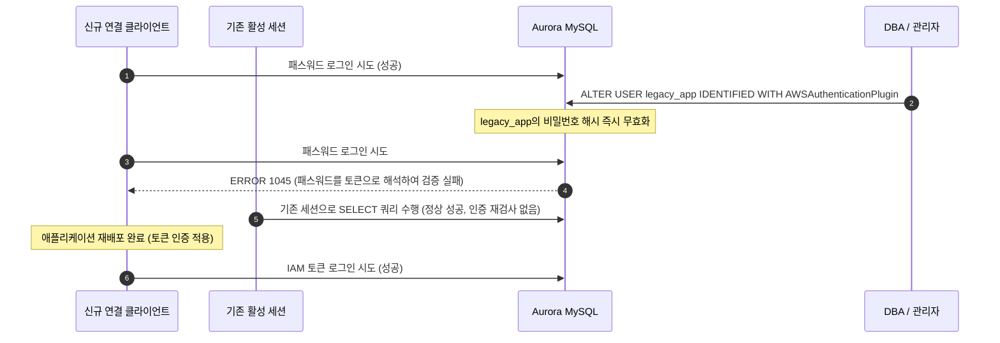

# 시나리오 5. 동일 사용자 유지 시의 In-Place 중단 전환과 영향도 분석

## 시나리오 개요 및 핵심 목표

| 항목 | 상세 내용 |
| --- | --- |
| **핵심 기능** | 기존 패스워드 사용자 계정명을 그대로 유지한 채 인증 플러그인을 IAM으로 변경하는 In-Place 전환의 한계 실측 |
| **활용 도구** | `ALTER USER ... IDENTIFIED WITH AWSAuthenticationPlugin AS 'RDS'`, `scripts/inplace_alter_demo.py` 실험 스크립트 |
| **입력 자원** | 실험용 DB 계정 `legacy_app`, 0.5초 간격으로 신규 연결을 맺는 클라이언트, 사전에 맺어둔 기존 활성 세션 1개 |
| **실습 작업** | 단계별 핸즈온 실습 1~2 |
| **최종 달성 목표** | `ALTER USER` 실행 즉시 신규 패스워드 로그인이 전면 거절(1045)되고, 클라이언트가 토큰으로 전환될 때까지의 중단 시간을 측정하며, 이미 수립된 기존 세션은 영향 없이 유지됨을 증명 |

## In-Place 전환 시 연결 단절이 발생하는 원인

Aurora MySQL 엔진은 **하나의 데이터베이스 사용자 계정에 오직 단 하나의 인증 플러그인만 바인딩**할 수 있도록 설계되어 있습니다.

`ALTER USER` 문을 통해 인증 플러그인을 `AWSAuthenticationPlugin`으로 변경하는 순간, 데이터베이스 내부에 저장되어 있던 기존 패스워드 해시는 즉시 무효화됩니다. 그 결과, 클라이언트가 애플리케이션 재배포 등을 통해 토큰 기반 인증으로 전환되기 전까지 인입되는 모든 패스워드 기반 신규 로그인 시도는 `ERROR 1045`로 즉시 거절됩니다. (이는 Aurora PostgreSQL도 동일합니다. 기존 계정에 `rds_iam` 역할을 부여하면 IAM 인증이 우선 적용되어 기존 비밀번호 로그인이 즉각 차단됩니다.)

이러한 기술적 특성 때문에 무중단 마이그레이션([시나리오 4](./4-zero-downtime-migration.md))에서는 반드시 별도의 신규 계정을 생성하는 전략을 취합니다. In-Place 중단 전환은 오직 **기존 DB 사용자 계정명을 절대로 변경할 수 없는 제약 조건이 존재할 때만 불가피하게 선택**하는 대안입니다.

| 동일 사용자 유지가 강제되는 제약 상황 | 기술적 배경 및 이유 |
| --- | --- |
| **서드파티 상용 솔루션 또는 레거시 환경** | 외부 벤더 패키지나 소스 수정 권한이 없어 DB 계정명이 내부적으로 하드코딩된 경우 |
| **복잡한 객체 소유권 의존성** | 대규모 View, Stored Procedure, Event의 `DEFINER` 속성이 해당 계정명에 종속되어 있어 계정 복제 비용이 과도한 경우 |
| **규제 준수 및 감사 이력 추적** | 기업 보안 규정상 특정 계정명으로만 접속 로그를 연속적으로 추적해야 하는 경우 |
| **설정 동적 주입이 불가능한 단일 인스턴스 앱** | 설정 스위치를 런타임에 반영할 수 없고 오직 재시작을 통해서만 설정이 갱신되는 구조 |

### 핵심 용어 정의

| 용어 | 정의 | 실습 적용 사례 |
| --- | --- | --- |
| **In-Place 전환** | 신규 계정을 만들지 않고 기존 계정의 인증 플러그인을 직접 수정 | `ALTER USER 'legacy_app'@'%' IDENTIFIED WITH AWSAuthenticationPlugin AS 'RDS'` |
| **중단 구간 (Downtime Window)** | `ALTER USER`가 실행된 시점부터 클라이언트가 토큰을 전송하도록 재배포가 완료될 때까지의 시간 | 본 실험 기준 약 10초, 운영 환경에서는 전체 배포 소요 시간 |
| **기존 활성 세션 (Established Sessions)** | 플러그인 변경 이전에 이미 연결이 수립되어 쿼리를 수행 중이던 세션 | 실험 중 `ALTER USER` 이후에도 끊어지지 않고 정상 유지 |

## 실험 구성 요소 및 역할

| 구성 요소 | 주요 역할 |
| --- | --- |
| `scripts/inplace_alter_demo.py` | `legacy_app` 계정을 생성하고, 5초 시점에 `ALTER USER`, 15초 시점에 클라이언트를 토큰으로 전환하며 0.5초마다 연결 상태 출력 |
| **신규 연결 클라이언트** | 배포 전후의 신규 유입 트래픽을 모의. 0~5초(패스워드 성공) → 5~15초(패스워드 실패) → 15초 이후(토큰 성공) |
| **기존 활성 세션** | 커넥션 풀에 미리 확보된 유휴 세션을 모의. 변경 작업 전후 전 구간에서 지속적인 쿼리 성공 유지 |

## In-Place 전환 시 연결 동작 시퀀스

실험 스크립트가 재현하는 동작 시퀀스로, 동일 시점에 신규 연결과 기존 세션이 어떻게 상이하게 반응하는지를 보여줍니다.



## 실습 진행: In-Place 전환 실험 및 메트릭 분석

[시나리오 2](./2-iam-db-auth.md) 실습을 통해 클러스터의 IAM DB 인증이 활성화되어 있어야 합니다.

### 1. In-Place 전환 스크립트 실행 및 단절 구간 측정

로컬 PC에서 `uv run` 명령어로 실험 스크립트를 기동합니다. 실험에 필요한 계정 생성과 테스트, 그리고 종료 후 계정 삭제는 스크립트가 자동으로 수행합니다.

`uv`를 사용하여 독립된 Python 3.12 환경에서 In-Place 전환 데모 스크립트를 실행합니다.

```bash
cd aws/rds/aurora-iam-auth
uv run --python 3.12 scripts/inplace_alter_demo.py \
  "$(terraform -chdir=terraform output -raw cluster_endpoint)" \
  "$(terraform -chdir=terraform output -raw master_secret_arn)" \
  /tmp/rds-ca.pem
```

스크립트 실행 중 터미널에 출력되는 타임라인별 로그입니다.

```text
  0.0s  new(password)=ok        existing_session=ok
  ...
  4.7s  new(password)=ok        existing_session=ok
  5.3s  --- ALTER USER 실행 ---
  5.3s  new(password)=ERR 1045  existing_session=ok
  6.2s  new(password)=ERR 1045  existing_session=ok
  ...
 14.6s  new(password)=ERR 1045  existing_session=ok
 15.2s  new(token)=ok        existing_session=ok
 15.9s  new(token)=ok        existing_session=ok
```

실험을 통해 확인된 핵심 사실은 다음과 같습니다.

1. **지연 없는 즉시 실패**: `ALTER USER`가 실행된 5.3초 직후, 첫 번째 신규 패스워드 연결부터 즉시 `ERR 1045`가 발생했습니다. 어떠한 유예 기간(Grace Period)도 제공되지 않습니다.
2. **기존 세션의 무영향 지속**: 변경 이전에 맺어진 기존 세션(`existing_session`)은 `ALTER USER` 이후에도 단절되지 않고 지속적으로 쿼리를 성공했습니다.
3. **다운타임과 재배포 시간의 일치**: 클라이언트가 토큰으로 전환된 15.2초 시점에 에러가 즉시 해소되었습니다. 즉, In-Place 전환 시의 서비스 장애 시간은 정확히 **`ALTER USER` 실행 시점부터 애플리케이션의 재배포 및 기동이 완료되는 시간**과 일치합니다.

### 2. RDS CloudWatch 메트릭 집계 확인

실험이 수행된 시점(UTC 04:53)의 RDS CloudWatch 네이티브 메트릭을 확인합니다.

| 메트릭 이름 | 집계 수치 | 수치 분석 및 해석 |
| --- | --- | --- |
| `IamDbAuthConnectionRequests` | 84건 | 실험 요청 및 실습 4의 백그라운드 정상 트래픽 합산치 |
| `IamDbAuthConnectionFailure` | 15건 | 5.3초~14.6초 동안 실패한 15건의 신규 패스워드 로그인 시도 |
| `IamDbAuthConnectionFailureInvalidToken` | **15건** | **실패한 15건 전량이 `InvalidToken`으로 정확히 분류 집계됨** |

- 클라이언트가 보낸 MySQL 정적 패스워드가 서버 엔진에서 IAM 토큰 형식으로 인식되어 파싱 실패(`InvalidToken`)로 처리되었음을 증명합니다. 전환 후 시스템에 옛 패스워드를 사용하는 잔류 클라이언트가 있는지 여부는 이 메트릭으로 식별할 수 있습니다.

## 불가피한 중단 전환 시 다운타임 최소화 절차

비즈니스 요건상 In-Place 전환을 선택해야 한다면, 다운타임을 순수 재배포 시간으로 최소화하기 위해 다음 절차에 따라 진행해야 합니다.

### 사전 준비 단계 (점검 시간 이전 완료)

1. **클러스터 IAM 활성화**: 운영 트래픽에 영향이 없으므로 일과 시간 중 사전에 활성화합니다.
2. **IAM 정책 부여**: 대상 인스턴스 Role에 해당 계정에 대한 `rds-db:connect` 권한을 사전에 부여합니다.
3. **모니터링 로그 활성화**: `iam-db-auth-error` CloudWatch 로그 스트림을 사전에 켭니다.
4. **신규 앱 빌드 및 롤백용 비밀번호 보관**: 토큰 기반으로 접속하는 신규 애플리케이션 아티팩트를 사전 빌드하여 즉시 배포 가능한 상태로 대기시킵니다. 롤백을 위해 기존 비밀번호는 안전하게 보관합니다.

### 점검 창(Maintenance Window) 내 전환 순서

1. **점검 모드 전환**: 인입 트래픽을 점검 페이지로 라우팅하거나 백엔드 인스턴스를 순차적으로 트래픽에서 제외합니다.
2. **인증 플러그인 변경 실행**: 데이터베이스 관리자 권한으로 계정의 플러그인을 변경합니다.

   관리자 권한으로 계정의 인증 플러그인을 변경합니다.

   ```sql
   ALTER USER '<계정명>'@'%' IDENTIFIED WITH AWSAuthenticationPlugin AS 'RDS';
   ```

3. **신규 토큰 버전 배포**: 준비된 신규 애플리케이션 버전을 일괄 배포합니다.
4. **연결 상태 및 메트릭 검증**: `IamDbAuthConnectionSuccess` 메트릭 증가 및 `IamDbAuthConnectionFailure` 0건 도달 여부를 확인합니다.
5. **트래픽 정상화**: 점검 모드를 해제하고 운영 트래픽을 복구합니다.

### 롤백 절차

신규 버전 기동 실패 등 긴급 롤백이 필요한 경우, 아래 SQL 명령어로 플러그인을 기존으로 되돌리고 보관해 둔 비밀번호를 다시 지정합니다.

```sql
ALTER USER '<계정명>'@'%' IDENTIFIED WITH mysql_native_password BY '<보관된 기존 비밀번호>';
```

## 부록: 실무 시사점 및 운영 팁

- **커넥션 풀이 장애를 은폐하는 착시 현상**: 커넥션 풀을 사용하는 애플리케이션은 `ALTER USER`가 실행된 직후에도 기존 열린 세션이 살아 있어 한동안 모든 요청이 정상 처리되는 것처럼 보입니다. 그러나 풀의 커넥션 수명이 다하거나 트래픽 급증으로 새 연결을 수립하는 순간 한꺼번에 에러가 폭증합니다. 점검 시간에 인스턴스를 내리지 않으면 변경 직후가 아니라 수십 분 뒤에 장애가 가시화되어 원인 분석을 어렵게 만듭니다.
- **다운타임 0초는 불가능합니다**: 아무리 배포 파이프라인이 고도화되어 있어도, In-Place 방식은 `ALTER USER`와 컨테이너 기동 사이에 단절 구간이 불가피합니다. 무중단 운영이 필수라면 계정명을 변경할 수 있도록 시스템 구조를 개선하여 [시나리오 4](./4-zero-downtime-migration.md)의 신규 계정 병행 방식을 선택해야 합니다.
- **비밀번호 보존이 롤백의 안전장치입니다**: 플러그인을 원래대로 되돌리려면 기존 패스워드 문자열이 반드시 필요합니다. 따라서 전환 작업이 완전히 검증되어 프로덕션에 안착할 때까지 구 비밀번호를 즉시 폐기하지 말고 안전한 비밀 저장소에 임시 보관해야 합니다.

## 참고 문서

1. [Creating a database account using IAM authentication](https://docs.aws.amazon.com/AmazonRDS/latest/AuroraUserGuide/UsingWithRDS.IAMDBAuth.DBAccounts.html)
2. [IAM database authentication - Limitations](https://docs.aws.amazon.com/AmazonRDS/latest/AuroraUserGuide/UsingWithRDS.IAMDBAuth.html#UsingWithRDS.IAMDBAuth.Limitations)
