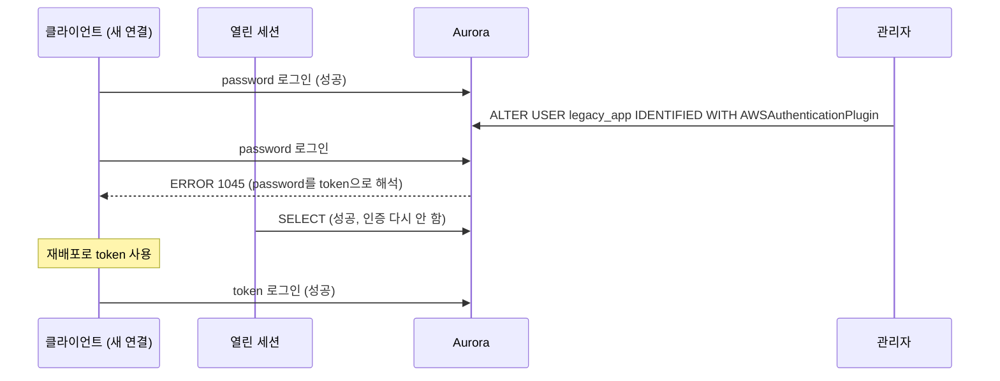

# 시나리오 5. 같은 사용자를 유지해야 하면 중단 전환이고, 중단 시간은 재배포 시간이다

## 이 시나리오의 목표

| 항목 | 내용 |
| --- | --- |
| 기능 | 기존 password 사용자를 그대로 IAM 사용자로 바꾸는 in-place 전환 |
| 쓰는 도구 | `ALTER USER ... IDENTIFIED WITH AWSAuthenticationPlugin AS 'RDS'`, `scripts/inplace_alter_demo.py` |
| 입력 | 실험용 사용자 `legacy_app`, 0.5초마다 새 연결을 맺는 클라이언트, 미리 열어 둔 세션 하나 |
| 작업 | 실습 1~2 |
| 달성할 것 | `ALTER USER` 순간부터 클라이언트가 token으로 바뀔 때까지 새 연결이 전부 실패하고, 열린 세션은 살아 있는 것을 확인 |

## in-place 전환이 끊기는 이유

Aurora MySQL은 사용자 하나에 인증 플러그인 하나만 둡니다. `ALTER USER`로 플러그인을 `AWSAuthenticationPlugin`으로 바꾸면 그 사용자의 비밀번호 해시는 사라지고, 그 순간부터 들어오는 비밀번호는 token으로 해석됩니다. 클라이언트가 token을 보내도록 바뀌기 전까지 새 로그인은 전부 `1045`로 실패합니다. Aurora PostgreSQL도 같습니다. 기존 사용자에 `rds_iam` role을 주면 IAM 인증이 우선해 password 로그인이 막힙니다.

그래서 무중단 전환([시나리오 4](./4-zero-downtime-migration.md))은 사용자를 새로 만듭니다. 중단 전환은 사용자 이름을 바꿀 수 없을 때만 고릅니다.

| 상황 | 이유 |
| --- | --- |
| 앱이나 외부 도구가 DB 사용자 이름을 고칠 수 없게 고정 | 벤더 솔루션, 설정 변경 권한이 없는 레거시 |
| 객체와 권한이 사용자 이름에 묶여 복제 비용이 큼 | `DEFINER`가 그 사용자인 procedure, view, event가 많음 |
| 감사 요건상 같은 계정 ID를 유지해야 함 | 접속 이력을 사용자 이름으로 추적하는 규정 |
| 앱이 두 자격증명을 처리할 수 없고 재시작으로만 설정이 바뀜 | 단일 인스턴스, 설정 스위치를 넣을 수 없는 구조 |

### 용어

| 용어 | 뜻 | 이 실습의 예 |
| --- | --- | --- |
| in-place 전환 | 같은 DB 사용자의 인증 플러그인을 바꿈 | `ALTER USER 'legacy_app'@'%' IDENTIFIED WITH AWSAuthenticationPlugin AS 'RDS'` |
| 중단 구간 | `ALTER USER`부터 클라이언트가 token을 보내기 시작할 때까지 | 실험에서 약 10초 |
| 열린 세션 | `ALTER USER` 전에 이미 인증을 마친 연결 | 실험 내내 쿼리 성공 |

## 컴포넌트 역할

| 컴포넌트 | 역할 |
| --- | --- |
| `scripts/inplace_alter_demo.py` | `legacy_app`을 만들고, 5초에 `ALTER USER`, 15초에 클라이언트를 token으로 전환하며 0.5초마다 결과 출력 |
| 새 연결 | 배포 전 앱의 새 로그인. 15초까지 password, 이후 token |
| 열린 세션 | 커넥션 풀이 쥐고 있는 기존 연결을 흉내 냄 |

## 흐름

실험 스크립트가 재현하는 순서입니다. 새 연결과 열린 세션이 `ALTER USER`에 다르게 반응합니다.



## 실습

### 1. in-place 전환 실험 실행

[시나리오 2](./2-iam-db-auth.md) 실습 1로 클러스터 IAM 인증이 켜져 있어야 합니다. 실험 사용자는 스크립트가 만들고 끝나면 지웁니다.

```bash
cd aws/rds/aurora-iam-auth
uv run --python 3.12 scripts/inplace_alter_demo.py \
  "$(terraform -chdir=terraform output -raw cluster_endpoint)" \
  "$(terraform -chdir=terraform output -raw master_secret_arn)" \
  /tmp/rds-ca.pem
```

```text
  0.0s  new(password)=ok        existing_session=ok
  ...
  4.7s  new(password)=ok        existing_session=ok
  5.3s  --- ALTER USER 실행 ---
  5.3s  new(password)=ERR 1045  existing_session=ok
  6.2s  new(password)=ERR 1045  existing_session=ok
  ...
 14.6s  new(password)=ERR 1045  existing_session=ok
 15.2s  new(token)=ok        existing_session=ok
 15.9s  new(token)=ok        existing_session=ok
```

- `ALTER USER` 직후 첫 새 연결부터 실패했습니다. 유예 시간은 없습니다.
- 열린 세션은 처음부터 끝까지 쿼리에 성공했습니다.
- 실패는 클라이언트가 token으로 바뀐 15.2초에 끝났습니다. 중단 구간은 `ALTER USER`부터 클라이언트가 token으로 바뀔 때까지이고, 운영에서는 재배포 시간이 됩니다.

### 2. 실패가 IAM metric에 어떻게 집계되는지 확인

실험한 분(UTC 04:53)의 RDS metric입니다. 같은 분에 [시나리오 4](./4-zero-downtime-migration.md)의 앱도 `app_iam`으로 접속 중이었으므로 `Requests`에는 앱의 성공 요청이 함께 들어 있습니다.

| metric | 값 |
| --- | --- |
| `IamDbAuthConnectionRequests` | 84 |
| `IamDbAuthConnectionFailure` | 15 |
| `IamDbAuthConnectionFailureInvalidToken` | 15 |

- 15개 password 로그인 실패가 모두 `InvalidToken`으로 집계됐습니다. 전환 후 옛 비밀번호를 쓰는 클라이언트는 이 metric으로 찾습니다.

## 중단 전환 절차

실험 결과대로 중단 구간을 재배포 시간까지 줄이는 순서입니다. 1~3은 점검 시간 전에 끝냅니다.

1. 클러스터 IAM DB 인증을 활성화합니다. 트래픽 영향이 없습니다([시나리오 4](./4-zero-downtime-migration.md) 측정).
2. 앱 role에 대상 사용자의 `rds-db:connect`를 부여하고 `iam-db-auth-error` 로그 내보내기를 켭니다.
3. token으로 접속하는 앱 버전을 빌드하고, 배포 대기 상태로 둡니다. 옛 비밀번호는 롤백용으로 보관합니다.
4. 점검 시간을 시작합니다. 트래픽을 막거나 앱을 내립니다.
5. `ALTER USER '<user>'@'%' IDENTIFIED WITH AWSAuthenticationPlugin AS 'RDS';`를 실행합니다.
6. token 버전을 배포합니다.
7. `IamDbAuthConnectionSuccess`가 오르고 `Failure`가 0인지, 앱 오류율이 원래대로인지 확인한 뒤 트래픽을 엽니다.

롤백은 플러그인을 되돌리고 옛 비밀번호를 다시 넣는 것입니다. MySQL 표준 문법이며 이 실습에서는 실행하지 않았습니다.

```sql
ALTER USER '<user>'@'%' IDENTIFIED WITH mysql_native_password BY '<옛 비밀번호>';
```

## 부록. 실무에서 얻는 것

- **커넥션 풀이 중단을 가립니다.** 열린 세션이 살아 있으므로 풀이 꽉 찬 앱은 `ALTER USER` 직후에도 한동안 정상으로 보입니다. 실패는 연결 수명이 끝나거나 부하가 늘어 풀이 새 연결을 만들 때 나타납니다. 점검 시간에 앱을 내리지 않으면 장애가 몇 분 뒤에 터지므로 원인 추적이 어려워집니다.
- **배포가 빨라도 중단 구간은 0이 되지 않습니다.** 사용자 이름을 바꿀 수 있다면 무중단 전환을 고릅니다.
- **옛 비밀번호를 지우는 시점이 롤백 가능 시점입니다.** 플러그인을 되돌리려면 비밀번호를 다시 넣어야 하므로, 안정화가 확인될 때까지 보관합니다.

## 참고 문서

1. [Creating a database account using IAM authentication](https://docs.aws.amazon.com/AmazonRDS/latest/AuroraUserGuide/UsingWithRDS.IAMDBAuth.DBAccounts.html)
2. [IAM database authentication - Limitations](https://docs.aws.amazon.com/AmazonRDS/latest/AuroraUserGuide/UsingWithRDS.IAMDBAuth.html#UsingWithRDS.IAMDBAuth.Limitations)
