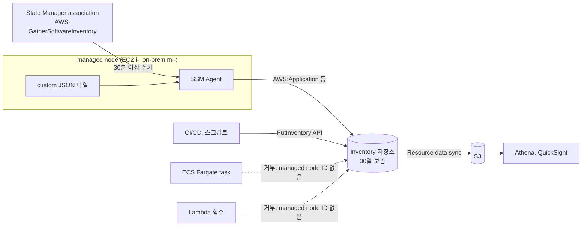

# 시나리오 1. SSM Inventory 기능 지도와 대상별 가능 여부

## 이 시나리오의 목표

| 항목 | 내용 |
| --- | --- |
| 기능 | 서버 단위 소프트웨어·구성 메타데이터 수집(Inventory)과 사용자 정의 메타데이터 기록(Custom inventory) |
| 쓰는 도구 | AWS Systems Manager Inventory, PutInventory API, Resource data sync |
| 입력 | EC2 managed node 1대, 앱 배포 정보 JSON |
| 작업 | 2 기본 수집 → 3 PutInventory → 4 ECS·Lambda 거부 확인 → 5 S3 집계 |
| 달성할 것 | Inventory가 다루는 대상(managed node)과 다루지 않는 대상(ECS task, Lambda)을 이유와 함께 구분 |

## 기능 지도

Inventory의 기능은 "누가 데이터를 만드는가"와 "어디에 쌓이는가"로 나뉩니다. SSM Agent가 OS에서 읽어 오는 기본 수집, 사람이나 파이프라인이 직접 써 넣는 custom inventory, 그리고 둘을 S3로 내보내는 resource data sync입니다.

| 기능 | 데이터를 만드는 주체 | 도구 | 시나리오 |
| --- | --- | --- | --- |
| 기본 수집 | SSM Agent | association `AWS-GatherSoftwareInventory` | [2](2-builtin-inventory.md) |
| custom inventory (API) | 외부 프로그램 | `PutInventory` | [3](3-put-inventory.md) |
| custom inventory (파일) | 노드 안의 스크립트 | `/var/lib/amazon/ssm/<node-id>/inventory/custom/*.json` | [3](3-put-inventory.md) |
| 대상 제약 | - | ECS task, Lambda로 `PutInventory` 호출 | [4](4-unsupported-targets.md) |
| 장기 보관·질의 | Systems Manager | Resource data sync → S3 | [5](5-resource-data-sync.md) |

## SSM Inventory가 무엇인가

Inventory는 managed node마다 붙는 **메타데이터 카드**입니다. CMDB의 서버 한 행과 비슷하지만, 사람이 채우지 않고 SSM Agent가 주기적으로 OS에서 읽어 와 갱신한다는 점이 다릅니다. 설치된 패키지, 네트워크 설정, 서비스, 파일, Windows 레지스트리 같은 항목이 미리 정해진 타입(`AWS:Application`, `AWS:Network` 등)으로 들어갑니다.

Custom inventory는 이 카드에 사용자가 열을 추가하는 기능입니다. 랙 위치, 배포된 앱 버전, 담당 팀처럼 OS가 모르는 정보를 `Custom:<이름>` 타입으로 넣습니다. 넣는 방법은 둘입니다. 노드 안에 JSON 파일을 두면 다음 수집 때 Agent가 함께 올리고, 밖에서 `PutInventory` API를 부르면 즉시 기록됩니다.

오해하기 쉬운 점은 다음과 같습니다.

- Inventory는 **managed node 단위**입니다. AWS 리소스 전체 목록이 아닙니다. S3 버킷, Lambda 함수, ECS 서비스의 목록과 설정 이력은 AWS Config가 맡습니다.
- `PutInventory`의 `InstanceId`는 자유 문자열 키가 아닙니다. 정규식 `(^i-(\w{8}|\w{17})$)|(^mi-\w{17}$)`을 만족하고, 그 ID가 SSM에 등록된 노드여야 합니다[^put-inventory].
- Inventory는 상태의 **최신 스냅샷**입니다. 변경 이력은 남기지 않으며, 마지막 갱신 뒤 30일이 지나면 지워집니다[^quotas].

### 용어

| 용어 | 뜻 | 이 실습의 예 |
| --- | --- | --- |
| managed node | SSM Agent가 등록되어 Systems Manager가 관리하는 머신. EC2는 `i-`, 하이브리드 활성화한 서버는 `mi-` | `ssm-inventory-node` (`i-0abc...`) |
| inventory type (schema) | 수집 항목의 묶음. AWS 정의 타입은 `AWS:`, 사용자 정의는 `Custom:`으로 시작 | `AWS:Application`, `Custom:AppDeployment` |
| SchemaVersion | custom type의 버전 문자열. `DisableSchema` 뒤에는 더 큰 버전만 받음 | `1.0` |
| CaptureTime | 그 데이터를 수집한 시각(UTC) | `2026-11-10T00:00:00Z` |
| association | State Manager가 노드에 주기적으로 적용하는 문서 실행 설정 | `ssm-inventory-gather` |
| resource data sync | Inventory 데이터를 S3에 계속 동기화하는 설정 | `ssm-inventory-sync` |

## 이 기능을 시스템이 제공해야 하는 이유

서버 수가 수십 대를 넘으면 "OpenSSL 3.0.x가 깔린 서버가 몇 대인가", "order-api 1.4.2가 배포된 노드는 어디인가" 같은 질문에 답하기 어려워집니다. 스프레드시트 CMDB는 사람이 갱신을 잊는 순간 틀리고, SSH로 서버를 돌며 `rpm -qa`를 모으는 스크립트는 접근 경로·자격증명·실패 재시도를 직접 관리해야 합니다.

Inventory는 이 수집을 SSM Agent의 outbound 연결 위에서 처리합니다. 인바운드 포트나 SSH 키 없이 패키지 목록이 모이고, 수집 주기와 대상은 association 하나로 관리됩니다. Custom inventory는 OS가 모르는 업무 정보를 같은 키(node ID)로 묶어 주므로, "OS 패키지 + 배포 앱 버전 + 담당 팀"을 한 번의 질의로 볼 수 있습니다.

## 대안 비교

| 방식 | 다루는 대상 | 수집 방식 | 이력 | 적합한 질문 |
| --- | --- | --- | --- | --- |
| SSM Inventory | managed node(EC2, 온프레미스, 타 클라우드 VM) | Agent 주기 수집 + PutInventory | 없음(최신값, 30일) | 이 서버에 무엇이 깔려 있나 |
| AWS Config | AWS 리소스 전반(Lambda, ECS service, S3 등) + `AWS::SSM::ManagedInstanceInventory` | API 변경 기록 | 있음 | 이 리소스 설정이 언제 어떻게 바뀌었나 |
| Amazon Inspector | EC2, ECR 이미지, Lambda 함수 | 패키지 스캔 | finding 단위 | 어디에 취약한 패키지가 있나 |
| 자체 CMDB + 스크립트 | 무엇이든 | 직접 구현 | 직접 구현 | 조직 고유 질문 |

ECS task와 Lambda의 소프트웨어 구성이 궁금하다면 Inventory가 아니라 Config(리소스 설정)와 Inspector(이미지·함수 패키지)를 보는 편이 맞습니다. 근거는 다음 절과 [시나리오 4](4-unsupported-targets.md)에 있습니다.

## 대상별 가능 여부

| 대상 | 기본 수집 | PutInventory | 이유 |
| --- | --- | --- | --- |
| EC2 (SSM Agent + instance profile) | 가능 | 가능 | `i-` ID를 가진 managed node |
| 온프레미스·타 클라우드 VM (하이브리드 활성화) | 가능 | 가능 | `mi-` ID를 가진 managed node |
| ECS on EC2의 container instance(호스트) | 가능 | 가능 | 호스트가 EC2 managed node. 단 컨테이너 내부 패키지는 수집 대상이 아님 |
| ECS on EC2의 컨테이너 | 불가 | 불가(호스트 ID에 대신 기록은 가능) | 컨테이너는 managed node가 아님. 호스트 Agent는 호스트 OS 패키지만 읽음 |
| ECS Fargate task | 불가 | 불가 | 호스트에 접근할 수 없고 task에 `i-`/`mi-` ID가 없음. ECS Exec의 SSM Agent는 Session Manager 채널용이며 managed node로 등록되지 않음 |
| Lambda 함수 | 불가 | 불가 | 상주하는 OS와 SSM Agent가 없고, 함수 이름·ARN은 `InstanceId` 정규식에 맞지 않음 |
| EKS 워커 노드(EC2) | 가능 | 가능 | EC2 managed node. 파드는 위 컨테이너와 같은 이유로 불가 |

Fargate task에 SSM Agent sidecar를 넣고 하이브리드 활성화로 `mi-` 노드로 등록하는 방법은 존재합니다. AWS FIS의 ECS task 액션이 이 방식을 씁니다[^fis-ecs]. 하지만 task가 교체될 때마다 새 `mi-` 노드가 생기고, 지우지 않으면 하이브리드 노드 한도(standard 1,000대)와 30일 보관 데이터가 쌓입니다. 수명이 짧은 task를 서버처럼 관리하는 구조라 inventory 용도로는 권장하지 않습니다.

## 부록. 실무에서 얻는 것

- custom type은 계정·리전당 20개, type당 속성 50개입니다[^quotas]. 팀마다 type을 만들면 금방 찹니다. `Custom:AppDeployment`처럼 범용 type 하나에 행을 늘리는 쪽이 오래 갑니다.
- 값은 모두 문자열입니다. 숫자 비교가 필요하면 Athena에서 캐스팅합니다.
- 속성 이름의 대소문자는 type 안에서 일관되어야 합니다. `Vendor`와 `vendor`를 섞으면 오류입니다[^custom].

## 참고 문서

1. [PutInventory API Reference](https://docs.aws.amazon.com/systems-manager/latest/APIReference/API_PutInventory.html)
2. [Working with custom inventory](https://docs.aws.amazon.com/systems-manager/latest/userguide/inventory-custom.html)
3. [Systems Manager service quotas - Inventory](https://docs.aws.amazon.com/general/latest/gr/ssm.html#inventory)
4. [Supported machine types for managed nodes](https://docs.aws.amazon.com/systems-manager/latest/userguide/operating-systems-and-machine-types.html)
5. [AWS FIS aws:ecs:task actions](https://docs.aws.amazon.com/fis/latest/userguide/ecs-task-actions.html)
6. [사례: custom inventory로 fleet 디스크 사용량 수집](https://aws.amazon.com/blogs/mt/get-disk-utilization-of-your-fleet-using-ec2-systems-manager-custom-inventory-types/)
7. [사례: Systems Manager와 Athena로 SAP landscape inventory 관리](https://aws.amazon.com/blogs/awsforsap/maintain-an-sap-landscape-inventory-with-aws-systems-manager-and-amazon-athena)
8. [사례: Inventory와 태그로 질의](https://aws.amazon.com/blogs/mt/using-aws-systems-manager-inventory-with-tags)

[^put-inventory]: PutInventory API Reference의 `InstanceId` Pattern
[^quotas]: Systems Manager service quotas의 Inventory 표
[^custom]: Working with custom inventory
[^fis-ecs]: AWS FIS aws:ecs:task actions
