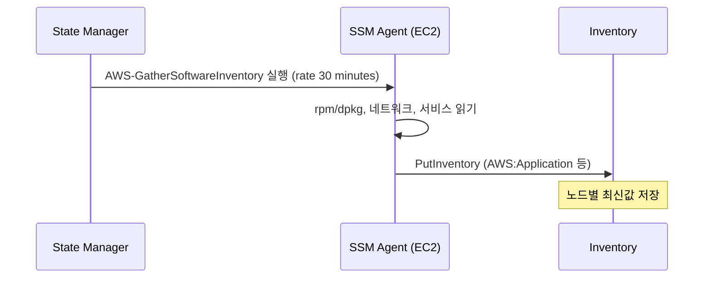

# 시나리오 2. 기본 inventory 수집

## 이 시나리오의 목표

| 항목 | 내용 |
| --- | --- |
| 기능 | SSM Agent가 OS에서 패키지, 네트워크, 서비스 정보를 주기적으로 수집 |
| 쓰는 도구 | State Manager association `AWS-GatherSoftwareInventory` |
| 입력 | [setup](setup.md)으로 구축한 EC2 managed node |
| 작업 | 1 노드 등록 확인 → 2 association 실행 확인 → 3 타입별 조회 → 4 조건 질의 |
| 달성할 것 | 서버에 SSH 접속하지 않고도 설치된 패키지 목록과 노드를 질의합니다 |

## 기본 수집의 동작 원리

기본 수집은 별도의 Inventory 전용 에이전트가 아니라 **State Manager association**으로 동작합니다. `AWS-GatherSoftwareInventory` 문서를 노드에 주기적으로 실행시키는 설정이며, AWS 콘솔의 **Inventory** → **Setup Inventory** 역시 내부적으로 동일한 association을 생성합니다. 수집 주기의 최소값은 30분입니다.

association 파라미터로 수집할 항목을 선택할 수 있습니다. `customInventory=Enabled`로 설정하면 노드의 로컬 경로에 둔 custom JSON 파일도 함께 수집됩니다([시나리오 3](3-put-inventory.md)).

### 용어

| 용어 | 뜻 | 이 실습의 예 |
| --- | --- | --- |
| `AWS-GatherSoftwareInventory` | 기본 수집을 수행하는 AWS 관리형 SSM 문서 | `terraform/ssm.tf` |
| `PingStatus` | SSM Agent가 SSM 엔드포인트와 정상 통신 중인지 나타내는 상태 | `Online` |
| inventory entry | 특정 inventory 타입에 속한 개별 데이터 행 | `AWS:Application`의 `openssl` 한 행 |

## 컴포넌트 역할

| 컴포넌트 | 역할 |
| --- | --- |
| SSM Agent | 문서를 실행해 OS 패키지, 네트워크, 서비스 정보를 읽어 업로드합니다 |
| instance profile (`AmazonSSMManagedInstanceCore`) | Agent가 SSM API를 호출하는 데 필요한 IAM 권한을 제공합니다 |
| association | 수집 주기와 대상 노드를 지정합니다 |
| Inventory 저장소 | 노드별 최신 수집값을 30일간 보관합니다 |

## 흐름

State Manager가 주기적으로 SSM Agent를 트리거해 OS 정보를 수집하고 Inventory 저장소에 기록하는 흐름입니다.



## 실습

명령은 저장소 루트에서 `aws/ssm/inventory` 디렉터리로 이동해 실행합니다. 아래 출력은 공식 문서 형식 기준 예상값이며 실제 AWS에서 실행해 검증하지 않았습니다. 인스턴스 ID와 시각은 실행마다 달라집니다.

### 1. managed node 등록 상태 확인

Terraform 출력에서 인스턴스 ID를 가져와 SSM managed node로 `Online` 등록되었는지 조회합니다.

```bash
cd aws/ssm/inventory
export AWS_REGION=ap-northeast-2
INSTANCE_ID=$(terraform -chdir=terraform output -raw instance_id)
aws ssm describe-instance-information \
  --filters "Key=InstanceIds,Values=$INSTANCE_ID" \
  --query 'InstanceInformationList[].[InstanceId,PingStatus,PlatformName,AgentVersion]' --output text
```

예상 출력(미검증):

```text
i-0abc1234def567890  Online  Amazon Linux  3.3.x
```

- `terraform apply` 직후 1~3분 동안은 결과가 비어 있을 수 있습니다. EC2 인스턴스가 instance profile 자격증명을 받아 SSM 엔드포인트에 등록을 마친 뒤 `Online`으로 표시됩니다.

### 2. association 첫 실행 결과 확인

수집을 담당하는 State Manager association의 최근 실행 상태가 `Success`인지 확인합니다.

```bash
ASSOC_ID=$(terraform -chdir=terraform output -raw association_id)
aws ssm describe-association-executions --association-id "$ASSOC_ID" \
  --query 'AssociationExecutions[0].[Status,CreatedTime]' --output text
```

예상 출력(미검증):

```text
Success  2026-11-10T00:05:12+00:00
```

- association은 생성 직후 한 번 실행되며, 이후 30분마다 주기적으로 실행됩니다.

### 3. 수집된 타입 목록과 패키지 조회

노드에 수집된 `AWS:Application` 항목 중 `openssl` 패키지의 버전과 아키텍처를 조회합니다.

```bash
aws ssm list-inventory-entries --instance-id "$INSTANCE_ID" --type-name AWS:Application \
  --filters "Key=Name,Values=openssl,Type=Equal" \
  --query 'Entries[].[Name,Version,Architecture]' --output text
```

예상 출력(미검증):

```text
openssl  3.2.2  aarch64
```

- 출력되는 패키지 버전은 사용한 AMI 시점에 따라 달라집니다.
- `ListInventoryEntries` API는 페이지당 최대 50행만 반환하며 CLI 자동 페이지네이션을 지원하지 않습니다. `--query` 필터는 받아 온 첫 페이지에만 적용되므로, 반드시 `--filters` 옵션으로 서버 측 필터링을 수행해야 합니다.

### 4. 조건으로 노드 찾기

특정 패키지(`openssl`)가 설치된 모든 managed node의 ID를 계정 내 전체 플릿에서 검색합니다.

```bash
aws ssm get-inventory \
  --filters "Key=AWS:Application.Name,Values=openssl,Type=Equal" \
  --query 'Entities[].Id' --output text
```

예상 출력(미검증):

```text
i-0abc1234def567890
```

- 계정 내 해당 리전의 모든 managed node 중 조건에 맞는 노드 ID가 나열됩니다.

## 부록. 실무에서 얻는 것

- 노드가 `Online` 상태여도 inventory association이 연결되어 있지 않으면 Inventory 데이터는 비어 있습니다. Fleet Manager 목록에 노드가 보이는 것과 Inventory가 채워진 것은 별개의 상태입니다.
- 한 노드를 대상으로 하는 association은 최대 20개까지 연결할 수 있습니다. Quick Setup과 Terraform이 각각 inventory association을 생성하면 동일한 수집이 두 번 실행되므로 주의해야 합니다.
- 노드당 하루 수집량 상한은 5,000KB입니다. `files` 파라미터로 넓은 디렉터리 경로를 지정하면 이 한도에 먼저 도달합니다.

## 참고 문서

1. [Configuring inventory collection](https://docs.aws.amazon.com/systems-manager/latest/userguide/inventory-collection.html)
2. [Metadata collected by Inventory](https://docs.aws.amazon.com/systems-manager/latest/userguide/inventory-schema.html)
