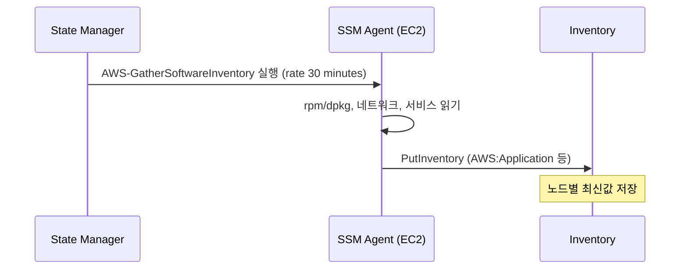

# 시나리오 2. 기본 inventory 수집

## 이 시나리오의 목표

| 항목 | 내용 |
| --- | --- |
| 기능 | SSM Agent가 OS에서 패키지·네트워크·서비스 정보를 주기적으로 수집 |
| 쓰는 도구 | State Manager association `AWS-GatherSoftwareInventory` |
| 입력 | [setup](setup.md)으로 만든 EC2 managed node |
| 작업 | 1 노드 등록 확인 → 2 association 실행 확인 → 3 타입별 조회 → 4 조건 질의 |
| 달성할 것 | 서버에 접속하지 않고 설치 패키지를 질의 |

## 기본 수집이 무엇인가

기본 수집은 Inventory 전용 에이전트가 아니라 **State Manager association**입니다. `AWS-GatherSoftwareInventory` 문서를 노드에 주기적으로 실행시키는 설정이며, 콘솔의 **Inventory** → **Setup Inventory**도 내부적으로 같은 association을 만듭니다. 수집 주기의 최소값은 30분입니다.

association 파라미터로 수집할 타입을 고릅니다. `customInventory=Enabled`이면 노드의 custom JSON 파일도 함께 올라갑니다([시나리오 3](3-put-inventory.md)).

### 용어

| 용어 | 뜻 | 이 실습의 예 |
| --- | --- | --- |
| `AWS-GatherSoftwareInventory` | 기본 수집을 수행하는 AWS 관리 SSM 문서 | `terraform/ssm.tf` |
| PingStatus | Agent가 SSM 엔드포인트와 통신 중인지 | `Online` |
| inventory entry | 타입 하나에 속한 행 | `AWS:Application`의 `openssl` 한 행 |

## 컴포넌트 역할

| 컴포넌트 | 역할 |
| --- | --- |
| SSM Agent | 문서를 실행해 OS 정보를 읽고 업로드 |
| instance profile (`AmazonSSMManagedInstanceCore`) | Agent의 SSM API 호출 권한 |
| association | 수집 주기와 대상 지정 |
| Inventory 저장소 | 노드별 최신값을 30일 보관 |

## 흐름



## 실습

명령은 workspace 루트에서 실행합니다. 출력은 공식 문서 형식 기준 예상값이며 실제 AWS에서 실행해 확인하지 않았습니다. ID와 시각은 실행마다 달라집니다.

### 1. managed node 등록 상태 확인

```bash
cd aws/ssm/inventory
export AWS_REGION=ap-northeast-2
INSTANCE_ID=$(terraform -chdir=terraform output -raw instance_id)
aws ssm describe-instance-information \
  --filters "Key=InstanceIds,Values=$INSTANCE_ID" \
  --query 'InstanceInformationList[].[InstanceId,PingStatus,PlatformName,AgentVersion]' --output text
```

예상 출력(미검증):

```text
i-0abc1234def567890  Online  Amazon Linux  3.3.x
```

- apply 직후 1~3분은 비어 있을 수 있음. Agent가 instance profile 자격증명을 받은 뒤 등록됨

### 2. association 첫 실행 결과 확인

```bash
ASSOC_ID=$(terraform -chdir=terraform output -raw association_id)
aws ssm describe-association-executions --association-id "$ASSOC_ID" \
  --query 'AssociationExecutions[0].[Status,CreatedTime]' --output text
```

예상 출력(미검증):

```text
Success  2026-11-10T00:05:12+00:00
```

- association은 생성 직후 한 번 실행되고, 그 뒤 30분마다 실행됨

### 3. 수집된 타입 목록과 패키지 조회

```bash
aws ssm list-inventory-entries --instance-id "$INSTANCE_ID" --type-name AWS:Application \
  --filters "Key=Name,Values=openssl,Type=Equal" \
  --query 'Entries[].[Name,Version,Architecture]' --output text
```

예상 출력(미검증):

```text
openssl  3.2.2  aarch64
```

- 버전은 AMI 시점에 따라 달라짐
- ListInventoryEntries는 페이지당 최대 50행이고 CLI 자동 페이지네이션이 없음. `--query` 필터는 받아 온 페이지에만 적용되므로 `--filters`로 서버에서 거름

### 4. 조건으로 노드 찾기

```bash
aws ssm get-inventory \
  --filters "Key=AWS:Application.Name,Values=openssl,Type=Equal" \
  --query 'Entities[].Id' --output text
```

예상 출력(미검증):

```text
i-0abc1234def567890
```

- 계정 안의 모든 managed node 중 openssl이 설치된 노드 ID가 나열됨

## 부록. 실무에서 얻는 것

- 노드가 Online이어도 association이 없으면 inventory는 비어 있습니다. Fleet Manager에 보이는 것과 Inventory가 채워진 것은 다른 상태입니다.
- 한 노드를 대상으로 하는 association은 최대 20개입니다. Quick Setup과 Terraform이 각각 inventory association을 만들면 같은 수집이 두 번 돕니다.
- 노드당 하루 수집량 상한은 5,000KB입니다. `files` 파라미터로 넓은 경로를 걸면 이 한도에 먼저 걸립니다.

## 참고 문서

1. [Configuring inventory collection](https://docs.aws.amazon.com/systems-manager/latest/userguide/inventory-collection.html)
2. [Metadata collected by Inventory](https://docs.aws.amazon.com/systems-manager/latest/userguide/inventory-schema.html)
