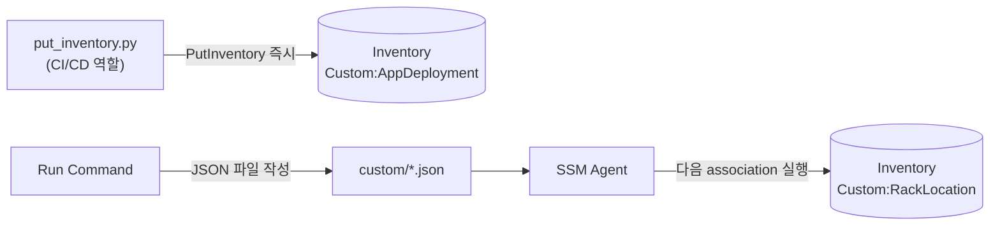

# 시나리오 3. PutInventory로 custom inventory 기록

## 이 시나리오의 목표

| 항목 | 내용 |
| --- | --- |
| 기능 | OS가 모르는 업무 메타데이터를 managed node에 기록 |
| 쓰는 도구 | `PutInventory` API(`scripts/put_inventory.py`), custom JSON 파일 |
| 입력 | `examples/app-deployment.json`, `examples/rack-location.json` |
| 작업 | 1 API 기록 → 2 조회 → 3 값 교체 → 4 파일 방식 → 5 버전 비활성화 → 6 삭제 |
| 달성할 것 | API 방식과 파일 방식의 반영 시점 차이 및 `SchemaVersion`의 동작을 확인합니다 |

## custom inventory의 동작 원리

custom inventory는 managed node의 inventory에 `Custom:` 타입을 추가하는 기능입니다. 배포 파이프라인이 "이 노드에 `order-api` 1.4.2를 배포했다"는 사실을 기록해 두면, 기본 수집의 OS 패키지와 동일한 키(node ID)를 기준으로 함께 질의할 수 있습니다.

주의할 점은 **같은 타입을 다시 쓰면 해당 노드의 그 타입 데이터 전체가 교체된다**는 것입니다. 행 단위 추가(Append)가 아니므로, 배포 도구는 항상 "현재 노드에 존재하는 앱 목록 전체"를 보내야 합니다.

### 용어

| 용어 | 뜻 | 이 실습의 예 |
| --- | --- | --- |
| `Custom:` 타입 | 사용자 정의 inventory type. `Custom`은 대문자 C로 시작하며 100자 이내여야 합니다 | `Custom:AppDeployment` |
| `Content` | 기록할 행 목록. 모든 속성 값은 문자열이어야 합니다 | `{"AppName": "order-api", "Version": "1.4.2", ...}` |
| `DeleteSchema` | 타입 스키마와 데이터를 완전히 삭제합니다. 이후 같은 이름으로 다시 만들 수 있습니다 | 6단계 |
| `DisableSchema` | 현재 버전 이하의 데이터를 삭제하고, 이후 같은 버전 이하의 입력을 무시합니다 | 5단계 |

## API 방식과 파일 방식 비교

| 항목 | PutInventory API | custom JSON 파일 |
| --- | --- | --- |
| 쓰는 주체 | 노드 외부 (CI/CD, Lambda, 운영 스크립트) | 노드 내부 (cron, user data, Run Command) |
| 반영 시점 | API 호출 즉시 | 다음 association 실행 시점 |
| 필요 권한 | 호출자 IAM 주체에 `ssm:PutInventory` | 노드 instance profile (`AmazonSSMManagedInstanceCore`) |
| 노드 ID 필요 여부 | 호출자가 대상 ID를 알아야 함 | 로컬 파일 경로에 node ID가 포함됨 |
| 한 번에 보내는 양 | 요청당 item 30개, item당 1,024KB | 노드 수집 1회당 1MB |
| 적합한 데이터 | 배포 이력, 소유 팀, 외부 시스템 메타데이터 | 노드 내부에서만 알 수 있는 값 (디스크 사용량, 로컬 설정) |

## 컴포넌트 역할

| 컴포넌트 | 역할 |
| --- | --- |
| `scripts/put_inventory.py` | 배포 파이프라인 역할을 하며 `Content`를 구성해 `PutInventory`를 호출합니다 |
| `/var/lib/amazon/ssm/<node-id>/inventory/custom/` | 파일 방식의 JSON 입력 디렉터리입니다 |
| association(`customInventory=Enabled`) | 노드 내 custom JSON 파일을 읽어 Inventory로 업로드합니다 |

## 흐름

외부에서 `PutInventory` API로 즉시 기록하는 경로와, 노드 내부에 JSON 파일을 두어 다음 association 주기에 수집되는 경로의 비교입니다.



## 실습

명령은 저장소 루트에서 `aws/ssm/inventory` 디렉터리로 이동해 실행합니다. 아래 출력은 예상값이며 실제 AWS에서 실행해 검증하지 않았습니다.

### 1. PutInventory로 앱 배포 정보 기록

인스턴스 ID를 인자로 넘겨 `examples/app-deployment.json`의 앱 2건(`order-api`, `batch-settlement`)을 `Custom:AppDeployment` 타입으로 기록합니다.

```bash
cd aws/ssm/inventory
export AWS_REGION=ap-northeast-2
INSTANCE_ID=$(terraform -chdir=terraform output -raw instance_id)
uv run scripts/put_inventory.py "$INSTANCE_ID"
```

예상 출력(미검증):

```text
PutInventory OK: i-0abc1234def567890 Custom:AppDeployment v1.0 rows=2
```

### 2. 기록한 행 조회

방금 기록한 `Custom:AppDeployment` 엔트리를 조회해 2개 행이 정상 저장되었는지 확인합니다.

```bash
aws ssm list-inventory-entries --instance-id "$INSTANCE_ID" --type-name Custom:AppDeployment \
  --query 'Entries[].[AppName,Version,Owner]' --output text
```

예상 출력(미검증):

```text
order-api         1.4.2  team-order
batch-settlement  2.0.0  team-billing
```

### 3. 행 하나만 보내 교체 동작 확인

`order-api` 1건만 담긴 임시 JSON 파일을 만들어 다시 `PutInventory`를 호출하고, 기존 `batch-settlement` 행이 어떻게 변하는지 확인합니다.

```bash
echo '[{"AppName":"order-api","Version":"1.5.0","Owner":"team-order","DeployedBy":"github-actions"}]' > /tmp/one-app.json
uv run scripts/put_inventory.py "$INSTANCE_ID" --apps /tmp/one-app.json
aws ssm list-inventory-entries --instance-id "$INSTANCE_ID" --type-name Custom:AppDeployment \
  --query 'Entries[].[AppName,Version]' --output text
```

예상 출력(미검증):

```text
order-api  1.5.0
```

- `batch-settlement` 행이 사라졌습니다. 같은 타입에 대한 `PutInventory` 호출은 행 추가가 아니라 해당 타입 데이터 전체를 교체합니다.

### 4. 파일 방식으로 랙 위치 기록

이번에는 Run Command를 사용해 EC2 노드 내부의 `/var/lib/amazon/ssm/<instance-id>/inventory/custom/` 경로에 `rack-location.json` 파일을 작성합니다. JSON의 따옴표가 AWS CLI shorthand 문법과 충돌하지 않도록 base64로 인코딩해 전달하고, 명령 완료까지 대기합니다.

```bash
BODY=$(base64 < examples/rack-location.json | tr -d '\n')
DIR=/var/lib/amazon/ssm/$INSTANCE_ID/inventory/custom
aws ssm send-command --instance-ids "$INSTANCE_ID" --document-name AWS-RunShellScript \
  --parameters "commands=[\"sudo mkdir -p $DIR\",\"echo $BODY | base64 -d | sudo tee $DIR/rack.json\"]" \
  --query 'Command.CommandId' --output text > /tmp/cmd-id
aws ssm wait command-executed --command-id "$(cat /tmp/cmd-id)" --instance-id "$INSTANCE_ID"
```

30분 주기의 다음 수집을 기다리지 않고 association을 즉시 1회 실행한 뒤, `Custom:RackLocation` 타입이 수집되었는지 조회합니다.

```bash
aws ssm start-associations-once --association-ids "$(terraform -chdir=terraform output -raw association_id)"
sleep 60
aws ssm list-inventory-entries --instance-id "$INSTANCE_ID" --type-name Custom:RackLocation \
  --query 'Entries[]' --output table
```

예상 출력(미검증):

```text
----------------------------------------
|         ListInventoryEntries          |
+-------------+-------------------------+
| CostCenter  |        Location         |
+-------------+-------------------------+
|  cc-1234    |  SEOUL-IDC-01.RACK7     |
+-------------+-------------------------+
```

- 파일 방식은 파일을 작성한 시점이 아니라 다음 association이 실행될 때 반영됩니다. API 방식과 반영 시점이 다릅니다.

### 5. DisableSchema 뒤 낮은 버전 입력 거부 확인

`Custom:AppDeployment` 타입을 `DisableSchema` 옵션으로 비활성화합니다. 삭제는 비동기로 처리되므로 `describe-inventory-deletions`의 상태가 `Complete`가 될 때까지 확인한 뒤 다음 명령을 실행합니다.

```bash
aws ssm delete-inventory --type-name Custom:AppDeployment --schema-delete-option DisableSchema
aws ssm describe-inventory-deletions --query 'InventoryDeletions[].[TypeName,LastStatus]' --output text
```

삭제 상태가 `Complete`가 된 것을 확인한 뒤, 기존 버전(`1.0`)과 더 높은 버전(`1.1`)으로 각각 `PutInventory`를 호출해 차이를 확인합니다.

```bash
uv run scripts/put_inventory.py "$INSTANCE_ID" --schema-version 1.0
aws ssm list-inventory-entries --instance-id "$INSTANCE_ID" --type-name Custom:AppDeployment --query 'Entries' --output text
uv run scripts/put_inventory.py "$INSTANCE_ID" --schema-version 1.1
```

- `1.0` 호출은 API 자체가 성공 응답을 반환하지만 데이터는 무시됩니다. 대신 EventBridge에 `action-status: failed` 경고 이벤트가 발생합니다.
- `1.1`처럼 기존보다 높은 버전으로 보내면 스키마가 다시 활성화되며 데이터가 정상 기록됩니다.

### 6. custom type 삭제

custom type은 계정 및 리전당 최대 20개까지 생성할 수 있으므로, 실습에 사용한 타입을 정리합니다.

```bash
aws ssm delete-inventory --type-name Custom:AppDeployment --schema-delete-option DeleteSchema
aws ssm delete-inventory --type-name Custom:RackLocation --schema-delete-option DeleteSchema
aws ssm describe-inventory-deletions --query 'InventoryDeletions[].[TypeName,LastStatus]' --output text
```

## 부록. 실무에서 얻는 것

- 전체 교체 동작 때문에 배포 파이프라인 여러 개가 같은 custom 타입을 쓰면 서로의 행을 덮어씁니다. 파이프라인마다 타입을 나누거나, 쓰기 전에 기존 행을 읽어 합쳐서 보내야 합니다. 이는 타입 수 한도(20개)와 맞바꾸는 설계 결정입니다.
- 노드가 종료되면 Inventory 데이터도 30일 뒤에 사라집니다. "언제 어떤 버전이 배포되었는가"와 같은 변경 이력은 Inventory가 아니라 S3 동기화나 AWS Config에 남겨야 합니다([시나리오 5](5-resource-data-sync.md)).
- `PutInventory` 호출자는 대상 노드 ID를 알아야 합니다. Auto Scaling 환경에서는 배포 도구가 현재 기동 중인 인스턴스 ID 목록을 조회할 수 있는지 먼저 확인해야 합니다.

## 참고 문서

1. [PutInventory API Reference](https://docs.aws.amazon.com/systems-manager/latest/APIReference/API_PutInventory.html)
2. [Assigning custom inventory metadata to a managed node](https://docs.aws.amazon.com/systems-manager/latest/userguide/inventory-custom-metadata.html)
3. [Working with custom inventory](https://docs.aws.amazon.com/systems-manager/latest/userguide/inventory-custom.html)
