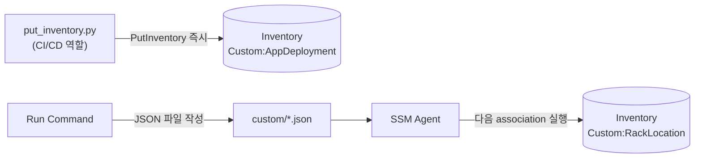

# 시나리오 3. PutInventory로 custom inventory 기록

## 이 시나리오의 목표

| 항목 | 내용 |
| --- | --- |
| 기능 | OS가 모르는 업무 메타데이터를 managed node에 기록 |
| 쓰는 도구 | `PutInventory` API(`scripts/put_inventory.py`), custom JSON 파일 |
| 입력 | `examples/app-deployment.json`, `examples/rack-location.json` |
| 작업 | 1 API 기록 → 2 조회 → 3 값 교체 → 4 파일 방식 → 5 버전 비활성화 → 6 삭제 |
| 달성할 것 | API 방식과 파일 방식의 차이, SchemaVersion의 역할을 확인 |

## custom inventory가 무엇인가

custom inventory는 managed node의 inventory에 `Custom:` 타입을 추가하는 기능입니다. 배포 파이프라인이 "이 노드에 order-api 1.4.2를 올렸다"를 기록해 두면, 기본 수집의 OS 패키지와 같은 키(node ID)로 함께 질의할 수 있습니다.

같은 타입을 다시 쓰면 그 노드의 해당 타입 데이터 전체가 **교체**됩니다. 행 단위 추가가 아닙니다. 그래서 배포 도구는 "노드의 현재 앱 목록 전체"를 보내야 합니다.

### 용어

| 용어 | 뜻 | 이 실습의 예 |
| --- | --- | --- |
| `Custom:` 타입 | 사용자 정의 inventory type. `Custom`은 대문자 C로 시작, 100자 이내 | `Custom:AppDeployment` |
| Content | 행 목록. 모든 값은 문자열 | `{"AppName": "order-api", "Version": "1.4.2", ...}` |
| `DeleteSchema` | 타입과 데이터를 지움. 같은 이름으로 다시 만들 수 있음 | 6단계 |
| `DisableSchema` | 현재 버전 이하의 데이터를 지우고 이후 같은 버전 이하 입력을 무시 | 5단계 |

## API 방식과 파일 방식 비교

| 항목 | PutInventory API | custom JSON 파일 |
| --- | --- | --- |
| 쓰는 주체 | 노드 밖(CI/CD, Lambda, 운영 스크립트) | 노드 안(cron, user data, Run Command) |
| 반영 시점 | 호출 즉시 | 다음 association 실행 때 |
| 필요 권한 | 호출자에 `ssm:PutInventory` | 노드 Agent 권한(`AmazonSSMManagedInstanceCore`) |
| 노드 ID 필요 | 호출자가 알아야 함 | 경로에 node ID가 들어감 |
| 한 번에 보내는 양 | 요청당 item 30개, item당 1,024KB | 노드 수집 1회 1MB |
| 적합한 데이터 | 배포 이력, 소유 팀, 외부 시스템 값 | 노드에서만 알 수 있는 값(디스크 사용량, 로컬 설정) |

## 컴포넌트 역할

| 컴포넌트 | 역할 |
| --- | --- |
| `scripts/put_inventory.py` | 배포 파이프라인 역할. Content를 만들어 PutInventory 호출 |
| `/var/lib/amazon/ssm/<node-id>/inventory/custom/` | 파일 방식의 입력 디렉터리 |
| association(`customInventory=Enabled`) | 파일을 읽어 업로드 |

## 흐름



## 실습

명령은 workspace 루트에서 실행합니다. 출력은 예상값이며 실제 AWS에서 확인하지 않았습니다.

### 1. PutInventory로 앱 배포 정보 기록

```bash
cd aws/ssm/inventory
export AWS_REGION=ap-northeast-2
INSTANCE_ID=$(terraform -chdir=terraform output -raw instance_id)
uv run scripts/put_inventory.py "$INSTANCE_ID"
```

예상 출력(미검증):

```text
PutInventory OK: i-0abc1234def567890 Custom:AppDeployment v1.0 rows=2
```

### 2. 기록한 행 조회

```bash
aws ssm list-inventory-entries --instance-id "$INSTANCE_ID" --type-name Custom:AppDeployment \
  --query 'Entries[].[AppName,Version,Owner]' --output text
```

예상 출력(미검증):

```text
order-api         1.4.2  team-order
batch-settlement  2.0.0  team-billing
```

### 3. 행 하나만 보내 교체 동작 확인

```bash
echo '[{"AppName":"order-api","Version":"1.5.0","Owner":"team-order","DeployedBy":"github-actions"}]' > /tmp/one-app.json
uv run scripts/put_inventory.py "$INSTANCE_ID" --apps /tmp/one-app.json
aws ssm list-inventory-entries --instance-id "$INSTANCE_ID" --type-name Custom:AppDeployment \
  --query 'Entries[].[AppName,Version]' --output text
```

예상 출력(미검증):

```text
order-api  1.5.0
```

- `batch-settlement` 행이 사라짐. 같은 타입의 PutInventory는 추가가 아니라 전체 교체

### 4. 파일 방식으로 랙 위치 기록

Run Command로 노드 안에 JSON 파일을 둡니다.

```bash
BODY=$(base64 < examples/rack-location.json | tr -d '\n')
DIR=/var/lib/amazon/ssm/$INSTANCE_ID/inventory/custom
aws ssm send-command --instance-ids "$INSTANCE_ID" --document-name AWS-RunShellScript \
  --parameters "commands=[\"sudo mkdir -p $DIR\",\"echo $BODY | base64 -d | sudo tee $DIR/rack.json\"]" \
  --query 'Command.CommandId' --output text > /tmp/cmd-id
aws ssm wait command-executed --command-id "$(cat /tmp/cmd-id)" --instance-id "$INSTANCE_ID"
```

- JSON의 따옴표가 shorthand 문법과 충돌하지 않도록 base64로 감싸 전달

다음 수집을 기다리지 않고 association을 즉시 다시 실행합니다.

```bash
aws ssm start-associations-once --association-ids "$(terraform -chdir=terraform output -raw association_id)"
sleep 60
aws ssm list-inventory-entries --instance-id "$INSTANCE_ID" --type-name Custom:RackLocation \
  --query 'Entries[]' --output table
```

예상 출력(미검증):

```text
----------------------------------------
|         ListInventoryEntries          |
+-------------+-------------------------+
| CostCenter  |        Location         |
+-------------+-------------------------+
|  cc-1234    |  SEOUL-IDC-01.RACK7     |
+-------------+-------------------------+
```

- 파일 방식은 association 실행 전까지 반영되지 않음. API 방식과의 반영 시점 차이

### 5. DisableSchema 뒤 낮은 버전 입력 거부 확인

```bash
aws ssm delete-inventory --type-name Custom:AppDeployment --schema-delete-option DisableSchema
uv run scripts/put_inventory.py "$INSTANCE_ID" --schema-version 1.0
aws ssm list-inventory-entries --instance-id "$INSTANCE_ID" --type-name Custom:AppDeployment --query 'Entries' --output text
uv run scripts/put_inventory.py "$INSTANCE_ID" --schema-version 1.1
```

- 1.0 호출은 API가 성공으로 응답하지만 데이터는 무시됨. EventBridge에 `action-status: failed` 경고 이벤트가 발생
- 1.1로 보내면 다시 기록됨
- 삭제는 비동기라 `describe-inventory-deletions`가 `Complete`가 될 때까지 몇 분 걸릴 수 있음

### 6. custom type 삭제

```bash
aws ssm delete-inventory --type-name Custom:AppDeployment --schema-delete-option DeleteSchema
aws ssm delete-inventory --type-name Custom:RackLocation --schema-delete-option DeleteSchema
aws ssm describe-inventory-deletions --query 'InventoryDeletions[].[TypeName,LastStatus]' --output text
```

- custom type은 계정·리전당 20개라 실습 타입을 남기지 않음

## 부록. 실무에서 얻는 것

- 전체 교체 동작 때문에 배포 파이프라인 여러 개가 같은 타입을 쓰면 서로의 행을 지웁니다. 파이프라인마다 타입을 나누거나, 쓰기 전에 기존 행을 읽어 합쳐야 합니다. 타입 수 한도(20개)와 맞바꾸는 결정입니다.
- 노드가 종료되면 데이터도 30일 뒤 사라집니다. "언제 어떤 버전이 배포되었는가"라는 이력은 Inventory가 아니라 S3 동기화나 Config에 남겨야 합니다([시나리오 5](5-resource-data-sync.md)).
- PutInventory 호출자는 노드 ID를 알아야 합니다. Auto Scaling 환경에서는 배포 도구가 대상 인스턴스 ID 목록을 가지고 있는지 먼저 확인합니다.

## 참고 문서

1. [PutInventory API Reference](https://docs.aws.amazon.com/systems-manager/latest/APIReference/API_PutInventory.html)
2. [Assigning custom inventory metadata to a managed node](https://docs.aws.amazon.com/systems-manager/latest/userguide/inventory-custom-metadata.html)
3. [Working with custom inventory](https://docs.aws.amazon.com/systems-manager/latest/userguide/inventory-custom.html)
