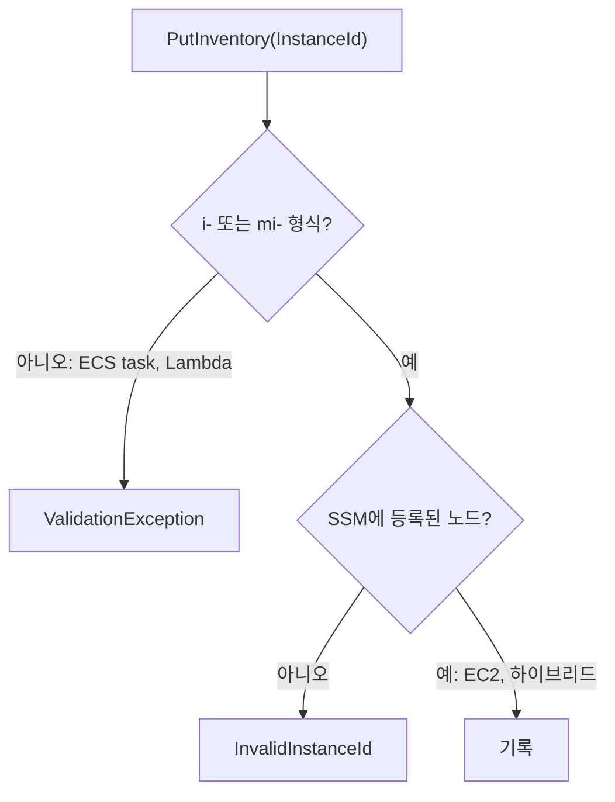

# 시나리오 4. ECS·Lambda가 Inventory 대상이 아닌 이유

## 이 시나리오의 목표

| 항목 | 내용 |
| --- | --- |
| 기능 | Inventory의 대상 제약(managed node 전용) 확인 |
| 쓰는 도구 | `scripts/probe_targets.py` |
| 입력 | EC2 managed node ID, ECS task 및 Lambda 형식의 테스트 ID |
| 작업 | 1 대상별 PutInventory 호출 → 2 오류 코드 해석 |
| 달성할 것 | ECS task와 Lambda가 거부되는 지점과 이유, 대신 사용할 도구를 구분합니다 |

## 거부되는 원인과 단계

Inventory의 저장 키는 managed node ID입니다. SSM은 Agent가 등록할 때 발급받은 `i-`(EC2) 또는 `mi-`(하이브리드) ID만 노드로 인식합니다. `PutInventory` 호출 시 거부는 두 단계에서 일어납니다.

1. **형식 검증**: `InstanceId`가 `(^i-(\w{8}|\w{17})$)|(^mi-\w{17}$)` 정규식에 맞지 않으면 노드 조회 전에 `ValidationException`으로 거부됩니다. ECS task ID(32자리 hex), task ARN, Lambda 함수 이름과 ARN이 모두 이 단계에서 걸립니다.
2. **등록 검증**: ID 형식이 맞더라도 SSM에 등록되지 않은 노드이면 `InvalidInstanceId` 오류를 반환합니다.

대상별로 managed node가 될 수 없는 이유는 다음과 같습니다.

| 대상 | managed node가 아닌 이유 | 대신 사용할 도구 |
| --- | --- | --- |
| ECS Fargate task | 호스트를 사용자가 제어할 수 없습니다. ECS Exec가 띄우는 SSM Agent는 Session Manager 채널(`ecs:<cluster>_<task-id>_<runtime-id>`) 전용이며 노드 등록을 하지 않습니다 | Inspector(ECR 이미지 스캔), Config(`AWS::ECS::TaskDefinition`), 이미지 SBOM |
| ECS on EC2 컨테이너 | 컨테이너는 노드가 아닙니다. 호스트의 SSM Agent는 호스트 OS 패키지만 수집합니다 | 호스트 ID에 `Custom:Container` 타입으로 `docker ps` 결과를 기록, Inspector |
| Lambda 함수 | 실행 환경이 요청 단위로 생성되고 사라지며, SSM Agent를 상주시킬 OS가 없습니다 | Config(`AWS::Lambda::Function`), Inspector Lambda 스캔, 함수 태그 |

ECS on EC2와 EKS 노드는 **호스트 OS까지만** Inventory 대상입니다. 컨테이너 정보가 꼭 Inventory에 있어야 한다면 호스트에서 `docker ps`나 `crictl ps` 결과를 custom JSON으로 남기는 방식을 씁니다. 다만 컨테이너는 호스트보다 교체 주기가 짧아 30분 주기의 수집과 맞지 않는 경우가 많습니다.

## 컴포넌트 역할

| 컴포넌트 | 역할 |
| --- | --- |
| `scripts/probe_targets.py` | 대상별 ID 형식으로 `PutInventory`를 호출하고 반환된 오류 코드를 출력합니다 |
| SSM API | 형식 검증 → 등록 검증 순서로 요청을 평가하고 거부합니다 |

## 흐름

`PutInventory` 요청이 ID 형식 검증과 SSM 노드 등록 검증을 거쳐 처리되거나 거부되는 흐름입니다.



## 실습

### 1. 대상별 PutInventory 호출

ECS task와 Lambda 리소스는 실제로 만들지 않습니다. 서버가 ID 형식 검증 단계에서 먼저 거부하므로 리소스 유무와 관계없이 동일한 결과를 확인할 수 있습니다.

EC2 managed node ID와 ECS·Lambda 형식의 가짜 ID로 `PutInventory`를 호출해 응답을 비교합니다.

```bash
cd aws/ssm/inventory
export AWS_REGION=ap-northeast-2
uv run scripts/probe_targets.py "$(terraform -chdir=terraform output -raw instance_id)"
```

예상 출력(미검증):

```text
EC2 managed node             OK
ECS task ID                  ValidationException
ECS task ARN                 ValidationException
ECS Exec target              ValidationException
Lambda name                  ValidationException
Lambda ARN                   ValidationException
형식만 맞는 없는 EC2 ID      InvalidInstanceId
```

- EC2 호출이 성공하며 생성한 `Custom:Probe` 타입은 스크립트 종료 시 `DeleteSchema`로 자동 삭제됩니다.

### 2. 오류 코드 해석

- **`ValidationException`**: 서버가 `InstanceId` 문자열 형식 자체를 거부한 상태입니다. 실제 리소스 존재 여부와 무관하게 정규식을 통과하지 못하면 즉시 실패합니다.
- **`InvalidInstanceId`**: ID 형식은 맞지만 현재 계정·리전의 SSM에 등록된 노드가 아닙니다. 실제 존재하는 EC2 인스턴스라도 SSM Agent가 `Online`으로 등록되어 있지 않으면 같은 오류가 발생합니다.

## 부록. 실무에서 얻는 것

- "모든 워크로드의 소프트웨어 목록"을 Inventory 하나로 통합할 수는 없습니다. 서버형 워크로드(EC2, 온프레미스)는 Inventory가 맡고, 컨테이너 이미지와 Lambda는 Inspector와 Config로 수집한 뒤 질의 단계(Athena 등)에서 합치는 구성이 현실적입니다.
- Fargate task에 sidecar와 하이브리드 활성화를 붙여 `mi-` 노드로 등록하는 우회 방법은 동작하지만, task가 교체될 때마다 등록 노드가 늘어나고 등록 해제를 직접 관리해야 합니다. AWS FIS처럼 짧은 실험용이 아니라면 inventory 목적에는 맞지 않습니다.

## 참고 문서

1. [PutInventory API Reference](https://docs.aws.amazon.com/systems-manager/latest/APIReference/API_PutInventory.html)
2. [Monitor Amazon ECS containers with ECS Exec](https://docs.aws.amazon.com/AmazonECS/latest/developerguide/ecs-exec.html)
3. [AWS FIS aws:ecs:task actions](https://docs.aws.amazon.com/fis/latest/userguide/ecs-task-actions.html)
4. [Supported machine types for managed nodes](https://docs.aws.amazon.com/systems-manager/latest/userguide/operating-systems-and-machine-types.html)
