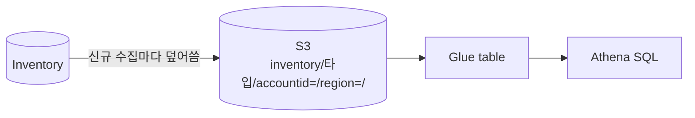

# 시나리오 5. Resource data sync로 S3에 집계

## 이 시나리오의 목표

| 항목 | 내용 |
| --- | --- |
| 기능 | Inventory 데이터를 S3에 계속 동기화해 30일 보관 한도 밖에서 질의 |
| 쓰는 도구 | Resource data sync, S3 |
| 입력 | 시나리오 2~3에서 쌓인 inventory |
| 작업 | 1 sync 상태 확인 → 2 S3 경로 구조 확인 → 3 custom 타입 파일 확인 |
| 달성할 것 | 타입별 S3 경로를 확인하고 Athena 질의로 이어지는 구조 이해 |

## Resource data sync가 무엇인가

Inventory 저장소는 노드별 최신값만 30일 보관하고 질의 기능이 단순합니다. Resource data sync는 이 데이터를 S3 버킷에 타입별 파티션 경로로 계속 내보내는 설정입니다. 한 번 만들면 baseline을 쓰고, 이후 새 수집이 있을 때마다 해당 노드 파일을 덮어씁니다. 여러 계정·리전의 sync가 같은 버킷을 가리키면 조직 전체 inventory가 한 버킷에 모입니다.

주의할 점은 **이력 저장소가 아니라는 것**입니다. 실행 중인 노드의 파일은 덮어쓰고, 삭제된 노드의 파일만 남습니다. 변경 이력이 필요하면 버킷 버저닝(이 실습의 terraform에서 켬)이나 AWS Config의 `AWS::SSM::ManagedInstanceInventory` 기록을 씁니다.

### 용어

| 용어 | 뜻 | 이 실습의 예 |
| --- | --- | --- |
| SyncFormat | S3에 쓰는 파일 형식. 현재 `JsonSerDe`만 지원 | `JsonSerDe` |
| prefix | 버킷 안 최상위 경로 | `inventory` |
| 파티션 경로 | `<prefix>/<타입>/accountid=/region=/resourcetype=/` | `inventory/Custom:AppDeployment/accountid=123456789012/...` |

## 대안 비교

| 방식 | 이력 | 질의 | 계정 통합 |
| --- | --- | --- | --- |
| Inventory 콘솔·`get-inventory` | 없음(30일) | 필터 몇 개 | 리전·계정별 |
| Resource data sync + Athena | 버저닝 시 객체 버전 | SQL | 버킷 하나로 통합 |
| AWS Config | 변경 이력 | Config advanced query(SQL 부분집합) | Aggregator |

## 컴포넌트 역할

| 컴포넌트 | 역할 |
| --- | --- |
| `aws_ssm_resource_data_sync` | 동기화 설정 |
| S3 버킷 정책 | `ssm.amazonaws.com`에 `GetBucketAcl`, `PutObject`(계정·sync ARN 조건) 허용 |
| Athena | S3 JSON을 테이블로 질의(이 실습 범위 밖) |

## 흐름



## 실습

출력은 예상값이며 실제 AWS에서 확인하지 않았습니다.

### 1. sync 상태 확인

```bash
cd aws/ssm/inventory
aws ssm list-resource-data-sync \
  --query 'ResourceDataSyncItems[].[SyncName,LastStatus,LastSuccessfulSyncTime]' --output text
```

예상 출력(미검증):

```text
ssm-inventory-sync  Successful  2026-11-10T00:10:00+00:00
```

### 2. S3 타입별 경로 확인

```bash
BUCKET=$(terraform -chdir=terraform output -raw sync_bucket)
aws s3 ls "s3://$BUCKET/inventory/"
```

예상 출력(미검증):

```text
PRE AWS:Application/
PRE AWS:InstanceInformation/
PRE AWS:Network/
PRE Custom:AppDeployment/
...
```

### 3. custom 타입 파일 내용 확인

```bash
KEY=$(aws s3 ls "s3://$BUCKET/inventory/Custom:AppDeployment/" --recursive | awk '{print $4}' | head -1)
aws s3 cp "s3://$BUCKET/$KEY" - | head -3
```

- 한 줄이 Content 한 행인 JSON Lines 형식. `resourceid`, `capturetime` 같은 열이 함께 붙음
- 시나리오 3의 6단계에서 타입을 지웠다면 3단계 전에 1단계를 다시 실행해 데이터를 만듦

## 부록. 실무에서 얻는 것

- sync는 리전 단위입니다. 리전 3개를 쓰면 sync도 3개를 만들고 같은 버킷을 가리킵니다. 계정·리전당 sync는 5개까지입니다.
- Object Lock이 켜진 버킷에는 쓰지 못합니다. 감사 목적으로 잠금 버킷을 쓰려면 sync 버킷과 보관 버킷을 나눕니다.
- 디스크 사용량, SAP landscape 같은 AWS 블로그 사례는 모두 custom inventory → sync → Athena 순서를 따릅니다. Inventory 자체를 질의 엔진으로 쓰지 않는 구조입니다.

## 참고 문서

1. [Creating a resource data sync for Inventory](https://docs.aws.amazon.com/systems-manager/latest/userguide/inventory-create-resource-data-sync.html)
2. [Walkthrough: Using resource data sync to aggregate inventory data](https://docs.aws.amazon.com/systems-manager/latest/userguide/inventory-resource-data-sync.html)
3. [사례: Systems Manager와 Athena로 SAP landscape inventory 관리](https://aws.amazon.com/blogs/awsforsap/maintain-an-sap-landscape-inventory-with-aws-systems-manager-and-amazon-athena)
