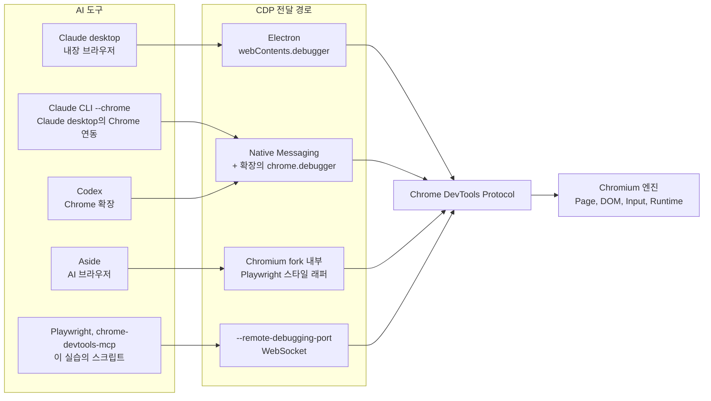
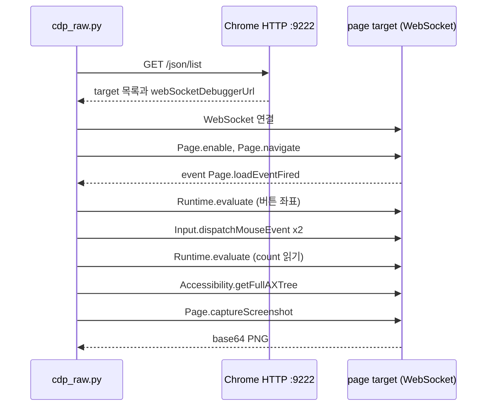

# 시나리오 1. AI가 브라우저를 조작하는 공통 원리, CDP

## 이 시나리오의 목표

| 항목 | 내용 |
|---|---|
| 기능 | 외부 프로그램이 브라우저를 원격으로 읽고 조작하는 기능 |
| 쓰는 도구 | Chrome의 `--remote-debugging-port`, Python `websockets` |
| 입력 | 로컬 테스트 페이지(`site/index.html`)의 버튼 하나와 카운터 |
| 작업 | 1. CDP 엔드포인트 탐색, 2. raw CDP로 이동·클릭·읽기·캡처 |
| 달성할 것 | AI 브라우저 도구가 내부에서 보내는 명령이 CDP 메시지 8개로 재현된다는 것을 확인 |

## 기능 지도

Claude desktop의 내장 브라우저, Claude in Chrome(Claude CLI의 `--chrome` 포함), Codex의 Chrome 확장, Aside는 겉모습이 모두 다르지만, 마지막에 브라우저 엔진으로 들어가는 명령은 같은 프로토콜입니다. 아래 그림은 도구마다 CDP에 도달하는 경로가 어떻게 다른지를 나타냅니다.



| 기능 | 쓰는 도구 | 시나리오 |
|---|---|---|
| CDP 자체의 동작 원리 | `--remote-debugging-port` + raw WebSocket | 1 (이 문서) |
| AI 제품별 CDP 전달 경로 | Chrome 확장 manifest, Native Messaging 설정, Claude.app 번들 | [2](2-ai-tool-access-paths.md) |
| CDP 위에 올라간 자동화 라이브러리 | Playwright `connect_over_cdp` | [3](3-playwright-vs-cdp.md) |
| CDP로 블로그 글과 사진 업로드(이론) | `Page.setInterceptFileChooserDialog`, `DOM.setFileInputFiles`, 페이지 안 `DataTransfer` | [4](4-blog-upload-scenario.md) |

## CDP가 무엇인가

Chrome DevTools Protocol(CDP)은 Chrome 개발자 도구가 브라우저를 들여다보고 조작할 때 쓰는 프로토콜입니다. 개발자 도구의 Elements 탭이 DOM을 그리고, Network 탭이 요청을 보여 주고, Console이 JavaScript를 실행하는 동작이 모두 CDP 명령입니다. 개발자 도구가 화면 안에 붙어 있어서 내장 기능처럼 보일 뿐, 구조로는 브라우저 밖의 클라이언트가 JSON 메시지로 브라우저를 원격 조작하는 것과 같습니다. AI 도구는 이 클라이언트 자리에 자기 프로그램을 넣습니다.

메시지는 JSON-RPC와 비슷한 형태입니다. 클라이언트가 `{"id": 1, "method": "Page.navigate", "params": {...}}`처럼 id를 붙여 명령을 보내면 브라우저가 같은 id로 결과를 돌려주고, 페이지 로드 완료처럼 브라우저 쪽에서 생긴 일은 id 없는 event(`Page.loadEventFired`)로 밀어 줍니다. 명령은 `Page`, `DOM`, `Runtime`, `Input`, `Network`, `Accessibility` 같은 domain으로 묶여 있습니다.

오해하기 쉬운 경계가 두 가지 있습니다. 첫째, CDP는 "브라우저 자동화 라이브러리"가 아니라 그 아래의 통신 규약입니다. 버튼이 보일 때까지 기다리거나 클릭 전에 스크롤하는 판단은 CDP가 해 주지 않고 클라이언트가 직접 해야 합니다. 둘째, CDP는 접속 방식(transport)을 정하지 않습니다. `--remote-debugging-port`의 WebSocket은 여러 transport 중 하나일 뿐이고, Chrome 확장의 `chrome.debugger` API나 Electron의 `webContents.debugger`도 같은 CDP 메시지를 다른 통로로 전달합니다. 시나리오 2에서 AI 제품들이 포트를 열지 않고도 CDP를 쓰는 이유가 여기에 있습니다.

### 용어

| 용어 | 뜻 | 이 실습의 예 |
|---|---|---|
| CDP 엔드포인트 | 디버깅 포트가 여는 HTTP + WebSocket 서버 | `http://127.0.0.1:9222` |
| target | CDP로 붙을 수 있는 대상(탭, service worker, 브라우저 UI 등) | `type: "page"`인 `about:blank` 탭 |
| `webSocketDebuggerUrl` | target 하나에 붙는 WebSocket 주소 | `ws://127.0.0.1:9222/devtools/page/<target id>` |
| domain | 기능별 명령 묶음 | `Page`, `Runtime`, `Input`, `Accessibility` |
| command / event | 클라이언트 → 브라우저 요청(id 있음) / 브라우저 → 클라이언트 알림(id 없음) | `Page.navigate` / `Page.loadEventFired` |
| 접근성 트리 | 스크린리더용으로 브라우저가 만드는 역할·이름 트리 | `button "카운트 증가"` |

## 이 기능을 시스템이 제공해야 하는 이유

LLM은 텍스트를 입력받고 텍스트를 출력합니다. 웹 페이지를 다루려면 누군가 페이지를 텍스트나 이미지로 바꿔 모델에 넣고, 모델이 출력한 "이 버튼을 눌러라"를 실제 입력으로 바꿔야 합니다. 페이지 HTML을 `curl`로 받아 오는 방식은 JavaScript가 그린 화면, 로그인 세션, 클릭 결과를 다룰 수 없습니다. 반대로 OS 화면을 캡처하고 마우스를 움직이는 computer use 방식은 어떤 앱이든 다룰 수 있지만, 좌표가 조금만 어긋나도 엉뚱한 곳을 누르고 요소 이름이나 상태를 구조적으로 읽을 수 없습니다.

브라우저 엔진이 직접 원격 조작 API를 제공하면 이 두 문제가 함께 풀립니다. 렌더링이 끝난 DOM과 접근성 트리를 그대로 읽어 모델에 줄 수 있고, `Input.dispatchMouseEvent`처럼 엔진 수준의 입력을 넣을 수 있으며, 필요할 때만 `Page.captureScreenshot`으로 이미지를 덧붙일 수 있습니다. AI 도구들이 제품 형태와 관계없이 결국 CDP로 모이는 이유입니다.

### Chrome 136의 보안 변경

CDP는 강력한 만큼 위험합니다. 디버깅 포트는 인증이 없어서 로컬에서 포트에 접속할 수 있는 프로그램이면 누구나 쿠키를 읽고 로그인된 사이트를 조작할 수 있습니다. 실제로 infostealer 악성코드가 이 포트로 쿠키를 빼 가는 사례가 늘자, Chrome 136부터는 기본 프로필 디렉터리에서 `--remote-debugging-port`를 무시합니다[^chrome136]. 그래서 이 실습은 `--user-data-dir`로 빈 프로필을 따로 지정해 Chrome을 띄웁니다.

이 변경은 AI 제품 설계에도 직접 영향을 줍니다. 사용자의 로그인 세션이 있는 평소 Chrome을 포트 방식으로는 조작할 수 없게 되었으므로, 평소 브라우저를 다뤄야 하는 제품은 Chrome 확장의 `chrome.debugger` API처럼 사용자가 설치를 승인한 경로로 CDP를 써야 합니다. 시나리오 2에서 그 구조를 확인합니다.

## 대안 비교

| 방식 | 페이지를 읽는 법 | 조작하는 법 | 장점 | 한계 |
|---|---|---|---|---|
| HTTP 요청(`curl`, fetch tool) | 서버가 준 HTML | 없음 | 가볍고 빠름 | JavaScript 렌더링, 로그인, 클릭 불가 |
| OS 수준 computer use | 화면 캡처 이미지 | OS 마우스·키보드 이벤트 | 브라우저 밖 앱도 조작 | 좌표 오차, 구조 정보 없음, 느림 |
| CDP | DOM, 접근성 트리, 스크린샷 | 엔진 수준 입력, JavaScript 실행 | 구조 정보와 정확한 입력 | Chromium 계열 전용, 권한이 매우 큼 |
| WebDriver BiDi | DOM, 스크린샷 | 표준화된 입력 명령 | W3C 표준, 브라우저 간 호환 | 도메인 범위가 CDP보다 좁음 |

## 컴포넌트 역할

| 컴포넌트 | 역할 |
|---|---|
| Chrome(`--remote-debugging-port=9222`) | CDP 서버. target 목록을 HTTP로, 명령을 WebSocket으로 받음 |
| `site/index.html` + `python3 -m http.server` | 클릭하면 count가 올라가는 테스트 페이지 |
| `cdp-raw/cdp_raw.py` | AI 도구의 브라우저 tool 호출을 raw CDP 메시지로 재현하는 클라이언트 |

## 흐름

아래 다이어그램은 `cdp_raw.py`가 탭 하나를 찾아 붙은 뒤 이동, 클릭, 읽기, 캡처를 하는 동안 오가는 메시지 순서입니다.



## 실습

실습 환경은 [setup.md](setup.md)로 먼저 띄웁니다. 아래 명령은 모두 `computer_science/ai/cdp-browser-access`에서 실행합니다.

### 1. CDP 엔드포인트가 노출하는 target 목록 조회

AI 도구가 브라우저에 붙기 전에 가장 먼저 하는 일은 "무엇에 붙을 수 있는가"를 알아내는 것입니다. 디버깅 포트의 HTTP 엔드포인트 `/json/list`가 그 목록을 줍니다.

```bash
curl -s http://127.0.0.1:9222/json/list | python3 -c "import json,sys; [print(t['type'], '|', t['url'][:60]) for t in json.load(sys.stdin)]"
```

```text
browser_ui | chrome://omnibox-popup.top-chrome/omnibox_popup_aim.html
page | about:blank
browser_ui | chrome://omnibox-popup.top-chrome/
service_worker | chrome-extension://nkeimhogjdpnpccoofpliimaahmaaome/thunk.js
service_worker | chrome-extension://admccjkmockfdflocgggjfgdacdodkdf/background.js
service_worker | chrome-extension://fignfifoniblkonapihmkfakmlgkbkcf/service_worker.js
```

목록에는 탭(`page`)뿐 아니라 주소창 팝업 같은 브라우저 UI와 Chrome 내장 확장의 service worker도 target으로 나옵니다. CDP가 탭 하나가 아니라 브라우저 프로세스 전체를 노출한다는 뜻이며, 이 포트에 붙은 프로그램이 어디까지 볼 수 있는지 보여 주는 대목입니다. 내장 확장 ID와 개수는 Chrome 버전에 따라 다르고 service worker는 idle 상태가 되면 목록에서 빠지기도 합니다. 이 실습에서 쓰는 것은 `page` 하나입니다. 이 HTTP 엔드포인트에는 인증 단계가 없다는 점도 함께 확인할 수 있습니다.

### 2. raw CDP로 이동·클릭·읽기·캡처 실행

`cdp_raw.py`는 `/json/list`에서 첫 `page` target을 골라 WebSocket으로 붙은 뒤, AI 브라우저 도구의 대표 tool(이동, 클릭, 페이지 읽기, 스크린샷)을 CDP 명령으로만 수행합니다. 클릭은 DOM의 `element.click()`이 아니라 `Input.dispatchMouseEvent`로 좌표에 실제 마우스 누름과 뗌을 넣습니다.

```bash
uv run cdp-raw/cdp_raw.py
```

```text
target: 3AC8F330772664B40D60D2FCF55A3B77 about:blank
>> {"id": 1, "method": "Page.enable", "params": {}}
>> {"id": 2, "method": "Page.navigate", "params": {"url": "http://127.0.0.1:8000/index.html"}}
<< event Page.frameStartedNavigating
<< event Page.frameStartedLoading
<< event Page.loadEventFired (대기 완료)
>> {"id": 3, "method": "Runtime.evaluate", "params": {"expression": "JSON.stringify(document.getElementById('add').getBound
<< event Page.frameStoppedLoading
>> {"id": 4, "method": "Input.dispatchMouseEvent", "params": {"type": "mousePressed", "x": 120.0, "y": 144.0, "button": "le
>> {"id": 5, "method": "Input.dispatchMouseEvent", "params": {"type": "mouseReleased", "x": 120.0, "y": 144.0, "button": "l
>> {"id": 6, "method": "Runtime.evaluate", "params": {"expression": "document.getElementById(\"count\").textContent", "retu
count after click: 1
>> {"id": 7, "method": "Accessibility.getFullAXTree", "params": {}}
ax nodes: 15, named: ['CDP 실습 페이지', 'CDP 실습 페이지', '카운트 증가', 'CDP 실습 페이지', '카운트 증가', 'count: ', 'CDP 실습 페이지', '카운트 증가', 'count: ', '1', '1']
screenshot: cdp-raw-screenshot.png (47884 base64 chars)
total commands sent: 8
```

target id는 Chrome을 띄울 때마다 달라집니다. 출력에서 봐야 할 것은 세 가지입니다.

- `count after click: 1`은 좌표 기반 입력 이벤트가 페이지의 click 핸들러까지 전달되었다는 증거입니다. 버튼 중심 좌표 `(120, 144)`는 `site/index.html`의 `left:40px; top:120px; width:160px; height:48px`에서 계산된 값입니다.
- `Accessibility.getFullAXTree`가 돌려준 이름 목록에 `카운트 증가`와 `1`이 들어 있습니다. AI 도구가 "페이지를 읽는다"고 할 때 모델에 주는 것이 HTML 원문보다 이런 역할·이름 트리에 가까운 이유는, 장식용 태그를 걷어 내고 사람이 화면에서 인식하는 단위만 남기기 때문입니다. 같은 이름이 여러 번 나오는 것은 텍스트 노드와 그 부모 요소가 각각 이름을 갖기 때문입니다.
- 전체 작업에 쓴 명령은 8개입니다. 시나리오 3에서 같은 작업을 Playwright로 하면 몇 개가 나가는지 이 숫자와 비교합니다.

> 이미 `count`가 1 이상이라면 앞선 실행에서 같은 탭에 버튼을 눌렀기 때문입니다. `Page.navigate`가 페이지를 다시 불러오므로 매 실행의 결과는 항상 1입니다.

### 3. 스크린샷 확인

`Page.captureScreenshot`은 OS 화면이 아니라 렌더러가 그린 페이지를 PNG로 돌려줍니다. 브라우저 창이 다른 창에 가려져 있어도 같은 이미지가 나옵니다.

```bash
open cdp-raw-screenshot.png
```

이미지에 `count: 1`이 보이면 클릭 이후 상태가 캡처된 것입니다.

## 부록. 실무에서 얻는 것

- **CDP 명령은 원자적이고 판단이 없습니다.** `Input.dispatchMouseEvent`는 그 좌표에 무엇이 있든 그대로 누릅니다. 버튼이 아직 렌더링되지 않았거나 모달에 가려져 있으면 클릭은 성공 응답을 받고도 아무 일도 일어나지 않습니다. raw CDP로 agent tool을 직접 만들면 대기, 스크롤, 가림 검사를 모두 직접 구현해야 하고, 이것이 시나리오 3에서 Playwright가 명령을 훨씬 많이 보내는 이유입니다.
- **event 순서는 보장되지 않습니다.** `Page.loadEventFired`가 `Page.navigate`의 응답보다 먼저 올 수 있습니다. `cdp_raw.py`가 받은 event를 `seen_events`에 쌓아 두고 기다리는 이유이며, event를 버리는 단순 구현은 간헐적으로 영원히 대기합니다.
- **디버깅 포트는 열어 두는 순간 로컬 전체에 공개됩니다.** 인증이 없으므로 같은 장비의 다른 프로세스가 9222에 붙으면 이 실습 프로필의 쿠키를 그대로 읽을 수 있습니다. 실습이 끝나면 [setup.md](setup.md#환경-내리기)의 명령으로 반드시 종료합니다.

## 참고 문서

1. [Chrome DevTools Protocol](https://chromedevtools.github.io/devtools-protocol/)
2. [Changes to remote debugging switches to improve security (Chrome for Developers)](https://developer.chrome.com/blog/remote-debugging-port)
3. [WebDriver BiDi (W3C)](https://w3c.github.io/webdriver-bidi/)

[^chrome136]: Chrome for Developers, "Changes to remote debugging switches to improve security".
