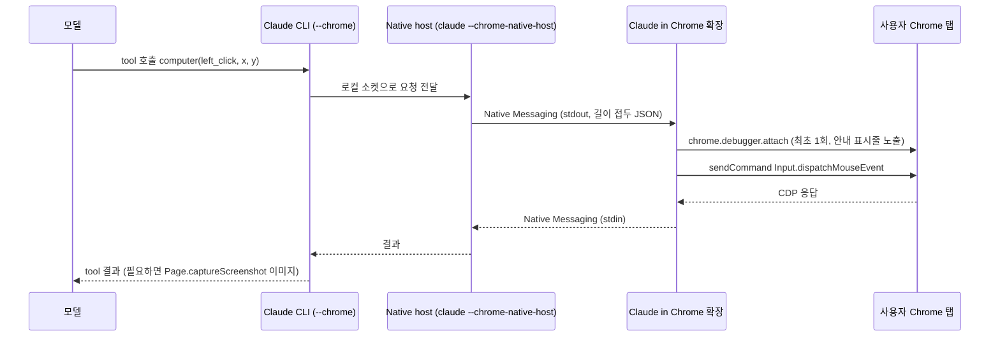

# 시나리오 2. AI 제품마다 CDP에 도달하는 경로

## 시나리오 목표

| 항목 | 내용 |
|---|---|
| 기능 | 디버깅 포트 없이 사용자의 브라우저에 CDP를 전달하는 기능 |
| 사용 도구 | Chrome 확장 manifest, Native Messaging host 설정, Claude.app 번들(`app.asar`) |
| 입력 | 로컬에 설치된 Claude in Chrome 확장, Codex의 Chrome 확장(이름: ChatGPT), Claude desktop 앱 |
| 작업 | 1. 확장 권한 확인, 2. 확장 내 CDP 명령 확인, 3. Native Messaging host 확인, 4. Claude desktop 내장 브라우저 확인 |
| 달성 목표 | 제품별로 transport는 다르지만 모두 CDP 명령으로 브라우저를 제어한다는 사실을 설치 파일에서 검증 |

## 디버깅 포트 없이 CDP를 전달하는 구조

[시나리오 1](1-cdp-principle.md)에서 확인했듯이 CDP는 메시지 규약이며 전송 통로(transport)는 별도로 선택할 수 있습니다. 디버깅 포트는 그중 가장 단순한 통로이지만, 사용자가 Chrome을 특수 옵션으로 재기동해야 하고 Chrome 136부터는 기본 프로필에서 동작하지 않습니다. AI 제품은 사용자가 이미 로그인해 둔 브라우저를 제어할 때 실용적 가치가 크기 때문에, 포트 대신 브라우저가 공식적으로 허용하는 다른 전송 통로를 사용합니다.

비유하자면 CDP는 "브라우저에 내리는 명령어 규약"이고, 제품마다 달라지는 것은 "명령서를 브라우저까지 운반하는 전달 경로"입니다. 이 시나리오에서는 그 전달 경로의 차이를 다루며, 모델이 어떤 tool을 어떤 순서로 호출하는지(agent 설계)는 범위에서 제외합니다.

### 핵심 용어

| 용어 | 의미 | 이 실습의 예 |
|---|---|---|
| `chrome.debugger` | Chrome 확장이 탭에 연결해 CDP 명령을 전송하는 확장 API. manifest에 `debugger` 권한 필요 | `chrome.debugger.sendCommand(target, "Input.dispatchMouseEvent", ...)` |
| Native Messaging | Chrome 확장이 로컬 실행 파일과 stdin/stdout으로 JSON을 주고받는 통신 통로. manifest에 `nativeMessaging` 권한 필요 | `com.anthropic.claude_code_browser_extension` |
| Native Messaging host | 확장이 실행하는 로컬 프로그램과 그 등록 파일 | `claude --chrome-native-host` |
| `webContents.debugger` | Electron 앱이 내부 웹 화면에 CDP를 전송하는 API | Claude desktop의 브라우저 패널 |
| Chromium fork | Chromium 소스를 수정해 직접 빌드한 브라우저 | Aside |

## 확장 프로그램과 Native Messaging을 사용하는 이유

사용자가 AI에게 위임하고 싶은 작업은 대부분 로그인이 필요한 서비스에서 발생합니다. 사내 대시보드 확인, 메일 정리, 쇼핑몰 장바구니 관리 등이 대표적입니다. 디버깅 포트 방식으로 이 작업을 수행하려면 사용자가 Chrome을 `--remote-debugging-port`와 별도 프로필로 다시 실행하고 모든 사이트에 재로그인해야 합니다. 또한 포트는 인증이 없어 같은 장비의 임의의 프로세스가 접근할 수 있다는 보안 문제도 있습니다.

Chrome 확장 경로는 이 두 가지 문제를 동시에 우회합니다. 확장은 사용자가 Chrome Web Store에서 명시적으로 설치하고 권한을 승인한 코드이므로, 평소 프로필의 탭에 `chrome.debugger`로 연결할 수 있습니다. 연결되는 순간 Chrome은 탭 상단에 "디버깅을 시작했습니다"라는 안내 표시줄을 띄워 사용자에게 상태를 알립니다. 로컬 AI 프로그램(Claude CLI, Codex)은 Native Messaging으로 확장에 명령을 전달하고, 확장은 이를 CDP 메시지로 변환해 탭에 전송합니다. 이 과정에서 외부에 개방되는 네트워크 포트는 없습니다.

## 제품별 CDP 전달 경로 비교

| 제품 | 제어 대상 브라우저 | AI 프로그램 → 브라우저 통로 | 모델에 노출하는 인터페이스 | 근거 |
|---|---|---|---|---|
| Claude desktop 내장 브라우저 | 앱 내 Electron 웹 화면(`WebContentsView`) | 동일 프로세스 내 `webContents.debugger` | `navigate`, `computer`(클릭·입력·스크린샷), `read_page` 등 tool | 작업 4에서 `app.asar` 확인 |
| Claude in Chrome(Claude desktop, Claude CLI `--chrome`) | 사용자의 평소 Chrome | Native Messaging → 확장의 `chrome.debugger` | 동일 계열의 브라우저 tool | 작업 1~3 |
| Codex Chrome 연동 | 사용자의 평소 Chrome | Native Messaging → 확장(이름 ChatGPT)의 `chrome.debugger` | Codex의 browser use tool | 작업 1~3 |
| Codex CLI + chrome-devtools-mcp | MCP 서버가 기동한 별도 Chrome | Puppeteer → CDP | 성능 trace, 네트워크, 콘솔 중심의 MCP tool | 참고 문서 5 |
| Aside | 자체 Chromium fork | 브라우저 내부의 Playwright 스타일 래퍼(Asidewright) → CDP | 모델이 Playwright 스타일 JavaScript를 직접 작성해 REPL에서 실행 | 참고 문서 6 (이 실습에서는 설치 확인 제외) |

Aside 역시 내부 원리는 CDP입니다. 다만 Aside 팀은 저수준 디버거 프로토콜인 CDP를 모델에 직접 노출하는 것은 효율이 떨어진다고 판단하고, 모델이 이미 학습해 익숙한 Playwright API 형태를 그대로 따르는 얇은 래퍼를 구현해 그 아래에서 CDP를 호출합니다[^aside]. 즉 "CDP를 사용하는가"에 대한 답은 다섯 제품 모두 동일하며, 차이는 "CDP 명령을 모델이 직접 고르는가, tool이 고르는가, 모델이 작성한 Playwright 코드가 고르는가"에 있습니다.

Codex의 데스크톱 앱 내장 브라우저와 Chrome 연동에 CDP 전체 접근(developer mode)이 추가되었다는 보도가 있으나[^codex-cdp], 이 문서에서는 로컬에 설치된 Chrome 확장과 Native Messaging host만 검증하며 Codex 데스크톱 앱 자체는 범위에서 제외합니다.

## 컴포넌트 구성

| 컴포넌트 | 역할 |
|---|---|
| Claude CLI(`claude --chrome`) / Codex | 모델과 대화하며 브라우저 tool 호출을 생성하는 로컬 프로그램 |
| Native Messaging host | Chrome이 확장 요청으로 실행하는 로컬 프로그램. AI 프로그램과 확장 사이의 중개자 |
| Chrome 확장(service worker) | Native Messaging으로 수신한 tool 호출을 `chrome.debugger` CDP 명령으로 변환 |
| 탭(page target) | 사용자의 로그인 세션이 유지된 실제 페이지 |
| Claude desktop의 `WebContentsView` | 확장 없이 앱 프로세스 내부에서 직접 CDP를 수신하는 내장 브라우저 화면 |

## 명령 전달 흐름

아래 다이어그램은 Claude CLI에서 `--chrome` 옵션으로 클릭 tool을 호출했을 때 명령이 평소 Chrome 탭까지 전달되는 경로입니다. Codex의 Chrome 연동도 host 이름만 다르고 동일한 구조로 동작합니다.



## 실습

이 시나리오는 이미 설치된 제품의 파일만 조회하므로 별도의 Chrome 실습 환경이 필요하지 않습니다. 설치하지 않은 제품이 있으면 해당 단계의 명령이 빈 출력 대신 오류(zsh의 `no matches found`, Python의 `IndexError`, grep의 `No such file`)로 종료되므로 설치된 제품에 해당하는 단계만 실행합니다. 작업 3은 Codex를 설치하지 않았다면 `for` 문에서 `"$NMH"/com.openai.*.json`을 제외하고 실행합니다. 출력되는 버전 번호는 설치 시점에 따라 달라집니다. 아래 예시는 macOS, Chrome `Default` 프로필 기준이며 다른 프로필을 사용 중이라면 경로의 `Default`를 `Profile 1` 등으로 변경합니다.

### 1. Claude in Chrome 확장과 Codex 확장의 권한 비교

확장이 CDP를 사용하려면 manifest에 `debugger` 권한이, 로컬 프로그램과 통신하려면 `nativeMessaging` 권한이 필요합니다. 두 확장의 ID(`fcoeoabgfenejglbffodgkkbkcdhcgfn`은 Claude, `hehggadaopoacecdllhhajmbjkdcmajg`는 Codex가 사용하는 ChatGPT 확장)로 manifest를 찾아 핵심 권한 네 가지만 필터링해 출력합니다.

```bash
EXT="$HOME/Library/Application Support/Google/Chrome/Default/Extensions"
for id in fcoeoabgfenejglbffodgkkbkcdhcgfn hehggadaopoacecdllhhajmbjkdcmajg; do
  python3 -c "import json,glob,sys; f=glob.glob(sys.argv[1]+'/'+sys.argv[2]+'/*/manifest.json')[0]; d=json.load(open(f)); print(d['name'], d['version'], [p for p in d['permissions'] if p in ('debugger','nativeMessaging','tabs','scripting')])" "$EXT" "$id"
done
```

실행 결과 두 확장이 요구하는 권한 목록은 다음과 같습니다.

```text
Claude 1.0.107 ['scripting', 'debugger', 'tabs', 'nativeMessaging']
ChatGPT 1.26.1102.11740 ['debugger', 'nativeMessaging', 'scripting', 'tabs']
```

두 확장 모두 `debugger`와 `nativeMessaging`을 함께 요구합니다. `debugger` 권한은 설치 시 브라우저 디버거 접근 경고가 표시되는 고권한 항목이며, 두 회사가 독립적으로 동일한 아키텍처를 채택했음을 확인할 수 있습니다.

### 2. 확장 코드 안의 CDP 명령 확인

권한 선언만으로는 실제 CDP 사용 여부를 단정할 수 없으므로, Claude 확장의 번들된 JavaScript에서 `chrome.debugger` 호출과 CDP 메서드 문자열의 빈도를 집계합니다.

```bash
D="$EXT/fcoeoabgfenejglbffodgkkbkcdhcgfn"
grep -rhoE 'chrome\.debugger\.[a-zA-Z]+|connectNative' "$D"/*/ | sort | uniq -c
grep -rhoE '"(Input|Page|Runtime|Accessibility|Network)\.[A-Za-z]+"' "$D"/*/ | sort | uniq -c | sort -rn | head -8
```

번들 파일에서 추출한 API 호출과 CDP 메서드 목록은 다음과 같습니다.

```text
   2 chrome.debugger.attach
   1 chrome.debugger.detach
   3 chrome.debugger.getTargets
   1 chrome.debugger.onDetach
   1 chrome.debugger.onEvent
   3 chrome.debugger.sendCommand
   2 connectNative
   6 "Page.enable"
   6 "Page.captureScreenshot"
   2 "Runtime.enable"
   2 "Page.getFrameTree"
   2 "Network.enable"
   2 "Input.dispatchMouseEvent"
   1 "Runtime.exceptionThrown"
   1 "Runtime.evaluate"
```

시나리오 1에서 raw WebSocket으로 전송한 `Input.dispatchMouseEvent`, `Page.captureScreenshot`, `Runtime.evaluate`가 그대로 나타납니다. 메시지 내용은 동일하고 전송 통로만 WebSocket에서 `chrome.debugger.sendCommand`로 바뀐 것입니다. `connectNative`는 확장이 Native Messaging host를 실행하는 호출입니다. Codex 확장 ID로 같은 명령을 실행하면 `DOMSnapshot.captureSnapshot`, `Input.dispatchDragEvent`처럼 사용하는 메서드 구성은 다르지만 동일한 `chrome.debugger` 경로를 확인할 수 있습니다.

### 3. Native Messaging host 등록 파일 확인

확장이 `connectNative`로 어떤 실행 파일을 호출하는지는 Chrome의 `NativeMessagingHosts` 디렉터리에 있는 등록 파일이 결정합니다. 각 파일의 이름, 통신 방식, 실행 파일 경로를 조회하며 홈 디렉터리는 `~`로 치환해 출력합니다.

```bash
NMH="$HOME/Library/Application Support/Google/Chrome/NativeMessagingHosts"
for f in "$NMH"/com.anthropic.*.json "$NMH"/com.openai.*.json; do
  python3 -c "import json,sys,os; d=json.load(open(sys.argv[1])); print(d['name'], '|', d['type'], '|', d['path'].replace(os.path.expanduser('~'),'~'))" "$f"
done
```

등록된 host 목록은 다음과 같습니다.

```text
com.anthropic.claude_browser_extension | stdio | /Applications/Claude.app/Contents/Helpers/chrome-native-host
com.anthropic.claude_code_browser_extension | stdio | ~/.claude/chrome/chrome-native-host
com.openai.codexextension | stdio | ~/.codex/plugins/cache/openai-bundled/chrome/latest/extension-host/macos/arm64/ChatGPT for Chrome
```

총 세 개의 host가 등록되어 있습니다. Claude desktop 앱과 Claude CLI가 동일한 Claude 확장에 각각 host를 등록하고, Codex는 번들된 Chrome 플러그인으로 자체 host를 등록합니다. 모두 `stdio` 방식을 사용하므로 네트워크 포트를 열지 않습니다. Claude CLI 측 host 실행 스크립트의 마지막 줄을 확인하면 Claude CLI 자체가 host 모드로 기동됨을 알 수 있습니다.

```bash
tail -1 ~/.claude/chrome/chrome-native-host
```

스크립트 끝부분에는 다음과 같은 실행 명령이 들어 있습니다.

```text
exec <claude 실행 파일 경로> --chrome-native-host
```

실제 출력에서는 `<claude 실행 파일 경로>` 위치에 로컬 설치 경로가 표시됩니다. 하나의 확장에 두 개의 host가 등록되어 있기 때문에, Claude desktop이 실행 중인 상태에서 확장이 desktop 쪽 host에 연결되면 CLI의 `--chrome` 옵션이 "Browser extension is not connected" 오류를 반환하는 충돌이 발생합니다. 구체적인 증상과 해결 방법은 [troubleshooting.md](troubleshooting.md)에 정리했습니다.

### 4. Claude desktop 내장 브라우저의 CDP 호출 확인

Claude desktop은 Electron 기반 앱이며, 내장 브라우저 패널은 확장 없이 앱 내부의 웹 화면을 직접 제어합니다. 앱 번들 `app.asar`에서 Electron 화면 객체와 debugger 호출 빈도를 추출합니다.

```bash
LC_ALL=C grep -aoE 'WebContentsView|webContents\.debugger|debugger\.(attach|sendCommand)\(|"(Input\.dispatchMouseEvent|Input\.dispatchKeyEvent|Page\.captureScreenshot|Accessibility\.getFullAXTree|Runtime\.evaluate)"' /Applications/Claude.app/Contents/Resources/app.asar | sort | uniq -c | sort -rn
```

추출된 심볼과 CDP 메서드 빈도는 다음과 같습니다.

```text
  16 WebContentsView
  15 debugger.sendCommand(
  15 "Input.dispatchMouseEvent"
   5 "Runtime.evaluate"
   3 "Input.dispatchKeyEvent"
   2 webContents.debugger
   1 debugger.attach(
   1 "Page.captureScreenshot"
   1 "Accessibility.getFullAXTree"
```

확인에 사용한 Claude desktop 버전은 5.11492.2이며 버전에 따라 횟수는 달라집니다. 여기서도 동일한 CDP 메서드가 사용되며 전송 통로는 `webContents.debugger.sendCommand`입니다. Electron 앱은 Chromium을 내장하고 있으므로 자체 화면에 대해서는 확장이나 포트 없이 동일 프로세스 내에서 직접 CDP를 전송할 수 있습니다. 대신 이 내장 브라우저는 사용자의 평소 Chrome과 쿠키를 공유하지 않으므로, 기존 Chrome의 로그인 세션이 필요하면 Claude in Chrome 경로를 사용해야 합니다.

## 부록. 실무 시사점

- **"어느 브라우저를 제어하는가"가 제품 선택 기준이 됩니다.** 내장 브라우저(Claude desktop, Codex 앱)는 격리된 환경이라 안전하지만 재로그인이 필요하고, 확장 경로(Claude in Chrome, Codex Chrome 연동)는 기존 세션을 바로 활용하는 대신 그 세션 전체의 권한을 AI에 위임합니다. Claude 제품군 내부에서도 두 경로를 분리해 제공하는 이유입니다.
- **확장의 `debugger` 권한은 사실상 브라우저 전체 제어 권한입니다.** 조직에서 AI 브라우저 확장 도입을 검토할 때는 Chrome 정책(`ExtensionSettings`)으로 `debugger` 권한을 요구하는 확장의 허용 범위를 먼저 정의해야 합니다.
- **host 충돌은 구조적 특성에서 비롯됩니다.** 단일 확장에 여러 Native Messaging host가 등록될 수 있으며, 확장이 어느 host에 연결할지는 확장 코드가 결정합니다. CLI와 desktop을 병행하는 환경에서 연결이 간헐적으로 끊기면 3단계의 등록 파일부터 점검합니다.

## 참고 문서

1. [chrome.debugger API (Chrome for Developers)](https://developer.chrome.com/docs/extensions/reference/api/debugger)
2. [Native messaging (Chrome for Developers)](https://developer.chrome.com/docs/extensions/develop/concepts/native-messaging)
3. [Electron Debugger API](https://www.electronjs.org/docs/latest/api/debugger)
4. [Use Claude Code with Chrome (Claude Code Docs)](https://code.claude.com/docs/en/chrome)
5. [Chrome DevTools MCP와 Codex CLI (Daniel Vaughan)](https://codex.danielvaughan.com/2026/04/24/chrome-devtools-mcp-codex-cli-browser-debugging-frontend-workflows/)
6. [How we built the SOTA browser agent (Aside, @hyojun_at)](https://x.com/hyojun_at/status/2070234507995910413)
7. [Codex Now Drives the Browser with the Chrome DevTools Protocol](https://pasqualepillitteri.it/en/news/5088/codex-browser-chrome-devtools-protocol)

[^aside]: Aside, "How we built the SOTA browser agent". Asidewright의 각 API가 CDP 메서드를 감싼 얇은 래퍼라고 설명한다.
[^codex-cdp]: 2026년 6월 Codex 앱 업데이트에 대한 2차 보도. OpenAI 공식 문서로는 확인하지 않았다.
