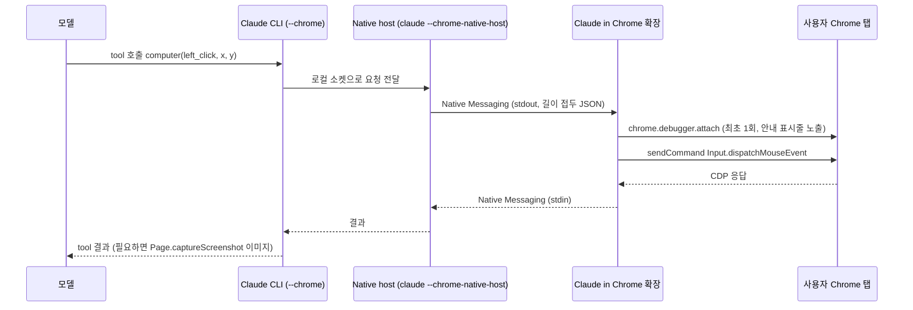

# 시나리오 2. AI 제품마다 CDP에 도달하는 경로

## 이 시나리오의 목표

| 항목 | 내용 |
|---|---|
| 기능 | 디버깅 포트 없이 사용자의 브라우저에 CDP를 전달하는 기능 |
| 쓰는 도구 | Chrome 확장 manifest, Native Messaging host 설정, Claude.app 번들(`app.asar`) |
| 입력 | 로컬에 설치된 Claude in Chrome 확장, Codex의 Chrome 확장(이름은 ChatGPT), Claude desktop 앱 |
| 작업 | 1. 확장의 권한 확인, 2. 확장이 보내는 CDP 명령 확인, 3. Native Messaging host 확인, 4. Claude desktop 내장 브라우저 확인 |
| 달성할 것 | 제품마다 transport는 다르지만 모두 CDP 명령으로 브라우저를 조작한다는 것을 설치 파일에서 확인 |

## 이 기능이 무엇인가

[시나리오 1](1-cdp-principle.md)에서 CDP는 메시지 규약이고 전달 통로(transport)는 따로 정해진다고 했습니다. 디버깅 포트는 그중 가장 단순한 통로지만, 사용자가 Chrome을 특수 옵션으로 다시 띄워야 하고 Chrome 136부터는 평소 프로필에서 아예 동작하지 않습니다. AI 제품은 사용자가 이미 로그인해 둔 브라우저를 다뤄야 가치가 생기므로, 포트 대신 브라우저가 공식으로 허용하는 다른 통로를 씁니다.

비유하면 CDP는 "브라우저에 내리는 명령어 사전"이고, 제품마다 다른 것은 "명령서를 브라우저에 들고 가는 배달원"입니다. 이 시나리오가 다루는 것은 배달원의 차이이며, 모델이 어떤 tool을 어떤 순서로 부르는지(agent 설계)는 다루지 않습니다.

### 용어

| 용어 | 뜻 | 이 실습의 예 |
|---|---|---|
| `chrome.debugger` | Chrome 확장이 탭에 붙어 CDP 명령을 보내는 확장 API. manifest에 `debugger` 권한이 필요 | `chrome.debugger.sendCommand(target, "Input.dispatchMouseEvent", ...)` |
| Native Messaging | Chrome 확장이 로컬 실행 파일과 stdin/stdout으로 JSON을 주고받는 통로. manifest에 `nativeMessaging` 권한이 필요 | `com.anthropic.claude_code_browser_extension` |
| Native Messaging host | 확장이 실행하는 로컬 프로그램과 그 등록 파일 | `claude --chrome-native-host` |
| `webContents.debugger` | Electron 앱이 자기 안의 웹 화면에 CDP를 보내는 API | Claude desktop의 브라우저 패널 |
| Chromium fork | Chromium 소스를 고쳐 직접 빌드한 브라우저 | Aside |

## 이 기능을 시스템이 제공해야 하는 이유

사용자가 AI에게 맡기고 싶은 작업은 대부분 로그인이 필요한 사이트에서 일어납니다. 사내 대시보드 확인, 메일 정리, 쇼핑몰 장바구니 같은 일입니다. 디버깅 포트 방식으로 이 일을 하려면 사용자가 Chrome을 `--remote-debugging-port`와 별도 프로필로 다시 띄우고 모든 사이트에 다시 로그인해야 합니다. 또한 포트는 인증이 없어 같은 장비의 아무 프로세스나 붙을 수 있습니다.

Chrome 확장 경로는 이 두 문제를 동시에 피합니다. 확장은 사용자가 Chrome Web Store에서 명시적으로 설치하고 권한을 승인한 코드이므로, 평소 프로필의 탭에 `chrome.debugger`로 붙을 수 있습니다. 붙는 순간 Chrome은 탭 위에 "디버깅을 시작했습니다"라는 안내 표시줄을 띄워 사용자가 알 수 있게 합니다. 로컬 AI 프로그램(Claude CLI, Codex)은 Native Messaging으로 확장에게 명령을 넘기고, 확장이 그 명령을 CDP로 바꿔 탭에 보냅니다. 외부에 열린 포트가 하나도 없습니다.

## 대안 비교

| 제품 | 조작 대상 브라우저 | AI 프로그램 → 브라우저 통로 | 모델에 노출하는 인터페이스 | 근거 |
|---|---|---|---|---|
| Claude desktop 내장 브라우저 | 앱 안의 Electron 웹 화면(`WebContentsView`) | 같은 프로세스 안 `webContents.debugger` | `navigate`, `computer`(클릭·입력·스크린샷), `read_page` 등 tool | 작업 4에서 `app.asar` 확인 |
| Claude in Chrome(Claude desktop, Claude CLI `--chrome`) | 사용자의 평소 Chrome | Native Messaging → 확장의 `chrome.debugger` | 같은 계열의 브라우저 tool | 작업 1~3 |
| Codex Chrome 연동 | 사용자의 평소 Chrome | Native Messaging → 확장(이름 ChatGPT)의 `chrome.debugger` | Codex의 browser use tool | 작업 1~3 |
| Codex CLI + chrome-devtools-mcp | MCP 서버가 띄운 별도 Chrome | Puppeteer → CDP | 성능 trace, 네트워크, 콘솔 중심의 MCP tool | 참고 문서 5 |
| Aside | 자체 Chromium fork | 브라우저 내부의 Playwright 스타일 래퍼(Asidewright) → CDP | 모델이 Playwright 스타일 JavaScript를 직접 작성해 REPL에서 실행 | 참고 문서 6 (이 저장소에서는 설치 확인하지 않음) |

Aside도 원리는 CDP입니다. 다만 Aside 팀은 low-level 디버거 프로토콜인 CDP를 모델에 그대로 노출하는 것은 대개 나쁜 선택이라고 보고, 모델이 이미 학습해 잘 아는 Playwright API 모양을 그대로 따르는 얇은 래퍼를 만들어 그 아래에서 CDP를 호출합니다[^aside]. 즉 "CDP를 쓰는가"의 답은 다섯 제품 모두 같고, 차이는 "CDP 명령을 모델이 직접 고르는가, tool이 고르는가, 모델이 작성한 Playwright 코드가 고르는가"에 있습니다.

Codex의 데스크톱 앱 내장 브라우저와 Chrome 연동에 CDP 전체 접근(developer mode)이 추가되었다는 보도가 있으나[^codex-cdp], 이 저장소에서는 Codex 데스크톱 앱을 설치해 확인하지 않았습니다. 이 시나리오에서는 로컬에 설치된 Chrome 확장과 Native Messaging host만 확인합니다.

## 컴포넌트 역할

| 컴포넌트 | 역할 |
|---|---|
| Claude CLI(`claude --chrome`) / Codex | 모델과 대화하며 브라우저 tool 호출을 만드는 로컬 프로그램 |
| Native Messaging host | Chrome이 확장 요청으로 실행하는 로컬 프로그램. AI 프로그램과 확장 사이의 다리 |
| Chrome 확장(service worker) | Native Messaging으로 받은 tool 호출을 `chrome.debugger` CDP 명령으로 변환 |
| 탭(page target) | 사용자의 로그인 세션이 있는 실제 페이지 |
| Claude desktop의 `WebContentsView` | 확장 없이 앱 프로세스 안에서 바로 CDP를 받는 내장 브라우저 화면 |

## 흐름

아래 다이어그램은 Claude CLI에서 `--chrome`으로 클릭 tool을 호출했을 때 명령이 평소 Chrome 탭까지 전달되는 경로입니다. Codex의 Chrome 연동도 host 이름만 다르고 같은 구조입니다.



## 실습

이 시나리오는 이미 설치된 제품의 파일을 읽기만 하며 Chrome 실습 환경이 필요하지 않습니다. 설치하지 않은 제품이 있으면 해당 단계의 명령은 빈 출력이 아니라 오류(zsh의 `no matches found`, Python의 `IndexError`, grep의 `No such file`)로 끝나므로, 설치한 제품의 단계만 따라 합니다. 작업 3은 Codex를 설치하지 않았다면 for 문에서 `"$NMH"/com.openai.*.json`을 지우고 실행합니다. 출력의 버전 번호는 설치 시점에 따라 다릅니다. 아래 결과는 macOS, Chrome `Default` 프로필 기준이며, 다른 프로필에 설치했다면 경로의 `Default`를 `Profile 1` 등으로 바꿉니다.

### 1. Claude in Chrome 확장과 Codex 확장의 권한 비교

확장이 CDP를 쓰려면 manifest에 `debugger` 권한이, 로컬 프로그램과 대화하려면 `nativeMessaging` 권한이 있어야 합니다. 두 확장의 ID(`fcoeoabgfenejglbffodgkkbkcdhcgfn`는 Claude, `hehggadaopoacecdllhhajmbjkdcmajg`는 Codex가 쓰는 ChatGPT 확장)로 manifest를 찾아 이 네 가지 권한만 추립니다.

```bash
EXT="$HOME/Library/Application Support/Google/Chrome/Default/Extensions"
for id in fcoeoabgfenejglbffodgkkbkcdhcgfn hehggadaopoacecdllhhajmbjkdcmajg; do
  python3 -c "import json,glob,sys; f=glob.glob(sys.argv[1]+'/'+sys.argv[2]+'/*/manifest.json')[0]; d=json.load(open(f)); print(d['name'], d['version'], [p for p in d['permissions'] if p in ('debugger','nativeMessaging','tabs','scripting')])" "$EXT" "$id"
done
```

```text
Claude 1.0.107 ['scripting', 'debugger', 'tabs', 'nativeMessaging']
ChatGPT 1.26.1102.11740 ['debugger', 'nativeMessaging', 'scripting', 'tabs']
```

두 확장 모두 `debugger`와 `nativeMessaging`을 함께 요구합니다. `debugger` 권한은 설치 시 디버거 접근 경고가 표시되는 가장 강한 축의 권한이며, 두 회사가 독립적으로 같은 설계를 골랐다는 것을 보여 줍니다.

### 2. 확장 코드 안의 CDP 명령 확인

권한만으로는 실제로 CDP를 쓰는지 알 수 없으므로, Claude 확장의 번들된 JavaScript에서 `chrome.debugger` 호출과 CDP 메서드 이름 문자열을 셉니다.

```bash
D="$EXT/fcoeoabgfenejglbffodgkkbkcdhcgfn"
grep -rhoE 'chrome\.debugger\.[a-zA-Z]+|connectNative' "$D"/*/ | sort | uniq -c
grep -rhoE '"(Input|Page|Runtime|Accessibility|Network)\.[A-Za-z]+"' "$D"/*/ | sort | uniq -c | sort -rn | head -8
```

```text
   2 chrome.debugger.attach
   1 chrome.debugger.detach
   3 chrome.debugger.getTargets
   1 chrome.debugger.onDetach
   1 chrome.debugger.onEvent
   3 chrome.debugger.sendCommand
   2 connectNative
   6 "Page.enable"
   6 "Page.captureScreenshot"
   2 "Runtime.enable"
   2 "Page.getFrameTree"
   2 "Network.enable"
   2 "Input.dispatchMouseEvent"
   1 "Runtime.exceptionThrown"
   1 "Runtime.evaluate"
```

시나리오 1에서 raw WebSocket으로 보낸 `Input.dispatchMouseEvent`, `Page.captureScreenshot`, `Runtime.evaluate`가 그대로 나옵니다. 메시지 내용은 같고 통로만 WebSocket에서 `chrome.debugger.sendCommand`로 바뀐 것입니다. `connectNative`는 확장이 Native Messaging host를 실행하는 호출입니다. Codex 확장 ID로 같은 명령을 실행하면 `DOMSnapshot.captureSnapshot`, `Input.dispatchDragEvent`처럼 쓰는 명령 구성은 다르지만 같은 `chrome.debugger` 경로가 나옵니다.

### 3. Native Messaging host 등록 파일 확인

확장이 `connectNative`로 무엇을 실행하는지는 Chrome의 `NativeMessagingHosts` 디렉터리에 있는 등록 파일이 정합니다. 각 파일의 이름, 통신 방식, 실행 파일 위치를 출력합니다. 홈 디렉터리는 `~`로 바꿔 표시합니다.

```bash
NMH="$HOME/Library/Application Support/Google/Chrome/NativeMessagingHosts"
for f in "$NMH"/com.anthropic.*.json "$NMH"/com.openai.*.json; do
  python3 -c "import json,sys,os; d=json.load(open(sys.argv[1])); print(d['name'], '|', d['type'], '|', d['path'].replace(os.path.expanduser('~'),'~'))" "$f"
done
```

```text
com.anthropic.claude_browser_extension | stdio | /Applications/Claude.app/Contents/Helpers/chrome-native-host
com.anthropic.claude_code_browser_extension | stdio | ~/.claude/chrome/chrome-native-host
com.openai.codexextension | stdio | ~/.codex/plugins/cache/openai-bundled/chrome/latest/extension-host/macos/arm64/ChatGPT for Chrome
```

host가 세 개입니다. Claude desktop 앱과 Claude CLI가 같은 Claude 확장에 각자 host를 등록하고, Codex는 번들된 Chrome 플러그인으로 자기 host를 등록합니다. 모두 `stdio` 방식이라 네트워크 포트를 열지 않습니다. Claude CLI 쪽 host가 무엇을 실행하는지 확인하면 Claude CLI 자신이 host 모드로 뜬다는 것을 알 수 있습니다.

```bash
tail -1 ~/.claude/chrome/chrome-native-host
```

```text
exec <claude 실행 파일 경로> --chrome-native-host
```

실제 출력에는 `<claude 실행 파일 경로>` 자리에 설치 위치가 나옵니다. 한 확장에 host가 둘 등록되어 있어서, Claude desktop이 켜져 있으면 확장이 desktop 쪽 host에 붙어 CLI의 `--chrome`이 "Browser extension is not connected"를 보고하는 충돌이 보고되어 있습니다. 증상과 해결은 [troubleshooting.md](troubleshooting.md)에 정리했습니다.

### 4. Claude desktop 내장 브라우저의 CDP 호출 확인

Claude desktop은 Electron 앱이고, 내장 브라우저 패널은 확장 없이 앱 안의 웹 화면을 직접 조작합니다. 앱 번들 `app.asar`에서 Electron 화면 객체와 debugger 호출을 셉니다.

```bash
LC_ALL=C grep -aoE 'WebContentsView|webContents\.debugger|debugger\.(attach|sendCommand)\(|"(Input\.dispatchMouseEvent|Input\.dispatchKeyEvent|Page\.captureScreenshot|Accessibility\.getFullAXTree|Runtime\.evaluate)"' /Applications/Claude.app/Contents/Resources/app.asar | sort | uniq -c | sort -rn
```

```text
  16 WebContentsView
  15 debugger.sendCommand(
  15 "Input.dispatchMouseEvent"
   5 "Runtime.evaluate"
   3 "Input.dispatchKeyEvent"
   2 webContents.debugger
   1 debugger.attach(
   1 "Page.captureScreenshot"
   1 "Accessibility.getFullAXTree"
```

검증한 Claude desktop 버전은 5.11492.2이며, 버전이 바뀌면 개수는 달라집니다. 여기서도 같은 CDP 메서드가 나오고, 통로는 `webContents.debugger.sendCommand`입니다. Electron 앱은 Chromium을 내장하고 있으므로 자기 화면에는 확장도 포트도 없이 같은 프로세스 안에서 CDP를 보낼 수 있습니다. 대신 이 브라우저는 사용자의 평소 Chrome과 쿠키를 공유하지 않으므로, 평소 Chrome의 로그인 세션이 필요하면 Claude in Chrome 경로를 써야 합니다.

## 부록. 실무에서 얻는 것

- **"어느 브라우저를 조작하는가"가 제품 선택 기준입니다.** 내장 브라우저(Claude desktop, Codex 앱)는 격리되어 안전하지만 로그인을 다시 해야 하고, 확장 경로(Claude in Chrome, Codex Chrome 연동)는 평소 세션을 바로 쓰는 대신 그 세션 전체를 AI에게 맡깁니다. 같은 Claude 안에서도 두 경로가 따로 있는 이유입니다.
- **확장의 `debugger` 권한은 사실상 브라우저 전권입니다.** 회사에서 AI 브라우저 확장 도입을 검토한다면 Chrome 정책(`ExtensionSettings`)으로 `debugger` 권한을 요구하는 확장을 어떻게 다룰지 먼저 정해야 합니다.
- **host 충돌은 구조에서 나옵니다.** 확장 하나에 Native Messaging host가 여럿 등록될 수 있고 확장이 어느 host에 붙을지는 확장 코드가 정합니다. CLI와 desktop을 동시에 쓰는 환경에서 연결이 간헐적으로 끊기면 먼저 작업 3의 등록 파일을 봅니다.

## 참고 문서

1. [chrome.debugger API (Chrome for Developers)](https://developer.chrome.com/docs/extensions/reference/api/debugger)
2. [Native messaging (Chrome for Developers)](https://developer.chrome.com/docs/extensions/develop/concepts/native-messaging)
3. [Electron Debugger API](https://www.electronjs.org/docs/latest/api/debugger)
4. [Use Claude Code with Chrome (Claude Code Docs)](https://code.claude.com/docs/en/chrome)
5. [Chrome DevTools MCP와 Codex CLI (Daniel Vaughan)](https://codex.danielvaughan.com/2026/04/24/chrome-devtools-mcp-codex-cli-browser-debugging-frontend-workflows/)
6. [How we built the SOTA browser agent (Aside, @hyojun_at)](https://x.com/hyojun_at/status/2070234507995910413)
7. [Codex Now Drives the Browser with the Chrome DevTools Protocol](https://pasqualepillitteri.it/en/news/5088/codex-browser-chrome-devtools-protocol)

[^aside]: Aside, "How we built the SOTA browser agent". Asidewright의 각 API가 CDP 메서드를 감싼 얇은 래퍼라고 설명한다.
[^codex-cdp]: 2026년 6월 Codex 앱 업데이트에 대한 2차 보도. OpenAI 공식 문서로는 확인하지 않았다.
