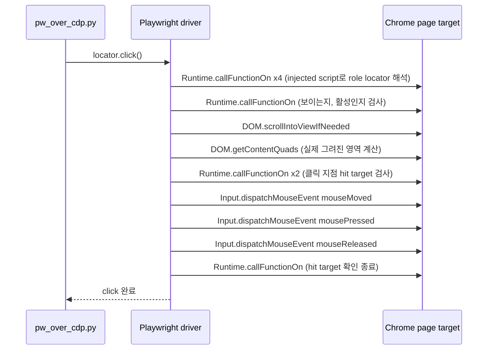

# 시나리오 3. Playwright와 CDP의 차이

## 시나리오 목표

| 항목 | 내용 |
|---|---|
| 기능 | 저수준 브라우저 프로토콜 위에서 안정적인 사용자 동작을 보장하는 자동화 계층 |
| 사용 도구 | Playwright for Python 1.55.0(`connect_over_cdp`), `DEBUG=pw:protocol` |
| 입력 | 시나리오 1과 동일한 Chrome(9222) 및 테스트 페이지 |
| 작업 | 1. Playwright로 동일 작업 실행, 2. Playwright가 전송한 CDP 명령 수집, 3. 단일 클릭의 CDP 명령 분해 |
| 달성 목표 | Playwright가 CDP의 대체재가 아니라 CDP 클라이언트이며, 클릭 한 번에 CDP 명령 10개 이상을 보내 대기·스크롤·가림 검사를 대신 수행함을 정량적으로 확인 |

## 프로토콜(CDP)과 자동화 라이브러리(Playwright)의 계층 차이

CDP와 Playwright는 동일한 추상화 계층에 위치하지 않습니다. CDP는 브라우저가 제공하는 저수준 통신 프로토콜이고, Playwright는 그 위에서 동작하는 자동화 라이브러리입니다. 네트워크 계층에 비유하면 CDP는 TCP 소켓이고, Playwright는 재시도와 타임아웃 로직이 내장된 HTTP 클라이언트에 가깝습니다. 따라서 "Playwright와 CDP 중 무엇을 선택할 것인가"는 엄밀히 "CDP를 직접 제어할 것인가, Playwright에 위임할 것인가"라는 질문입니다.

Playwright가 Chromium을 제어할 때 내부적으로 사용하는 프로토콜이 바로 CDP입니다. Firefox와 WebKit에는 Playwright가 자체 패치한 각 엔진 전용 프로토콜을 사용하며, 이 엔진별 차이를 단일 API(`page.click`, `locator`)로 추상화합니다. `connect_over_cdp`는 Playwright가 브라우저를 직접 실행하지 않고 이미 기동된 Chromium 인스턴스에 CDP로 연결하는 진입점입니다. AI 도구가 "Playwright로 브라우저를 조작한다"고 할 때도 대상이 Chromium이라면 결국 CDP 메시지가 전송됩니다.

다만 Playwright가 CDP의 모든 기능을 래핑하는 것은 아닙니다. 성능 trace 세부 옵션이나 특정 domain의 event 구독처럼 Playwright API에 노출되지 않은 기능은 `CDPSession`을 통해 raw CDP 명령을 직접 전송해야 합니다. `chrome-devtools-mcp`가 Playwright 대신 Puppeteer와 CDP를 직접 사용해 성능 및 네트워크 분석에 집중하는 이유가 여기에 있습니다.

### 핵심 용어 비교

동일한 용어가 두 계층에서 서로 다른 의미로 사용되므로 나란히 비교해 구분합니다.

| 용어 | CDP에서의 의미 | Playwright에서의 의미 | 이 실습의 예 |
|---|---|---|---|
| page | target의 한 종류(`type: "page"`) 또는 `Page` domain | 탭 하나를 제어하는 `Page` 객체 | `browser.contexts[0].pages[0]` |
| context | `Runtime`의 JavaScript 실행 컨텍스트(frame, isolated world) | 쿠키와 스토리지를 공유하는 `BrowserContext` | 실습 Chrome의 기본 프로필 컨텍스트 |
| session | target에 연결된 세션을 구분하는 `sessionId` | raw CDP를 전송하는 `CDPSession` 객체 | Playwright 로그의 `sessionId` 필드 |
| click | 별도 명령 없음. `Input.dispatchMouseEvent`를 직접 조합 | 대기·스크롤·가림 검사를 포함한 고수준 동작 | `get_by_role("button", name="카운트 증가").click()` |
| 요소 지정 | 좌표, `nodeId`, `objectId` | locator(역할, 텍스트, CSS)를 동작 시점에 재평가 | `get_by_role("button", ...)` |

## 고수준 자동화 계층(Actionability Check)이 필요한 이유

[시나리오 1](1-cdp-principle.md)의 `cdp_raw.py`는 `getBoundingClientRect()`로 버튼 좌표를 계산해 해당 위치를 클릭했습니다. 단순한 테스트 페이지에서는 문제가 없지만 실제 웹 서비스에서는 세 가지 실패 유형이 빈번하게 발생합니다. 버튼이 아직 렌더링되지 않았거나 비활성(`disabled`) 상태일 수 있고, 뷰포트 밖에 위치해 스크롤이 필요할 수 있으며, 쿠키 동의 배너 같은 다른 요소에 가려져 있을 수도 있습니다. CDP는 이러한 상태를 검증하지 않고 지정된 좌표에 입력만 주입하므로, 클릭 명령은 성공 응답을 반환하고도 실제 동작은 일어나지 않는 조용한 실패가 발생합니다.

Playwright의 actionability check는 클릭 직전에 요소가 DOM에 연결되어 있는지, 화면에 표시되는지, 애니메이션 없이 안정적인지, 활성화되어 있는지, 클릭 지점에서 실제로 포인터 이벤트를 수신하는지(hit target)를 검증하고 조건이 충족될 때까지 재시도합니다. 실습 3에서는 이러한 사전 검증 단계가 여러 개의 CDP 명령으로 분해되어 전송되는 과정을 확인합니다.

AI agent 설계에서도 이 차이는 중요합니다. 모델이 raw CDP 명령을 직접 선택하게 하면 대기와 재시도 판단까지 모델이 매 턴 수행해야 하므로 tool 호출 횟수와 토큰 소모가 급증합니다. Aside가 모델에 Playwright 형태의 API를 노출하는 것이나, AI 브라우저 tool이 `left_click` 인터페이스 내부에 이러한 검증 로직을 캡슐화하는 것도 같은 맥락입니다.

## 브라우저 자동화 도구 비교

| 기준 | raw CDP | Playwright | Puppeteer |
|---|---|---|---|
| 계층 | 프로토콜 | 라이브러리(CDP 및 엔진별 프로토콜 클라이언트) | 라이브러리(CDP 및 WebDriver BiDi 클라이언트) |
| 지원 브라우저 | Chromium 계열 | Chromium, Firefox, WebKit | Chrome, Firefox |
| 클릭 방식 | 좌표 입력만 수행 | 자동 대기, 스크롤, 가림 검사 포함 | 스크롤과 좌표 계산, 대기는 직접 구현 |
| 요소 지정 | 좌표, `nodeId` | 역할·텍스트 기반 locator | CSS·XPath selector 중심 |
| 사용 시점 | 라이브러리에 없는 domain 접근, 최소 오버헤드 필요 시 | 테스트 및 agent의 일반 브라우저 제어 | Chrome 전용 도구, `chrome-devtools-mcp` 등 분석 도구 |
| 이 실습의 명령 수 | 8개 | 연결 20~28개 + 작업 36개 | 측정하지 않음 |

## 컴포넌트 구성

| 컴포넌트 | 역할 |
|---|---|
| `playwright/pw_over_cdp.py` | 시나리오 1과 동일한 작업을 Playwright API로 수행 |
| Playwright driver(Node.js) | Python API 호출을 CDP 메시지로 변환하는 프로세스. `DEBUG=pw:protocol` 설정 시 송수신 로그를 stderr로 출력 |
| injected script | Playwright가 페이지에 주입하는 JavaScript. locator 해석 및 actionability check 실행 |
| Chrome(9222) | 시나리오 1과 동일한 CDP 서버 |

## 클릭 동작의 CDP 변환 흐름

아래 다이어그램은 `get_by_role(...).click()` 한 번이 CDP 명령 시퀀스로 변환되는 순서를 나타냅니다. 실습 3에서 수집한 실제 로그를 기준으로 구성했습니다.



## 실습

실습 환경은 [setup.md](setup.md)를 참고해 먼저 기동합니다. 시나리오 1을 마친 Chrome 인스턴스를 그대로 재사용해도 됩니다. 아래 명령은 모두 `computer_science/ai/cdp-browser-access` 디렉터리에서 실행합니다.

### 1. Playwright로 같은 작업 실행 및 CDP 로그 수집

`pw_over_cdp.py`는 Chrome을 새로 실행하지 않고 `connect_over_cdp("http://127.0.0.1:9222")`로 기존 탭에 연결해 이동, 역할 기반 클릭, 값 읽기, 접근성 스냅샷, 스크린샷 저장을 수행합니다. `DEBUG=pw:protocol` 환경 변수를 지정하면 driver가 송수신하는 CDP 메시지가 stderr로 출력되므로 `pw.err` 파일로 리다이렉션해 저장합니다.

```bash
DEBUG=pw:protocol uv run playwright/pw_over_cdp.py 2> pw.err
```

스크립트의 표준 출력 결과는 다음과 같습니다.

```text
count after click: 1
aria snapshot:
- heading "CDP 실습 페이지" [level=1]
- button "카운트 증가"
- paragraph: "count: 1"
screenshot: playwright-screenshot.png
```

실행 결과는 시나리오 1과 동일하지만, 코드에서 좌표를 직접 계산하지 않았다는 차이가 있습니다. 버튼을 `role=button`, 이름 `카운트 증가`로 지정했으며, `aria_snapshot()`은 시나리오 1에서 `Accessibility.getFullAXTree`로 받은 15개 노드를 사람이 읽기 쉬운 3줄의 트리 구조로 요약해 반환합니다. AI 브라우저 tool이 페이지 상태를 모델에 전달할 때 사용하는 형식도 이와 유사합니다.

### 2. Playwright가 보낸 CDP 명령 수 집계

동일한 작업을 완료하기 위해 전송된 CDP 명령 수를 집계합니다. `Page.navigate` 이전 명령은 Chrome 연결 및 초기화(setup) 단계이며, 그 이후가 실제 작업(task) 단계입니다.

```bash
grep -c "SEND ►" pw.err
grep "SEND ►" pw.err | grep -o '"method":"[A-Za-z.]*"' | cut -d'"' -f4 | awk '/Page.navigate/{p=1} {if(p) t++; else s++} END{print "setup:", s, "task:", t}'
```

전체 명령 수와 단계별 집계 결과는 다음과 같습니다.

```text
56
setup: 20 task: 36
```

작업 단계에서 전송된 명령은 36개로, raw CDP의 8개보다 4.5배 많습니다. 초기화 단계(`setup`)의 명령 수는 Chrome에 활성화된 target 수에 따라 달라집니다. Chrome을 기동한 직후 처음 실행할 때는 내장 확장 service worker들이 target으로 함께 잡혀 `Runtime.runIfWaitingForDebugger`가 추가로 전송되므로 초기화 명령이 28개(전체 64개)까지 늘어날 수 있지만, 작업 단계(`task`)는 동일하게 36개로 일정합니다.

### 3. 단일 클릭의 CDP 명령 분해

`Page.navigate` 이후 전송된 명령을 순서대로 출력해 `click()` 한 번이 어떤 CDP 시퀀스로 변환되는지 확인합니다.

```bash
grep "SEND ►" pw.err | grep -o '"method":"[A-Za-z.]*"' | cut -d'"' -f4 | sed -n '/Page.navigate/,$p' | head -18 | nl
```

추출된 상위 18개 명령은 다음과 같습니다.

```text
     1 Page.navigate
     2 Runtime.evaluate
     3 Runtime.evaluate
     4 Runtime.callFunctionOn
     5 Runtime.callFunctionOn
     6 Runtime.callFunctionOn
     7 Runtime.callFunctionOn
     8 Runtime.releaseObject
     9 Runtime.callFunctionOn
    10 DOM.scrollIntoViewIfNeeded
    11 DOM.getContentQuads
    12 Runtime.callFunctionOn
    13 Runtime.callFunctionOn
    14 Input.dispatchMouseEvent
    15 Input.dispatchMouseEvent
    16 Input.dispatchMouseEvent
    17 Runtime.callFunctionOn
    18 Runtime.releaseObject
```

4~17번 명령이 단일 `click()` 호출에 해당합니다. `Runtime.callFunctionOn`은 Playwright가 페이지에 주입한 스크립트 함수를 호출하는 명령으로, 앞선 호출들은 `injected.querySelectorAll(...)`을 통해 role locator를 해석하고 대상 요소를 찾습니다. 이어서 `DOM.scrollIntoViewIfNeeded`로 요소를 뷰포트 안으로 스크롤하고, `DOM.getContentQuads`로 실제 렌더링된 영역을 계산해 클릭 좌표를 확정합니다. 12~13번은 해당 좌표에서 포인터 이벤트를 받을 요소가 실제 버튼인지 확인하는 hit target 검사이며, 이를 통과한 뒤에야 마우스 이벤트가 전송됩니다.

마우스 이벤트 역시 raw CDP에서는 누름(`mousePressed`)과 뗌(`mouseReleased`) 2개만 전송했지만, Playwright는 `mouseMoved`를 먼저 전송해 hover 상태까지 재현합니다. `Input.dispatchMouseEvent`의 `type` 필드만 추출해 확인합니다.

```bash
grep "SEND ►" pw.err | grep dispatchMouseEvent | grep -o '"type":"[a-zA-Z]*"'
```

추출 결과 세 가지 마우스 이벤트가 순서대로 전송된 것을 확인할 수 있습니다.

```text
"type":"mouseMoved"
"type":"mousePressed"
"type":"mouseReleased"
```

## 부록. 실무 시사점

- **Playwright와 CDP는 양자택일이 아니라 계층 관계입니다.** Chromium 환경에서 Playwright를 사용하면 내부적으로 CDP를 사용하게 됩니다. 따라서 Chrome 136의 디버깅 포트 제한, 디버거 안내 표시줄, `debugger` 권한 등 CDP의 보안 제약이 Playwright 기반 agent에도 그대로 적용됩니다.
- **명령 수의 차이는 곧 안정성을 위한 비용입니다.** 36개와 8개의 차이는 대부분 locator 해석과 actionability check에서 발생합니다. 로컬 CDP 환경에서는 왕복 지연이 1ms 수준이라 체감하기 어렵지만, 원격 브라우저(클라우드 브라우저, 다른 리전의 Chrome)에 `connect_over_cdp`로 연결하면 `왕복 지연 × 명령 수`만큼 클릭당 지연 시간이 누적됩니다. 원격 브라우저 서비스들이 Playwright 자체 프로토콜(`connect`)을 별도로 지원하는 이유입니다.
- **raw CDP가 필요한 영역은 명확합니다.** Playwright API가 지원하지 않는 domain(성능 trace, heap snapshot, 특정 event 구독)이 필요하거나, 모델에 최소한의 tool 집합만 노출해 명령을 직접 통제하려는 경우가 이에 해당합니다. 일반적인 브라우저 제어는 Playwright에 위임하고, 특수한 저수준 제어가 필요한 시점에만 `page.context.new_cdp_session(page)`로 내려가는 하이브리드 구성이 실무에서 널리 쓰입니다.
- **`connect_over_cdp`는 Playwright 기능의 일부를 제한합니다.** Playwright가 직접 실행한 브라우저와 달리 기존 브라우저의 컨텍스트 설정을 변경할 수 없으며, Playwright 공식 문서에서도 자체 프로토콜 대비 충실도가 낮다고 명시합니다. 이 실습처럼 이미 열린 탭에 붙어 상태를 관찰하거나 재사용하는 용도에 적합합니다.

## 참고 문서

1. [BrowserType.connectOverCDP (Playwright Docs)](https://playwright.dev/docs/api/class-browsertype#browser-type-connect-over-cdp)
2. [Actionability (Playwright Docs)](https://playwright.dev/docs/actionability)
3. [CDPSession (Playwright Docs)](https://playwright.dev/docs/api/class-cdpsession)
4. [chrome-devtools-mcp (GitHub)](https://github.com/ChromeDevTools/chrome-devtools-mcp)
5. [CDP vs Playwright vs Puppeteer: Is This the Wrong Question? (Lightpanda)](https://lightpanda.io/blog/posts/cdp-vs-playwright-vs-puppeteer-is-this-the-wrong-question)
