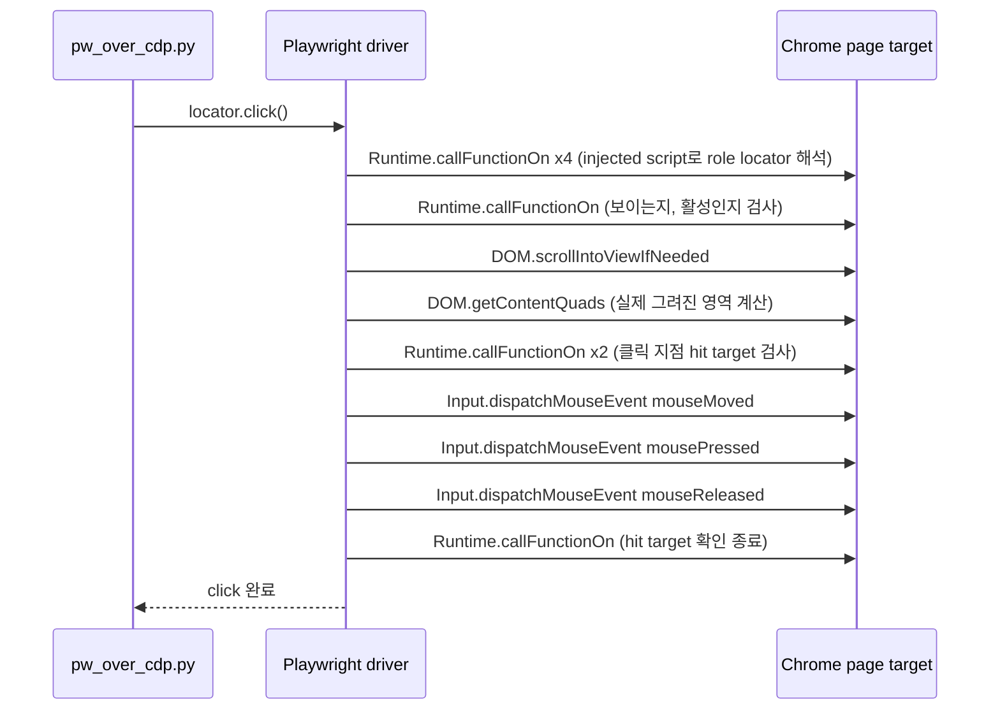

# 시나리오 3. Playwright와 CDP의 차이

## 이 시나리오의 목표

| 항목 | 내용 |
|---|---|
| 기능 | 저수준 브라우저 프로토콜 위에서 "안정적인 사용자 동작"을 만들어 주는 자동화 계층 |
| 쓰는 도구 | Playwright for Python 1.55.0(`connect_over_cdp`), `DEBUG=pw:protocol` |
| 입력 | 시나리오 1과 같은 Chrome(9222)과 같은 테스트 페이지 |
| 작업 | 1. Playwright로 같은 작업 실행, 2. Playwright가 보낸 CDP 명령 수집, 3. 클릭 한 번의 CDP 분해 |
| 달성할 것 | Playwright는 CDP의 대체재가 아니라 CDP 클라이언트이며, 클릭 한 번에 CDP 명령 10개 이상을 보내 대기·스크롤·가림 검사를 대신한다는 것을 숫자로 확인 |

## 이 기능이 무엇인가

CDP와 Playwright는 같은 층에 있지 않습니다. CDP는 브라우저가 제공하는 저수준 프로토콜이고, Playwright는 그 위에서 동작하는 라이브러리입니다. 네트워크에 빗대면 CDP는 TCP 소켓이고 Playwright는 재시도와 타임아웃이 들어 있는 HTTP 클라이언트에 가깝습니다. 그래서 "Playwright를 쓸까, CDP를 쓸까"는 엄밀히 "CDP를 직접 다룰까, Playwright에게 맡길까"라는 질문입니다.

Playwright가 Chromium을 다룰 때 내부에서 쓰는 프로토콜이 CDP입니다. Firefox와 WebKit에는 Playwright가 패치한 각 엔진 전용 프로토콜을 쓰고, 그 차이를 하나의 API(`page.click`, `locator`)로 덮습니다. `connect_over_cdp`는 Playwright가 직접 띄운 브라우저가 아니라 이미 떠 있는 Chromium에 CDP로 붙는 진입점입니다. AI 도구가 "Playwright로 브라우저를 조작한다"고 할 때도 Chromium이면 결국 CDP 메시지가 나갑니다.

오해하기 쉬운 경계는 Playwright가 CDP의 모든 기능을 감싸지는 않는다는 점입니다. 성능 trace 세부, 특정 domain의 event 구독처럼 Playwright API에 없는 기능은 `CDPSession`으로 raw CDP를 직접 보내야 합니다. chrome-devtools-mcp가 Playwright 대신 Puppeteer와 CDP를 직접 쓰고 성능·네트워크 분석에 집중하는 이유가 여기에 있습니다.

### 용어

같은 단어가 두 계층에서 다른 뜻으로 쓰이므로 나란히 놓고 구분합니다.

| 용어 | CDP에서의 뜻 | Playwright에서의 뜻 | 이 실습의 예 |
|---|---|---|---|
| page | target의 한 종류(`type: "page"`) 또는 `Page` domain | 탭 하나를 다루는 `Page` 객체 | `browser.contexts[0].pages[0]` |
| context | `Runtime`의 JavaScript 실행 컨텍스트(frame, isolated world) | 쿠키와 저장소를 공유하는 `BrowserContext` | 실습 Chrome의 기본 프로필 컨텍스트 |
| session | target에 붙은 연결을 구분하는 `sessionId` | raw CDP를 보내는 `CDPSession` 객체 | Playwright 로그의 `sessionId` 필드 |
| click | 명령이 없음. `Input.dispatchMouseEvent`를 직접 조합 | 대기·스크롤·가림 검사를 포함한 고수준 동작 | `get_by_role("button", name="카운트 증가").click()` |
| 요소 지정 | 좌표, `nodeId`, `objectId` | locator(역할, 텍스트, CSS)를 동작 시점에 다시 해석 | `get_by_role("button", ...)` |

## 이 기능을 시스템이 제공해야 하는 이유

[시나리오 1](1-cdp-principle.md)의 `cdp_raw.py`는 버튼 좌표를 `getBoundingClientRect()`로 계산해 그 위치를 눌렀습니다. 테스트 페이지에서는 문제가 없지만 실제 사이트에서는 세 가지가 자주 깨집니다. 버튼이 아직 렌더링되지 않았거나 비활성 상태일 수 있고, 화면 밖에 있어 스크롤이 필요할 수 있으며, 쿠키 동의 배너 같은 다른 요소에 가려져 있을 수 있습니다. CDP는 이 중 어느 것도 검사하지 않고 좌표에 입력만 넣으므로, 클릭 명령은 성공 응답을 받는데 아무 일도 일어나지 않는 실패가 생깁니다.

Playwright의 actionability check는 클릭 직전에 요소가 붙어 있는지, 보이는지, 안정적인지(애니메이션 중이 아닌지), 활성화되어 있는지, 클릭 지점에서 이벤트를 실제로 받는지를 확인하고, 조건을 만족할 때까지 재시도합니다. 실습 3에서 이 검사들이 CDP 명령 여러 개로 나뉘어 나가는 것을 직접 확인합니다.

AI agent에게도 이 차이는 중요합니다. 모델이 raw CDP 명령을 고르게 하면 대기와 재시도 판단까지 모델이 매번 해야 하고, 그만큼 tool 호출과 토큰이 늘어납니다. Aside가 모델에게 Playwright 모양의 API를 노출하는 것도, 브라우저 tool이 `left_click` 하나 안에 이런 처리를 숨기는 것도 같은 이유입니다.

## 대안 비교

| 기준 | raw CDP | Playwright | Puppeteer |
|---|---|---|---|
| 계층 | 프로토콜 | 라이브러리(CDP 및 엔진별 프로토콜 클라이언트) | 라이브러리(CDP 및 WebDriver BiDi 클라이언트) |
| 지원 브라우저 | Chromium 계열 | Chromium, Firefox, WebKit | Chrome, Firefox |
| 클릭 | 좌표 입력만 | 자동 대기, 스크롤, 가림 검사 | 스크롤과 좌표 계산, 대기는 직접 |
| 요소 지정 | 좌표, nodeId | 역할·텍스트 기반 locator | CSS·XPath selector 중심 |
| 쓰는 시점 | 라이브러리에 없는 domain, 최소 오버헤드가 필요할 때 | 테스트와 agent의 일반 조작 | Chrome 전용 도구, chrome-devtools-mcp 같은 분석 도구 |
| 이 실습의 명령 수 | 8개 | 연결 20~28개 + 작업 36개 | 측정하지 않음 |

## 컴포넌트 역할

| 컴포넌트 | 역할 |
|---|---|
| `playwright/pw_over_cdp.py` | 시나리오 1과 같은 작업을 Playwright API로 수행 |
| Playwright driver(Node.js) | Python API 호출을 CDP 메시지로 바꾸는 프로세스. `DEBUG=pw:protocol`로 송수신을 stderr에 출력 |
| injected script | Playwright가 페이지에 주입하는 JavaScript. locator 해석과 actionability check 실행 |
| Chrome(9222) | 시나리오 1과 같은 CDP 서버 |

## 흐름

아래 다이어그램은 `get_by_role(...).click()` 한 번이 CDP 명령으로 펼쳐지는 순서입니다. 실습 3의 실제 로그를 묶어 그렸습니다.



## 실습

실습 환경은 [setup.md](setup.md)로 먼저 띄웁니다. 시나리오 1을 끝낸 Chrome을 그대로 써도 됩니다. 아래 명령은 모두 `computer_science/ai/cdp-browser-access`에서 실행합니다.

### 1. Playwright로 같은 작업 실행 및 CDP 로그 수집

`pw_over_cdp.py`는 Chrome을 새로 띄우지 않고 `connect_over_cdp("http://127.0.0.1:9222")`로 기존 탭에 붙어 이동, 역할 기반 클릭, 값 읽기, 접근성 스냅샷, 스크린샷을 수행합니다. `DEBUG=pw:protocol`을 주면 driver가 보내고 받는 CDP 메시지를 stderr로 출력하므로 `pw.err`에 따로 저장합니다.

```bash
DEBUG=pw:protocol uv run playwright/pw_over_cdp.py 2> pw.err
```

```text
count after click: 1
aria snapshot:
- heading "CDP 실습 페이지" [level=1]
- button "카운트 증가"
- paragraph: "count: 1"
screenshot: playwright-screenshot.png
```

결과는 시나리오 1과 같습니다. 차이는 코드에서 좌표를 계산하지 않았다는 점입니다. 버튼을 `role=button`, 이름 `카운트 증가`로 지정했고, aria snapshot은 시나리오 1에서 `Accessibility.getFullAXTree`로 받은 15개 노드를 사람이 읽을 수 있는 3줄로 정리해 줍니다. AI 브라우저 tool이 페이지를 모델에 넘길 때 쓰는 형식도 이와 비슷합니다.

### 2. Playwright가 보낸 CDP 명령 수 집계

같은 작업에 CDP 명령이 몇 개 나갔는지 셉니다. `Page.navigate` 앞의 명령은 Chrome에 붙는 연결 준비이고, 그 뒤가 실제 작업입니다.

```bash
grep -c "SEND ►" pw.err
grep "SEND ►" pw.err | grep -o '"method":"[A-Za-z.]*"' | cut -d'"' -f4 | awk '/Page.navigate/{p=1} {if(p) t++; else s++} END{print "setup:", s, "task:", t}'
```

```text
56
setup: 20 task: 36
```

작업 부분은 36개로, raw CDP의 8개보다 4.5배 많습니다. 연결 준비 명령 수는 Chrome에 살아 있는 target 수에 따라 달라집니다. 검증 중 Chrome을 띄운 직후 처음 실행했을 때는 내장 확장 service worker들이 target으로 함께 잡혀 `Runtime.runIfWaitingForDebugger`가 더 나갔고 연결 준비가 28개(전체 64개)였습니다. 작업 부분은 두 번 모두 36개였습니다.

### 3. 클릭 한 번의 CDP 분해

`Page.navigate` 뒤의 명령을 순서대로 출력해 `click()` 한 번이 무엇으로 펼쳐지는지 봅니다.

```bash
grep "SEND ►" pw.err | grep -o '"method":"[A-Za-z.]*"' | cut -d'"' -f4 | sed -n '/Page.navigate/,$p' | head -18 | nl
```

```text
     1 Page.navigate
     2 Runtime.evaluate
     3 Runtime.evaluate
     4 Runtime.callFunctionOn
     5 Runtime.callFunctionOn
     6 Runtime.callFunctionOn
     7 Runtime.callFunctionOn
     8 Runtime.releaseObject
     9 Runtime.callFunctionOn
    10 DOM.scrollIntoViewIfNeeded
    11 DOM.getContentQuads
    12 Runtime.callFunctionOn
    13 Runtime.callFunctionOn
    14 Input.dispatchMouseEvent
    15 Input.dispatchMouseEvent
    16 Input.dispatchMouseEvent
    17 Runtime.callFunctionOn
    18 Runtime.releaseObject
```

4~17번이 클릭 한 번입니다. `Runtime.callFunctionOn`은 Playwright가 페이지에 주입한 스크립트의 함수를 호출하는 명령인데, 앞쪽 호출들의 인자를 보면 `injected.querySelectorAll(...)`로 role locator를 해석하고 결과 요소를 꺼냅니다. 이어서 `DOM.scrollIntoViewIfNeeded`로 화면 안에 들이고, `DOM.getContentQuads`로 실제로 그려진 영역을 받아 클릭 좌표를 정합니다. 12~13번은 그 좌표에서 이벤트를 받을 요소가 정말 이 버튼인지 확인하는 hit target 검사이고, 그 뒤에야 마우스 이벤트가 나갑니다. 마우스 이벤트도 raw CDP에서는 누름과 뗌 2개였지만 Playwright는 `mouseMoved`를 먼저 보내 hover 상태까지 재현합니다.

```bash
grep "SEND ►" pw.err | grep dispatchMouseEvent | grep -o '"type":"[a-zA-Z]*"'
```

```text
"type":"mouseMoved"
"type":"mousePressed"
"type":"mouseReleased"
```

## 부록. 실무에서 얻는 것

- **Playwright와 CDP는 선택지가 아니라 계층입니다.** Chromium에서 Playwright를 쓰면 CDP를 쓰는 것입니다. 그래서 Chrome 136의 디버깅 포트 제한, 디버거 안내 표시줄, `debugger` 권한 같은 CDP의 보안 특성이 Playwright 기반 agent에도 그대로 적용됩니다.
- **명령 수의 차이는 안정성 비용입니다.** 36개와 8개의 차이는 대부분 locator 해석과 actionability check입니다. 로컬 CDP에서는 왕복이 1ms 수준이라 체감이 없지만, 원격 브라우저(클라우드 브라우저, 다른 리전의 Chrome)에 `connect_over_cdp`로 붙으면 왕복 지연 × 명령 수가 클릭 하나의 지연이 됩니다. 원격 브라우저 서비스가 Playwright 자체 프로토콜(`connect`)을 따로 지원하는 이유입니다.
- **raw CDP가 필요한 때는 분명합니다.** Playwright API에 없는 domain(성능 trace, heap snapshot, 특정 event 구독)이 필요하거나, 모델에게 아주 작은 tool 집합만 노출해 명령을 직접 통제하려는 경우입니다. 그 외의 일반 조작은 Playwright에 맡기고, 필요한 순간에만 `page.context.new_cdp_session(page)`로 내려가는 구성이 흔한 절충입니다.
- **`connect_over_cdp`는 Playwright 기능을 일부 잃습니다.** Playwright가 직접 띄운 브라우저와 달리 기존 브라우저의 컨텍스트 설정을 바꿀 수 없고, Playwright 공식 문서도 자체 프로토콜보다 충실도가 낮다고 설명합니다. 이 실습처럼 기존 탭을 재사용하는 관찰 용도에 적합합니다.

## 참고 문서

1. [BrowserType.connectOverCDP (Playwright Docs)](https://playwright.dev/docs/api/class-browsertype#browser-type-connect-over-cdp)
2. [Actionability (Playwright Docs)](https://playwright.dev/docs/actionability)
3. [CDPSession (Playwright Docs)](https://playwright.dev/docs/api/class-cdpsession)
4. [chrome-devtools-mcp (GitHub)](https://github.com/ChromeDevTools/chrome-devtools-mcp)
5. [CDP vs Playwright vs Puppeteer: Is This the Wrong Question? (Lightpanda)](https://lightpanda.io/blog/posts/cdp-vs-playwright-vs-puppeteer-is-this-the-wrong-question)
