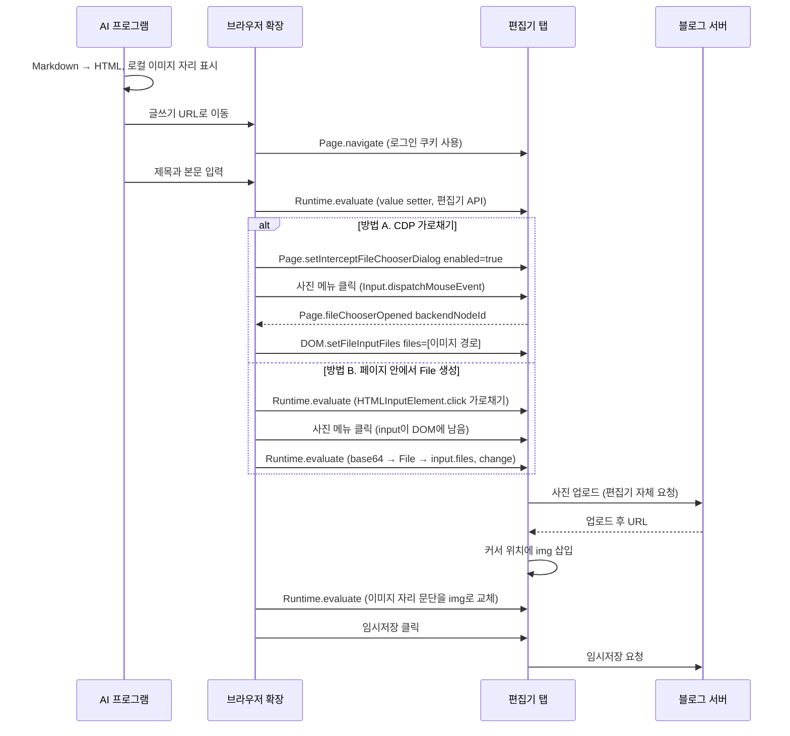

# 시나리오 4. CDP로 블로그 글과 사진을 업로드하는 원리 (이론)

> 이 시나리오는 실습하지 않은 설계 검토입니다. 시나리오 1~3에서 확인한 CDP 동작과 설치된 확장 파일에서 확인한 사실을 근거로 "이렇게 하면 될 것이다"를 정리했습니다. 블로그 편집기 내부 구조에 대한 서술은 작성 시점의 추정이며, 확인한 것과 추정한 것을 문장마다 구분해 적었습니다.

## 이 시나리오의 목표

| 항목 | 내용 |
|---|---|
| 기능 | 로그인된 브라우저 세션으로 블로그 편집기에 제목·본문·사진을 넣고 임시저장하는 기능 |
| 쓰는 도구 | CDP(`Page.setInterceptFileChooserDialog`, `DOM.setFileInputFiles`, `Runtime.evaluate`, `Input.dispatchDragEvent`), AI 브라우저 확장 |
| 입력 | 로컬 Markdown 파일 한 개와 그 파일이 참조하는 로컬 이미지, 개인 블로그(네이버 블로그, 티스토리, 워드프레스 중 하나)의 글쓰기 화면 |
| 작업 | 1. Markdown → HTML 변환, 2. 제목 입력, 3. 본문 입력, 4. 사진 업로드, 5. 이미지 자리 교체, 6. 임시저장 |
| 달성할 것 | 사진 업로드가 왜 클릭 한 번으로 끝나지 않는지, CDP로 OS 파일 선택창을 우회하는 세 가지 방법이 각각 무엇을 대가로 치르는지 설명할 수 있음 |

## 이 기능이 무엇인가

사람이 블로그에 글을 올릴 때는 글쓰기 화면을 열고, 제목을 치고, 본문을 붙여 넣고, 사진 버튼을 눌러 파일 선택창에서 이미지를 고른 뒤 임시저장을 누릅니다. 이 시나리오는 그 과정을 AI 브라우저 tool이 대신하는 구조를 다룹니다. 시나리오 2에서 본 Claude in Chrome이나 Codex의 Chrome 연동처럼 사용자가 이미 로그인해 둔 Chrome을 조작하므로, 블로그 비밀번호나 API 키를 AI 프로그램에 넘기지 않아도 됩니다.

여기서 다루는 것은 "편집기에 내용을 넣는 경로"입니다. Markdown을 블로그 스타일에 맞게 다듬는 글쓰기 규칙이나 검색 노출 최적화는 다루지 않습니다. 또한 공개 발행은 범위 밖입니다. AI가 누르는 버튼은 임시저장까지로 한정하고, 발행은 사람이 결과를 확인한 뒤 직접 누른다고 가정합니다. 이 경계를 두는 이유는 부록에서 설명합니다.

텍스트 입력과 사진 입력은 난이도가 크게 다릅니다. 텍스트는 페이지 안의 JavaScript로 편집기에 넣으면 끝나지만, 사진 버튼은 브라우저 밖의 OS 파일 선택창을 띄웁니다. 이 창은 DOM이 아니므로 `Input.dispatchMouseEvent`로 클릭할 수 없고, 접근성 트리에도 나타나지 않습니다. 이 시나리오의 중심은 이 OS 창을 띄우지 않고 파일을 편집기에 전달하는 방법입니다.

### 용어

| 용어 | 뜻 | 이 시나리오의 예 |
|---|---|---|
| file chooser | `<input type="file">`의 `click()`이 띄우는 OS 파일 선택창. 페이지 밖에 그려진다 | 편집기 툴바 **사진** 메뉴를 누르면 뜨는 창 |
| file chooser 가로채기 | Chrome이 OS 창 대신 CDP event로 "파일 선택 요청이 왔다"를 알려 주게 하는 모드 | `Page.setInterceptFileChooserDialog` → `Page.fileChooserOpened` |
| `DOM.setFileInputFiles` | 파일 경로 목록을 file input에 직접 넣는 CDP 명령. 브라우저 프로세스가 그 경로를 읽는다 | `{"files": ["<이미지 경로>"], "backendNodeId": 42}` |
| `DataTransfer` | 드래그·붙여넣기에서 파일과 데이터를 담는 웹 API 객체. JavaScript로 만들어 `input.files`에 넣을 수 있다 | `new DataTransfer()`에 `new File([bytes], "a.png")` 추가 |
| 제어 컴포넌트 입력창 | React 같은 프레임워크가 값을 자기 상태로 관리하는 입력창. DOM의 `value`만 바꾸면 프레임워크가 모른다 | 제목 textarea |
| 업로드 후 URL | 편집기가 사진을 블로그 서버(CDN)에 올린 뒤 본문에 넣는 이미지 주소 | `/...">` |

## 이 기능을 시스템이 제공해야 하는 이유

개인 블로그에 글을 자주 쓰는 사람은 로컬 Markdown(Obsidian 등)으로 초안을 쓰고 블로그 편집기로 옮기는 단계에서 시간을 씁니다. 표와 코드블록 서식이 깨지고, 사진은 한 장씩 다시 올려야 하며, Markdown의 이미지 자리마다 업로드한 사진을 다시 끼워 넣어야 합니다. 이 반복을 자동화하려면 보통 블로그의 공식 API를 쓰는데, 블로그 서비스마다 사정이 다릅니다.

| 블로그 | 글쓰기 공식 API | 브라우저 자동화가 필요한 정도 |
|---|---|---|
| 워드프레스(자체 설치) | REST API(`/wp-json/wp/v2/posts`, `/wp-json/wp/v2/media`)와 Application Password로 초안 작성과 사진 업로드 가능 | 낮음. API가 더 안정적이다 |
| 티스토리 | 공개 Open API는 서비스가 종료되어 신규 사용이 어렵다고 알려져 있음(이 문서에서는 공지 원문을 확인하지 않음) | 높음 |
| 네이버 블로그 | 개인이 글쓰기에 쓸 수 있는 공개 API를 기대하기 어렵다고 가정 | 높음 |

API가 없는 블로그에서 쓸 수 있는 통로는 사람이 쓰는 글쓰기 화면뿐입니다. 이때 CDP 기반 AI 브라우저 tool은 이미 로그인된 세션 위에서 화면을 조작하므로 별도 인증 정보 없이 동작합니다. 반대로 워드프레스처럼 공식 API가 있으면 화면 자동화보다 API가 낫습니다. 편집기 화면은 예고 없이 바뀌지만 API는 버전과 호환성을 약속하기 때문입니다.

## 대안 비교

사진 한 장을 file input까지 전달하는 방법은 세 가지로 나뉩니다. 아래 근거 칸의 확장 코드 확인은 시나리오 2의 작업 2와 같은 방식(`grep`)으로 설치된 확장 번들을 읽은 결과입니다.

| 방법 | 동작 | 파일 출처 | 장점 | 대가 | 쓰는 곳 |
|---|---|---|---|---|---|
| A. CDP 가로채기 + `DOM.setFileInputFiles` | `Page.setInterceptFileChooserDialog`로 OS 창 대신 `Page.fileChooserOpened` event를 받고, event의 `backendNodeId`에 파일 경로를 넣는다 | 브라우저가 실행 중인 장비의 파일 경로 | 페이지 코드를 건드리지 않음. 편집기가 input을 동적으로 만들어도 event로 잡힘. 브라우저가 실제 사용자 선택과 같은 방식으로 파일을 넣음 | AI 프로그램과 브라우저가 다른 장비면 경로가 의미 없음 | Codex Chrome 확장(`DOM.setFileInputFiles` 3회, `Page.setInterceptFileChooserDialog` 4회 등장), Playwright `page.expect_file_chooser()`. Claude desktop `app.asar`에는 가로채기 명령만 있고 `DOM.setFileInputFiles` 문자열은 없어 파일을 넣는 단계는 확인하지 못함 |
| B. 페이지 안에서 `File` 생성 | 파일 바이트를 base64로 페이지에 보내고, JavaScript로 `File`과 `DataTransfer`를 만들어 `input.files`에 대입한 뒤 `change` event를 발생시킨다 | 바이트 자체(어느 장비의 파일이든 됨) | 파일 경로가 필요 없어 원격 브라우저에도 동작 | base64로 크기가 약 33% 늘어 큰 파일에 불리. input이 DOM에 있어야 하므로 동적 input은 미리 붙잡아 둬야 함. 프로그램이 만든 event라 `isTrusted`가 `false` | Claude in Chrome 확장의 `file_upload` tool(번들에서 `new DataTransfer`, `input.files = ...` 확인. `DOM.setFileInputFiles` 문자열은 없음) |
| C. 드래그 앤 드롭 흉내 | 편집기 본문 위치에 `drop` event를 보낸다. CDP `Input.dispatchDragEvent`(파일 경로)나 페이지 JavaScript `DragEvent`(바이트) 중 하나 | 경로 또는 바이트 | 사진 메뉴를 열 필요가 없음 | 편집기가 drop을 지원해야 함. 놓는 좌표가 곧 삽입 위치라 위치 제어가 어려움 | Claude in Chrome의 `upload_image` tool(번들에서 `DragEvent("dragenter")` 확인), Codex 확장(`Input.dispatchDragEvent` 등장) |

이 밖에 페이지 안에서 `fetch`로 블로그의 내부 업로드 주소를 직접 호출하는 방법도 이론상 가능합니다. 쿠키가 자동으로 붙어 인증은 통과하지만, 공개되지 않은 내부 주소와 요청 형식에 의존하므로 편집기가 바뀌면 조용히 깨집니다. 화면 조작이 실패하면 눈에 보이지만 내부 API 호출은 잘못된 데이터를 성공 응답과 함께 남길 수 있어서 이 시나리오에서는 고르지 않습니다.

방법 A가 원리상 가장 깨끗합니다. 사용자가 OS 창에서 파일을 고르는 동작과 브라우저 내부에서 같은 일이 일어나기 때문입니다. 그런데도 Claude in Chrome이 B를 쓰는 이유는 확장의 구조에서 짐작할 수 있습니다. Claude CLI가 다른 장비나 컨테이너에서 실행되어도 확장은 사용자의 Chrome 안에서 돌기 때문에, 파일 경로보다 바이트를 넘기는 방식이 어디서든 통합니다. 이 판단은 확장 코드에서 추정한 것이며 제품 문서로 확인하지 않았습니다.

## 컴포넌트 역할

| 컴포넌트 | 역할 |
|---|---|
| Markdown 변환기(pandoc 등) | Markdown을 편집기가 받아들이는 HTML로 바꾸고 로컬 이미지 자리를 표시한다 |
| AI 프로그램(Claude CLI, Codex) | 변환 결과와 이미지 목록을 들고 브라우저 tool을 순서대로 호출한다 |
| 브라우저 확장(`chrome.debugger`) | tool 호출을 CDP 명령이나 페이지 JavaScript로 바꿔 탭에 보낸다 |
| 블로그 편집기 | 본문 데이터 모델을 갖고, 사진을 받으면 블로그 서버에 올려 업로드 후 URL로 본문에 넣는다 |
| 블로그 서버 | 사진을 저장하고 CDN 주소를 돌려준다. 임시저장 글을 보관한다 |

### 블로그별 편집기 가정

본문을 넣는 방법은 편집기마다 다릅니다. 아래 표는 작성 시점의 공개된 정보와 일반적인 구조에서 추정한 것이며 실제 화면에서 확인하지 않았습니다.

| 블로그 | 편집기 구조(추정) | 본문 넣기(추정) | 주의할 점 |
|---|---|---|---|
| 티스토리 | TinyMCE 기반 | `tinymce.activeEditor.setContent(html)` 후 `change` event | 편집기가 일부 태그와 속성을 정리하므로 넣은 뒤 블록 수를 다시 센다 |
| 네이버 블로그 | 자체 편집기(SmartEditor ONE). DOM이 아니라 내부 문서 모델이 원본 | DOM을 직접 고치면 저장 시 반영되지 않을 가능성이 큼. 붙여넣기 event(`text/html`이 담긴 `ClipboardEvent`)나 `Input.insertText`로 사용자가 입력한 것처럼 넣는다 | 글쓰기 화면이 iframe 안에 있을 수 있어 CDP 명령을 보낼 frame(실행 컨텍스트)을 먼저 찾는다 |
| 워드프레스 | 블록 편집기(Gutenberg) | `wp.blocks.rawHandler({ HTML })`로 블록을 만들어 `wp.data.dispatch('core/block-editor').resetBlocks(...)` | 같은 일을 REST API로 할 수 있으면 화면 자동화를 쓸 이유가 적다 |

세 편집기 모두 제목 입력창은 프레임워크가 관리할 가능성이 큽니다. `input.value = "제목"`만 하면 화면에는 보이지만 프레임워크 상태는 비어 있어 저장 시 제목이 빠집니다. 그래서 `HTMLTextAreaElement.prototype`의 원래 `value` setter로 값을 넣고 `input` event를 발생시켜 프레임워크가 변경을 알아채게 합니다.

## 흐름

아래 다이어그램은 로컬 이미지 한 장이 들어 있는 Markdown을 편집기에 넣고 임시저장하기까지의 순서이며, 사진 업로드 구간은 방법 A와 B를 나란히 놓았습니다.



## 이론상 절차

이 절은 실행하지 않은 절차이므로 출력이 없습니다. 각 단계는 시나리오 1의 `cdp-raw/cdp_raw.py`처럼 raw CDP로 보낼 메시지를 기준으로 적었고, AI 브라우저 tool을 쓰면 tool이 같은 메시지를 대신 만듭니다. 블로그 주소와 파일 경로는 `<내 블로그>`, `<이미지 경로>`로 표시합니다.

### 1. Markdown을 HTML로 변환하고 로컬 이미지 목록 추출

편집기는 Markdown을 직접 받지 않으므로 HTML로 바꿉니다. frontmatter는 본문이 아니므로 떼고, 원격 URL 이미지는 블로그가 그대로 보여 줄 수 있어 업로드 대상에서 뺍니다. 업로드할 것은 `http`로 시작하지 않는 이미지 경로뿐입니다. 아래 명령은 `post.md`를 `post.html`로 바꾸고 업로드할 로컬 이미지 경로를 출력합니다.

```bash
awk 'NR==1&&/^---/{f=1;next} f&&/^---/{f=0;next} !f' post.md | pandoc -f gfm -t html --wrap=none -o post.html
grep -oE '/<글쓰기 경로>"}}
```

### 3. 제목과 본문을 편집기 API로 입력

제목은 원래 `value` setter와 `input` event로, 본문은 편집기의 공개 API로 넣습니다. 아래는 TinyMCE 기반 편집기를 가정한 `Runtime.evaluate` 식입니다. 마지막 줄이 넣은 결과를 숫자로 돌려주므로 원본 HTML의 제목·표 수와 비교합니다.

```javascript
const t = document.querySelector('<제목 입력창 선택자>');
Object.getOwnPropertyDescriptor(HTMLTextAreaElement.prototype, 'value').set.call(t, TITLE);
t.dispatchEvent(new Event('input', { bubbles: true }));
const ed = tinymce.activeEditor;
ed.setContent(HTML);
ed.fire('change');
({ title: t.value, h2: ed.getBody().querySelectorAll('h2').length, tables: ed.getBody().querySelectorAll('table').length });
```

### 4-A. 사진 업로드: CDP 가로채기 방식

먼저 가로채기 모드를 켭니다. 이 상태에서 사진 메뉴를 누르면 Chrome은 OS 파일 선택창을 띄우지 않고 `Page.fileChooserOpened` event를 보냅니다.

```json
{"id": 10, "method": "Page.setInterceptFileChooserDialog", "params": {"enabled": true}}
```

사진 메뉴를 `Input.dispatchMouseEvent`로 누르면 아래 event가 옵니다. `backendNodeId`가 편집기가 방금 만든 file input이고, `mode`가 `selectMultiple`이면 여러 장을 한 번에 넣을 수 있습니다.

```json
{"method": "Page.fileChooserOpened", "params": {"frameId": "<frame id>", "mode": "selectMultiple", "backendNodeId": 42}}
```

받은 `backendNodeId`에 파일 경로를 넣으면 브라우저가 파일을 읽어 input의 `change` event를 발생시키고, 편집기는 사람이 고른 것과 똑같이 업로드를 시작합니다. 경로는 브라우저 프로세스 기준이므로 AI 프로그램과 브라우저가 같은 장비여야 합니다.

```json
{"id": 11, "method": "DOM.setFileInputFiles", "params": {"files": ["<이미지 경로>"], "backendNodeId": 42}}
```

### 4-B. 사진 업로드: 페이지 안에서 File을 만드는 방식

가로채기 API를 tool로 쓸 수 없고 file input에 파일을 넣는 tool만 있는 경우입니다. 많은 편집기는 사진 메뉴를 누를 때 file input을 만들어 곧바로 `click()`하고, 파일 선택이 끝나면 지웁니다. tool이 대상 input을 찾기 전에 OS 창이 뜨고 input이 사라지므로, `HTMLInputElement.prototype.click`을 먼저 바꿔 file input이면 창을 띄우지 않고 DOM에 붙여 둡니다.

```javascript
window.__origClick = HTMLInputElement.prototype.click;
HTMLInputElement.prototype.click = function () {
  if (this.type !== 'file') return window.__origClick.call(this);
  this.id = 'captured-file-input';
  document.body.appendChild(this);
};
```

사진 메뉴를 누른 뒤 `#captured-file-input`에 바이트로 만든 파일을 넣습니다. 아래 식은 Claude in Chrome의 `file_upload` tool 내부와 같은 원리이며, `B64`는 AI 프로그램이 읽은 이미지의 base64 문자열입니다. 작업이 끝나면 `click`을 원래 함수로 되돌립니다.

```javascript
const bytes = Uint8Array.from(atob(B64), c => c.charCodeAt(0));
const dt = new DataTransfer();
dt.items.add(new File([bytes], 'image.png', { type: 'image/png' }));
const input = document.getElementById('captured-file-input');
input.files = dt.files;
input.dispatchEvent(new Event('change', { bubbles: true }));
HTMLInputElement.prototype.click = window.__origClick;
```

`change` event는 프로그램이 만든 것이라 `isTrusted`가 `false`입니다. 편집기가 이 값을 검사하면 B는 동작하지 않고 A로 바꿔야 합니다. A는 브라우저가 직접 event를 만들기 때문에 `isTrusted`가 `true`입니다.

### 5. 업로드된 사진을 이미지 자리에 배치

편집기는 업로드한 사진을 커서 위치에 넣습니다. 여러 장을 한 번에 올리면 모두 한곳에 몰리므로, 파일 이름(`data-filename`, `alt` 등 편집기가 남기는 속성)으로 각 사진을 찾아 1단계에서 남긴 이미지 자리 문단과 바꿉니다. 같은 사진이 여러 번 나오면 노드를 복제합니다. 마지막에 남은 자리 표시 수가 0인지, 본문의 `img` 수가 원본과 같은지 셉니다. 이 단계는 편집기마다 속성 이름이 달라 실제 화면을 보고 정해야 합니다.

### 6. 임시저장만 누르고 저장 카운터 확인

임시저장 버튼을 누른 뒤 편집기가 보여 주는 임시저장 개수나 저장 시각이 바뀌었는지 확인합니다. 발행 버튼은 누르지 않고 탭을 열어 둔 채 사람이 확인하도록 넘깁니다.

## 부록. 실무에서 얻는 것

- **사진 업로드의 핵심은 OS 창을 띄우지 않는 것입니다.** 클릭 좌표를 아무리 정확히 맞춰도 OS 파일 선택창 안은 CDP가 조작할 수 없습니다. 브라우저에 가로채기를 요청하거나(A), 창을 띄우는 `click()` 자체를 막거나(B), 창을 거치지 않는 drop 경로를 쓰는(C) 세 가지가 전부입니다. Playwright의 `expect_file_chooser()`도 내부적으로 A입니다.
- **A와 B는 "파일이 어디에 있는가"로 고릅니다.** AI 프로그램과 브라우저가 같은 장비면 A가 단순하고 `isTrusted` 문제도 없습니다. 클라우드 브라우저나 원격 장비처럼 파일 경로를 공유하지 않으면 바이트를 넘기는 B가 필요합니다. Codex 확장은 A를, Claude in Chrome 확장은 B를 고른 것도 이 차이에서 나온 선택으로 보입니다.
- **`prototype.click` 교체는 페이지 전역을 바꿉니다.** 작업 도중 다른 코드가 file input을 열면 같이 가로채지고, 되돌리지 않으면 사용자가 그 탭에서 사진을 올릴 수 없습니다. 교체와 복원을 한 번의 작업 단위로 묶어야 합니다.
- **임시저장까지만 자동화하는 이유는 되돌릴 수 있는 경계이기 때문입니다.** AI는 사용자의 로그인 세션 전체를 쥐고 있고, 글쓰기 화면이나 붙여 넣은 원문에 숨은 지시문이 있으면 그 지시를 따를 위험(prompt injection)이 있습니다. 임시저장은 사람만 보는 상태라 실수해도 지우면 끝나지만, 발행은 검색 엔진과 구독자에게 즉시 퍼집니다.
- **편집기 화면은 API가 아닙니다.** 선택자, 메뉴 위치, 내부 문서 모델은 공지 없이 바뀝니다. 공식 API가 있는 블로그(워드프레스)는 API를 쓰고, 화면 자동화는 API가 없을 때의 차선책으로 둡니다. 화면 자동화를 쓴다면 3·5단계처럼 넣은 결과를 숫자로 세어 원본과 맞추는 검증을 매번 붙여야 조용한 실패를 잡을 수 있습니다.

## 참고 문서

1. [Page.setInterceptFileChooserDialog (Chrome DevTools Protocol)](https://chromedevtools.github.io/devtools-protocol/tot/Page/#method-setInterceptFileChooserDialog)
2. [DOM.setFileInputFiles (Chrome DevTools Protocol)](https://chromedevtools.github.io/devtools-protocol/tot/DOM/#method-setFileInputFiles)
3. [Input.dispatchDragEvent (Chrome DevTools Protocol)](https://chromedevtools.github.io/devtools-protocol/tot/Input/#method-dispatchDragEvent)
4. [FileChooser (Playwright Docs)](https://playwright.dev/python/docs/api/class-filechooser)
5. [DataTransfer (MDN)](https://developer.mozilla.org/en-US/docs/Web/API/DataTransfer)
6. [Event.isTrusted (MDN)](https://developer.mozilla.org/en-US/docs/Web/API/Event/isTrusted)
7. [Media endpoint (WordPress REST API Handbook)](https://developer.wordpress.org/rest-api/reference/media/)
8. [Application Passwords Integration Guide (Make WordPress Core)](https://make.wordpress.org/core/2020/11/05/application-passwords-integration-guide/)
