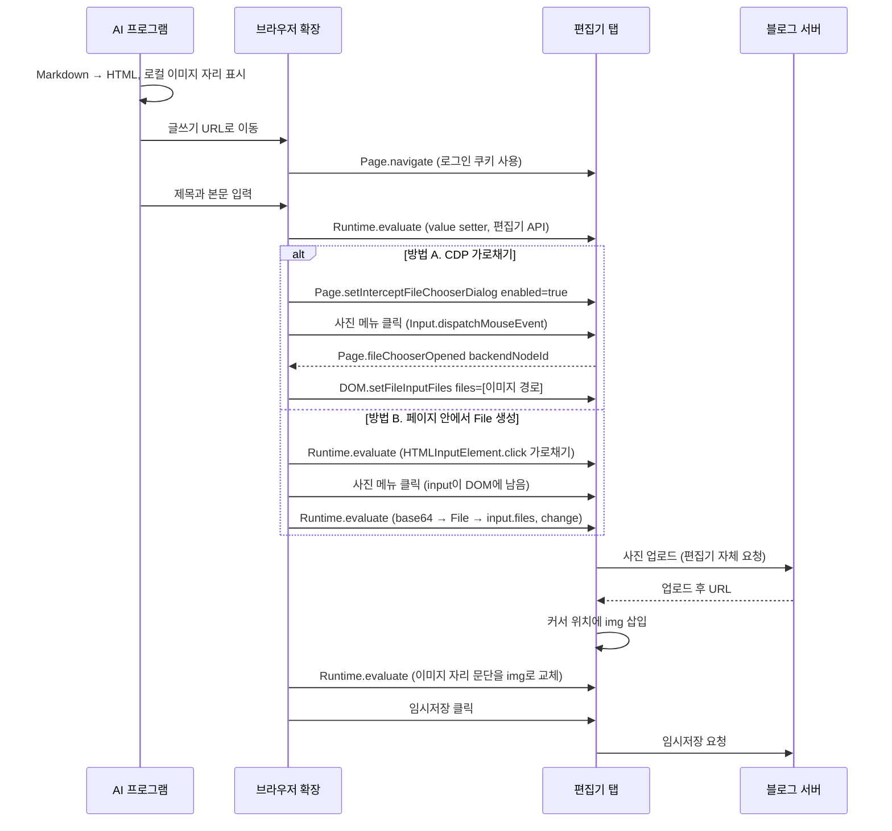

# 시나리오 4. CDP로 블로그 글과 사진을 업로드하는 원리 (이론)

> 이 문서는 실제 실행 검증을 거치지 않은 아키텍처 설계 검토입니다. 시나리오 1~3에서 확인한 CDP 동작과 설치된 확장 번들 분석 결과를 근거로 구현 원리를 정리했으며, 블로그 편집기 내부 구조에 대한 서술은 작성 시점의 공개 정보 기반 추정입니다.

## 시나리오 목표

| 항목 | 내용 |
|---|---|
| 기능 | 로그인된 브라우저 세션을 활용해 블로그 편집기에 제목·본문·이미지를 입력하고 임시저장하는 기능 |
| 사용 도구 | CDP(`Page.setInterceptFileChooserDialog`, `DOM.setFileInputFiles`, `Runtime.evaluate`, `Input.dispatchDragEvent`), AI 브라우저 확장 |
| 입력 | 로컬 Markdown 파일 1개와 참조된 로컬 이미지, 개인 블로그(네이버 블로그, 티스토리, 워드프레스 중 하나)의 글쓰기 화면 |
| 작업 | 1. Markdown → HTML 변환, 2. 제목 입력, 3. 본문 입력, 4. 이미지 업로드, 5. 이미지 자리 치환, 6. 임시저장 |
| 달성 목표 | 이미지 업로드가 단순 클릭으로 끝나지 않는 이유와, CDP로 OS 파일 선택창을 우회하는 세 가지 방법의 트레이드오프 설명 |

## 브라우저 자동화 기반 블로그 업로드의 구조와 범위

사용자가 블로그에 글을 게시할 때는 글쓰기 화면을 열고, 제목과 본문을 입력한 뒤, 사진 버튼을 눌러 OS 파일 선택창에서 이미지를 선택하고 임시저장을 누릅니다. 이 시나리오는 해당 과정을 AI 브라우저 tool이 대신 수행하는 구조를 다룹니다. 시나리오 2에서 살펴본 Claude in Chrome이나 Codex의 Chrome 연동처럼 사용자가 이미 로그인해 둔 Chrome을 조작하므로, 블로그 비밀번호나 API 키를 AI 프로그램에 별도로 전달할 필요가 없습니다.

이 문서가 다루는 범위는 "편집기에 콘텐츠를 주입하는 기술적 경로"입니다. Markdown을 특정 블로그 스타일로 다듬는 문체 규칙이나 SEO 최적화는 다루지 않으며, 공개 발행 역시 범위 밖입니다. AI가 수행하는 최종 동작은 임시저장까지로 한정하고, 발행은 사람이 결과를 검수한 뒤 직접 실행한다고 가정합니다. 이러한 경계를 두는 이유는 부록에서 설명합니다.

텍스트 입력과 이미지 업로드는 구현 난이도가 크게 다릅니다. 텍스트는 페이지 내부의 JavaScript를 통해 편집기에 삽입하면 되지만, 사진 버튼은 브라우저 외부의 OS 파일 선택창을 호출합니다. 이 OS 대화상자는 DOM 요소가 아니므로 `Input.dispatchMouseEvent`로 클릭할 수 없고 접근성 트리에도 노출되지 않습니다. 따라서 이 시나리오의 핵심은 OS 창을 띄우지 않고 로컬 파일을 편집기에 전달하는 기법에 있습니다.

### 핵심 용어

| 용어 | 의미 | 이 시나리오의 예 |
|---|---|---|
| file chooser | `<input type="file">`의 `click()` 호출 시 뜨는 OS 파일 선택창. 페이지 외부에 렌더링됨 | 편집기 툴바의 **사진** 메뉴 클릭 시 표시되는 대화상자 |
| file chooser 가로채기 | Chrome이 OS 창 대신 CDP event로 파일 선택 요청 발생을 알리도록 전환하는 모드 | `Page.setInterceptFileChooserDialog` → `Page.fileChooserOpened` |
| `DOM.setFileInputFiles` | 파일 경로 목록을 file input 요소에 직접 바인딩하는 CDP 명령. 브라우저 프로세스가 해당 경로를 읽음 | `{"files": ["<이미지 경로>"], "backendNodeId": 42}` |
| `DataTransfer` | 드래그·붙여넣기 작업에서 파일과 데이터를 담는 웹 API 객체. JavaScript로 생성해 `input.files`에 할당 가능 | `new DataTransfer()`에 `new File([bytes], "a.png")` 추가 |
| 제어 컴포넌트 입력창 | React 등 프레임워크가 상태를 직접 관리하는 입력창. DOM의 `value`만 수정하면 프레임워크가 변경을 감지하지 못함 | 제목 `textarea` |
| 업로드 후 URL | 편집기가 이미지를 블로그 서버(CDN)에 업로드한 뒤 본문에 삽입하는 이미지 주소 | `/...">` |

## 공식 API 부재 시 브라우저 자동화의 필요성

로컬 Markdown(Obsidian 등)으로 초안을 작성해 블로그에 게시할 때는 서식 변환과 이미지 재업로드에 많은 수작업이 들어갑니다. 표나 코드블록 서식이 깨지기 쉽고, 로컬 이미지는 한 장씩 업로드한 뒤 본문의 원래 위치에 다시 배치해야 합니다. 보통 이런 반복 작업을 자동화할 때는 블로그의 공식 API를 사용하지만, 플랫폼별로 API 제공 여부가 다릅니다.

| 블로그 | 글쓰기 공식 API | 브라우저 자동화 필요성 |
|---|---|---|
| 워드프레스(자체 설치) | REST API(`/wp-json/wp/v2/posts`, `/wp-json/wp/v2/media`)와 Application Password로 초안 작성 및 이미지 업로드 가능 | 낮음. 공식 API가 훨씬 안정적임 |
| 티스토리 | 공개 Open API 서비스가 종료되어 신규 사용이 어렵다고 알려져 있음(공지 원문 미확인) | 높음 |
| 네이버 블로그 | 개인이 글쓰기에 활용할 수 있는 공개 API를 기대하기 어렵다고 가정 | 높음 |

공식 API가 없는 플랫폼에서 활용할 수 있는 유일한 인터페이스는 사람이 사용하는 웹 글쓰기 화면입니다. 이때 CDP 기반 AI 브라우저 tool은 이미 로그인된 브라우저 세션 위에서 화면을 제어하므로 별도의 인증 구현 없이 동작합니다. 반면 워드프레스처럼 공식 API가 제공되는 환경에서는 화면 자동화보다 API를 사용하는 것이 유리합니다. 편집기 UI는 예고 없이 개편되지만 API는 버전과 호환성을 보장하기 때문입니다.

## OS 파일 선택창 우회 방식 비교

이미지 한 장을 `file input`까지 전달하는 기법은 크게 세 가지로 나뉩니다. 아래 표의 확장 코드 근거는 시나리오 2의 2단계와 동일한 방식(`grep`)으로 설치된 확장 번들을 분석한 결과입니다.

| 방법 | 동작 원리 | 파일 출처 | 장점 | 트레이드오프(대가) | 적용 사례 |
|---|---|---|---|---|---|
| A. CDP 가로채기 + `DOM.setFileInputFiles` | `Page.setInterceptFileChooserDialog`로 OS 창 대신 `Page.fileChooserOpened` event를 수신하고, event의 `backendNodeId`에 파일 경로를 전달 | 브라우저가 실행 중인 호스트의 파일 경로 | 페이지 코드를 수정하지 않음. 동적 생성 input도 event로 포착 가능. 브라우저가 실제 사용자 선택과 동일하게 파일을 처리 | AI 프로그램과 브라우저가 다른 장비에 있으면 경로가 유효하지 않음 | Codex Chrome 확장(`DOM.setFileInputFiles` 3회, `Page.setInterceptFileChooserDialog` 4회), Playwright `page.expect_file_chooser()`. Claude desktop `app.asar`에는 가로채기 명령만 확인되고 `DOM.setFileInputFiles` 문자열은 확인되지 않음 |
| B. 페이지 내 `File` 객체 생성 | 파일 바이트를 base64로 페이지에 전달한 뒤, JavaScript로 `File`과 `DataTransfer`를 생성해 `input.files`에 대입하고 `change` event를 발생시킴 | 바이트 데이터 자체(실행 위치와 무관) | 파일 경로가 불필요해 원격 브라우저에서도 동작 | base64 인코딩으로 크기가 약 33% 증가해 대용량 파일에 불리. input이 DOM에 존재해야 하므로 동적 input은 사전 포착 필요. 스크립트 생성 event이므로 `isTrusted`가 `false` | Claude in Chrome 확장의 `file_upload` tool(번들에서 `new DataTransfer`, `input.files = ...` 확인, `DOM.setFileInputFiles` 문자열 없음) |
| C. 드래그 앤 드롭 모방 | 편집기 본문 좌표에 `drop` event를 전송. CDP `Input.dispatchDragEvent`(파일 경로) 또는 페이지 JavaScript `DragEvent`(바이트) 사용 | 경로 또는 바이트 | 사진 메뉴를 열 필요가 없음 | 편집기가 drag & drop을 지원해야 함. 드롭 좌표가 곧 삽입 위치가 되어 정밀한 위치 제어가 어려움 | Claude in Chrome의 `upload_image` tool(번들에서 `DragEvent("dragenter")` 확인), Codex 확장(`Input.dispatchDragEvent` 확인) |

이외에도 페이지 컨텍스트 내에서 `fetch`로 블로그의 내부 업로드 엔드포인트를 직접 호출하는 방식이 이론상 가능합니다. 브라우저 쿠키가 자동으로 포함되므로 인증은 통과하지만, 비공개 내부 API 스펙과 요청 형식에 의존하기 때문에 편집기 업데이트 시 조용히 실패할 위험이 큽니다. 화면 조작은 실패 시 UI 상태로 즉시 드러나지만, 비공개 API 호출은 잘못된 데이터를 정상 응답과 함께 저장할 수 있으므로 이 시나리오에서는 배제합니다.

원리상 가장 깔끔한 방식은 방법 A입니다. 사용자가 OS 대화상자에서 파일을 선택하는 흐름과 브라우저 내부 처리가 완전히 일치하기 때문입니다. 그럼에도 Claude in Chrome이 방법 B를 채택한 이유는 확장 아키텍처에서 유추할 수 있습니다. Claude CLI가 원격 장비나 컨테이너에서 실행되더라도 확장은 사용자의 로컬 Chrome 내부에서 동작하므로, 호스트 경로에 의존하는 대신 바이트 데이터를 직접 넘기는 방식이 환경에 구애받지 않고 동작합니다. 이 판단은 확장 번들 분석에 기반한 추론이며 제품 공식 문서로 확인된 내용은 아닙니다.

## 컴포넌트 구성

| 컴포넌트 | 역할 |
|---|---|
| Markdown 변환기(`pandoc` 등) | Markdown을 편집기가 수용하는 HTML로 변환하고 로컬 이미지 위치를 표시 |
| AI 프로그램(Claude CLI, Codex) | 변환된 HTML과 이미지 목록을 전달받아 브라우저 tool을 순차 호출 |
| 브라우저 확장(`chrome.debugger`) | tool 호출을 CDP 명령이나 페이지 JavaScript로 변환해 탭에 전송 |
| 블로그 편집기 | 본문 데이터 모델을 유지하며, 이미지를 수신하면 블로그 서버에 업로드한 뒤 업로드 URL을 본문에 삽입 |
| 블로그 서버 | 이미지 파일을 저장하고 CDN URL을 반환. 임시저장 게시글 보관 |

### 블로그 플랫폼별 편집기 구조 가정

본문 데이터를 주입하는 구체적인 방식은 플랫폼의 편집기 엔진에 따라 달라집니다. 아래 표는 작성 시점의 공개 정보와 일반적인 웹 편집기 구조에 기반한 추정이며 실제 화면에서 검증한 내용은 아닙니다.

| 블로그 | 편집기 구조(추정) | 본문 입력 방식(추정) | 주의사항 |
|---|---|---|---|
| 티스토리 | TinyMCE 기반 | `tinymce.activeEditor.setContent(html)` 호출 후 `change` event 발생 | 편집기가 일부 태그와 속성을 자동 정리(sanitize)하므로 입력 후 블록 수 재검증 필요 |
| 네이버 블로그 | 자체 편집기(SmartEditor ONE). DOM이 아닌 내부 문서 모델이 원본 | DOM을 직접 수정하면 저장 시 유실될 가능성 높음. 붙여넣기 event(`text/html`이 담긴 `ClipboardEvent`)나 `Input.insertText`로 사용자 입력을 모방 | 글쓰기 화면이 `iframe` 내부에 존재할 수 있어 CDP 명령을 전송할 frame(실행 컨텍스트) 선별 필요 |
| 워드프레스 | 블록 편집기(Gutenberg) | `wp.blocks.rawHandler({ HTML })`로 블록 생성 후 `wp.data.dispatch('core/block-editor').resetBlocks(...)` 호출 | REST API로 동일 작업이 가능하므로 화면 자동화 실익이 낮음 |

세 편집기 모두 제목 입력창은 React 등의 프레임워크가 상태를 제어할 가능성이 높습니다. 단순히 `input.value = "제목"`만 할당하면 화면에는 텍스트가 표시되지만 프레임워크 내부 상태는 비어 있어 저장 시 제목이 누락됩니다. 따라서 `HTMLTextAreaElement.prototype`의 원래 `value` setter를 호출해 값을 설정하고 `input` event를 발생시켜 프레임워크가 상태 변경을 인지하도록 유도해야 합니다.

## 전체 업로드 흐름

아래 다이어그램은 로컬 이미지 한 장이 포함된 Markdown 문서를 편집기에 입력하고 임시저장하기까지의 전체 흐름입니다. 이미지 업로드 구간은 방법 A와 방법 B를 분기해 나타냈습니다.



## 이론적 실행 절차

이 절은 실제 실행을 거치지 않은 이론적 절차이므로 출력 예시는 포함하지 않습니다. 각 단계는 시나리오 1의 `cdp-raw/cdp_raw.py`와 같이 raw CDP 메시지를 기준으로 기술했으며, AI 브라우저 tool을 사용할 경우 tool 내부에서 동일한 메시지를 생성합니다. 블로그 주소와 파일 경로는 `<내 블로그>`, `<이미지 경로>`로 표기합니다.

### 1. Markdown 변환 및 로컬 이미지 경로 추출

편집기는 Markdown 원문을 직접 수용하지 않으므로 HTML로 변환합니다. 상단의 YAML frontmatter는 본문이 아니므로 제거하고, 이미 원격 URL로 호스팅된 이미지는 별도 업로드가 불필요하므로 제외합니다. 즉 `http`로 시작하지 않는 로컬 이미지 경로만 업로드 대상으로 추립니다. 아래 명령은 `post.md`에서 frontmatter를 제거해 `post.html`로 변환하고, 업로드할 로컬 이미지 경로를 추출합니다.

```bash
awk 'NR==1&&/^---/{f=1;next} f&&/^---/{f=0;next} !f' post.md | pandoc -f gfm -t html --wrap=none -o post.html
grep -oE '/<글쓰기 경로>"}}
```

### 3. 편집기 API를 통한 제목 및 본문 입력

제목은 프로토타입의 원래 `value` setter와 `input` event로 입력하고, 본문은 편집기가 제공하는 공개 API로 주입합니다. 아래는 TinyMCE 기반 편집기를 가정한 `Runtime.evaluate` 실행 식입니다. 마지막 줄에서 입력된 제목과 `h2`, `table` 요소 개수를 반환하도록 구성해 원본 HTML의 구조와 누락 여부를 대조합니다.

```javascript
const t = document.querySelector('<제목 입력창 선택자>');
Object.getOwnPropertyDescriptor(HTMLTextAreaElement.prototype, 'value').set.call(t, TITLE);
t.dispatchEvent(new Event('input', { bubbles: true }));
const ed = tinymce.activeEditor;
ed.setContent(HTML);
ed.fire('change');
({ title: t.value, h2: ed.getBody().querySelectorAll('h2').length, tables: ed.getBody().querySelectorAll('table').length });
```

### 4-A. 이미지 업로드: CDP File Chooser 가로채기 방식

먼저 CDP의 file chooser 가로채기 모드를 활성화합니다. 이 상태에서 사진 버튼을 클릭하면 Chrome은 OS 파일 선택창을 띄우지 않고 `Page.fileChooserOpened` event를 발생시킵니다.

```json
{"id": 10, "method": "Page.setInterceptFileChooserDialog", "params": {"enabled": true}}
```

사진 메뉴를 `Input.dispatchMouseEvent`로 클릭하면 브라우저가 다음과 같은 event를 전송합니다. 여기서 `backendNodeId`는 편집기가 동적으로 생성한 file input 요소를 가리키며, `mode`가 `selectMultiple`이면 여러 이미지를 한 번에 전달할 수 있습니다.

```json
{"method": "Page.fileChooserOpened", "params": {"frameId": "<frame id>", "mode": "selectMultiple", "backendNodeId": 42}}
```

수신한 `backendNodeId`를 대상으로 파일 경로를 전달하면 브라우저가 로컬 파일을 직접 읽어 input의 `change` event를 발생시킵니다. 편집기는 사용자가 OS 창에서 파일을 선택한 것과 완전히 동일하게 업로드 요청을 시작합니다. 단, 파일 경로는 브라우저 프로세스 기준으로 해석되므로 AI 프로그램과 브라우저가 동일 호스트에 있어야 합니다.

```json
{"id": 11, "method": "DOM.setFileInputFiles", "params": {"files": ["<이미지 경로>"], "backendNodeId": 42}}
```

### 4-B. 이미지 업로드: 페이지 내 File 객체 생성 방식

가로채기 API를 tool로 사용할 수 없고 DOM의 file input에 파일을 주입하는 방식만 가능한 환경에서 사용합니다. 대부분의 편집기는 사진 메뉴 클릭 시 `<input type="file">`을 동적으로 생성해 즉시 `click()`을 호출한 뒤 선택이 끝나면 DOM에서 제거합니다. 따라서 자동화 스크립트가 해당 input을 찾기 전에 OS 창이 열리고 요소가 사라지는 문제를 막기 위해, 먼저 `HTMLInputElement.prototype.click`을 오버라이드해 file input인 경우 OS 창을 띄우지 않고 DOM에 고정해 둡니다.

```javascript
window.__origClick = HTMLInputElement.prototype.click;
HTMLInputElement.prototype.click = function () {
  if (this.type !== 'file') return window.__origClick.call(this);
  this.id = 'captured-file-input';
  document.body.appendChild(this);
};
```

사진 메뉴를 클릭한 뒤 DOM에 포착된 `#captured-file-input`에 바이트 데이터로 생성한 `File` 객체를 할당합니다. 아래 스크립트는 Claude in Chrome의 `file_upload` tool 내부 동작과 동일한 원리이며, `B64`는 AI 프로그램이 로컬에서 읽은 이미지의 base64 문자열입니다. 파일 주입과 `change` event 발생이 끝나면 `click` 메서드를 원래대로 복원합니다.

```javascript
const bytes = Uint8Array.from(atob(B64), c => c.charCodeAt(0));
const dt = new DataTransfer();
dt.items.add(new File([bytes], 'image.png', { type: 'image/png' }));
const input = document.getElementById('captured-file-input');
input.files = dt.files;
input.dispatchEvent(new Event('change', { bubbles: true }));
HTMLInputElement.prototype.click = window.__origClick;
```

이때 발생한 `change` event는 JavaScript 코드가 생성한 것이므로 `isTrusted` 속성이 `false`입니다. 만약 편집기 코드가 보안이나 봇 방지를 위해 `event.isTrusted`를 검사한다면 방법 B는 동작하지 않으므로, 브라우저가 직접 event를 생성해 `isTrusted`가 `true`로 설정되는 방법 A를 사용해야 합니다.

### 5. 업로드된 이미지의 본문 내 위치 치환

편집기는 업로드가 완료된 이미지를 현재 커서 위치에 삽입합니다. 여러 장을 한꺼번에 업로드하면 이미지들이 한곳에 몰려 들어가므로, 편집기가 부여하는 파일 식별 속성(`data-filename`, `alt` 등)을 기준으로 각 이미지 노드를 찾아 1단계에서 남겨 둔 자리 표시자 문단과 치환합니다. 동일한 이미지가 본문에서 여러 번 참조된다면 노드를 복제해 배치합니다. 치환 후에는 남은 자리 표시자 수가 0인지, 본문 내 `img` 요소 수가 원본과 일치하는지 검증합니다. 구체적인 DOM 속성명은 편집기마다 다르므로 실제 DOM을 확인해 맞춰야 합니다.

### 6. 임시저장 실행 및 저장 상태 검증

임시저장 버튼을 클릭한 뒤 편집기 UI에 표시되는 임시저장 개수나 마지막 저장 시각이 갱신되었는지 확인합니다. 공개 발행 버튼은 누르지 않고 편집기 탭을 열어 둔 상태로 남겨 사람이 최종 검수할 수 있도록 합니다.

## 부록. 실무 시사점

- **이미지 업로드 자동화의 본질은 OS 대화상자 회피에 있습니다.** 클릭 좌표를 아무리 정교하게 맞춰도 OS 파일 선택창 내부는 CDP의 제어 범위 밖입니다. 따라서 브라우저에 가로채기를 요청하거나(A), `click()` 호출 자체를 가로막거나(B), 창을 거치지 않는 drag & drop 경로를 사용하는(C) 세 가지 방식으로 수렴합니다. Playwright의 `expect_file_chooser()` 역시 내부적으로 방법 A를 사용합니다.
- **방법 A와 B의 선택 기준은 파일의 물리적 위치입니다.** AI 프로그램과 브라우저가 같은 장비에서 실행된다면 구현이 단순하고 `isTrusted` 제약이 없는 방법 A가 유리합니다. 반면 클라우드 브라우저나 격리된 컨테이너 환경처럼 파일 시스템 경로를 공유하지 못하는 구조에서는 바이트 데이터를 전송하는 방법 B가 필수적입니다. Codex 확장이 A를, Claude in Chrome 확장이 B를 선택한 것도 이러한 실행 환경 차이에 따른 설계로 해석됩니다.
- **`prototype.click` 오버라이드는 페이지 전역 상태를 변경합니다.** 작업 도중 다른 스크립트가 file input을 열면 함께 가로채질 수 있고, 복원 로직이 누락되면 이후 사용자가 해당 탭에서 수동으로 파일을 업로드할 수 없게 됩니다. 따라서 오버라이드와 복원은 예외 발생 시에도 실행되도록 반드시 하나의 원자적 작업 단위로 묶어야 합니다.
- **자동화 범위를 임시저장으로 제한하는 이유는 가역성(reversibility) 때문입니다.** AI는 사용자의 로그인 세션 전체를 대리하며, 글쓰기 화면이나 붙여 넣은 원문에 숨겨진 악성 지시문(prompt injection)에 노출될 위험이 있습니다. 임시저장은 작성자만 볼 수 있는 상태라 문제가 생겨도 삭제하면 되돌릴 수 있지만, 공개 발행은 즉시 검색 엔진과 구독자에게 전파됩니다.
- **편집기 UI는 안정적인 API가 아닙니다.** DOM 선택자, 툴바 구조, 내부 문서 모델은 서비스 업데이트에 따라 예고 없이 변경됩니다. 워드프레스처럼 공식 API가 있다면 API를 우선 사용하고, 화면 자동화는 API가 없는 플랫폼을 위한 차선책으로 두어야 합니다. 화면 자동화를 사용할 때도 3·5단계처럼 입력된 요소 수를 원본과 대조하는 검증 로직을 매번 포함해야 조용한 데이터 누락을 방지할 수 있습니다.

## 참고 문서

1. [Page.setInterceptFileChooserDialog (Chrome DevTools Protocol)](https://chromedevtools.github.io/devtools-protocol/tot/Page/#method-setInterceptFileChooserDialog)
2. [DOM.setFileInputFiles (Chrome DevTools Protocol)](https://chromedevtools.github.io/devtools-protocol/tot/DOM/#method-setFileInputFiles)
3. [Input.dispatchDragEvent (Chrome DevTools Protocol)](https://chromedevtools.github.io/devtools-protocol/tot/Input/#method-dispatchDragEvent)
4. [FileChooser (Playwright Docs)](https://playwright.dev/python/docs/api/class-filechooser)
5. [DataTransfer (MDN)](https://developer.mozilla.org/en-US/docs/Web/API/DataTransfer)
6. [Event.isTrusted (MDN)](https://developer.mozilla.org/en-US/docs/Web/API/Event/isTrusted)
7. [Media endpoint (WordPress REST API Handbook)](https://developer.wordpress.org/rest-api/reference/media/)
8. [Application Passwords Integration Guide (Make WordPress Core)](https://make.wordpress.org/core/2020/11/05/application-passwords-integration-guide/)
