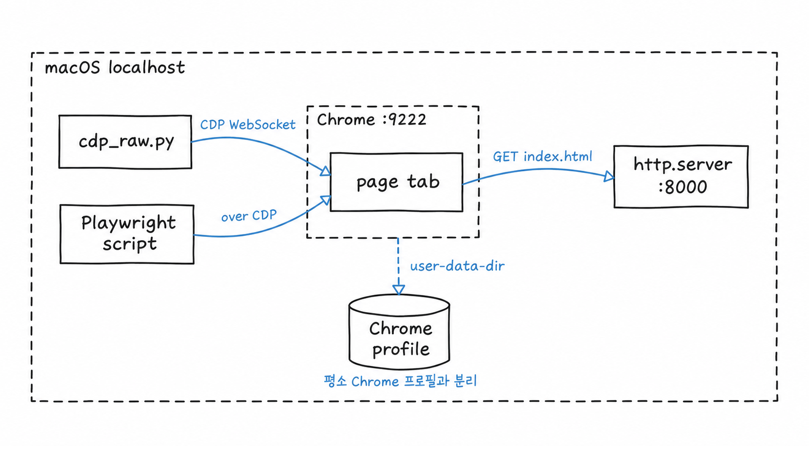

# 실습 환경 준비

모든 시나리오는 macOS의 로컬 Chrome 인스턴스 하나와 정적 웹 서버 하나로 진행합니다. 실습용 Chrome은 평소 사용하는 Chrome과 프로필 디렉터리를 분리해 기동하므로, 기존 로그인 세션이나 열린 탭에 영향을 주지 않습니다.

## 필요한 도구

| 도구 | 용도 | 확인 명령 |
|---|---|---|
| Google Chrome | CDP 서버 역할을 수행하는 브라우저 | `"/Applications/Google Chrome.app/Contents/MacOS/Google Chrome" --version` |
| Python 3 | 테스트 페이지를 제공하는 정적 HTTP 서버 | `python3 --version` |
| uv | PEP 723 스크립트 실행 및 의존성 자동 설치 | `uv --version` |

검증에 사용한 버전은 Chrome 157.0.8103.78, `uv`로 설치되는 `websockets` 15.0.1, `playwright` 1.55.0입니다. Playwright는 브라우저를 직접 실행하지 않고 이미 기동된 Chrome에 연결하므로 `playwright install`은 필요하지 않습니다.

## 실습 구성

실습용 Chrome이 9222번 포트로 CDP 엔드포인트를 열고, raw CDP 클라이언트(`cdp_raw.py`)와 Playwright 스크립트가 같은 포트에 연결해 Chrome을 제어합니다. Chrome은 8000번 포트의 정적 서버에서 테스트 페이지를 로드하며, 프로필 데이터는 평소 Chrome과 격리된 실습 전용 디렉터리에 저장합니다.



## 실습 환경 기동

아래 명령은 저장소 루트에서 작업 디렉터리로 이동한 뒤 테스트 페이지 서버(8000번 포트)와 CDP를 활성화한 Chrome(9222번 포트)을 백그라운드로 실행합니다. `--user-data-dir`로 실습 전용 프로필을 지정해야 하는 이유는 [시나리오 1](1-cdp-principle.md#chrome-136의-보안-정책-변경)에서 설명합니다.

```bash
cd computer_science/ai/cdp-browser-access
python3 -m http.server 8000 --bind 127.0.0.1 -d site >/dev/null 2>&1 &
"/Applications/Google Chrome.app/Contents/MacOS/Google Chrome" --remote-debugging-port=9222 --user-data-dir="$PWD/.chrome-profile" --no-first-run --no-default-browser-check about:blank >/dev/null 2>&1 &
```

빈 탭 하나가 열린 새 Chrome 창이 나타나면 정상입니다. 다음 명령으로 CDP 엔드포인트가 정상적으로 열렸는지 확인합니다.

```bash
curl -s http://127.0.0.1:9222/json/version
```

응답의 `Browser` 필드에 Chrome 버전이, `webSocketDebuggerUrl` 필드에 `ws://127.0.0.1:9222/devtools/browser/<UUID>` 형식의 주소가 반환되면 준비가 완료된 것입니다. UUID는 Chrome을 기동할 때마다 새로 생성됩니다.

## 실습 환경 종료 및 정리

기동 시와 동일한 `computer_science/ai/cdp-browser-access` 디렉터리에서 실행합니다. 실습용 Chrome과 정적 서버 프로세스를 종료하고, 실습 프로필과 생성된 스크린샷 및 로그 파일을 삭제합니다. `pkill -f` 패턴에 실습 전용 프로필 경로가 포함되므로 평소 사용 중인 Chrome은 종료되지 않습니다.

```bash
pkill -f "user-data-dir=$PWD/.chrome-profile"; pkill -f "http.server 8000"; rm -rf .chrome-profile cdp-raw-screenshot.png playwright-screenshot.png pw.err pw.out
```
