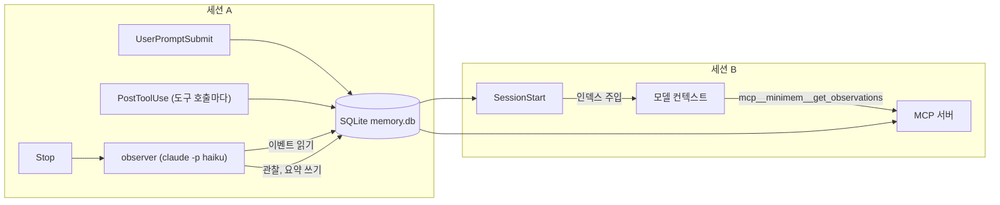

# 시나리오 1. 기능 지도와 최종 목표: 인수인계 노트를 남기는 동료

이 첫 번째 시나리오에서는 코딩 에이전트에게 세션 간 메모리(persistent memory)를 붙였을 때 무엇이 어떻게 달라지는지 전체 그림을 먼저 잡습니다. 할인 계산 버그가 심어져 있는 `shop` 프로젝트에서 세션 A(버그 수정)와 세션 B(지난 작업 질문)를 각각 **메모리 없이** 한 번, **minimem을 켜고** 한 번 실행해 봅니다. 새 세션이 프로젝트 파일을 다시 뒤지지 않고도 지난 세션의 버그 원인, 금액 규칙, 다음 할 일을 바로 답하는지 실제 수치로 비교해 보는 것이 목표입니다.

## 세션 간 메모리는 퇴근하는 동료가 남기는 인수인계 노트

개발자가 퇴근하기 전 "할인 계산 버그는 퍼센트를 100으로 나누지 않아서 발생했고, 금액은 원 단위 `int`로만 다루기로 했다. 다음 작업은 쿠폰 중복 적용 금지다" 같은 짧은 메모를 남겨 두면, 다음 날 출근한 동료는 그 노트만 읽고 바로 일을 이어받을 수 있습니다. 더 자세한 맥락이 궁금할 때만 커밋 로그나 티켓을 열어보면 되죠.

하지만 코딩 에이전트에게는 이런 인수인계 노트가 기본적으로 없습니다. Claude Code 세션이 닫히면 컨텍스트 윈도도 함께 비워지기 때문에, 다음 세션은 프로젝트 파일을 처음부터 다시 읽고 이미 알려준 규칙을 되묻거나, 환경에 `pytest`가 설치되어 있지 않다는 사실조차 잊은 채 똑같은 실패를 반복합니다. `claude-mem`은 작업 중인 에이전트 옆에 기록만 전담하는 별도 에이전트(observer)를 하나 더 두어, 이 인수인계 노트를 자동으로 작성하고 다음 세션에 넘겨줍니다.

세션 간 메모리가 책임지는 영역과 다른 기능이 맡는 영역을 구분하면 역할이 훨씬 선명해집니다.

| 세션 간 메모리가 다루는 것 | 다루지 않는 것 |
| --- | --- |
| 지난 세션에서 내린 의사결정, 발견한 사실, 고친 버그, 남은 할 일 | 현재 진행 중인 세션 안의 대화 맥락 (컨텍스트 윈도가 담당) |
| 사용자가 프롬프트로 전달한 프로젝트 규칙 (예: 금액은 `int`만 사용) | 소스 코드 자체 (이미 저장소에 있으므로 중복 저장하지 않음) |
| 다음 세션이 시작 직후 훑어볼 수 있는 짧은 인덱스 | 전체 대화 원문 보관 (`claude --resume`과 transcript 파일이 담당) |

### 핵심 용어 정리

이후 시나리오 전반에서 반복해서 등장하는 용어와 이 실습에서의 구체적인 예시입니다.

| 용어 | 의미 | 이 실습에서의 예 |
| --- | --- | --- |
| hook | Claude Code가 특정 lifecycle 이벤트가 발생할 때마다 실행하는 셸 명령 | `PostToolUse` 시점에 `minimem-hook tool` 실행 |
| 이벤트(event) | hook이 전달받은 도구 호출 원본 1건 | `Edit` 호출의 입력과 응답 894자 |
| observer | 쌓인 이벤트를 읽고 핵심 관찰을 추출하는 별도 LLM 호출 | `claude -p --model haiku --tools=` |
| 관찰(observation) | 다음 세션이 빠르게 이해할 수 있도록 압축한 사실 1건 | `#1 [bugfix] apply_discount 할인율 계산 누락된 100 나눗셈 수정` |
| 세션 요약(summary) | 세션 하나의 요청, 완료 내역, 알게 된 사실, 다음 할 일 정리 | `다음 할 일: 쿠폰 중복 적용 금지 기능을 구현한다` |
| 컨텍스트 주입 | 새 세션이 열릴 때 요약과 관찰 인덱스를 모델 입력에 넣어주는 과정 | `SessionStart` hook의 `additionalContext` 806자 |
| progressive disclosure | 짧은 인덱스를 먼저 보여주고, 상세 본문은 필요할 때만 조회하는 패턴 | `search` 인덱스 431자 vs 전체 본문 2,363자 |

## 메모리가 없을 때 생기는 한계

세션 A에서 사용자는 버그 수정을 요청하면서 두 가지 중요한 맥락을 함께 건넵니다. "금액은 원 단위 `int`로만 다루고 `float`는 쓰지 않는다"는 규칙과 "다음 작업은 쿠폰 중복 적용 금지 기능"이라는 계획입니다. 문제는 이 두 정보가 소스 코드에는 직접 남지 않는다는 점입니다.

메모리 없이 실행한 세션 B는 답을 찾으려고 도구를 4번이나 호출하며 프로젝트 디렉터리 이곳저곳을 뒤졌지만, 결국 아래와 같이 답할 수밖에 없었습니다.

```text
지난 세션 기록은 찾지 못했습니다. 그래서 버그 원인, 금액 타입 규칙, 다음 할 일은 말씀드릴 수 없습니다.
```

코드에 흔적이 남는 수정 내역은 파일을 다시 읽어서 어느 정도 추측할 수 있지만, 그럴 때마다 불필요한 토큰과 시간을 쓰게 됩니다. 더 큰 문제는 코드에 남지 않는 정보입니다. 사용자가 구두로 정한 설계 규칙, 다음 작업 계획, "이 환경에는 `pytest`가 없다" 같은 실행 환경 정보는 코드를 아무리 읽어도 복원할 수 없습니다. 세션 간 메모리는 바로 이 복원 불가능한 맥락을 보존하면서, 동시에 코드를 다시 뒤지는 탐색 비용까지 줄여 줍니다.

## 다른 메모리 방식과의 비교

세션 간 기억을 유지하는 방법은 여러 가지가 있고, 각 방식은 기록을 누가 언제 남기느냐에 따라 뚜렷한 트레이드오프를 가집니다.

| 방식 | 기록 시점 | 기록 주체 | 다음 세션이 읽는 방식 | 한계 |
| --- | --- | --- | --- | --- |
| `CLAUDE.md` 수동 기록 | 사람이 직접 작성할 때 | 사람 | 매 세션 전체 로드 | 사람이 잊으면 기록이 비고, 문서가 길어질수록 매 세션 고정 토큰이 늘어남 |
| Claude Code auto memory (`~/.claude/projects/<프로젝트>/memory/MEMORY.md`) | 에이전트가 필요하다고 판단할 때 | 작업 중인 에이전트 | 매 세션 로드 | 기록 여부가 작업 에이전트의 판단에 달려 있어 중요한 사실이 누락될 수 있음 |
| `claude --resume` | 세션 대화 원문 자동 저장 | Claude Code | 이전 대화 원문을 그대로 이어 붙임 | 원문이 커서 컨텍스트 소모가 크고, 여러 세션의 기록을 하나로 합치기 어려움 |
| claude-mem, minimem | 도구 호출마다 자동 캡처 | 별도 observer | 요약·인덱스 주입 후 필요 시 검색 | observer 호출 비용이 추가되고, 요약 과정에서 내용이 왜곡될 위험이 있음 |

`claude-mem` 방식의 가장 큰 차별점은 **무엇을 기록할지 작업 에이전트에게 맡기지 않는다**는 점입니다. hook이 모든 도구 호출을 기계적으로 빠짐없이 수집하고, 그중 다음 세션에 남길 만한 사실을 추려내는 일은 별도의 observer가 전담합니다.

## 구성 요소와 시나리오 지도

`claude-mem`의 핵심 구조를 `minimem`으로 축소해 옮긴 대응표입니다. 각 단계의 상세 원리는 이어지는 시나리오 문서에서 하나씩 깊이 다룹니다.

| 단계 | claude-mem 컴포넌트 | minimem 구현 | 상세 시나리오 |
| --- | --- | --- | --- |
| 캡처 | `plugin/hooks/hooks.json`, `src/cli/handlers/observation.ts` | `minimem/hook.py` | [시나리오 2](2-capture-hooks.md) |
| 압축 | `src/sdk/prompts.ts`, `src/services/worker/ClaudeProvider.ts` | `minimem/observer.py` | [시나리오 3](3-observer.md) |
| 저장·검색 | `src/services/sqlite/` (SQLite FTS5), Chroma | `minimem/db.py`, `minimem/search.py` | [시나리오 4](4-storage-search.md) |
| 주입 | `src/services/context/ContextBuilder.ts` | `minimem/context.py` | [시나리오 5](5-context-injection.md) |
| 본문 조회 | `src/servers/mcp-server.ts` | `minimem/mcp_server.py` | [시나리오 6](6-mcp-search.md) |
| 비동기 처리, 웹 viewer, 다중 에이전트 | worker 서비스, `/viewer` | 생략 | [시나리오 7](7-claude-mem-comparison.md) |

## 전체 동작 흐름

세션 A에서 일어난 도구 호출이 관찰로 압축되어 세션 B의 컨텍스트에 들어가기까지의 전체 데이터 흐름은 다음과 같습니다.



## 실습: 메모리 유무에 따른 세션 B 비교

실습을 시작하기 전에 [setup.md](setup.md)를 따라 `~/minimem-workspace/shop` 환경을 먼저 만들어 둡니다. 아래 명령은 저장소 루트에서 시작합니다.

### 1. 메모리 없이 세션 A 실행

먼저 기준선(baseline)을 잡기 위해 `--no-memory` 옵션으로 세션 A를 실행합니다. 이 옵션은 환경 변수 `MINIMEM_DISABLE=1`을 설정해 hook을 비활성화하고 MCP 서버도 연결하지 않습니다.

```bash
cd computer_science/ai/claude-mem-agent-memory
PA="tests/test_discount.py가 실패한다. 원인을 찾아 고쳐라. 참고로 이 프로젝트는 금액을 원 단위 int로만 다루기로 했고 float는 쓰지 않는다. 다음 작업은 쿠폰 중복 적용 금지 기능이다."
uv run scripts/run_session.py --no-memory ~/minimem-workspace/shop "$PA"
```

실행하면 세션 A가 버그를 수정하고 테스트를 통과시킨 뒤 아래와 같은 지표를 출력합니다.

```text
session_id: <실행마다 다름>
injected_context_chars: 0
tool_calls: 4 {'Bash': 3, 'Edit': 1}
turns: 5  input_tokens: 79179  output_tokens: 937  duration_s: 8.7
```

이 핸즈온 문서에서는 가독성을 위해 세션 출력 중 지표 줄과 답변 핵심 부분만 발췌했습니다. `--- answer ---` 이하 답변을 생략한 블록도 있습니다.

참고로 `run_session.py`는 `--no-session-persistence` 플래그로 Claude Code의 transcript 저장을 끄고 실행합니다. 만약 transcript가 남아 있으면 메모리 없는 세션 B가 그 파일을 뒤져 읽어버리기 때문에 공정한 비교가 되지 않습니다. LLM 특성상 매 실행마다 도구 호출 횟수와 토큰 수치는 조금씩 달라질 수 있습니다.

### 2. 메모리 없이 세션 B 실행

이제 새 세션을 열어 방금 전 세션에서 무슨 일을 했는지 물어봅니다.

```bash
PB="지난 세션에서 이 프로젝트에 무슨 작업을 했지? 버그 원인, 금액 타입 규칙, 다음 할 일을 알려줘."
uv run scripts/run_session.py --no-memory ~/minimem-workspace/shop "$PB"
```

실행 결과를 보면 세션 B가 `Bash`를 4번이나 호출하고도 답을 찾지 못했습니다.

```text
session_id: <실행마다 다름>
injected_context_chars: 0
tool_calls: 4 {'Bash': 4}
turns: 5  input_tokens: 100592  output_tokens: 1521  duration_s: 12.5
--- answer ---
지난 세션 기록은 찾지 못했습니다. 그래서 버그 원인, 금액 타입 규칙, 다음 할 일은 말씀드릴 수 없습니다.
```

세션 B는 프로젝트 디렉터리와 `~/.claude/projects/` 아래를 샅샅이 뒤졌지만 아무 기록도 찾지 못했습니다. 코드 안에서 `price - price * rate // 100`이라는 식을 보았더라도, 그것이 직전 세션의 버그 수정 결과인지 판단할 근거가 없었기 때문입니다.

### 3. minimem을 켜고 세션 A 실행

이번에는 프로젝트와 메모리를 깨끗하게 초기화한 뒤, `minimem`을 켠 상태로 똑같은 지시를 세션 A에 보냅니다. 이번에는 hook이 도구 호출을 빠짐없이 저장하고, 세션이 끝나는 시점에 observer가 백그라운드로 떠서 관찰을 작성합니다.

```bash
make down && make up
uv run scripts/run_session.py ~/minimem-workspace/shop "$PA"
```

세션 A의 실행 지표는 메모리 없을 때와 거의 비슷합니다.

```text
session_id: <실행마다 다름>
injected_context_chars: 0
tool_calls: 5 {'Bash': 2, 'Read': 2, 'Edit': 1}
turns: 6  input_tokens: 79346  output_tokens: 1108  duration_s: 8.9
```

observer는 세션이 끝난 뒤 백그라운드에서 약 10초 정도 동작합니다. 바로 다음 세션을 열면 아직 관찰이 저장되기 전일 수 있으므로, `pgrep -f minimem.observer`가 종료될 때까지 기다린 뒤 저장된 통계를 확인합니다.

```bash
while pgrep -f minimem.observer >/dev/null; do sleep 2; done
uv run --project minimem minimem stats shop
```

아래처럼 이벤트 5건이 관찰 3건으로 압축되고, 다음 세션에 주입될 컨텍스트가 806자로 준비된 것을 확인할 수 있습니다.

```text
{"events": 5, "event_chars": 2617, "observations": 3, "observation_chars": 1120, "context_chars": 806}
```

이 수치는 세션 A의 이벤트 5건과 당시 observer 출력 기준이며, observer가 생성하는 관찰 개수와 문장은 실행마다 조금씩 달라집니다.

### 4. minimem을 켜고 세션 B 실행

이제 메모리 없이 실행했을 때와 완전히 동일한 질문(`$PB`)을 새 세션에 던져 봅니다.

```bash
uv run scripts/run_session.py ~/minimem-workspace/shop "$PB"
```

결과는 확연히 다릅니다. 도구 호출 없이 단 1턴 만에 3.3초 걸려 모든 항목을 정확히 답합니다.

```text
session_id: <실행마다 다름>
injected_context_chars: 806
tool_calls: 0 {}
turns: 1  input_tokens: 19880  output_tokens: 476  duration_s: 3.3
--- answer ---
**버그 원인**
- `apply_discount`가 정수 퍼센트 `rate`를 100으로 나누지 않아서 할인 금액이 과도하게 계산됐습니다.
**금액 타입 규칙**
- 금액은 원 단위 `int`만 사용하고 `float`는 쓰지 않습니다.
**다음 할 일**
1. 쿠폰 중복 적용 금지 기능 구현
2. 내림 방식 할인 반올림 정책이 맞는지 확인하고, 필요하면 문서화
3. pytest가 필요하면 설치. 현재 환경에는 없어서 unittest로 검증해야 합니다.

참고로 이 내용은 세션 시작 시 불러온 기록 기준입니다. 현재 코드가 그 기록과 같은지는 따로 확인하지 않았습니다.
```

답변은 핵심만 남기고 일부 줄였습니다. `SessionStart` hook이 주입해 준 806자만으로 필요한 맥락이 충분했기 때문에, 세션 B는 파일을 열거나 명령을 실행할 필요가 전혀 없었습니다.

### 5. 두 결과 비교

메모리 유무에 따른 세션 B의 지표를 나란히 놓고 비교해 보면 차이가 한눈에 들어옵니다.

| 세션 B 지표 | 메모리 없음 | minimem 적용 | 변화 |
| --- | --- | --- | --- |
| 지난 결정(`int` 규칙, 다음 할 일) 답변 | 실패 | 성공 | - |
| 도구 호출 횟수 | 4회 | 0회 | -4회 |
| 입력 토큰 (캐시 포함) | 100,592 | 19,880 | -80% |
| 소요 시간 | 12.5초 | 3.3초 | -74% |

입력 토큰에는 시스템 프롬프트와 기본 도구 정의가 포함되어 있어서 질문 한 번에 약 2만 토큰이 기본으로 깔립니다. 메모리 없는 세션은 도구를 호출할 때마다 그때까지의 대화를 매 턴 다시 입력해야 하므로, 도구 4번을 부르는 동안 약 8만 토큰을 추가로 소모했습니다. 물론 이 이득을 얻기 위해 세션 A가 끝날 때 observer 호출 1회(haiku, 약 10초)가 추가로 들었다는 비용도 함께 계산해야 공정합니다.

## 실무 관점에서 짚어볼 점

- **메모리의 진짜 가치는 코드에 남지 않는 맥락에 있습니다**: 이번 실습에서 세션 B가 메모리 없이 답하지 못한 항목들은 모두 사용자 프롬프트나 실행 환경에서 나온 정보였습니다. 코드를 다시 읽는 비용을 줄여주는 것도 좋지만, 코드에 아예 적히지 않는 의사결정과 제약을 이어주는 역할이 훨씬 큽니다.
- **주입된 기록을 사실로 신뢰하는 것은 양날의 검입니다**: 세션 B의 답변 끝에 붙은 "현재 코드가 그 기록과 같은지는 따로 확인하지 않았습니다"라는 문장이 핵심을 찌릅니다. 기록이 정확하면 엄청난 지름길이 되지만, observer가 잘못 요약한 기록이 들어가면 그 오해가 다음 세션에 그대로 전파됩니다. 이 문제는 [시나리오 3](3-observer.md)에서 자세히 살펴봅니다.
- **메모리 실험에서는 다른 기억 경로를 반드시 통제해야 합니다**: Claude Code에는 transcript, auto memory, `CLAUDE.md` 등 자체 기억 경로가 여럿 있습니다. 실제로 통제 없이 돌린 첫 실험에서는 메모리 없는 세션 B가 `~/.claude/projects/`의 이전 transcript를 스스로 찾아 읽으려 했습니다.
