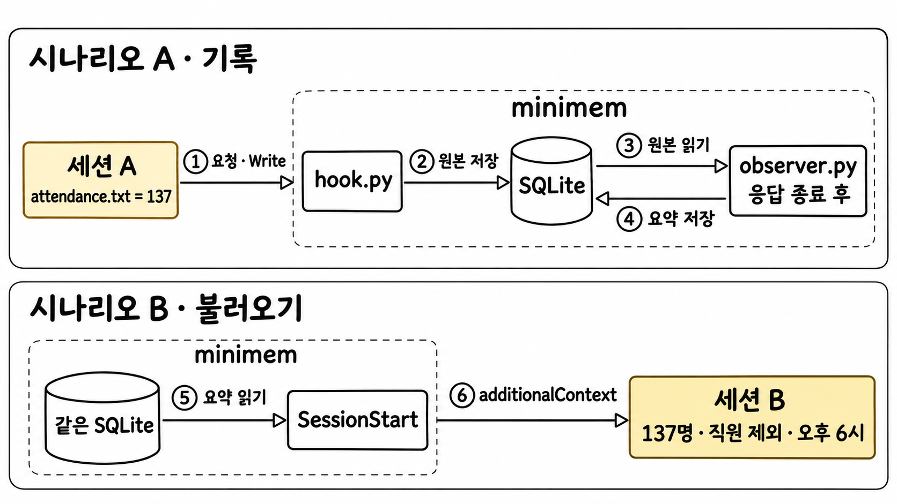

# 시나리오 1. 오늘 놀이공원에 몇 명이 왔을까?

`attendance.txt`에는 방문객 수만 적습니다. 대화로 알려준 집계 기준과 확정 시각까지 새 세션이 기억하는지 확인합니다.

## 코드에서 기록이 이동하는 경로



1. **①–② 캡처** — Claude Code가 첫 요청과 성공한 `Write` 이벤트를 JSON으로 넘깁니다. `on_prompt()`와 `on_tool()`이 각각 SQLite에 바로 저장합니다. 여기서는 모델을 추가로 호출하지 않습니다. 파일에는 `137`만 있지만, 별도로 저장한 요청에는 직원 제외와 오후 6시가 들어 있습니다. [요청 저장](../minimem/minimem/hook.py#L33-L36) · [도구 기록 저장](../minimem/minimem/hook.py#L47-L59)
2. **③–④ 요약** — 세션 A가 응답을 마치면 `Stop` hook이 백그라운드에서 `observe()`를 실행합니다. observer는 두 기록을 읽어 Haiku로 요약과 관찰을 만들고 같은 DB에 저장합니다. [`observe()`](../minimem/minimem/observer.py#L108-L122)
3. **⑤–⑥ 주입** — 새 세션이 열리면 `on_session_start()`가 DB에서 요약과 관찰 제목을 읽어 `additionalContext`로 돌려줍니다. Claude Code가 이를 모델 입력에 붙이므로 새 세션이 파일을 읽지 않고도 집계 기준을 답할 수 있습니다. [`on_session_start()`](../minimem/minimem/hook.py#L25-L30)

## 1. 방문객 수 기록

[환경 준비](setup.md)를 마친 터미널에서 아래를 실행합니다. 처음부터 다시 실습할 때는 새 폴더와 DB를 준비하세요.

```bash
PA='attendance.txt를 만들어 137 한 줄만 적어 줘. 방문객은 지금까지 137명이고, 직원은 집계에서 제외해. 최종 인원은 오후 6시에 확정할 거야.'
minimem/.venv/bin/python scripts/run_session.py --no-mcp --tools Write "$LAB_DIR/park" "$PA" &&
  cat "$LAB_DIR/park/attendance.txt" &&
  minimem/.venv/bin/minimem events park
```

`137`은 파일 내용이고, `Write` 행은 hook이 SQLite에 남긴 기록입니다.

## 2. 파일 쓰기와 hook 기록 확인

### Claude Code에 Write 도구 전달

`run()`은 프롬프트와 `--tools=Write`를 Claude Code에 넘깁니다. 실행기의 작업 디렉터리인 `cwd=options.lab_dir`는 이 실습에서 `$LAB_DIR/park`입니다. Claude Code가 `Write` 도구로 그곳에 파일을 만듭니다. [`run_session.py` 30–40줄](../scripts/run_session.py#L30-L40)

```python
args = ["claude", "-p", options.prompt, *CLAUDE_ARGS]
if options.tools is not None:
  args.append(f"--tools={options.tools}")
```

### 파일을 쓴 뒤 hook 호출

`PostToolUse`에 등록된 명령은 성공한 도구 호출 뒤에 실행됩니다. `make up`이 설정의 `__MINIMEM__`을 실제 설치 경로로 바꿉니다. [`settings.json` 23–32줄](../lab-template/.claude/settings.json#L23-L32)

```json
{
  "type": "command",
  "command": "\"__MINIMEM__/.venv/bin/minimem-hook\" tool"
}
```

### 도구 결과를 SQLite에 저장

`main()`은 표준 입력을 JSON으로 읽고, 명령 인자 `tool`에 연결된 `on_tool()`을 호출합니다. `on_tool()`은 `tool_input`과 `tool_response`를 꺼내 `db.insert_event()`로 저장합니다. [`hook.py` 74–82줄](../minimem/minimem/hook.py#L74-L82) · [SQLite INSERT](../minimem/minimem/db.py#L91-L97)

```python
HANDLERS[sys.argv[1]](json.load(sys.stdin))
```

SQLite에서 `Write`에 전달된 경로와 내용, 도구가 반환한 결과를 확인합니다.

```bash
sqlite3 -line "$MINIMEM_HOME/memory.db" \
  "SELECT tool_input, tool_output FROM events WHERE project = 'park' AND tool_name = 'Write';"
```

`tool_input`에서 `attendance.txt`와 `137\n`을 찾으세요. 그럼 다음 세션이 기억할 **‘직원 제외’**는 어디에 기록됐을까요?

## 3. 같은 질문으로 비교

먼저 minimem을 끄고 묻습니다. 둘 다 `--tools ""`를 사용해 파일 읽기를 막습니다.

```bash
PB='오늘 놀이공원 방문객은 몇 명이었어? 집계에서 누구를 뺐고 몇 시에 확정하기로 했어? 모르는 항목은 모른다고 답해 줘.'
minimem/.venv/bin/python scripts/run_session.py --no-memory --tools "" "$LAB_DIR/park" "$PB"
```

### 지난 세션 요약 확인

세션 A가 응답을 마칠 때 `Stop` hook이 observer를 백그라운드에서 시작합니다. observer는 세션 ID로 첫 요청과 `Write` 기록을 읽어 Haiku에 보내고, 응답에서 요약을 꺼내 SQLite에 저장합니다. 세션 A의 명령이 끝난 직후에는 이 작업이 진행 중일 수 있습니다. [Stop hook](../minimem/minimem/hook.py#L62-L71) · [observer의 입력과 저장](../minimem/minimem/observer.py#L108-L122)

아래 명령은 이미 저장된 요약과 관찰 제목을 `build_context()`로 출력합니다. `지난 세션 요약`이 보일 때까지 몇 초 뒤 다시 확인하세요. [`context` 명령](../minimem/minimem/cli.py#L48-L50)

```bash
minimem/.venv/bin/minimem context park
```

### 요약을 받은 새 세션에 같은 질문

이제 MCP 검색을 끈 채 같은 질문을 합니다.

```bash
minimem/.venv/bin/python scripts/run_session.py --no-mcp --tools "" "$LAB_DIR/park" "$PB"
```

`--no-mcp`는 MCP 서버 연결만 생략합니다. 새 세션의 `SessionStart` hook은 작업 경로에서 프로젝트 키 `park`를 구하고, 위에서 확인한 것과 같은 `build_context()`로 텍스트를 만듭니다. 이 텍스트가 `additionalContext`로 반환되면 Claude Code가 첫 질문을 처리하기 전에 모델 입력에 붙입니다. [옵션 처리](../scripts/run_session.py#L32-L40) · [SessionStart hook](../minimem/minimem/hook.py#L25-L30)

다음 두 줄이 `context park`에서 본 텍스트를 Claude Code에 돌려주는 부분입니다.

```python
if context:
  print(json.dumps({"hookSpecificOutput": {"hookEventName": "SessionStart", "additionalContext": context}}, ensure_ascii=False))
```

| 옵션 | 시작 시 메모리 주입 | MCP 검색 |
| --- | --- | --- |
| `--no-memory` | 끔 | 끔 |
| `--no-mcp` | 켬 | 끔 |

첫 질문은 `injected_context_chars: 0`이 예상됩니다. 두 번째는 주입 글자 수가 0보다 큰지, **137명, 직원 제외, 오후 6시**를 답했는지 확인하세요. [SQLite에 저장된 원본 이벤트 확인](2-capture-hooks.md)
