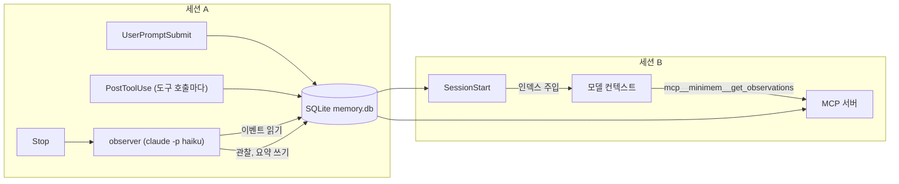

# 시나리오 1. 기능 지도와 최종 목표: 인수인계 노트를 남기는 동료

## 이 시나리오의 목표

| 항목 | 내용 |
| --- | --- |
| 기능 | 코딩 에이전트의 세션 간 메모리(persistent memory) |
| 쓰는 도구 | Claude Code(`claude -p`), minimem, `scripts/run_session.py` |
| 입력 | 할인 계산 버그가 있는 `shop` 프로젝트, 세션 A의 작업 지시, 세션 B의 질문 |
| 작업 | 1. 메모리 없이 세션 A·B 실행 2. minimem을 켜고 세션 A·B 실행 3. 두 결과 비교 |
| 달성할 것 | 세션 B가 파일을 다시 읽지 않고 지난 세션의 원인, 규칙, 다음 할 일을 답하는 것을 숫자로 확인 |

## 세션 간 메모리는 퇴근하는 동료가 남기는 인수인계 노트다

사람 개발자는 퇴근 전에 "할인 계산 버그는 퍼센트를 100으로 나누지 않아서였다. 금액은 int로만 다루기로 했다. 다음은 쿠폰 중복 금지다" 같은 노트를 남깁니다. 다음 날 아침 출근한 사람은 노트를 읽고, 자세한 내용이 필요할 때만 커밋이나 티켓을 엽니다.

코딩 에이전트에게는 이 노트가 없습니다. Claude Code 세션은 끝나면 컨텍스트 윈도가 비고, 다음 세션은 같은 파일을 다시 읽고 같은 질문을 다시 하며, 이미 고친 실수(예: 설치되지 않은 `pytest` 실행)를 반복합니다. claude-mem은 에이전트 옆에 기록 담당 에이전트를 하나 더 두어 이 노트를 자동으로 씁니다.

세션 간 메모리가 다루는 범위와 다루지 않는 범위는 다음과 같습니다.

| 다루는 것 | 다루지 않는 것 |
| --- | --- |
| 지난 세션에서 내린 결정, 발견한 사실, 고친 버그, 남은 일 | 현재 세션 안의 대화 기억. 이것은 컨텍스트 윈도가 맡습니다 |
| 사용자가 프롬프트로 알려 준 규칙(예: 금액은 int) | 코드 자체. 코드는 저장소에 있으므로 다시 저장하지 않습니다 |
| 다음 세션이 처음에 읽을 짧은 인덱스 | 대화 원문 보관. `claude --resume`과 transcript 파일이 맡습니다 |

### 용어

| 용어 | 뜻 | 이 실습의 예 |
| --- | --- | --- |
| hook | Claude Code가 lifecycle 이벤트마다 실행하는 셸 명령 | `PostToolUse`에서 `minimem-hook tool` 실행 |
| 이벤트(event) | hook이 받은 도구 호출 원본 1건 | `Edit` 호출 입력과 결과 894자 |
| observer | 이벤트를 읽고 관찰을 쓰는 별도 LLM 호출 | `claude -p --model haiku --tools=` |
| 관찰(observation) | 다음 세션이 쓸 수 있게 압축한 사실 1건 | `#1 [bugfix] apply_discount 할인율 계산 누락된 100 나눗셈 수정` |
| 세션 요약(summary) | 세션 하나의 요청, 완료, 알게 된 것, 다음 할 일 | `다음 할 일: 쿠폰 중복 적용 금지 기능을 구현한다` |
| 컨텍스트 주입 | 새 세션 시작 때 요약과 관찰 인덱스를 모델 입력에 넣는 것 | `SessionStart` hook의 `additionalContext` 806자 |
| progressive disclosure | 인덱스를 먼저 주고 본문은 요청할 때만 주는 방식 | `search` 결과 431자, 전체 본문 2,363자 |

## 메모리가 없으면 다음 세션이 지난 결정을 복원하지 못한다

세션 A에서 사용자는 "금액은 원 단위 int로만 다루고 float는 쓰지 않는다", "다음 작업은 쿠폰 중복 적용 금지"라고 알려 줍니다. 이 두 정보는 코드에 남지 않습니다. 메모리 없는 세션 B는 도구를 4번 호출해 프로젝트를 뒤졌지만 답하지 못했습니다.

```text
지난 세션 기록은 찾지 못했습니다. 그래서 버그 원인, 금액 타입 규칙, 다음 할 일은 말씀드릴 수 없습니다.
```

코드에 남는 정보(고친 계산식)는 다시 읽어서 복원할 수 있지만, 그때마다 토큰과 시간이 듭니다. 코드에 남지 않는 정보(사용자 규칙, 다음 할 일, `pytest`가 없다는 환경 사실)는 아예 복원할 수 없습니다. 세션 간 메모리는 두 번째 문제를 풀고 첫 번째 비용을 줄입니다.

## 대안 비교

| 방식 | 기록 시점 | 기록 주체 | 다음 세션이 읽는 방식 | 한계 |
| --- | --- | --- | --- | --- |
| `CLAUDE.md`에 직접 기록 | 사람이 쓸 때 | 사람 | 매 세션 전체 로드 | 사람이 잊으면 남지 않고, 길어질수록 매 세션 토큰을 씁니다 |
| Claude Code auto memory(`~/.claude/projects/<프로젝트>/memory/MEMORY.md`) | 에이전트가 판단할 때 | 작업 중인 에이전트 | 매 세션 로드 | 작업 에이전트가 기록할지 스스로 정하므로 빠질 수 있습니다 |
| `claude --resume` | 세션 원문 저장 | Claude Code | 대화 원문을 이어 붙임 | 원문이 커서 컨텍스트를 많이 쓰고, 여러 세션을 합치지 못합니다 |
| claude-mem, minimem | 도구 호출마다 자동 | 별도 observer | 인덱스 주입 + 필요 시 검색 | observer 호출 비용, 요약 왜곡 가능성 |

claude-mem 방식의 특징은 기록을 작업 에이전트의 판단에 맡기지 않는다는 점입니다. hook이 모든 도구 호출을 빠짐없이 모으고, 무엇을 남길지는 별도 observer가 정합니다.

## 컴포넌트 역할

| 기능 | claude-mem 컴포넌트 | minimem 파일 | 시나리오 |
| --- | --- | --- | --- |
| 캡처 | `plugin/hooks/hooks.json`, `src/cli/handlers/observation.ts` | `minimem/hook.py` | [2](2-capture-hooks.md) |
| 압축 | `src/sdk/prompts.ts`, `src/services/worker/ClaudeProvider.ts` | `minimem/observer.py` | [3](3-observer.md) |
| 저장·검색 | `src/services/sqlite/`(SQLite FTS5), Chroma | `minimem/db.py`, `minimem/search.py` | [4](4-storage-search.md) |
| 주입 | `src/services/context/ContextBuilder.ts` | `minimem/context.py` | [5](5-context-injection.md) |
| 본문 조회 | `src/servers/mcp-server.ts` | `minimem/mcp_server.py` | [6](6-mcp-search.md) |
| 비동기 처리, viewer, 다중 에이전트 | worker 서비스, `/viewer` | 생략 | [7](7-claude-mem-comparison.md) |

## 흐름

세션 A의 도구 호출이 관찰이 되어 세션 B의 입력에 들어가기까지의 전체 경로입니다.



## 실습

실습 환경은 [setup.md](setup.md)로 먼저 만듭니다. 아래 명령은 저장소 루트에서 시작합니다.

### 1. 메모리 없이 세션 A 실행

`--no-memory`는 hook을 무력화(`MINIMEM_DISABLE=1`)하고 MCP 서버를 연결하지 않습니다. 세션 A는 버그를 고치고 테스트를 통과시킵니다.

```bash
cd computer_science/ai/claude-mem-agent-memory
PA="tests/test_discount.py가 실패한다. 원인을 찾아 고쳐라. 참고로 이 프로젝트는 금액을 원 단위 int로만 다루기로 했고 float는 쓰지 않는다. 다음 작업은 쿠폰 중복 적용 금지 기능이다."
uv run scripts/run_session.py --no-memory ~/minimem-workspace/shop "$PA"
```

```text
session_id: <실행마다 다름>
injected_context_chars: 0
tool_calls: 4 {'Bash': 3, 'Edit': 1}
turns: 5  input_tokens: 79179  output_tokens: 937  duration_s: 8.7
```

이 문서의 세션 출력은 지표 줄과 답변 일부만 옮겼습니다. 답변(`--- answer ---` 이하)을 생략한 블록도 있습니다.

`run_session.py`는 `--no-session-persistence`로 Claude Code의 transcript 저장을 끕니다. 세션 B가 transcript 파일을 찾아 읽으면 메모리 유무 비교가 흐려지기 때문입니다. 실행마다 도구 호출 수와 토큰은 조금씩 달라집니다.

### 2. 메모리 없이 세션 B 실행

새 세션에서 지난 작업을 묻습니다.

```bash
PB="지난 세션에서 이 프로젝트에 무슨 작업을 했지? 버그 원인, 금액 타입 규칙, 다음 할 일을 알려줘."
uv run scripts/run_session.py --no-memory ~/minimem-workspace/shop "$PB"
```

```text
session_id: <실행마다 다름>
injected_context_chars: 0
tool_calls: 4 {'Bash': 4}
turns: 5  input_tokens: 100592  output_tokens: 1521  duration_s: 12.5
--- answer ---
지난 세션 기록은 찾지 못했습니다. 그래서 버그 원인, 금액 타입 규칙, 다음 할 일은 말씀드릴 수 없습니다.
```

세션 B는 `Bash`로 디렉터리와 `~/.claude/projects/` 아래를 뒤졌지만 기록을 찾지 못했습니다. 코드에서 `price - price * rate // 100`을 읽었어도 그것이 버그 수정의 결과인지 판단하지 못했습니다.

### 3. minimem을 켜고 세션 A 실행

프로젝트와 메모리를 초기화하고 같은 지시로 세션 A를 실행합니다. 이번에는 hook이 도구 호출을 모으고, 세션이 끝나면 observer가 백그라운드에서 관찰을 씁니다.

```bash
make down && make up
uv run scripts/run_session.py ~/minimem-workspace/shop "$PA"
```

```text
session_id: <실행마다 다름>
injected_context_chars: 0
tool_calls: 5 {'Bash': 2, 'Read': 2, 'Edit': 1}
turns: 6  input_tokens: 79346  output_tokens: 1108  duration_s: 8.9
```

observer는 세션이 끝난 뒤 약 10초 동안 실행됩니다. `pgrep -f minimem.observer`가 아무것도 출력하지 않을 때까지 기다린 뒤 다음 단계로 넘어갑니다.

```bash
while pgrep -f minimem.observer >/dev/null; do sleep 2; done
uv run --project minimem minimem stats shop
```

```text
{"events": 5, "event_chars": 2617, "observations": 3, "observation_chars": 1120, "context_chars": 806}
```

이 수치는 세션 A의 이벤트 5개와 observer 출력 기준이며, observer가 만드는 관찰 개수는 실행마다 달라집니다.

### 4. minimem을 켜고 세션 B 실행

같은 질문을 새 세션에 보냅니다.

```bash
uv run scripts/run_session.py ~/minimem-workspace/shop "$PB"
```

```text
session_id: <실행마다 다름>
injected_context_chars: 806
tool_calls: 0 {}
turns: 1  input_tokens: 19880  output_tokens: 476  duration_s: 3.3
--- answer ---
**버그 원인**
- `apply_discount`가 정수 퍼센트 `rate`를 100으로 나누지 않아서 할인 금액이 과도하게 계산됐습니다.
**금액 타입 규칙**
- 금액은 원 단위 `int`만 사용하고 `float`는 쓰지 않습니다.
**다음 할 일**
1. 쿠폰 중복 적용 금지 기능 구현
2. 내림 방식 할인 반올림 정책이 맞는지 확인하고, 필요하면 문서화
3. pytest가 필요하면 설치. 현재 환경에는 없어서 unittest로 검증해야 합니다.

참고로 이 내용은 세션 시작 시 불러온 기록 기준입니다. 현재 코드가 그 기록과 같은지는 따로 확인하지 않았습니다.
```

답변은 줄였습니다. 세션 B는 `SessionStart`가 주입한 806자만 읽고 도구를 한 번도 호출하지 않았습니다.

### 5. 두 결과 비교

| 세션 B 지표 | 메모리 없음 | minimem | 변화 |
| --- | --- | --- | --- |
| 지난 결정(int 규칙, 다음 할 일) 답변 | 실패 | 성공 | |
| 도구 호출 | 4회 | 0회 | -4 |
| 입력 토큰(캐시 포함) | 100,592 | 19,880 | -80% |
| 소요 시간 | 12.5초 | 3.3초 | -74% |

입력 토큰은 시스템 프롬프트와 도구 정의를 포함한 값이라, 질문 하나에 약 2만 토큰이 기본으로 듭니다. 메모리 없는 세션은 도구를 호출할 때마다 그때까지의 대화 전체를 다시 입력하므로, 호출 4번이 약 8만 토큰을 더 썼습니다. 세션 B를 위해 세션 A 끝에 observer 호출 1번(haiku, 약 10초)이 추가로 들었다는 점도 함께 계산해야 합니다.

## 부록. 실무에서 얻는 것

- 메모리의 가치는 "코드에 남지 않는 정보"에서 가장 크게 나타납니다. 이 실습에서 세션 B가 메모리 없이 답하지 못한 항목은 모두 사용자 프롬프트나 실행 환경에서 온 정보였습니다.
- 주입된 컨텍스트를 에이전트가 사실로 믿는다는 점이 장점이자 위험입니다. 세션 B는 "현재 코드가 그 기록과 같은지는 따로 확인하지 않았습니다"라고 답했습니다. 기록이 틀리면 틀린 채로 전달됩니다. 이 위험은 [시나리오 3](3-observer.md)에서 다룹니다.
- 비교 실험을 할 때는 Claude Code 자체의 기억 경로(transcript, auto memory, `CLAUDE.md`)를 통제해야 합니다. 통제하지 않은 첫 실험에서 메모리 없는 세션 B는 `~/.claude/projects/`의 이전 transcript를 찾아 읽으려 했습니다.
