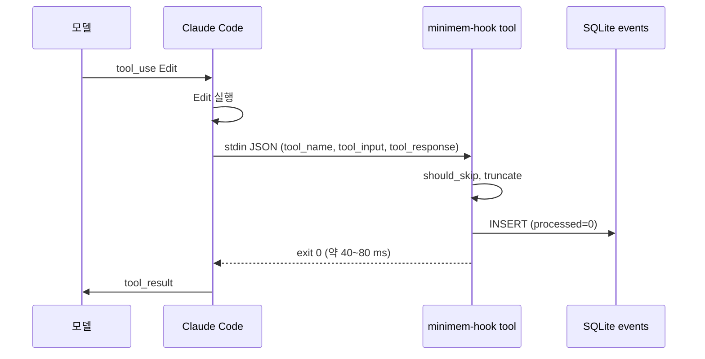

# 시나리오 2. 캡처: lifecycle hook으로 도구 호출을 모은다

## 이 시나리오의 목표

| 항목 | 내용 |
| --- | --- |
| 기능 | 에이전트 활동 캡처 |
| 쓰는 도구 | Claude Code hook, `minimem/hook.py` |
| 입력 | 시나리오 1에서 실행한 세션 A의 도구 호출 |
| 작업 | 1. 저장된 이벤트 확인 2. 이벤트 원본 1건 확인 3. hook 실행 시간 측정 4. hook 실패가 세션을 멈추지 않는지 확인 |
| 달성할 것 | 모든 도구 호출이 LLM 없이 원본 그대로 저장되고, hook 1회가 100 ms 안에 끝나는 것을 확인 |

## 캡처는 에이전트 판단과 상관없이 모든 도구 호출을 받아 적는 일이다

Claude Code hook은 lifecycle 이벤트가 일어날 때 Claude Code가 실행하는 셸 명령입니다. Claude Code는 이벤트 내용을 JSON으로 명령의 stdin에 넘기고, `SessionStart`처럼 출력이 의미 있는 이벤트에서는 stdout을 읽어 모델 컨텍스트에 넣습니다.

minimem이 쓰는 이벤트는 4개입니다.

| 이벤트 | 시점 | stdin의 핵심 필드 | minimem 동작 |
| --- | --- | --- | --- |
| `SessionStart` | 세션 시작 | `session_id`, `cwd`, `source` | 지난 기록을 출력해 주입([시나리오 5](5-context-injection.md)) |
| `UserPromptSubmit` | 사용자가 프롬프트를 보낼 때 | `prompt` | 세션의 첫 프롬프트와 `cwd` 저장 |
| `PostToolUse` | 도구 호출이 성공한 뒤 | `tool_name`, `tool_input`, `tool_response` | 이벤트 1건 저장 |
| `Stop` | 에이전트가 응답을 끝낼 때 | `session_id` | observer를 분리 프로세스로 실행([시나리오 3](3-observer.md)) |

캡처가 다루지 않는 것도 있습니다. hook은 모델의 내부 추론이나 응답 텍스트를 받지 않습니다. 권한이 거부된 도구 호출은 `PostToolUse`가 아니라 `PostToolUseFailure`로 가므로 minimem은 기록하지 않습니다. claude-mem은 두 이벤트를 모두 받습니다.

### 용어

| 용어 | 뜻 | 이 실습의 예 |
| --- | --- | --- |
| lifecycle 이벤트 | Claude Code 세션의 정해진 시점 | `PostToolUse` |
| matcher | 어느 도구에 hook을 걸지 정하는 패턴 | `"matcher": "*"`는 모든 도구 |
| `additionalContext` | `SessionStart` hook이 stdout JSON으로 돌려주는 모델 입력 | 지난 세션 요약 806자 |
| async hook | Claude Code가 끝나기를 기다리지 않는 hook | claude-mem의 `PostToolUse`(`"async": true`) |

## 기록을 작업 에이전트에게 맡기면 빠진다

에이전트에게 "중요한 것은 메모해라"라고 지시하는 방식은 모델의 판단에 의존합니다. 모델은 작업에 집중할수록 기록을 건너뛰고, 무엇이 중요한지는 작업이 끝난 뒤에야 알 수 있는 경우가 많습니다. 시나리오 1의 `pytest`가 없다는 사실이 그런 예입니다. 세션 A의 에이전트는 `python -m pytest` 실패를 우회했을 뿐 기록하지 않았지만, hook은 그 실패 출력을 이벤트로 남겼고 observer가 그것을 관찰로 만들었습니다.

hook은 모델이 아니라 Claude Code 프로세스가 실행하므로, 모델이 무엇을 생각하든 모든 도구 호출이 빠짐없이 저장됩니다.

## 대안 비교

| 방식 | 장점 | 단점 |
| --- | --- | --- |
| hook(claude-mem, minimem) | 실시간, 도구 호출 단위, 에이전트 판단과 무관 | hook이 느리면 에이전트도 느려집니다 |
| transcript 파일 감시 | Claude Code 설정을 바꾸지 않아도 됩니다 | 파일 형식이 공개 API가 아니라 버전마다 바뀔 수 있습니다. claude-mem도 `transcripts` 감시 기능을 보조로 둡니다 |
| 에이전트 자기 기록(auto memory) | 별도 프로세스가 필요 없습니다 | 기록 누락이 모델 판단에 달려 있습니다 |

## hook은 빨라야 하므로 LLM을 부르지 않는다

`PostToolUse` hook은 도구 호출마다 실행되고, 동기 hook이면 Claude Code가 끝나기를 기다립니다. hook 안에서 LLM을 부르면 도구 호출마다 수 초가 추가됩니다. 그래서 minimem의 `on_tool`은 이벤트를 SQLite에 INSERT만 하고 끝나며, LLM 호출은 세션이 끝날 때 `Stop` hook이 분리 프로세스로 넘깁니다.

claude-mem은 한 단계 더 나아갑니다. `PostToolUse` hook을 `"async": true`로 등록하고, hook은 이벤트를 로컬 worker HTTP 서버로 보내며, worker가 응답하지 않으면 로컬 spool 파일에 적어 둡니다. `src/cli/handlers/observation.ts`의 주석은 Codex의 hook timeout 5초 안에 spool 기록까지 끝내도록 서버 대기 시간을 2초로 잡았다고 설명합니다.

## 컴포넌트 역할

| 컴포넌트 | 역할 |
| --- | --- |
| `.claude/settings.json`의 `hooks` | 이벤트별로 실행할 명령 등록 |
| `minimem-hook <이벤트>` | stdin JSON을 읽어 `HANDLERS[이벤트]` 실행 |
| `truncate()` | 도구 입력과 출력을 각 2,000자로 자릅니다. 큰 파일 `Read`가 DB와 observer 입력을 키우지 않게 합니다 |
| `should_skip()` | `mcp__minimem__*`, `ToolSearch` 호출은 저장하지 않습니다([시나리오 6](6-mcp-search.md)) |
| `events` 테이블 | 이벤트 원본, `processed` 플래그 |

## 흐름

도구 호출 1번이 `events` 테이블의 행 1개가 되기까지의 순서입니다.



## 실습

[시나리오 1](1-memory-map.md)의 3단계(minimem을 켜고 세션 A 실행)까지 끝낸 상태에서 시작합니다. 명령은 workspace 루트(`computer_science/ai/claude-mem-agent-memory`)에서 실행합니다.

### 1. 저장된 이벤트 목록 확인

세션 A의 도구 호출이 모두 저장됐는지 봅니다. `processed=1`은 observer가 이미 처리한 이벤트입니다.

```bash
uv run --project minimem minimem events shop
```

```text
1  Bash  379 chars  processed=1  {"command": "ls -R . | head -50 && python -m pytest tests/te
2  Read  392 chars  processed=1  {"file_path": "/root/minimem-workspace/shop/shop/discount.py
3  Read  686 chars  processed=1  {"file_path": "/root/minimem-workspace/shop/tests/test_disco
4  Edit  894 chars  processed=1  {"file_path": "/root/minimem-workspace/shop/shop/discount.py
5  Bash  266 chars  processed=1  {"command": "python -m unittest tests.test_discount 2>&1 | t
```

`run_session.py`가 보고한 세션 A의 도구 호출 5개(`Bash` 2, `Read` 2, `Edit` 1)가 모두 행으로 남았습니다. 1번 이벤트의 출력에는 `No module named pytest`가 들어 있고, 이것이 시나리오 3에서 관찰 `#2`가 됩니다.

### 2. 이벤트 원본 1건 확인

`Edit` 이벤트에 무엇이 담기는지 확인합니다. `tool_response`에는 Claude Code가 돌려준 수정 전 파일 전체(`originalFile`)까지 들어 있습니다.

```bash
python3 -c "import sqlite3,os;c=sqlite3.connect(os.path.expanduser('~/.minimem/memory.db'));print(c.execute('select tool_input, substr(tool_output,1,200) from events where id=4').fetchone())"
```

```text
('{"file_path": "/root/minimem-workspace/shop/shop/discount.py", "old_string": "  return price - price * rate", "new_string": "  return price - price * rate // 100", "replace_all": false}', '{"filePath": "/root/minimem-workspace/shop/shop/discount.py", "oldString": "  return price - price * rate", "newString": "  return price - price * rate // 100", "originalFile": "\\"\\"\\"할인 계산.\\"\\"\\"\\n\\n')
```

이벤트 원본에는 다음 세션에 필요 없는 정보(절대 경로, 파일 전문, JSON 키 중복)가 많습니다. 이 원본을 그대로 다음 세션에 넣지 않고 observer로 압축하는 이유입니다.

### 3. hook 실행 시간 측정

`hook_latency.py`는 임시 `MINIMEM_HOME`에서 hook을 10번씩 실행합니다. 실습 DB는 바뀌지 않습니다.

```bash
uv run scripts/hook_latency.py
```

```text
PostToolUse, uv run 경유: median 80 ms, max 94 ms
PostToolUse, venv 직접 실행: median 39 ms, max 52 ms
Stop, observer 분리 실행: median 43 ms, max 45 ms
```

hook 시간의 절반은 `uv run`이 가상환경을 확인하는 데 씁니다. 도구 호출이 수십 번인 세션이면 `uv run` 경유가 수 초를 더하므로, 운영 환경에서는 venv의 `minimem-hook`을 직접 호출하거나 claude-mem처럼 async hook으로 등록합니다. `Stop`은 observer를 기다리지 않으므로 observer 실행 시간(약 10초)과 상관없이 43 ms에 끝납니다.

### 4. hook 실패 시 동작 확인

hook이 예외를 던져도 세션이 멈추지 않아야 합니다. 잘못된 JSON을 넣어 확인합니다.

```bash
echo 'not json' | minimem/.venv/bin/minimem-hook tool; echo "exit=$?"
```

```text
minimem hook error: Expecting value: line 1 column 1 (char 0)
exit=0
```

`main()`은 모든 예외를 stderr로 보내고 exit 0으로 끝납니다. Claude Code hook에서 exit 2는 작업을 차단하는 신호이므로, 메모리 기록 실패가 사용자 작업을 멈추게 해서는 안 됩니다. claude-mem의 handler 주석도 "never exit 2"를 규칙으로 둡니다.

## 부록. 실무에서 얻는 것

- hook 명령 하나의 시간이 곧 에이전트의 도구 호출마다 붙는 지연입니다. 측정해 보면 인터프리터 기동과 패키지 매니저 확인이 대부분입니다. claude-mem이 PATH에 별도 launcher를 설치하고 hook을 셸 없이 실행하는 이유도 같습니다.
- 권한 거부 같은 실패는 `PostToolUseFailure`로 갑니다. 실패한 시도도 다음 세션에 유용한 정보(이 명령은 승인이 필요하다)이므로 운영에서는 두 이벤트를 모두 받습니다.
- 이벤트에는 파일 전문과 명령 출력이 들어가므로 비밀값도 그대로 저장될 수 있습니다. claude-mem은 `<private>` 태그 제거(`src/utils/tag-stripping.ts`)와 redaction(`src/utils/redaction.ts`)을 둡니다. minimem에는 없습니다.
