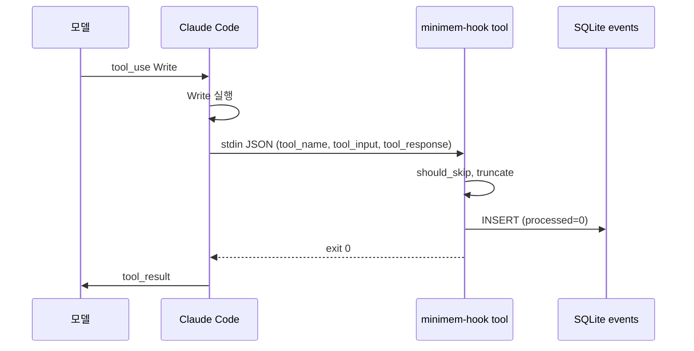

# 시나리오 2. 캡처: lifecycle hook으로 도구 호출 모으기

메모리 파이프라인의 첫 번째 단계는 에이전트가 세션 동안 무엇을 했는지 빠짐없이 수집하는 일입니다. 이 시나리오에서는 Claude Code의 lifecycle hook과 `minimem/hook.py`가 도구 호출을 LLM 호출 없이 원본 그대로 SQLite에 기록하는 구조를 살펴봅니다. 시나리오 1에서 실행한 세션 A의 이벤트가 실제로 어떻게 저장되었는지 확인하고, hook 1회 실행에 걸리는 시간과 hook이 실패했을 때 세션이 안전하게 계속 도는지도 직접 측정해 봅니다.

## 캡처는 에이전트 판단과 무관하게 모든 활동을 받아 적는 단계

Claude Code hook은 세션의 특정 lifecycle 시점에 Claude Code 프로세스가 자동으로 실행하는 셸 명령입니다. 이벤트가 발생하면 Claude Code가 관련 정보를 JSON 형태로 명령의 stdin에 넘겨주고, `SessionStart`처럼 모델에게 돌려줄 내용이 있는 이벤트라면 stdout을 읽어 컨텍스트에 반영합니다.

`minimem`은 이 중 네 가지 이벤트를 사용합니다.

| 이벤트 | 발생 시점 | stdin 핵심 필드 | minimem 동작 |
| --- | --- | --- | --- |
| `SessionStart` | 새 세션 시작 | `session_id`, `cwd`, `source` | 지난 세션 요약과 관찰 인덱스를 출력해 컨텍스트에 주입 ([시나리오 5](5-context-injection.md)) |
| `UserPromptSubmit` | 사용자가 프롬프트를 전송할 때 | `prompt` | 세션의 첫 프롬프트와 `cwd`를 DB에 저장 |
| `PostToolUse` | 도구 호출이 성공적으로 끝난 직후 | `tool_name`, `tool_input`, `tool_response` | 도구 호출 이벤트 1건을 원본 그대로 저장 |
| `Stop` | 에이전트가 응답을 마칠 때 | `session_id` | observer를 별도 분리 프로세스로 백그라운드 실행 ([시나리오 3](3-observer.md)) |

물론 hook이 모든 것을 다 받는 것은 아닙니다. 모델의 내부 추론 과정이나 일반 응답 텍스트는 hook으로 전달되지 않습니다. 또한 권한이 거부되어 실패한 도구 호출은 `PostToolUse`가 아니라 `PostToolUseFailure` 이벤트로 빠지는데, `minimem`은 단순화를 위해 `PostToolUse`만 구독합니다. 반면 원본 `claude-mem`은 두 이벤트를 모두 받아 실패한 시도까지 기록합니다.

### 핵심 용어 정리

| 용어 | 의미 | 이 실습에서의 예 |
| --- | --- | --- |
| lifecycle 이벤트 | Claude Code 세션의 정해진 동작 시점 | `PostToolUse` |
| matcher | 어떤 도구 호출에 hook을 적용할지 지정하는 패턴 | `"matcher": "*"` (모든 도구 대상) |
| `additionalContext` | `SessionStart` hook이 stdout JSON으로 반환해 모델 입력에 추가하는 문자열 | 방문객 집계 요약과 관찰 제목 |
| async hook | Claude Code가 종료를 기다리지 않고 비동기로 넘기는 hook | `claude-mem`의 `PostToolUse` (`"async": true`) |

## 왜 작업 에이전트에게 기록을 맡기지 않을까

흔히 떠올리는 방법은 프롬프트로 "중요한 발견이 있으면 메모 파일에 적어 두라"고 지시하는 것입니다. 하지만 이 방식은 기록 여부가 전적으로 작업 중인 모델의 판단에 좌우됩니다. 모델은 당장 방문객 숫자를 기록하는 데 집중하면서 집계 기준을 따로 메모하지 않을 수 있고, 애초에 작업 도중에는 어떤 사실이 나중에 중요해질지 알기 어려운 경우도 많습니다.

세션 A에서 Claude Code는 첫 요청을 `sessions`에, 숫자 파일을 만든 `Write` 호출을 `events`에 남깁니다. observer는 이 두 기록을 함께 읽습니다.

Claude Code가 등록된 이벤트에서 hook을 직접 호출하므로, 모델이 별도 메모를 쓰기로 판단할 필요가 없습니다.

## 캡처 방식별 대안 비교

| 방식 | 장점 | 단점 |
| --- | --- | --- |
| lifecycle hook (`claude-mem`, `minimem`) | 실시간으로 도구 호출 단위 캡처 가능, 에이전트 판단과 무관하게 누락 없음 | 동기 hook이 느리면 에이전트 응답 전체가 함께 느려짐 |
| transcript 파일 감시 | Claude Code hook 설정을 따로 건드리지 않아도 됨 | 파일 포맷이 공개 API가 아니라 버전업 시 깨질 수 있음 (`claude-mem`도 보조 수단으로만 사용) |
| 에이전트 자기 기록 (auto memory) | 별도 프로세스나 설정 없이 가볍게 동작 | 무엇을 남길지 모델 판단에 달려 있어 기록이 누락될 수 있음 |

## hook 안에서 LLM을 호출하지 않는 이유

`PostToolUse` hook은 에이전트가 도구를 한 번 쓸 때마다 매번 실행됩니다. 만약 동기(sync) hook 안에서 곧바로 LLM을 호출해 요약을 만들면, 도구 호출 1회마다 수 초의 지연이 그대로 사용자 대기 시간으로 누적됩니다.

그래서 `minimem`의 `on_tool`은 아주 단순한 일만 합니다. 받은 JSON을 적당한 길이로 자른 뒤 SQLite `events` 테이블에 `INSERT`하고 즉시 종료합니다. 시간이 오래 걸리는 LLM 요약 작업은 세션이 끝나는 `Stop` hook 시점에 별도 프로세스로 넘겨 백그라운드에서 처리합니다.

원본 `claude-mem`은 여기서 한 걸음 더 나아갑니다. `PostToolUse` hook 자체를 `"async": true`로 등록해 Claude Code가 기다리지 않게 만들고, hook은 이벤트를 로컬에서 상주하는 worker HTTP 서버로 전송합니다. 만약 worker가 죽어 있거나 응답하지 않으면 로컬 spool 파일에 임시로 적어 두고 끝납니다. `src/cli/handlers/observation.ts`의 주석을 보면 Codex의 hook timeout인 5초 안에 spool fallback까지 안전하게 마치기 위해 서버 대기 시간을 2초로 잡았다는 배경까지 확인할 수 있습니다.

## 주요 구성 요소와 역할

| 구성 요소 | 역할 |
| --- | --- |
| `.claude/settings.json`의 `hooks` | 각 lifecycle 이벤트에 실행할 셸 명령 등록 |
| `minimem-hook <이벤트>` | stdin의 JSON을 파싱해 `HANDLERS[이벤트]`로 라우팅 |
| `truncate()` | 도구 입력과 출력을 각각 2,000자로 제한해 대용량 `Read`가 DB와 observer 입력을 부풀리지 않도록 방지 |
| `should_skip()` | `mcp__minimem__*`, `ToolSearch` 같은 메모리 조회 도구 호출은 캡처 대상에서 제외 ([시나리오 6](6-mcp-search.md)) |
| `events` 테이블 | 도구 호출 원본과 observer 처리 여부(`processed` 플래그) 저장 |

## 도구 호출 캡처 흐름

에이전트가 도구를 한 번 호출했을 때 `events` 테이블에 행 하나가 쌓이기까지의 흐름입니다.



## 실습: 숫자 파일을 만든 기록 확인

[시나리오 1](1-memory-map.md)을 끝낸 같은 터미널에서 조회합니다. `Write` 행의 `processed=1`은 observer가 이 이벤트를 처리했다는 표시입니다.

```bash
minimem/.venv/bin/minimem events park
```

원본 입력과 결과를 보려면 아래를 실행합니다. 입력에 숫자 137은 있지만 직원 제외나 오후 6시라는 집계 지시는 없습니다. 이 두 정보의 출처는 `UserPromptSubmit`으로 저장한 첫 요청입니다.

```bash
sqlite3 "$MINIMEM_HOME/memory.db" "SELECT tool_input, tool_output FROM events WHERE project='park' AND tool_name='Write';"
```

hook을 직접 실행할 때와 uv를 매번 거칠 때의 차이는 아래 로컬 벤치마크로 확인합니다. 각 방식으로 `Write` 이벤트를 10번씩 넣고 중앙값과 최댓값을 출력합니다.

```bash
minimem/.venv/bin/python scripts/hook_latency.py
```

깨진 hook 입력을 전달했을 때도 Claude Code의 작업이 계속되는 이유는 hook이 오류를 stderr에 쓰고 종료 코드 0을 반환하기 때문입니다. 아래 명령으로 확인할 수 있습니다.

```bash
printf '%s\n' 'not json' | minimem/.venv/bin/minimem-hook tool
echo "exit=$?"
```

## 실무 관점에서 짚어볼 점

- **hook의 오버헤드는 대부분 코드가 아니라 실행기 기동 비용입니다**: 측정해 보면 SQLite `INSERT` 자체는 몇 밀리초에 불과하고, 인터프리터 기동과 패키지 매니저 확인이 지연의 대부분을 차지합니다. `claude-mem`이 PATH에 전용 launcher를 설치해 셸 없이 hook을 띄우는 것도 이 비용을 줄이기 위함입니다.
- **실패한 도구 호출도 훌륭한 기억 소재입니다**: 권한 거부나 명령 실패는 `PostToolUseFailure`로 전달됩니다. "이 명령은 승인이 필요하다"거나 "이 테스트 러너는 안 된다" 같은 실패 경험이 다음 세션의 시행착오를 크게 줄여주므로, 운영 수준에서는 성공과 실패 이벤트를 모두 수집하는 편이 유리합니다.
- **원본 이벤트에는 민감 정보가 섞일 수 있습니다**: 파일 전문과 셸 출력이 그대로 저장되므로 API 키나 환경 변수 값이 DB로 흘러들어갈 위험이 있습니다. `minimem`에는 빠져 있지만, `claude-mem`은 `<private>` 태그 제거(`src/utils/tag-stripping.ts`)와 민감정보 마스킹(`src/utils/redaction.ts`) 단계를 캡처 앞단에 두고 있습니다.
