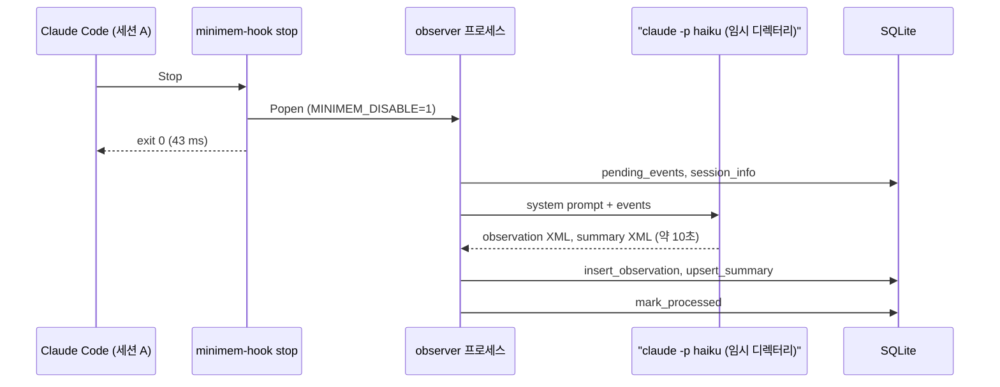

# 시나리오 3. 압축: observer 에이전트가 원본을 관찰로 바꾼다

## 이 시나리오의 목표

| 항목 | 내용 |
| --- | --- |
| 기능 | 에이전트 활동 압축(observation) |
| 쓰는 도구 | `minimem/observer.py`, `claude -p --model haiku` |
| 입력 | `events` 테이블의 미처리 이벤트, 세션의 첫 프롬프트 |
| 작업 | 1. 압축 결과 확인 2. 원본 대비 크기 비교 3. 격리 없이 observer를 실행했을 때의 재귀 기록 확인 |
| 달성할 것 | 이벤트 원본이 타입이 붙은 관찰로 줄어들고, observer 자신의 호출은 기록되지 않는 것을 확인 |

## observer는 작업 에이전트 옆에서 기록만 하는 두 번째 에이전트다

claude-mem README는 이 구조를 "your agent works, the observer takes notes"로 설명합니다. 작업 에이전트(세션 A의 sonnet)는 버그를 고치고, observer(별도 `claude -p` 호출, haiku)는 그 도구 호출 기록을 읽고 다음 세션에 남길 사실만 고릅니다. observer는 도구를 쓰지 않고 정해진 XML만 출력합니다.

minimem observer가 받는 입력과 출력은 다음과 같습니다.

| 구분 | 내용 |
| --- | --- |
| system prompt | 역할("기록 담당이다. 너 자신은 작업하지 않는다"), 기록 기준, XML 형식 |
| user 메시지 | `<project_root>`, `<user_request>`(세션 첫 프롬프트), `<events>`(도구 호출 원본) |
| 출력 | `<observation>` 0개 이상과 `<summary>` 1개 |

observer는 판단을 합니다. 단순 조회와 실패 후 재시도는 버리고, 사용자 프롬프트에만 있던 규칙("금액은 int")은 `decision` 관찰로 남깁니다. 이 판단 때문에 압축률이 생기고, 같은 이유로 왜곡도 생깁니다.

### 용어

| 용어 | 뜻 | 이 실습의 예 |
| --- | --- | --- |
| 관찰 타입 | 관찰의 분류. claude-mem `code` 모드의 타입을 줄여 썼습니다 | `bugfix`, `feature`, `decision`, `discovery`, `change` |
| facts | 검증 가능한 사실 목록 | `python -m pytest`는 "No module named pytest"로 실패했다 |
| narrative | 무엇을 왜 했는지 2~3문장 | 테스트 러너를 unittest로 바꿔 검증했다 |
| 재귀 기록 | observer의 LLM 호출이 다시 hook에 잡혀 기록되는 현상 | 격리 없이 실행하면 `sessions`가 1행 늘어남 |

## 원본 이벤트는 다음 세션에 넣기에 크고 시끄럽다

시나리오 2에서 본 `Edit` 이벤트 하나는 894자이고, 그중 대부분은 수정 전 파일 전문과 절대 경로입니다. 세션 A의 이벤트 5개는 2,617자, 세션 C(쿠폰 기능)의 이벤트 3개는 3,896자였습니다. 세션이 쌓일수록 원본을 그대로 주입하면 컨텍스트가 선형으로 커지고, 모델은 "무엇을 했는가"를 매번 다시 해석해야 합니다.

observer는 이 해석을 한 번만 하고 결과를 저장합니다.

| 세션 | 이벤트 | 원본 크기 | 관찰 | 관찰 크기 | 비율 |
| --- | --- | --- | --- | --- | --- |
| A(버그 수정) | 5개 | 2,617자 | 3개 | 1,120자 | 43% |
| C(쿠폰 기능) | 3개 | 3,896자 | 3개 | 975자 | 25% |

관찰 크기는 제목, facts, narrative 길이의 합입니다. 다음 세션에 주입되는 것은 이 본문도 아니고 제목 인덱스뿐이라 실제 주입량은 더 작습니다([시나리오 5](5-context-injection.md)).

## 대안 비교

| 방식 | 압축 품질 | 비용 | 지연 |
| --- | --- | --- | --- |
| 압축 없이 원본 저장 | 정보 손실 없음 | 주입할 때마다 큰 컨텍스트 | 없음 |
| 규칙 기반 요약(도구 이름, 파일 목록만) | 무엇을 했는지만 남고 왜는 사라집니다 | 없음 | 없음 |
| 작업 에이전트가 직접 요약 | 맥락을 가장 잘 앎 | 작업 에이전트의 컨텍스트와 시간을 씀 | 작업 중 발생 |
| 별도 observer(claude-mem, minimem) | 판단 포함, 왜곡 가능 | 작은 모델 호출 1회 | 백그라운드 |

claude-mem은 observer 모델을 `ClaudeProvider`, `OpenRouterProvider`, `GeminiProvider`처럼 교체할 수 있게 두었습니다. 압축은 비싼 모델이 아니어도 되는 일이라 작은 모델을 쓰는 선택지가 중요합니다.

## observer는 프로젝트 hook과 설정에서 격리해야 한다

observer도 `claude -p`로 실행하는 Claude Code 세션입니다. 격리하지 않으면 두 가지 문제가 생깁니다.

1. 재귀 기록. 프로젝트 디렉터리에서 실행하면 프로젝트의 hook이 observer 세션에도 걸립니다. observer의 프롬프트가 `UserPromptSubmit`으로 저장되고, `Stop`이 다시 observer를 띄웁니다.
2. 오염. 사용자 설정, `CLAUDE.md`, MCP 서버가 observer 컨텍스트에 들어가고, 도구가 열려 있으면 observer가 파일을 읽거나 고치려 합니다.

minimem은 claude-mem의 `src/sdk/hardened-options.ts`와 같은 방식으로 겹겹이 막습니다.

| 장치 | minimem 구현 | 막는 것 |
| --- | --- | --- |
| 작업 디렉터리 분리 | `tempfile.TemporaryDirectory()`를 `cwd`로 사용 | 프로젝트 hook, 프로젝트 `CLAUDE.md` |
| 환경 변수 가드 | `MINIMEM_DISABLE=1`이면 `minimem-hook`이 바로 반환 | 다른 경로로 hook이 걸려도 기록 안 함 |
| 도구 차단 | `--tools=` | observer의 파일 읽기와 수정 |
| 설정 차단 | `--setting-sources=`, `--strict-mcp-config` | 사용자 설정과 MCP 서버 |
| 세션 기록 끔 | `--no-session-persistence` | observer 대화가 transcript로 남는 것 |
| 지시문 분리 | `--system-prompt`로 지시문 전달 | 사용자 메시지에 섞인 지시와 역할 혼동 |

## 컴포넌트 역할

| 컴포넌트 | 역할 |
| --- | --- |
| `on_stop()` | `python -m minimem.observer <session_id>`를 `start_new_session=True`로 띄우고 바로 반환 |
| `build_prompt()` | `<project_root>`, `<user_request>`, `<events>`로 사용자 메시지 구성 |
| `call_llm()` | 격리 플래그로 `claude -p` 실행, JSON 출력의 `result`를 반환 |
| `parse_observations()` | 정규식으로 XML을 파싱하고, 허용되지 않은 타입은 `change`로 바꿈 |
| `mark_processed()` | 처리한 이벤트에 `processed=1`을 표시해 중복 압축을 막음 |

## 흐름

`Stop` hook이 observer를 띄운 뒤 관찰이 저장되기까지의 순서입니다.



## 실습

[시나리오 1](1-memory-map.md)의 세션 A와 [시나리오 6](6-mcp-search.md)의 세션 C까지 실행한 상태를 기준으로 합니다. 명령은 workspace 루트에서 실행합니다.

### 1. 관찰 결과 확인

observer가 세션 A에서 만든 관찰을 봅니다.

```bash
uv run --project minimem minimem observations shop
```

```text
#1 [bugfix] apply_discount 할인율 계산 누락된 100 나눗셈 수정
- 수정 전 apply_discount는 `price - price * rate`를 반환했다. rate는 정수 퍼센트(10 = 10%)인데 100으로 나누지 않아 10000원에 10%를 적용하면 -90000이 나왔다.
- 수정 후 반환식은 `price - price * rate // 100`이다. ...
files: shop/discount.py, tests/test_discount.py

#2 [discovery] 현재 환경에는 pytest가 없어 unittest로 테스트를 실행함
- `python -m pytest tests/test_discount.py`는 "No module named pytest"로 실패했다.
- tests/test_discount.py는 unittest.TestCase 기반이며, 검증은 `python -m unittest tests.test_discount`로 수행했다.
files: tests/test_discount.py

#3 [decision] 할인액 계산에 정수 나눗셈(//) 사용, 부동소수점 미사용
- 프로젝트 규칙에 따라 금액은 원 단위 int로만 다루고 float는 쓰지 않는다.
...
```

출력은 줄였고, 관찰 개수와 문장은 실행마다 달라집니다. `#2`는 세션 A의 에이전트가 따로 언급하지 않은 실패(1번 `Bash` 이벤트 출력)에서, `#3`은 코드가 아니라 사용자 프롬프트에서 나왔습니다. 파일 경로가 `/root/...`가 아닌 상대 경로인 것은 `<project_root>`를 주고 상대 경로로 쓰라고 지시했기 때문입니다.

### 2. 원본과 관찰 크기 비교

`stats`는 프로젝트 전체 이벤트와 관찰의 글자 수를 합산합니다.

```bash
uv run --project minimem minimem stats shop
```

```text
{"events": 8, "event_chars": 6513, "observations": 6, "observation_chars": 2095, "context_chars": 1041}
```

세션 A와 C의 이벤트 8개(6,513자)가 관찰 6개(2,095자)로 줄었습니다. 세션별 수치는 위 "원본 이벤트는 다음 세션에 넣기에 크고 시끄럽다" 절의 표에 있습니다.

### 3. 격리 없이 observer를 실행했을 때의 재귀 기록 확인

observer가 프로젝트 디렉터리에서 가드 없이 실행되면 무슨 일이 생기는지 재현합니다. 실습 프로젝트에서 observer와 비슷한 `claude -p`를 직접 실행하고 `sessions` 행 수를 셉니다.

```bash
COUNT='import sqlite3,os;c=sqlite3.connect(os.path.expanduser("~/.minimem/memory.db"));print(c.execute("select count(*) from sessions").fetchone()[0])'
cd ~/minimem-workspace/shop
python3 -c "$COUNT"
claude -p "<events>Bash ls</events> 위 이벤트를 관찰로 요약해" --model haiku --tools= --no-session-persistence > /dev/null
python3 -c "$COUNT"
MINIMEM_DISABLE=1 claude -p "<events>Bash ls</events> 위 이벤트를 관찰로 요약해" --model haiku --tools= --no-session-persistence > /dev/null
python3 -c "$COUNT"
cd -
```

```text
4
5
5
```

가드 없는 호출은 프로젝트 hook에 잡혀 observer의 프롬프트가 사용자 세션처럼 저장됐습니다(4 → 5). 이 세션에 도구 호출이 있었다면 그 이벤트도 관찰로 압축되어, 메모리가 메모리 생성 과정을 기록하게 됩니다. `MINIMEM_DISABLE=1`을 준 호출은 행을 늘리지 않았습니다. 실제 observer는 이 가드와 임시 디렉터리를 함께 씁니다.

## 부록. 실무에서 얻는 것

- observer 요약은 틀릴 수 있고, 틀린 요약도 다음 세션에 사실로 전달됩니다. 개발 중 실행에서 observer는 "100으로 나누지 않음"이 원인인 버그의 제목을 "연산자 우선순위 버그 수정"으로 붙였고, 그 실행의 세션 B는 이 제목을 원인으로 인용했습니다. facts에 원문 코드(`price - price * rate`)를 남기게 한 것이 이런 왜곡을 사람이 확인할 수 있게 합니다.
- 관찰이 중복됩니다. 세션 C의 observer는 이미 있던 "프로젝트 구조 확인"과 같은 `discovery`를 다시 만든 적이 있습니다. claude-mem은 `src/services/dedup/`를 두고, observer에게 이전 관찰을 함께 보여 주는 방식(`buildInitPrompt`의 `priorContext`)으로 줄입니다.
- 세션 요약은 마지막 세션 것만 컨텍스트에 들어갑니다. 메모리를 조회만 한 세션의 요약이 쓸모 있는 직전 요약을 덮어쓴 문제를 겪었고, 메모리 도구 호출을 캡처에서 제외해 고쳤습니다([시나리오 6](6-mcp-search.md)).
- observer는 세션이 끝난 뒤 약 10초 걸립니다. 그 사이 새 세션을 열면 직전 세션의 관찰이 아직 없습니다. claude-mem README도 "Memory injection starts on your second session"이라고 안내합니다.
