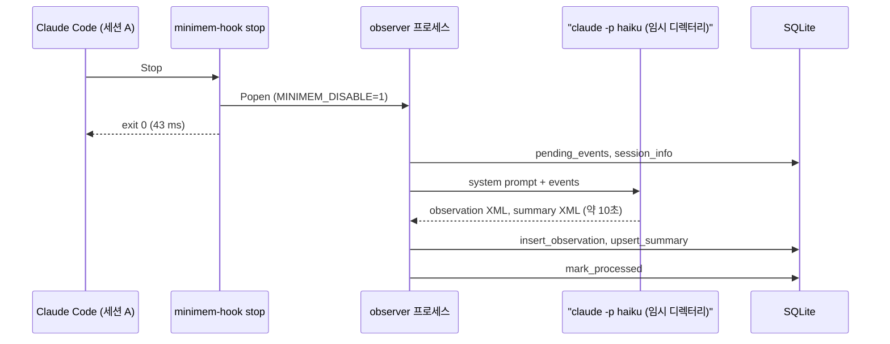

# 시나리오 3. 압축: observer 에이전트가 원본을 관찰로 바꾸는 과정

시나리오 2에서 모아 둔 `events` 테이블의 원본 데이터는 길고 잡음이 많습니다. 이 시나리오에서는 `minimem/observer.py`가 별도의 `claude -p --model haiku` 세션을 띄워 미처리 이벤트와 첫 프롬프트를 읽고, 다음 세션에 필요한 핵심만 추려 관찰(observation)과 세션 요약으로 압축하는 과정을 살펴봅니다. 실제로 원본 대비 크기가 얼마나 줄어드는지 확인하고, 만약 observer를 격리하지 않고 실행하면 어떤 재귀 기록 사고가 벌어지는지도 직접 재현해 봅니다.

## observer는 작업 에이전트 옆에서 받아 적는 기록 담당자

`claude-mem` README는 이 이원화 구조를 "your agent works, the observer takes notes"라는 한 문장으로 요약합니다. 작업 에이전트(세션 A의 `sonnet`)는 오롯이 버그 수정과 코드 작성에만 집중하고, 세션이 끝나면 기록 전담 에이전트(별도 `claude -p` 호출, `haiku`)가 도구 호출 로그를 훑어보며 다음 세션에 넘겨줄 사실만 정리합니다. observer는 파일 수정이나 명령 실행 권한 없이 오직 정해진 XML 형식의 텍스트만 출력합니다.

`minimem` observer의 입출력 구조는 단출합니다.

| 구분 | 내용 |
| --- | --- |
| system prompt | 역할 정의("기록 담당이다. 너 자신은 작업하지 않는다"), 기록 기준, XML 출력 스키마 |
| user 메시지 | `<project_root>`, `<user_request>`(세션의 첫 프롬프트), `<events>`(도구 호출 원본 목록) |
| 출력 | `<observation>` 0개 이상과 `<summary>` 1개 |

observer는 단순 복사기가 아니라 **가치 판단**을 수행합니다. 의미 없는 단순 조회나 실패 후 곧바로 재시도한 흔적은 걸러내고, 반대로 코드에는 없지만 사용자 프롬프트에 담겨 있던 규칙("금액은 `int`")은 `decision` 타입의 관찰로 건져 올립니다. 이 판단 덕분에 높은 압축률이 나오지만, 동시에 모델이 원인을 잘못 해석해 왜곡된 기록을 남길 위험도 함께 생깁니다.

### 핵심 용어 정리

| 용어 | 의미 | 이 실습에서의 예 |
| --- | --- | --- |
| 관찰 타입 | 관찰의 성격 분류 (`claude-mem`의 `code` 모드 타입을 간소화) | `bugfix`, `feature`, `decision`, `discovery`, `change` |
| facts | 나중에 검증할 수 있는 구체적 사실 목록 | `python -m pytest`는 "No module named pytest"로 실패했다 |
| narrative | 무엇을 왜 바꾸었는지 설명하는 2~3문장 서술 | 테스트 러너를 `unittest`로 바꿔 검증했다 |
| 재귀 기록 | observer 자신의 LLM 호출이 다시 프로젝트 hook에 잡혀 기록되는 현상 | 격리 없이 실행하면 `sessions` 테이블 행이 1건 증가 |

## 원본 이벤트를 그대로 쓰지 않고 압축하는 이유

시나리오 2에서 살펴본 `Edit` 이벤트 하나만 해도 894자에 달했고, 그중 대부분은 수정 전 파일 전문과 절대 경로였습니다. 세션 A의 이벤트 5건은 총 2,617자, 쿠폰 기능을 구현한 세션 C의 이벤트 3건은 3,896자였습니다. 세션이 열 개, 스무 개씩 쌓이는 상황에서 이 원본을 그대로 다음 세션에 밀어 넣으면 컨텍스트가 선형으로 불어나고, 매 세션마다 모델이 "도대체 지난번에 뭘 한 거지?"를 처음부터 다시 추론해야 합니다.

observer는 이 해석 비용을 세션이 끝나는 시점에 단 한 번만 치르고 결과를 정형화해 저장해 둡니다. 실제 압축 비율은 아래와 같습니다.

| 세션 | 원본 이벤트 수 | 원본 크기 | 생성된 관찰 수 | 관찰 전체 크기 | 원본 대비 비율 |
| --- | --- | --- | --- | --- | --- |
| A (할인 버그 수정) | 5개 | 2,617자 | 3개 | 1,120자 | 43% |
| C (쿠폰 기능 구현) | 3개 | 3,896자 | 3개 | 975자 | 25% |

여기서 관찰 전체 크기는 제목, facts, narrative를 모두 합친 길이입니다. 게다가 다음 세션 시작 시 주입되는 것은 이 본문 전체가 아니라 한 줄짜리 제목 인덱스뿐이므로, 실제로 컨텍스트에 들어가는 분량은 여기서 훨씬 더 줄어듭니다([시나리오 5](5-context-injection.md)).

## 압축 방식별 대안 비교

| 방식 | 압축 품질 | 추가 비용 | 응답 지연 |
| --- | --- | --- | --- |
| 압축 없이 원본 그대로 저장 | 정보 손실 없음 | 다음 세션마다 거대한 컨텍스트 소모 | 없음 |
| 규칙 기반 요약 (도구 이름, 파일 목록만 추출) | 무엇을 건드렸는지만 남고 "왜"가 사라짐 | 없음 | 없음 |
| 작업 에이전트가 직접 요약 | 맥락을 가장 정확히 앎 | 비싼 메인 모델의 컨텍스트와 시간을 소모 | 작업 도중 발생 |
| 별도 observer (`claude-mem`, `minimem`) | 의도와 맥락을 살리되 왜곡 가능성 존재 | 가벼운 모델 호출 1회 | 백그라운드 처리 |

요약과 구조화는 굳이 가장 비싼 추론 모델이 맡지 않아도 충분히 해내는 일입니다. `claude-mem`이 `ClaudeProvider`, `OpenRouterProvider`, `GeminiProvider`처럼 observer 백엔드를 손쉽게 갈아 끼울 수 있게 설계한 이유도 여기에 있습니다.

## observer를 프로젝트 hook과 설정에서 격리해야 하는 이유

observer 역시 `claude -p`로 띄우는 또 하나의 Claude Code 세션입니다. 아무런 격리 없이 프로젝트 디렉터리 안에서 observer를 실행하면 두 가지 까다로운 문제가 곧바로 터집니다.

1. **재귀 기록**: 프로젝트의 `.claude/settings.json`에 등록된 hook이 observer 세션에도 그대로 걸립니다. observer에게 보낸 이벤트 요약 프롬프트가 `UserPromptSubmit`으로 기록되고, observer가 응답을 마치면 `Stop` hook이 다시 또 다른 observer를 띄우는 악순환으로 이어질 수 있습니다.
2. **컨텍스트 오염과 오동작**: 사용자 전역 설정, 프로젝트의 `CLAUDE.md`, MCP 서버가 observer의 입력에 섞여 들어갑니다. 만약 도구 사용까지 열려 있으면 기록만 해야 할 observer가 갑자기 프로젝트 파일을 읽거나 수정하려 들 수 있습니다.

`minimem`은 `claude-mem`의 `src/sdk/hardened-options.ts`와 동일한 철학으로 여러 겹의 안전장치를 두어 observer를 완전히 고립시킵니다.

| 격리 장치 | minimem 구현 | 차단하는 위험 |
| --- | --- | --- |
| 작업 디렉터리 분리 | `tempfile.TemporaryDirectory()`를 `cwd`로 지정 | 프로젝트 hook 및 프로젝트 `CLAUDE.md` 로드 |
| 환경 변수 가드 | `MINIMEM_DISABLE=1`이면 `minimem-hook`이 즉시 반환 | 다른 경로로 hook이 호출되더라도 기록 차단 |
| 도구 사용 차단 | `--tools=` | observer가 파일을 읽거나 수정하는 오동작 |
| 외부 설정 차단 | `--setting-sources=`, `--strict-mcp-config` | 사용자 전역 설정 및 MCP 서버 주입 |
| 세션 저장 끔 | `--no-session-persistence` | observer 대화가 transcript 파일로 남는 현상 |
| 시스템 지시문 분리 | `--system-prompt`로 역할 지시 전달 | 사용자 메시지에 섞인 내용과 역할 혼동 |

## 주요 구성 요소와 역할

| 구성 요소 | 역할 |
| --- | --- |
| `on_stop()` | `python -m minimem.observer <session_id>`를 `start_new_session=True`로 분리 실행한 뒤 즉시 반환 |
| `build_prompt()` | `<project_root>`, `<user_request>`, `<events>` 태그로 observer용 사용자 메시지 조립 |
| `call_llm()` | 격리 플래그를 모두 붙여 `claude -p`를 실행하고 JSON 응답의 `result` 추출 |
| `parse_observations()` | 정규식으로 XML을 파싱하며, 지정되지 않은 관찰 타입은 안전하게 `change`로 정규화 |
| `mark_processed()` | 처리가 끝난 이벤트에 `processed=1`을 표시해 중복 압축 방지 |

## observer 실행 및 압축 흐름

`Stop` hook이 백그라운드 observer를 띄운 뒤 관찰과 요약이 SQLite에 기록되기까지의 순서입니다.



## 실습: 관찰 결과 확인과 재귀 기록 재현

[시나리오 1](1-memory-map.md)의 세션 A와 [시나리오 6](6-mcp-search.md)의 세션 C까지 실행된 DB를 기준으로 확인합니다. 명령은 workspace 루트에서 실행합니다.

### 1. observer가 생성한 관찰 확인

먼저 `minimem observations` 명령으로 세션 A의 원본 이벤트가 어떤 관찰로 정리되었는지 출력해 봅니다.

```bash
uv run --project minimem minimem observations shop
```

실행하면 각 관찰이 타입, 제목, 구체적 사실(facts), 관련 파일 경로와 함께 정리되어 나옵니다.

```text
#1 [bugfix] apply_discount 할인율 계산 누락된 100 나눗셈 수정
- 수정 전 apply_discount는 `price - price * rate`를 반환했다. rate는 정수 퍼센트(10 = 10%)인데 100으로 나누지 않아 10000원에 10%를 적용하면 -90000이 나왔다.
- 수정 후 반환식은 `price - price * rate // 100`이다. ...
files: shop/discount.py, tests/test_discount.py

#2 [discovery] 현재 환경에는 pytest가 없어 unittest로 테스트를 실행함
- `python -m pytest tests/test_discount.py`는 "No module named pytest"로 실패했다.
- tests/test_discount.py는 unittest.TestCase 기반이며, 검증은 `python -m unittest tests.test_discount`로 수행했다.
files: tests/test_discount.py

#3 [decision] 할인액 계산에 정수 나눗셈(//) 사용, 부동소수점 미사용
- 프로젝트 규칙에 따라 금액은 원 단위 int로만 다루고 float는 쓰지 않는다.
...
```

출력은 핵심만 추려 줄였고, 실제 관찰 개수와 문장은 실행마다 조금씩 달라집니다. 눈여겨볼 부분은 `#2`와 `#3`입니다. `#2`는 세션 A의 에이전트가 최종 답변에서 언급하지도 않았던 첫 `Bash` 실패 로그에서 뽑아낸 사실이고, `#3`은 코드가 아니라 사용자 프롬프트에서 건져 올린 의사결정입니다. 또한 파일 경로가 `/root/...` 같은 절대 경로 대신 `shop/discount.py`처럼 깔끔한 상대 경로로 저장된 것은, 프롬프트에 `<project_root>`를 함께 넘겨 상대 경로로 기록하도록 지시했기 때문입니다.

### 2. 원본과 관찰 크기 비교

`stats` 명령으로 프로젝트 전체 이벤트와 관찰의 글자 수 합계를 비교합니다.

```bash
uv run --project minimem minimem stats shop
```

출력 결과를 보면 이벤트 8건의 6,513자가 관찰 6건의 2,095자로 약 3분의 1 수준까지 줄어들었습니다.

```text
{"events": 8, "event_chars": 6513, "observations": 6, "observation_chars": 2095, "context_chars": 1041}
```

세션 A와 C 각각의 세부 압축률은 위쪽 표에 정리해 두었습니다.

### 3. 격리 없이 observer를 실행했을 때의 재귀 기록 재현

만약 격리 장치를 빼먹고 프로젝트 디렉터리 안에서 observer를 돌리면 실제로 무슨 일이 벌어질까요? `~/minimem-workspace/shop` 안에서 observer와 유사한 `claude -p` 명령을 가드 없이 한 번, `MINIMEM_DISABLE=1` 가드를 붙여 한 번 실행하면서 `sessions` 테이블의 행 수 변화를 지켜봅니다.

```bash
COUNT='import sqlite3,os;c=sqlite3.connect(os.path.expanduser("~/.minimem/memory.db"));print(c.execute("select count(*) from sessions").fetchone()[0])'
cd ~/minimem-workspace/shop
python3 -c "$COUNT"
claude -p "<events>Bash ls</events> 위 이벤트를 관찰로 요약해" --model haiku --tools= --no-session-persistence > /dev/null
python3 -c "$COUNT"
MINIMEM_DISABLE=1 claude -p "<events>Bash ls</events> 위 이벤트를 관찰로 요약해" --model haiku --tools= --no-session-persistence > /dev/null
python3 -c "$COUNT"
cd -
```

세 번의 조회 결과는 다음과 같습니다.

```text
4
5
5
```

가드 없이 실행한 첫 번째 호출은 프로젝트 hook에 그대로 잡혀, observer에게 보낸 요약 프롬프트가 마치 새 사용자 세션인 것처럼 DB에 추가되었습니다(`4 → 5`). 만약 이 observer 세션에 도구 호출까지 섞여 있었다면, 메모리가 메모리 생성 과정을 다시 기록하는 꼬리 물기가 벌어졌을 것입니다. 반면 `MINIMEM_DISABLE=1`을 붙인 두 번째 호출은 행 수가 그대로 유지되었습니다. 실제 `minimem` observer는 이 환경 변수 가드에 더해 임시 디렉터리(`cwd`) 분리까지 이중으로 적용합니다.

## 실무 관점에서 짚어볼 점

- **observer의 오판은 그대로 다음 세션의 '사실'이 됩니다**: 개발 과정에서 실제로 겪은 일입니다. "100으로 나누지 않음"이 원인이었던 버그에 observer가 "연산자 우선순위 버그 수정"이라는 엉뚱한 제목을 달았고, 그다음 세션 B는 이 잘못된 제목을 진짜 원인인 것처럼 인용해 답했습니다. 관찰의 `facts` 항목에 `price - price * rate` 같은 원문 코드를 꼭 남기도록 프롬프트를 설계해 두면, 나중에 사람이 보거나 에이전트가 본문을 조회할 때 왜곡 여부를 검증할 수 있습니다.
- **비슷한 관찰이 중복으로 쌓이는 문제**: 세션 C의 observer가 이미 기록되어 있던 "프로젝트 구조 확인"과 똑같은 `discovery`를 새로 만들어 낸 적이 있습니다. `claude-mem`은 이를 줄이기 위해 별도의 중복 제거 모듈(`src/services/dedup/`)을 두고, observer 프롬프트를 만들 때 이전 관찰 목록(`buildInitPrompt`의 `priorContext`)을 함께 보여 줍니다.
- **빈 세션이나 조회 전용 세션이 직전 요약을 덮어쓸 수 있습니다**: 다음 세션에 주입되는 요약은 가장 마지막 세션 하나뿐입니다. 메모리를 검색만 하고 끝낸 세션의 요약이 직전 작업 요약을 덮어써 버리는 문제가 실제로 발생했고, 메모리 조회 도구를 캡처에서 제외해 해결했습니다([시나리오 6](6-mcp-search.md)).
- **비동기 압축의 시차(약 10초)**: observer는 세션이 끝난 뒤 약 10초 동안 백그라운드에서 돕니다. 세션 A를 닫자마자 1초 뒤에 세션 B를 열면 아직 직전 관찰이 DB에 들어가기 전일 수 있습니다. `claude-mem` README가 "Memory injection starts on your second session"이라고 안내하는 것도 같은 맥락입니다.
