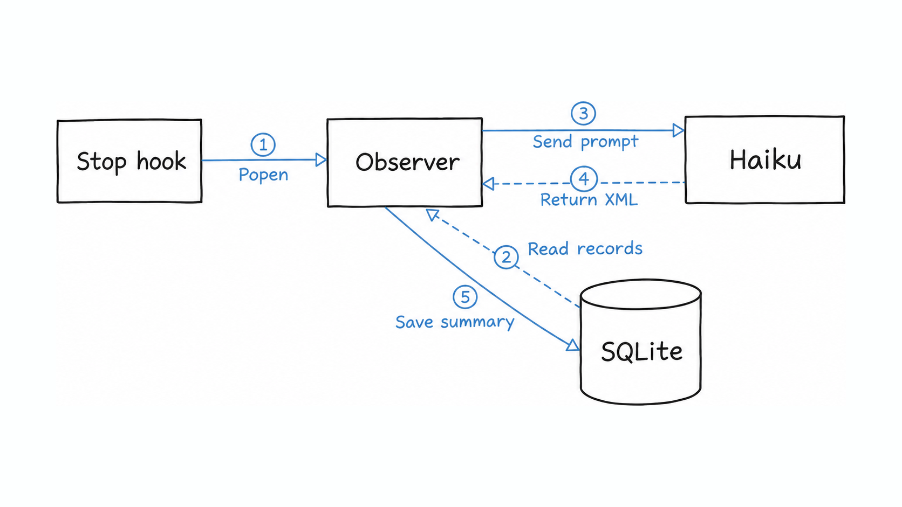
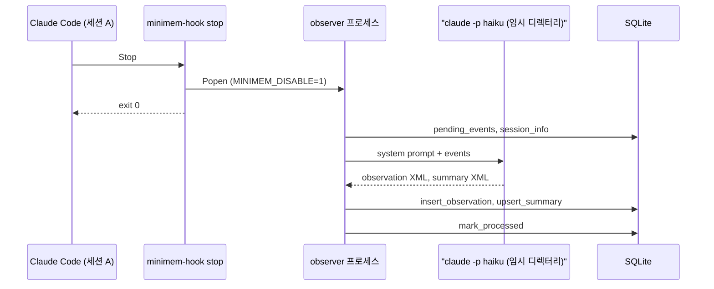

# 시나리오 3. 압축: observer 에이전트가 원본을 관찰로 바꾸는 과정

시나리오 2에서 모아 둔 `events` 테이블의 원본 데이터는 길고 잡음이 많습니다. 이 시나리오에서는 `minimem/observer.py`가 별도의 `claude -p --model haiku` 세션을 띄워 미처리 이벤트와 첫 프롬프트를 읽고, 다음 세션에 필요한 핵심만 추려 관찰(observation)과 세션 요약으로 압축하는 과정을 살펴봅니다. 놀이공원 예제로 입력과 압축 결과를 비교합니다.

## observer는 작업 에이전트 옆에서 받아 적는 기록 담당자

`claude-mem` README는 이 이원화 구조를 "your agent works, the observer takes notes"라는 한 문장으로 요약합니다. 세션 A의 작업 에이전트는 방문객 수 파일 기록을 맡고, 세션이 끝나면 observer(별도 `claude -p` 호출, `haiku`)가 도구 호출 로그에서 다음 세션에 필요한 사실을 골라냅니다. observer는 파일 수정이나 명령 실행 권한 없이 오직 정해진 XML 형식의 텍스트만 출력합니다.

`minimem` observer의 입출력 구조는 단출합니다.

| 구분 | 내용 |
| --- | --- |
| system prompt | 역할 정의("기록 담당이다. 너 자신은 작업하지 않는다"), 기록 기준, XML 출력 스키마 |
| user 메시지 | `<project_root>`, `<user_request>`(세션의 첫 프롬프트), `<events>`(도구 호출 원본 목록) |
| 출력 | `<observation>` 0개 이상과 `<summary>` 1개 |

observer는 단순 복사기가 아니라 **가치 판단**을 수행합니다. 의미 없는 단순 조회나 실패 후 곧바로 재시도한 흔적은 걸러내고, 반대로 숫자 파일에는 없지만 첫 요청에 담긴 기준("직원 제외")은 `decision` 타입의 관찰로 건져 올립니다. 이 판단 덕분에 높은 압축률이 나오지만, 동시에 모델이 원인을 잘못 해석해 왜곡된 기록을 남길 위험도 함께 생깁니다.

### 핵심 용어 정리

| 용어 | 의미 | 이 실습에서의 예 |
| --- | --- | --- |
| 관찰 타입 | 관찰의 성격 분류 (`claude-mem`의 `code` 모드 타입을 간소화) | `bugfix`, `feature`, `decision`, `discovery`, `change` |
| facts | 나중에 검증할 수 있는 구체적 사실 목록 | `attendance.txt`에 137을 기록했다 |
| narrative | 무엇을 왜 바꾸었는지 설명하는 2~3문장 서술 | 137은 현재 집계이며 오후 6시에 최종 인원을 확정한다 |
| 재귀 기록 | observer 자신의 LLM 호출이 다시 프로젝트 hook에 잡혀 기록되는 현상 | 격리 없이 실행하면 `sessions` 테이블 행이 1건 증가 |

## 원본 이벤트를 그대로 쓰지 않고 압축하는 이유

원본 이벤트에는 파일 경로와 도구가 돌려준 결과처럼 다음 답변에서 다시 읽을 필요가 없는 정보도 들어 있습니다. observer는 작업 의도와 결과를 요약과 개별 관찰로 정리합니다. 관찰의 제목은 새 세션에 바로 전달하고, 본문은 필요할 때 조회합니다.

## 압축 방식별 대안 비교

| 방식 | 압축 품질 | 추가 비용 | 응답 지연 |
| --- | --- | --- | --- |
| 압축 없이 원본 그대로 저장 | 정보 손실 없음 | 다음 세션마다 거대한 컨텍스트 소모 | 없음 |
| 규칙 기반 요약 (도구 이름, 파일 목록만 추출) | 무엇을 건드렸는지만 남고 "왜"가 사라짐 | 없음 | 없음 |
| 작업 에이전트가 직접 요약 | 맥락을 가장 정확히 앎 | 비싼 메인 모델의 컨텍스트와 시간을 소모 | 작업 도중 발생 |
| 별도 observer (`claude-mem`, `minimem`) | 의도와 맥락을 살리되 왜곡 가능성 존재 | 가벼운 모델 호출 1회 | 백그라운드 처리 |

요약과 구조화는 굳이 가장 비싼 추론 모델이 맡지 않아도 충분히 해내는 일입니다. `claude-mem`이 `ClaudeProvider`, `OpenRouterProvider`, `GeminiProvider`처럼 observer 백엔드를 손쉽게 갈아 끼울 수 있게 설계한 이유도 여기에 있습니다.

## observer를 프로젝트 hook과 설정에서 격리해야 하는 이유

observer 역시 `claude -p`로 띄우는 또 하나의 Claude Code 세션입니다. 아무런 격리 없이 프로젝트 디렉터리 안에서 observer를 실행하면 두 가지 까다로운 문제가 곧바로 터집니다.

1. **재귀 기록**: 프로젝트의 `.claude/settings.json`에 등록된 hook이 observer 세션에도 그대로 걸립니다. observer에게 보낸 이벤트 요약 프롬프트가 `UserPromptSubmit`으로 기록되고, observer가 응답을 마치면 `Stop` hook이 다시 또 다른 observer를 띄우는 악순환으로 이어질 수 있습니다.
2. **컨텍스트 오염과 오동작**: 사용자 전역 설정, 프로젝트의 `CLAUDE.md`, MCP 서버가 observer의 입력에 섞여 들어갑니다. 만약 도구 사용까지 열려 있으면 기록만 해야 할 observer가 갑자기 프로젝트 파일을 읽거나 수정하려 들 수 있습니다.

`minimem`은 `claude-mem`의 `src/sdk/hardened-options.ts`와 동일한 철학으로 여러 겹의 안전장치를 두어 observer를 완전히 고립시킵니다.

| 격리 장치 | minimem 구현 | 차단하는 위험 |
| --- | --- | --- |
| 작업 디렉터리 분리 | `tempfile.TemporaryDirectory()`를 `cwd`로 지정 | 프로젝트 hook 및 프로젝트 `CLAUDE.md` 로드 |
| 환경 변수 가드 | `MINIMEM_DISABLE=1`이면 `minimem-hook`이 즉시 반환 | 다른 경로로 hook이 호출되더라도 기록 차단 |
| 도구 사용 차단 | `--tools=` | observer가 파일을 읽거나 수정하는 오동작 |
| 외부 설정 차단 | `--setting-sources=`, `--strict-mcp-config` | 사용자 전역 설정 및 MCP 서버 주입 |
| 세션 저장 끔 | `--no-session-persistence` | observer 대화가 transcript 파일로 남는 현상 |
| 시스템 지시문 분리 | `--system-prompt`로 역할 지시 전달 | 사용자 메시지에 섞인 내용과 역할 혼동 |

## 주요 구성 요소와 역할

| 구성 요소 | 역할 |
| --- | --- |
| `on_stop()` | `python -m minimem.observer <session_id>`를 `start_new_session=True`로 분리 실행한 뒤 즉시 반환 |
| `build_prompt()` | `<project_root>`, `<user_request>`, `<events>` 태그로 observer용 사용자 메시지 조립 |
| `call_llm()` | 격리 플래그를 모두 붙여 `claude -p`를 실행하고 JSON 응답의 `result` 추출 |
| `parse_observations()` | 정규식으로 XML을 파싱하며, 지정되지 않은 관찰 타입은 안전하게 `change`로 정규화 |
| `mark_processed()` | 처리가 끝난 이벤트에 `processed=1`을 표시해 중복 압축 방지 |

## 구현 코드

`on_stop()`은 `Popen()`으로 observer를 띄우고 기다리지 않습니다. observer가 넘겨받은 `session_id`로 현재 세션의 첫 요청과 미처리 이벤트를 찾습니다. [hook.py 62–71줄](../minimem/minimem/hook.py#L62-L71) · [observer.py 108–122줄](../minimem/minimem/observer.py#L108-L122)

```python
user_prompt, project_root = db.session_info(conn, session_id)
response = call_llm(build_prompt(user_prompt, project_root, events))
```

Haiku 응답을 파싱해 관찰과 요약을 DB에 기록한 다음에야 `mark_processed()`를 호출합니다. 실습의 `processed=1`은 이 마지막 단계의 결과입니다. [observer.py 117–121줄](../minimem/minimem/observer.py#L117-L121) · [db.py 105–108줄](../minimem/minimem/db.py#L105-L108)

```python
observations = parse_observations(response)
for obs in observations:
  db.insert_observation(conn, session_id, project, obs)
db.upsert_summary(conn, session_id, project, parse_summary(response))
db.mark_processed(conn, [e["id"] for e in events])
```

## observer 실행 및 압축 흐름

`Stop` hook이 백그라운드 observer를 띄운 뒤 관찰과 요약이 SQLite에 기록되기까지의 순서입니다.



<!-- markdownlint-disable MD033 -->
<details>
<summary>메시지와 분기를 포함한 상세 흐름</summary>



</details>
<!-- markdownlint-enable MD033 -->

## 실습: 관찰과 요약 확인

[시나리오 1](1-memory-map.md)에서 이미 만든 기록을 조회합니다.

```bash
minimem/.venv/bin/minimem observations park
minimem/.venv/bin/minimem context park
minimem/.venv/bin/minimem stats park
```

관찰은 개별 사실을, 요약은 세션 전체를 묶어서 보여 줍니다. 파일에 없던 직원 제외 기준과 오후 6시 확정이 어디에 기록됐는지 확인하세요. 표현이나 관찰 개수는 실행마다 달라질 수 있습니다.

`event_chars`와 `observation_chars`의 범위는 서로 다릅니다. 전자는 도구 입력과 출력의 길이이고, 후자는 첫 요청의 정보도 반영한 관찰 본문의 길이입니다. 특히 숫자 하나를 쓴 실습에서는 구조화한 관찰이 오히려 길어질 수 있습니다. 실제 다음 세션에 전달하는 분량은 `context_chars`에서 확인합니다.

## 실무 관점에서 짚어볼 점

- **observer의 오판은 그대로 다음 세션의 '사실'이 됩니다**: 개발 과정에서 실제로 겪은 일입니다. "100으로 나누지 않음"이 원인이었던 버그에 observer가 "연산자 우선순위 버그 수정"이라는 엉뚱한 제목을 달았고, 그다음 세션 B는 이 잘못된 제목을 진짜 원인인 것처럼 인용해 답했습니다. 관찰의 `facts` 항목에 `price - price * rate` 같은 원문 코드를 꼭 남기도록 프롬프트를 설계해 두면, 나중에 사람이 보거나 에이전트가 본문을 조회할 때 왜곡 여부를 검증할 수 있습니다.
- **비슷한 관찰이 중복으로 쌓이는 문제**: 여러 세션에서 집계 기준을 다시 확인하면 같은 내용의 관찰이 여러 건 생길 수 있습니다. `claude-mem`은 중복 제거 모듈(`src/services/dedup/`)을 두고, observer에게 이전 관찰 목록(`buildInitPrompt`의 `priorContext`)을 함께 보여 줍니다.
- **빈 세션이나 조회 전용 세션이 직전 요약을 덮어쓸 수 있습니다**: 다음 세션에 주입되는 요약은 가장 마지막 세션 하나뿐입니다. 메모리를 검색만 하고 끝낸 세션의 요약이 직전 작업 요약을 덮어써 버리는 문제가 실제로 발생했고, 메모리 조회 도구를 캡처에서 제외해 해결했습니다([시나리오 6](6-mcp-search.md)).
- **비동기 압축의 시차**: 세션 A가 응답을 끝낸 시점에 observer가 작업을 시작합니다. 그 사이 새 세션을 열면 직전 관찰이 아직 SQLite에 없을 수 있습니다. `claude-mem` README가 "Memory injection starts on your second session"이라고 안내하는 것도 같은 맥락입니다.
