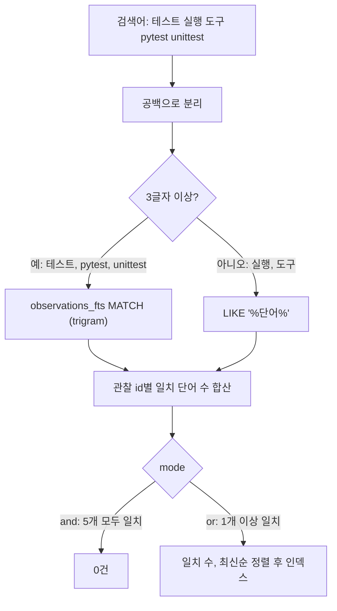

# 시나리오 4. 저장과 검색: SQLite FTS5와 한국어 토크나이저

압축된 관찰이 수십, 수백 개씩 쌓이기 시작하면 필요한 기록을 빠르고 정확하게 찾아내는 저장소와 검색 엔진이 중요해집니다. 이 시나리오에서는 `minimem/db.py`와 `minimem/search.py`가 로컬 SQLite 파일 하나와 FTS5 전문 검색으로 메모리를 어떻게 저장하고 조회하는지 살펴봅니다. 특히 한국어 관찰을 검색할 때 기본 토크나이저(`unicode61`)가 왜 실패하는지, 그리고 에이전트가 여러 단어를 한꺼번에 던질 때 AND 검색이 왜 0건을 돌려주는지 `scripts/tokenizer_compare.py`와 실제 DB 질의로 확인해 봅니다.

## 메모리 저장소는 로컬 SQLite 파일 하나

`claude-mem`은 별도 DB 서버를 띄우지 않고 `~/.claude-mem/claude-mem.db` SQLite 파일 하나에 세션, 관찰, 요약을 모두 담습니다. 여기에 SQLite 내장 FTS5 가상 테이블로 키워드 검색을 붙이고, Chroma 벡터 DB를 더해 의미 검색까지 지원합니다. 로컬 파일 하나만 복사하면 그대로 백업이 되는 단순한 구조죠. `minimem`은 이 구성에서 Chroma만 덜어내고 동일한 SQLite 스키마를 따릅니다.

`minimem`이 관리하는 테이블과 색인 구성은 다음과 같습니다.

| 테이블 / 색인 | 저장 내용 | 주로 접근하는 주체 |
| --- | --- | --- |
| `sessions` | 세션 ID, 프로젝트 이름, `cwd`, 첫 프롬프트 | `UserPromptSubmit` hook, observer |
| `events` | 도구 호출 원본과 처리 여부(`processed`) | `PostToolUse` hook, observer |
| `observations` | 관찰 타입, 제목, facts, narrative, 관련 파일 | observer, 컨텍스트 빌더, 검색기 |
| `summaries` | 세션별 요청, 알게 된 것, 완료 내역, 다음 할 일 | observer, 컨텍스트 빌더 |
| `observations_fts` | 관찰의 제목, facts, narrative에 대한 FTS5 전문 색인 | 검색기 |

여기서 `observations_fts`는 `content='observations'` 옵션을 준 **external content 테이블**입니다. 실제 본문 텍스트는 `observations` 테이블에만 보관하고, FTS5 쪽은 검색용 색인만 유지해 용량 중복을 없앱니다. 새 관찰이 들어올 때마다 `observations_ai` 트리거가 자동으로 색인을 갱신합니다. `claude-mem` 역시 같은 구조를 쓰는데, 소스 코드 주석을 보면 이미 데이터가 찬 external content 색인에 다시 `INSERT`를 돌리면 색인이 깨질 수 있어 새로 만든 색인에만 backfill을 수행한다는 주의사항이 적혀 있습니다.

### 핵심 용어 정리

| 용어 | 의미 | 이 실습에서의 예 |
| --- | --- | --- |
| FTS5 | SQLite에 내장된 전문(full-text) 검색 확장 | `observations_fts MATCH '"할인율"'` |
| 토크나이저 | 문장을 색인 단위 토큰으로 쪼개는 규칙 | `unicode61`, `trigram` |
| `unicode61` | 공백과 구두점 기준으로 단어를 나누는 FTS5 기본 토크나이저 | `"할인율을"` 전체를 토큰 1개로 취급 |
| `trigram` | 연속된 3글자 조각을 모두 토큰으로 만드는 토크나이저 (SQLite 3.34+) | `"할인율을"` → `"할인율"`, `"인율을"` |
| AND 검색 | 질의의 모든 단어를 포함한 관찰만 반환하는 방식 | `--mode and` |
| OR 검색 | 질의 단어 중 하나라도 포함하면 후보로 모아 점수순 정렬하는 방식 | `minimem` 기본값 |

## 한국어 검색에서 공백 기반 토크나이저가 막히는 이유

에이전트가 과거 기억을 찾을 때 던지는 키워드는 보통 `"할인율"`, `"쿠폰"`, `"pytest"`처럼 깔끔한 명사입니다. 하지만 실제 한국어 관찰 문장 안에는 `"할인율을"`, `"pytest가"`, `"테스트를"`처럼 명사 뒤에 조사가 딱 붙어 있습니다. `claude-mem`이 기본으로 사용하는 `unicode61` 토크나이저는 공백과 구두점만으로 단어를 자르기 때문에 `"할인율을"`을 통째로 하나의 토큰으로 색인합니다. 결국 `"할인율"`로 검색하면 아무것도 걸리지 않습니다. 영어는 단어 사이에 공백이 들어가므로 기본 설정만으로도 문제가 거의 드러나지 않지만, 한국어에서는 치명적인 누락으로 이어집니다.

이를 피하기 위해 `trigram` 토크나이저를 쓰면 문장을 3글자 단위로 쪼개 색인하므로 조사와 무관하게 `"할인율"`을 잘 찾아냅니다. 그런데 여기에도 또 다른 함정이 있습니다. `"할인"`, `"쿠폰"`, `"버그"`, `"중복"`, `"적용"`처럼 한국어 핵심 단어 중 상당수가 **2글자**라는 점입니다. 3글자 미만 검색어는 `trigram` 색인에 아예 토큰이 존재하지 않아 검색 자체가 실패합니다.

그래서 `minimem`은 두 방식을 현실적으로 조합했습니다. 3글자 이상 단어는 `trigram` FTS5 색인으로 빠르게 찾고, 3글자 미만 단어는 `LIKE '%단어%'`로 조회합니다. 물론 `LIKE`는 인덱스를 타지 않는 풀 스캔이지만, 한 프로젝트에 쌓이는 관찰은 많아야 수천 행 수준이므로 로컬 SQLite에서는 지연이 거의 느껴지지 않습니다.

## 여러 단어 질의를 AND로 묶으면 0건이 나오는 이유

토크나이저 문제를 해결하고 나서도 실제 세션에서 또 한 번 검색 실패를 겪었습니다. 에이전트는 검색어를 사람처럼 1~2단어로 압축해 넣지 않고, 관련 있어 보이는 단어를 넉넉하게 나열하는 경향이 있습니다. 실제로 세션 D의 에이전트는 `"테스트 실행 도구 pytest unittest"`라는 다섯 단어짜리 질의를 보냈습니다.

처음에 구현했던 AND 검색은 이 다섯 단어가 모두 들어 있는 관찰만 찾으려 했고, 관찰 본문에 `"도구"`라는 단어 하나가 빠져 있었다는 이유만으로 0건을 돌려주었습니다. 다행히 당시에는 `SessionStart` 인덱스에 `#2`가 보여서 에이전트가 직접 골라 답을 찾았지만, 만약 인덱스 밖으로 밀려난 오래된 관찰이었다면 그대로 "기록 없음"으로 끝났을 상황입니다.

그래서 `minimem`은 기본 검색 방식을 OR로 바꾸었습니다. 각 단어별로 일치하는 관찰 ID를 모은 뒤, **일치한 단어 개수가 많은 순서(동점이면 최신순)**로 정렬해 돌려줍니다. 후보 개수는 조금 늘어나지만 관련도 높은 관찰이 자연스럽게 맨 위로 올라오고, 어차피 본문은 에이전트가 인덱스를 보고 골라낸 일부만 조회하므로([시나리오 6](6-mcp-search.md)) 후보가 늘어나는 부담도 작습니다.

## 검색 방식별 대안 비교

| 방식 | 한국어 조사 대응 | 2글자 단어 대응 | 의미(유사어) 검색 | 추가 구성 부담 |
| --- | --- | --- | --- | --- |
| FTS5 `unicode61` (`claude-mem` 키워드 검색) | 못 찾음 | 조사가 없을 때만 가능 | 없음 | 없음 |
| FTS5 `trigram` | 가능 | 못 찾음 | 없음 | 없음 |
| `trigram` + `LIKE` (`minimem`) | 가능 | 가능 | 없음 | 없음 |
| 형태소 분석기 토크나이저 | 가능 | 가능 | 없음 | SQLite C 확장 별도 빌드 필요 |
| 벡터 검색 (`claude-mem`의 Chroma) | 임베딩 모델에 따라 다름 | 임베딩 모델에 따라 다름 | 가능 | Chroma와 임베딩 모델 운영 필요 |

원본 `claude-mem`은 `unicode61` 키워드 검색의 빈틈을 Chroma 벡터 의미 검색으로 메웁니다. `minimem`은 외부 의존성을 최소화하기 위해 키워드 검색만 남기는 대신, 한국어 조사와 짧은 단어 문제를 `trigram` + `LIKE` 조합으로 풀었습니다.

## 주요 구성 요소와 역할

| 구성 요소 | 역할 |
| --- | --- |
| `db.SCHEMA` | 기본 테이블 4개, `observations_fts` 가상 테이블, INSERT 트리거 정의 |
| `search.term_ids()` | 단일 키워드를 길이에 따라 FTS5 `trigram` 또는 `LIKE`로 조회해 관찰 ID 집합 반환 |
| `search.search_ids()` | 단어별 결과를 합산해 일치 단어 수 점수를 매기고 AND/OR 조건 적용 |
| `search.search()` | 최종 결과를 `#id [type] 제목 (파일)` 형태의 한 줄 인덱스로 포맷해 반환 |

## 키워드 검색 처리 흐름

에이전트가 보낸 다중 단어 검색어가 관찰 인덱스로 변환되기까지의 처리 경로입니다.



## 실습: 토크나이저와 AND/OR 검색 비교

명령은 workspace 루트에서 실행합니다. 3단계 비교는 [시나리오 6](6-mcp-search.md)의 세션 C까지 실행되어 관찰 6건이 쌓인 DB를 기준으로 합니다.

### 1. 테이블 및 트리거 구성 확인

먼저 `memory.db` 안에 어떤 테이블과 트리거가 생성되어 있는지 확인합니다. FTS5가 내부적으로 만드는 보조 테이블(`observations_fts_*`)은 제외하고 출력합니다.

```bash
python3 -c "import sqlite3,os;c=sqlite3.connect(os.path.expanduser('~/.minimem/memory.db'));[print(r[0]) for r in c.execute(\"select name from sqlite_master where type in ('table','trigger') and name not like 'observations_fts_%' and name != 'sqlite_sequence' order by name\")]"
```

실행하면 설계한 테이블 4개와 FTS5 가상 테이블, INSERT 트리거가 모두 보입니다.

```text
events
observations
observations_ai
observations_fts
sessions
summaries
```

### 2. 토크나이저별 한국어 검색 적중 비교

`tokenizer_compare.py`는 고정된 한국어 관찰 제목 4개를 각각 `unicode61`, `trigram`, 그리고 `minimem`(`trigram` + `LIKE`) 방식으로 색인한 뒤 8개 검색어의 적중 건수를 비교합니다. "부분 문자열 정답"은 제목 안에 해당 문자열이 실제로 포함된 행 수입니다. 고정 샘플을 쓰므로 어느 환경에서 돌려도 동일한 표가 나옵니다.

```bash
uv run scripts/tokenizer_compare.py
```

실행 결과는 다음과 같습니다.

```text
관찰 4건
| 검색어 | 부분 문자열 정답 | unicode61 | trigram | minimem(trigram+LIKE) |
| --- | --- | --- | --- | --- |
| 할인 | 2 | 1 | 0 | 2 |
| 할인율 | 1 | 0 | 1 | 1 |
| 버그 | 1 | 1 | 0 | 1 |
| 쿠폰 | 1 | 1 | 0 | 1 |
| 중복 | 1 | 1 | 0 | 1 |
| 적용 | 1 | 0 | 0 | 1 |
| pytest | 1 | 0 | 1 | 1 |
| 테스트 | 1 | 0 | 1 | 1 |
```

결과가 꽤 극명합니다. `unicode61`은 조사가 붙은 `"할인율을"`, `"적용을"`, `"pytest가"`, `"테스트를"`을 전부 놓쳤고, `"할인"`도 조사 없이 쓰인 `"할인 금액은"` 1건만 찾아냈습니다. 반대로 `trigram`은 2글자 검색어 5개를 모두 0건으로 놓쳤습니다. 특히 `"적용"`은 2글자이면서 문장 속에 `"적용을"`로 쓰여 두 토크나이저 모두 찾지 못했습니다. 반면 `minimem`의 조합 방식은 8개 검색어 모두 정답과 일치합니다. 참고로 `--db` 옵션을 붙이면 고정 샘플 대신 현재 실습 DB의 관찰로 같은 비교를 수행할 수 있습니다.

### 3. AND 검색과 OR 검색 비교

이번에는 실제 세션 D의 에이전트가 보냈던 5단어 검색어로 AND 모드와 기본 OR 모드의 차이를 비교합니다.

```bash
uv run --project minimem minimem search shop "테스트 실행 도구 pytest unittest" --mode and
uv run --project minimem minimem search shop "테스트 실행 도구 pytest unittest"
```

첫 번째 AND 검색은 결과를 찾지 못하지만, 두 번째 OR 검색은 가장 관련도가 높은 관찰 `#2`를 맨 위에 올려 돌려줍니다.

```text
검색 결과 없음
#2 [discovery] 현재 환경에는 pytest가 없어 unittest로 테스트를 실행함 (tests/test_discount.py)
#6 [discovery] 전체 테스트 실행 결과 7개 통과 (shop/coupon.py, tests/test_coupon.py)
#1 [bugfix] apply_discount 할인율 계산 누락된 100 나눗셈 수정 (shop/discount.py, tests/test_discount.py)
#5 [change] apply_coupons 단위 테스트 5개 추가 (tests/test_coupon.py)
```

AND 검색은 `"도구"`가 포함된 관찰이 없어 빈 결과를 냈습니다. 반면 OR 검색은 `"테스트"`, `"실행"`, `"pytest"`, `"unittest"` 네 단어가 모두 일치한 `#2`에 가장 높은 점수를 매겨 최상단에 배치했습니다. 관찰 문장은 observer가 생성한 결과이므로 독자 환경에서는 순서나 개수가 조금 다를 수 있습니다.

## 실무 관점에서 짚어볼 점

- **영어 기본 설정은 한국어 메모리에서 조용히 실패합니다**: FTS5의 기본 `unicode61`은 한국어 조사에 매우 취약합니다. 아예 observer에게 영어로만 관찰을 쓰게 만드는 방법도 있지만, 사용자가 한국어로 지시한 도메인 규칙을 번역하는 과정에서 미묘한 뉘앙스가 바뀔 수 있습니다. `claude-mem`이 `CLAUDE_MEM_MODE`에 `code--ko` 같은 언어별 모드를 두어 관찰 언어를 선택하게 하는 것도 이런 트레이드오프 때문입니다.
- **에이전트 검색은 정밀도(precision)보다 재현율(recall)이 우선입니다**: 사람은 검색 결과가 0건이면 단어를 바꿔 다시 검색하지만, 코딩 에이전트는 0건을 받는 순간 "아, 관련 기록이 없구나"라고 성급히 결론 내리고 다음 단계로 넘어가 버리는 경우가 많습니다. 약간의 노이즈가 섞이더라도 후보를 넉넉히 보여주고 에이전트가 고르게 하는 편이 훨씬 안전합니다.
- **external content FTS5 운영 시 동기화 트리거에 주의해야 합니다**: `minimem`은 관찰을 추가(INSERT)만 하기 때문에 INSERT 트리거 하나만 두었지만, 운영 환경에서 관찰을 수정하거나 삭제하는 기능이 들어가면 반드시 `UPDATE`와 `DELETE` 트리거까지 함께 관리해야 색인 불일치를 막을 수 있습니다.
