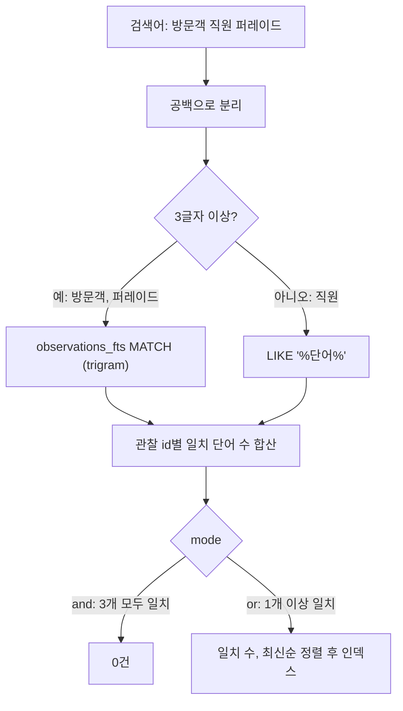

# 시나리오 4. 저장과 검색: SQLite FTS5와 한국어 토크나이저

압축된 관찰이 수십, 수백 개씩 쌓이기 시작하면 필요한 기록을 빠르고 정확하게 찾아내는 저장소와 검색 엔진이 중요해집니다. 이 시나리오에서는 `minimem/db.py`와 `minimem/search.py`가 로컬 SQLite 파일 하나와 FTS5 전문 검색으로 메모리를 어떻게 저장하고 조회하는지 살펴봅니다. 특히 한국어 관찰을 검색할 때 기본 토크나이저(`unicode61`)가 왜 실패하는지, 그리고 에이전트가 여러 단어를 한꺼번에 던질 때 AND 검색이 왜 0건을 돌려주는지 `scripts/tokenizer_compare.py`와 실제 DB 질의로 확인해 봅니다.

## 메모리 저장소는 로컬 SQLite 파일 하나

`claude-mem`은 별도 DB 서버를 띄우지 않고 `~/.claude-mem/claude-mem.db` SQLite 파일 하나에 세션, 관찰, 요약을 모두 담습니다. 여기에 SQLite 내장 FTS5 가상 테이블로 키워드 검색을 붙이고, Chroma 벡터 DB를 더해 의미 검색까지 지원합니다. 로컬 파일 하나만 복사하면 그대로 백업이 되는 단순한 구조죠. `minimem`은 이 구성에서 Chroma만 덜어내고 동일한 SQLite 스키마를 따릅니다.

`minimem`이 관리하는 테이블과 색인 구성은 다음과 같습니다.

| 테이블 / 색인 | 저장 내용 | 주로 접근하는 주체 |
| --- | --- | --- |
| `sessions` | 세션 ID, 프로젝트 이름, `cwd`, 첫 프롬프트 | `UserPromptSubmit` hook, observer |
| `events` | 도구 호출 원본과 처리 여부(`processed`) | `PostToolUse` hook, observer |
| `observations` | 관찰 타입, 제목, facts, narrative, 관련 파일 | observer, 컨텍스트 빌더, 검색기 |
| `summaries` | 세션별 요청, 알게 된 것, 완료 내역, 다음 할 일 | observer, 컨텍스트 빌더 |
| `observations_fts` | 관찰의 제목, facts, narrative에 대한 FTS5 전문 색인 | 검색기 |

여기서 `observations_fts`는 `content='observations'` 옵션을 준 **external content 테이블**입니다. 실제 본문 텍스트는 `observations` 테이블에만 보관하고, FTS5 쪽은 검색용 색인만 유지해 용량 중복을 없앱니다. 새 관찰이 들어올 때마다 `observations_ai` 트리거가 자동으로 색인을 갱신합니다. `claude-mem` 역시 같은 구조를 쓰는데, 소스 코드 주석을 보면 이미 데이터가 찬 external content 색인에 다시 `INSERT`를 돌리면 색인이 깨질 수 있어 새로 만든 색인에만 backfill을 수행한다는 주의사항이 적혀 있습니다.

### 핵심 용어 정리

| 용어 | 의미 | 이 실습에서의 예 |
| --- | --- | --- |
| FTS5 | SQLite에 내장된 전문(full-text) 검색 확장 | `observations_fts MATCH '"방문객"'` |
| 토크나이저 | 문장을 색인 단위 토큰으로 쪼개는 규칙 | `unicode61`, `trigram` |
| `unicode61` | 공백과 구두점 기준으로 단어를 나누는 FTS5 기본 토크나이저 | `"방문객을"` 전체를 토큰 1개로 취급 |
| `trigram` | 연속된 3글자 조각을 모두 토큰으로 만드는 토크나이저 (SQLite 3.34+) | `"방문객을"` → `"방문객"`, `"문객을"` |
| AND 검색 | 질의의 모든 단어를 포함한 관찰만 반환하는 방식 | `--mode and` |
| OR 검색 | 질의 단어 중 하나라도 포함하면 후보로 모아 점수순 정렬하는 방식 | `minimem` 기본값 |

## 한국어 검색에서 공백 기반 토크나이저가 막히는 이유

관찰에 “방문객을 137명으로 기록했다”라고 적혀 있다면, `unicode61`은 “방문객을” 전체를 한 토큰으로 색인합니다. 검색어 “방문객”은 이 토큰과 정확히 일치하지 않습니다. `trigram`은 “방문객”, “문객을” 두 조각을 색인하므로 “방문객”도 찾을 수 있습니다.

“직원”처럼 두 글자인 검색어는 `trigram` 색인에서 찾을 수 없습니다. 세 글자짜리 조각보다 짧기 때문입니다.

그래서 `minimem`은 두 방식을 현실적으로 조합했습니다. 3글자 이상 단어는 `trigram` FTS5 색인으로 빠르게 찾고, 3글자 미만 단어는 `LIKE '%단어%'`로 조회합니다. 물론 `LIKE`는 인덱스를 타지 않는 풀 스캔이지만, 한 프로젝트에 쌓이는 관찰은 많아야 수천 행 수준이므로 로컬 SQLite에서는 지연이 거의 느껴지지 않습니다.

## 여러 단어 질의를 AND로 묶으면 0건이 나오는 이유

“방문객 직원 퍼레이드”로 검색하면 AND는 세 단어가 모두 들어간 관찰을 찾습니다. 퍼레이드를 기록한 적이 없다면 결과는 0건입니다. OR는 방문객이나 직원이 들어간 관찰도 후보에 올립니다.

그래서 `minimem`은 기본 검색 방식을 OR로 바꾸었습니다. 각 단어별로 일치하는 관찰 ID를 모은 뒤, **일치한 단어 개수가 많은 순서(동점이면 최신순)**로 정렬해 돌려줍니다. 후보 개수는 조금 늘어나지만 관련도 높은 관찰이 자연스럽게 맨 위로 올라오고, 어차피 본문은 에이전트가 인덱스를 보고 골라낸 일부만 조회하므로([시나리오 6](6-mcp-search.md)) 후보가 늘어나는 부담도 작습니다.

## 검색 방식별 대안 비교

| 방식 | 한국어 조사 대응 | 2글자 단어 대응 | 의미(유사어) 검색 | 추가 구성 부담 |
| --- | --- | --- | --- | --- |
| FTS5 `unicode61` (`claude-mem` 키워드 검색) | 못 찾음 | 조사가 없을 때만 가능 | 없음 | 없음 |
| FTS5 `trigram` | 가능 | 못 찾음 | 없음 | 없음 |
| `trigram` + `LIKE` (`minimem`) | 가능 | 가능 | 없음 | 없음 |
| 형태소 분석기 토크나이저 | 가능 | 가능 | 없음 | SQLite C 확장 별도 빌드 필요 |
| 벡터 검색 (`claude-mem`의 Chroma) | 임베딩 모델에 따라 다름 | 임베딩 모델에 따라 다름 | 가능 | Chroma와 임베딩 모델 운영 필요 |

원본 `claude-mem`은 `unicode61` 키워드 검색의 빈틈을 Chroma 벡터 의미 검색으로 메웁니다. `minimem`은 외부 의존성을 최소화하기 위해 키워드 검색만 남기는 대신, 한국어 조사와 짧은 단어 문제를 `trigram` + `LIKE` 조합으로 풀었습니다.

## 주요 구성 요소와 역할

| 구성 요소 | 역할 |
| --- | --- |
| `db.SCHEMA` | 기본 테이블 4개, `observations_fts` 가상 테이블, INSERT 트리거 정의 |
| `search.term_ids()` | 단일 키워드를 길이에 따라 FTS5 `trigram` 또는 `LIKE`로 조회해 관찰 ID 집합 반환 |
| `search.search_ids()` | 단어별 결과를 합산해 일치 단어 수 점수를 매기고 AND/OR 조건 적용 |
| `search.search()` | 최종 결과를 `#id [type] 제목 (파일)` 형태의 한 줄 인덱스로 포맷해 반환 |

## 키워드 검색 처리 흐름

에이전트가 보낸 다중 단어 검색어가 관찰 인덱스로 변환되기까지의 처리 경로입니다.



## 실습: 한국어 검색 결과 비교

고정 예제 관찰 네 건에 대한 결과를 바로 비교합니다.

```bash
minimem/.venv/bin/python scripts/tokenizer_compare.py
```

“방문객”은 실제로 세 문장에 들어 있습니다. `unicode61`은 두 건, `trigram`은 세 건을 찾습니다. “직원”은 `unicode61`과 `trigram` 모두 0건이며, 부분 문자열을 확인하는 `LIKE`로는 한 건입니다.

[시나리오 1](1-memory-map.md)의 실제 관찰에서도 AND와 OR를 비교합니다. 퍼레이드가 관찰에 없으므로 AND는 0건이고, OR는 다른 단어가 들어간 관찰을 보여 줍니다.

```bash
minimem/.venv/bin/minimem search park '방문객 직원 퍼레이드' --mode and
minimem/.venv/bin/minimem search park '방문객 직원 퍼레이드'
```

## 실무 관점에서 짚어볼 점

- **영어 기본 설정은 한국어 메모리에서 조용히 실패합니다**: FTS5의 기본 `unicode61`은 한국어 조사에 매우 취약합니다. 아예 observer에게 영어로만 관찰을 쓰게 만드는 방법도 있지만, 사용자가 한국어로 지시한 도메인 규칙을 번역하는 과정에서 미묘한 뉘앙스가 바뀔 수 있습니다. `claude-mem`이 `CLAUDE_MEM_MODE`에 `code--ko` 같은 언어별 모드를 두어 관찰 언어를 선택하게 하는 것도 이런 트레이드오프 때문입니다.
- **에이전트 검색은 정밀도(precision)보다 재현율(recall)이 우선입니다**: 사람은 검색 결과가 0건이면 단어를 바꿔 다시 검색하지만, 코딩 에이전트는 0건을 받는 순간 "아, 관련 기록이 없구나"라고 성급히 결론 내리고 다음 단계로 넘어가 버리는 경우가 많습니다. 약간의 노이즈가 섞이더라도 후보를 넉넉히 보여주고 에이전트가 고르게 하는 편이 훨씬 안전합니다.
- **external content FTS5 운영 시 동기화 트리거에 주의해야 합니다**: `minimem`은 관찰을 추가(INSERT)만 하기 때문에 INSERT 트리거 하나만 두었지만, 운영 환경에서 관찰을 수정하거나 삭제하는 기능이 들어가면 반드시 `UPDATE`와 `DELETE` 트리거까지 함께 관리해야 색인 불일치를 막을 수 있습니다.
