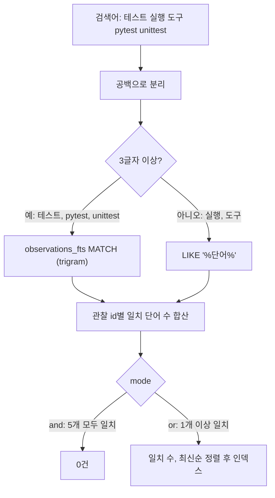

# 시나리오 4. 저장과 검색: SQLite FTS5와 한국어 토크나이저

## 이 시나리오의 목표

| 항목 | 내용 |
| --- | --- |
| 기능 | 관찰 저장과 키워드 검색 |
| 쓰는 도구 | SQLite FTS5, `minimem/db.py`, `minimem/search.py`, `scripts/tokenizer_compare.py` |
| 입력 | 한국어 관찰 제목 4개, 실습 DB의 관찰 6개 |
| 작업 | 1. 테이블 구성 확인 2. 토크나이저별 한국어 검색 적중 비교 3. AND 검색과 OR 검색 비교 |
| 달성할 것 | 한국어 관찰을 조사와 상관없이 찾고, 여러 단어 질의에서 결과가 0건이 되지 않는 검색을 확인 |

## 메모리 저장소는 로컬 SQLite 파일 하나다

claude-mem은 `~/.claude-mem/claude-mem.db` SQLite 파일 하나에 세션, 관찰, 요약을 저장하고, FTS5 가상 테이블로 키워드 검색을, Chroma 벡터 DB로 의미 검색을 붙입니다. 서버를 띄우지 않아도 되고, 파일 하나를 복사하면 백업이 됩니다. minimem도 같은 구조에서 Chroma만 뺐습니다.

| 테이블 | 내용 | 쓰는 쪽 |
| --- | --- | --- |
| `sessions` | 세션 id, 프로젝트, `cwd`, 첫 프롬프트 | `UserPromptSubmit` hook, observer |
| `events` | 도구 호출 원본, `processed` | `PostToolUse` hook, observer |
| `observations` | 타입, 제목, facts, narrative, 파일 | observer, 컨텍스트, 검색 |
| `summaries` | 세션별 요청, 알게 된 것, 완료, 다음 할 일 | observer, 컨텍스트 |
| `observations_fts` | 제목, facts, narrative의 FTS5 색인 | 검색 |

`observations_fts`는 `content='observations'`로 선언한 external content 테이블입니다. 본문은 `observations`에만 있고 FTS5는 색인만 가지며, `observations_ai` 트리거가 INSERT 때마다 색인을 갱신합니다. claude-mem도 같은 방식이고, 소스 주석은 이미 있는 external content 색인에 다시 INSERT하면 색인이 손상될 수 있어 새로 만든 색인에만 backfill한다고 경고합니다.

### 용어

| 용어 | 뜻 | 이 실습의 예 |
| --- | --- | --- |
| FTS5 | SQLite의 전문 검색 확장 | `observations_fts MATCH '"할인율"'` |
| 토크나이저 | 문장을 색인 단위로 자르는 규칙 | `unicode61`, `trigram` |
| `unicode61` | 공백과 구두점으로 단어를 자르는 FTS5 기본 토크나이저 | "할인율을" 전체가 토큰 1개 |
| `trigram` | 연속한 3글자를 토큰으로 만드는 토크나이저(SQLite 3.34 이상) | "할인율을" → "할인율", "인율을" |
| AND 검색 | 모든 단어를 포함해야 결과에 넣는 방식 | `--mode and` |
| OR 검색 | 한 단어라도 포함하면 결과에 넣는 방식 | minimem 기본값 |

## 한국어는 조사가 붙어 공백 기준 토크나이저로 찾지 못한다

에이전트가 메모리를 찾을 때 쓰는 검색어는 "할인율", "쿠폰", "pytest" 같은 단어입니다. 그런데 관찰 문장에는 "할인율을", "pytest가", "테스트를"처럼 조사가 붙어 있습니다. claude-mem이 쓰는 `unicode61`은 공백 단위로 자르므로 "할인율을"을 토큰 1개로 저장하고, "할인율"로는 찾지 못합니다. 영어 문서에서는 거의 생기지 않는 문제라 기본 설정으로는 드러나지 않습니다.

`trigram`은 3글자 조각을 색인하므로 조사와 상관없이 "할인율"을 찾지만, 한국어 핵심 단어의 상당수가 2글자(할인, 쿠폰, 버그, 중복)라 3글자 미만 검색어를 아예 찾지 못합니다. minimem은 두 방식을 조합합니다. 3글자 이상 단어는 `trigram` FTS5로, 3글자 미만 단어는 `LIKE '%단어%'`로 찾습니다. `LIKE`는 색인을 쓰지 않는 전체 스캔이지만, 한 프로젝트의 관찰은 수천 행 수준이라 비용이 작습니다.

## 여러 단어 질의를 AND로 묶으면 결과가 0건이 된다

에이전트는 검색어를 넉넉하게 넣습니다. 개발 중 실행에서 세션 D의 에이전트는 `"테스트 실행 도구 pytest unittest"`로 검색했고, 처음 구현한 AND 검색은 "도구"가 들어간 관찰이 없어 0건을 돌려줬습니다. 에이전트는 SessionStart 인덱스에서 직접 `#2`를 골라 조회해 답을 찾았지만, 인덱스에 없는 오래된 관찰이었다면 찾지 못했을 것입니다.

그래서 minimem 검색은 OR로 후보를 모으고 일치한 단어 수가 많은 순으로 정렬합니다. 결과는 늘지만 정렬 덕분에 관련 높은 관찰이 위로 올라오고, 본문은 에이전트가 고른 것만 가져가므로([시나리오 6](6-mcp-search.md)) 결과가 늘어나는 비용이 작습니다.

## 대안 비교

| 방식 | 한국어 조사 | 2글자 단어 | 의미 검색 | 추가 구성 |
| --- | --- | --- | --- | --- |
| FTS5 `unicode61`(claude-mem 키워드 검색) | 못 찾음 | 찾음(조사가 없을 때만) | 없음 | 없음 |
| FTS5 `trigram` | 찾음 | 못 찾음 | 없음 | 없음 |
| `trigram` + `LIKE`(minimem) | 찾음 | 찾음 | 없음 | 없음 |
| 형태소 분석기 토크나이저 | 찾음 | 찾음 | 없음 | SQLite 확장 빌드 필요 |
| 벡터 검색(claude-mem의 Chroma) | 임베딩 모델에 따라 다름 | 임베딩 모델에 따라 다름 | 있음 | Chroma와 임베딩 모델 |

claude-mem은 키워드 검색의 빈틈을 Chroma 의미 검색으로 메웁니다. minimem은 의존성을 늘리지 않으려 키워드 검색만 쓰고, 조사 문제를 토크나이저 조합으로 풀었습니다.

## 컴포넌트 역할

| 컴포넌트 | 역할 |
| --- | --- |
| `db.SCHEMA` | 테이블 4개, FTS5 색인, INSERT 트리거 정의 |
| `search.term_ids()` | 단어 1개를 FTS5 또는 `LIKE`로 찾아 관찰 id 집합 반환 |
| `search.search_ids()` | 단어별 결과를 합쳐 점수(일치 단어 수)를 매기고 AND 또는 OR로 거름 |
| `search.search()` | 결과를 `#id [type] 제목 (파일)` 한 줄 인덱스로 반환 |

## 흐름

검색어 하나가 관찰 인덱스가 되기까지의 순서입니다.



## 실습

명령은 workspace 루트에서 실행합니다. 2단계는 [시나리오 6](6-mcp-search.md)의 세션 C까지 실행한 DB를 씁니다.

### 1. 테이블 구성 확인

minimem DB에 어떤 테이블과 트리거가 있는지 봅니다. FTS5가 내부적으로 만드는 `observations_fts_*` 테이블은 뺐습니다.

```bash
python3 -c "import sqlite3,os;c=sqlite3.connect(os.path.expanduser('~/.minimem/memory.db'));[print(r[0]) for r in c.execute(\"select name from sqlite_master where type in ('table','trigger') and name not like 'observations_fts_%' and name != 'sqlite_sequence' order by name\")]"
```

```text
events
observations
observations_ai
observations_fts
sessions
summaries
```

### 2. 토크나이저별 한국어 검색 적중 비교

`tokenizer_compare.py`는 고정된 관찰 제목 4개를 `unicode61`과 `trigram`으로 각각 색인하고, 검색어마다 찾은 행 수를 셉니다. "부분 문자열 정답"은 제목에 그 문자열이 들어 있는 행 수입니다. 고정 문장을 쓰므로 결과는 실행마다 같습니다.

```bash
uv run scripts/tokenizer_compare.py
```

```text
관찰 4건
| 검색어 | 부분 문자열 정답 | unicode61 | trigram | minimem(trigram+LIKE) |
| --- | --- | --- | --- | --- |
| 할인 | 2 | 1 | 0 | 2 |
| 할인율 | 1 | 0 | 1 | 1 |
| 버그 | 1 | 1 | 0 | 1 |
| 쿠폰 | 1 | 1 | 0 | 1 |
| 중복 | 1 | 1 | 0 | 1 |
| 적용 | 1 | 0 | 0 | 1 |
| pytest | 1 | 0 | 1 | 1 |
| 테스트 | 1 | 0 | 1 | 1 |
```

`unicode61`은 조사가 붙은 "할인율을", "적용을", "pytest가", "테스트를"을 찾지 못했고, "할인"은 조사 없이 쓰인 "할인 금액은" 1건만 찾았습니다. `trigram`은 2글자 검색어 5개를 모두 놓쳤습니다. "적용"은 2글자이면서 "적용을"로 쓰여 두 토크나이저 모두 놓쳤습니다. minimem 방식은 8개 검색어 모두 정답 수와 같습니다. `--db`를 붙이면 실습 DB의 관찰로 같은 비교를 합니다.

### 3. AND 검색과 OR 검색 비교

에이전트가 실제로 보낸 검색어로 두 방식을 비교합니다.

```bash
uv run --project minimem minimem search shop "테스트 실행 도구 pytest unittest" --mode and
uv run --project minimem minimem search shop "테스트 실행 도구 pytest unittest"
```

```text
검색 결과 없음
#2 [discovery] 현재 환경에는 pytest가 없어 unittest로 테스트를 실행함 (tests/test_discount.py)
#6 [discovery] 전체 테스트 실행 결과 7개 통과 (shop/coupon.py, tests/test_coupon.py)
#1 [bugfix] apply_discount 할인율 계산 누락된 100 나눗셈 수정 (shop/discount.py, tests/test_discount.py)
#5 [change] apply_coupons 단위 테스트 5개 추가 (tests/test_coupon.py)
```

AND는 "도구"가 들어간 관찰이 없어 0건입니다. OR는 "테스트", "실행", "pytest", "unittest"를 모두 포함한 `#2`를 맨 위에 둡니다. 관찰 문장은 observer 출력이라 실행마다 달라지므로, 순서와 개수는 독자의 결과와 다를 수 있습니다.

## 부록. 실무에서 얻는 것

- FTS5 기본 토크나이저는 한국어 메모리 검색에 맞지 않습니다. 영어로 관찰을 쓰게 하면 이 문제를 피하지만, 사용자 프롬프트의 한국어 규칙을 번역하며 뜻이 바뀔 수 있습니다. claude-mem은 `CLAUDE_MEM_MODE`에 `code--ko` 같은 언어 모드를 두어 관찰 언어를 고르게 합니다.
- 에이전트용 검색은 정밀도보다 재현율을 우선합니다. 사람은 0건이면 검색어를 바꾸지만, 에이전트는 "기록이 없다"고 결론 내리고 다음 단계로 넘어가는 경우가 많습니다.
- external content FTS5 테이블은 트리거로 동기화하므로 UPDATE와 DELETE 트리거도 필요합니다. minimem은 관찰을 수정하거나 지우지 않아 INSERT 트리거만 두었습니다.
