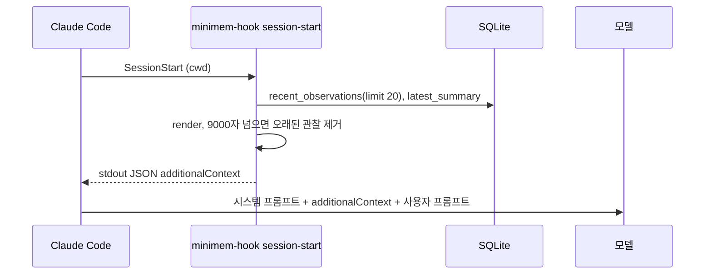

# 시나리오 5. 주입: SessionStart hook으로 컨텍스트에 인덱스 넣기

아무리 좋은 관찰을 DB에 잘 쌓아 두어도, 새 세션이 그 존재를 모른다면 무용지물입니다. 이 시나리오에서는 새 Claude Code 세션이 열릴 때 `SessionStart` hook과 `minimem/context.py`가 직전 세션 요약 1개와 최근 관찰 인덱스(최대 20개)를 `additionalContext`로 모델 입력에 넣어 주는 과정을 살펴봅니다. 주입 분량을 1,000자 안팎으로 가볍게 유지하는 구조와 함께, Claude Code의 hook 출력 한도(10,000자)를 넘겼을 때 어떤 일이 벌어지는지도 `scripts/context_limit.py`로 직접 확인해 봅니다.

## 주입은 출근한 동료가 책상에서 가장 먼저 읽는 노트

[시나리오 1](1-memory-map.md)의 세션 B가 도구를 단 한 번도 호출하지 않고 지난 작업 내역을 술술 답할 수 있었던 비결은, 첫 번째 턴이 시작되기 전에 이미 지난 기록을 건네받았기 때문입니다. Claude Code는 새 세션이 시작되면 `SessionStart` hook을 실행하고, hook이 stdout JSON의 `hookSpecificOutput.additionalContext` 필드로 돌려준 텍스트를 모델의 초기 컨텍스트에 붙여 줍니다. 모델 입장에서는 시스템 프롬프트 바로 옆에 놓인 참고 자료처럼 읽게 됩니다.

`minimem`이 세션 시작 시 주입하는 내용은 딱 두 가지로 제한합니다.

| 구성 | 담기는 내용 | 대략적인 크기 |
| --- | --- | --- |
| 지난 세션 요약 | 가장 최근 세션의 요청, 완료 내역, 알게 된 사실, 다음 할 일 | 수백 자 |
| 관찰 인덱스 | `#id [type] 제목 (파일)` 형식의 한 줄 목록 (최신순 최대 20건) | 한 줄당 약 50~100자 |

여기서 중요한 점은 관찰의 상세 본문(`facts`와 `narrative`)은 주입하지 않는다는 것입니다. 일단 가벼운 목차만 먼저 보여주고, 에이전트가 "이 항목은 자세히 봐야겠다"고 판단할 때만 MCP 도구로 본문을 꺼내 보게 합니다([시나리오 6](6-mcp-search.md)).

### 핵심 용어 정리

| 용어 | 의미 | 이 실습에서의 예 |
| --- | --- | --- |
| `additionalContext` | `SessionStart` hook 출력 중 모델 입력으로 전달되는 텍스트 | 세션 B에 주입된 806자 |
| hook 출력 한도 | Claude Code가 hook 출력을 자르지 않고 그대로 컨텍스트에 넣는 최대 길이 | 10,000자 |
| `persisted-output` | 출력 한도를 넘은 텍스트를 임시 파일로 저장하고 앞부분 미리보기만 넣는 동작 | 10,100자 주입 시 발생 |
| 컨텍스트 예산 | 주입 텍스트가 한도를 넘지 않도록 정해 둔 자체 상한선 | `minimem`의 `CONTEXT_MAX_CHARS = 9000` |

## 주입이 없으면 에이전트는 기록이 있는지조차 모른다

"굳이 세션 시작마다 주입하지 말고, 필요할 때 검색 도구만 쓰게 하면 토큰을 아끼지 않을까?"라는 생각이 들 수 있습니다. 하지만 검색 도구만 열어 두면 에이전트는 매 세션마다 "혹시 이전 기록을 검색해 볼까?"를 스스로 떠올려야 합니다.

시나리오 1처럼 "지난 세션에서 무슨 일을 했지?"라고 대놓고 물으면 에이전트가 기록을 찾으려 시도하겠지만, 실무의 평범한 요청("쿠폰 기능을 구현해라")에서는 굳이 과거 메모리를 뒤져볼 이유를 느끼지 못합니다. 반면 `SessionStart`로 짧은 인덱스를 먼저 넣어 주면 에이전트가 묻기 전에 "이 프로젝트에는 이런 맥락이 있구나"를 자연스럽게 인지합니다.

실제로 쿠폰 기능을 구현한 세션 C([시나리오 6](6-mcp-search.md))가 이 효과를 잘 보여줍니다. 주입된 인덱스에 `pytest`가 없다는 관찰이 한 줄 들어 있었기 때문에, 세션 C는 `pytest`를 시도하며 시간을 낭비하지 않고 곧바로 `python -m unittest discover`로 테스트를 돌렸고, 답변에서도 "이전 세션에서 정한 정수 내림 정책이 그대로 적용됩니다"라고 자연스럽게 맥락을 이어받았습니다.

## 주입량을 hook 출력 한도 안에서 관리하는 이유

주입하는 정보가 많을수록 에이전트가 더 많은 맥락을 알겠지만, 무작정 늘릴 수 없는 현실적인 제약이 두 가지 있습니다. 첫째는 매 턴마다 반복 입력되는 기본 토큰 비용이 커진다는 점이고, 둘째는 Claude Code 자체의 **hook 출력 한도**입니다.

`claude-mem`의 `src/services/context/ContextBudget.ts` 주석에 따르면, hook의 stdout이 10,000자를 넘으면 Claude Code가 전체 내용을 디스크 파일로 빼내고 모델에는 앞부분 약 2KB 미리보기만 넘겨줍니다. 더 까다로운 점은 이때 hook이 실패하지 않고 정상 성공으로 처리된다는 것입니다. 즉, 아무런 에러 메시지 없이 뒷부분 메모리가 조용히 사라집니다. 아래 실습 3단계에서 이 현상을 직접 재현해 볼 수 있습니다.

이 때문에 `claude-mem`은 단순히 "최근 N개"로 자르지 않고, 실제로 렌더링한 글자 수를 재면서 예산을 넘기면 가장 큰 항목부터 덜어내고 다시 렌더링하는 방식을 씁니다. `minimem`도 같은 원리를 단순하게 구현해, 렌더링 결과가 9,000자를 넘지 않을 때까지 가장 오래된 관찰을 한 줄씩 빼냅니다.

## 컨텍스트 전달 방식별 대안 비교

| 방식 | 장점 | 단점 |
| --- | --- | --- |
| 인덱스 주입 + 필요 시 본문 조회 (`claude-mem`, `minimem`) | 매 세션 주입 크기가 작고 일정하게 유지됨 | 인덱스 제목이 부실하면 에이전트가 중요한 관찰을 지나칠 수 있음 |
| 관찰 본문 전체 주입 | 추가 조회 없이 모든 세부를 바로 파악 가능 | 관찰이 조금만 쌓여도 출력 한도와 토큰 예산을 금방 초과함 |
| 주입 없이 검색 도구만 제공 | 세션 시작 시 고정 토큰 비용이 0 | 에이전트가 스스로 검색을 떠올리지 않으면 메모리가 활용되지 못함 |
| `CLAUDE.md`에 직접 누적 | 별도 hook 구성 없이 간단함 | 파일이 길어질수록 동일한 컨텍스트 비대화 문제가 생기며 사람이 직접 정리해야 함 |

## 주요 구성 요소와 역할

| 구성 요소 | 역할 |
| --- | --- |
| `on_session_start()` | `cwd`에서 프로젝트 이름을 추출하고 `build_context()` 결과를 `additionalContext` JSON으로 출력 |
| `build_context()` | 직전 요약과 관찰 인덱스를 조합하고 `max_chars`를 넘으면 오래된 관찰부터 제거 |
| `index_row()` | 관찰 1건을 한 줄 인덱스로 포맷하며 관련 파일은 최대 2개까지만 표시 |
| `summary_lines()` | 내용이 비어 있는 요약 항목은 출력에서 생략 |

## 세션 시작 컨텍스트 주입 흐름

새 세션이 열렸을 때 SQLite에서 꺼낸 기록이 모델의 입력 프롬프트에 합쳐지기까지의 순서입니다.



## 실습: 주입 내용 확인과 10,000자 한도 검증

모든 명령은 workspace 루트에서 실행합니다.

### 1. 실제 주입될 컨텍스트 내용 확인

`minimem context` 명령은 `SessionStart` hook이 호출하는 것과 완전히 같은 함수로 주입 문자열을 출력합니다. [시나리오 1](1-memory-map.md)의 세션 A 직후에 실행하면 세션 B가 받게 될 내용과 동일합니다.

```bash
uv run --project minimem minimem context shop
```

실행하면 직전 세션 요약 아래에 최신순 관찰 인덱스가 깔끔하게 붙어 나옵니다.

```text
# minimem: shop 프로젝트의 지난 작업 기록

## 지난 세션 요약
- 요청: tests/test_discount.py 실패 원인을 찾아 고친다. 금액은 원 단위 int만 사용하며 float는 쓰지 않는다. 다음 작업은 쿠폰 중복 적용 금지 기능이다.
- 완료: shop/discount.py의 반환식을 `price - price * rate // 100`으로 수정했다. `python -m unittest tests.test_discount`로 2개 테스트가 모두 통과함을 확인했다.
- 알게 된 것: apply_discount가 정수 퍼센트 rate를 100으로 나누지 않아 할인 금액이 과도하게 계산되었다. 현재 환경에는 pytest가 없어 unittest로 검증해야 한다. 나눗셈은 `//`로 내림 처리된다.
- 다음 할 일: 쿠폰 중복 적용 금지 기능을 구현한다. 내림 방식 할인 반올림 정책이 맞는지 사용자에게 확인하거나 필요하면 문서화한다. pytest를 쓰려면 설치가 필요하다.

## 관찰 인덱스 (최신순, 본문은 mcp__minimem__get_observations로 id를 지정해 조회)
#3 [decision] 할인액 계산에 정수 나눗셈(//) 사용, 부동소수점 미사용 (shop/discount.py)
#2 [discovery] 현재 환경에는 pytest가 없어 unittest로 테스트를 실행함 (tests/test_discount.py)
#1 [bugfix] apply_discount 할인율 계산 누락된 100 나눗셈 수정 (shop/discount.py, tests/test_discount.py)
```

위 텍스트는 세션 B가 실제로 전달받은 `additionalContext`를 stream-json 로그에서 꺼내 옮긴 것이며, observer 출력 특성상 실행마다 세부 문장은 달라집니다. 인덱스 소제목에 `본문은 mcp__minimem__get_observations로 id를 지정해 조회`라고 안내를 넣어 둔 덕분에, 에이전트는 추가 설명 없이도 상세 본문이 필요할 때 어떤 도구를 호출해야 할지 바로 알아차립니다.

### 2. 세션이 받은 컨텍스트 길이 확인

`run_session.py`는 stream-json의 `hook_response` 이벤트에서 `additionalContext`를 찾아 글자 수를 출력합니다. 시나리오 1의 세션 B 실행 결과에 찍혔던 아래 값이 바로 주입 길이입니다.

```text
injected_context_chars: 806
```

세션 C가 끝나 관찰이 6개로 늘어난 뒤에도 컨텍스트 크기를 확인해 봅니다.

```bash
uv run --project minimem minimem stats shop
```

출력의 `context_chars`를 보면 1,041자로 여전히 아주 가볍습니다.

```text
{"events": 8, "event_chars": 6513, "observations": 6, "observation_chars": 2095, "context_chars": 1041}
```

관찰 한 줄이 대략 80자 안팎이므로, 기본 상한인 20개를 꽉 채워 넣어도 요약을 합쳐 약 2,500자 정도에 불과합니다. Claude Code의 10,000자 한도에 비하면 4분의 1 수준으로 여유가 충분합니다.

### 3. hook 출력 한도(10,000자) 직접 확인

이번에는 `scripts/context_limit.py`로 실제 출력 한도를 실험해 봅니다. 이 스크립트는 임시 프로젝트에 `SessionStart` hook을 걸고, 지정한 길이의 `additionalContext` 맨 끝에 `MARKER-BLUE-FALCON-7`이라는 표식을 숨겨 넣은 뒤 새 `claude -p`(haiku) 세션에게 그 표식이 보이는지 묻습니다. 영문(`x`)과 한글(`가`)로 각각 9,900자와 10,100자를 테스트합니다.

```bash
uv run scripts/context_limit.py
uv run scripts/context_limit.py --ko
```

실행 결과는 10,000자를 경계로 정확하게 갈립니다.

```text
additionalContext 9900자(x): marker 전달됨
additionalContext 10100자(x): marker 전달 안 됨
additionalContext 9900자(가): marker 전달됨
additionalContext 10100자(가): marker 전달 안 됨
```

9,900자에서는 맨 끝의 마커까지 온전히 전달되었지만, 10,100자가 되자 마커가 사라졌습니다. 같은 조건에서 모델에게 컨텍스트가 어떻게 보이느냐고 물어보니 "persisted-output 형태로 잘려서 파일에 저장돼 있고, 앞부분 2KB 미리보기만 보이는 상태"라고 답했습니다. 특히 UTF-8로 약 29,700바이트에 달하는 한글 9,900자가 무사히 통과한 것으로 보아, 이 한도는 바이트가 아니라 **글자 수(character count) 기준**임을 알 수 있습니다. 이 측정은 Claude Code 2.1.327 기준이며 버전 업데이트에 따라 한도가 달라질 수 있습니다.

## 실무 관점에서 짚어볼 점

- **출력 한도 초과는 에러 없이 조용히 발생합니다**: 어느 날부터 에이전트가 갑자기 지난 작업 기록을 전혀 모르는 것처럼 행동한다면 hook 출력 한도를 의심해 봐야 합니다. 주입 글자 수(`injected_context_chars`)를 로그 지표로 남겨 두면 이런 조용한 실패를 금방 잡아낼 수 있습니다.
- **앞쪽에 무엇을 배치하느냐가 중요합니다**: `persisted-output`이 발동하면 앞부분 2KB만 미리보기로 살아남습니다. `minimem`과 `claude-mem`이 모두 가장 중요한 '지난 세션 요약'을 맨 앞에 두고 '관찰 인덱스'를 그 아래에 배치하는 이유도, 최악의 경우 잘리더라도 핵심 요약만큼은 모델에 닿도록 하기 위함입니다.
- **요약은 직전 세션 하나만 유지됩니다**: 따라서 실제 코드 작업 없이 메모리만 검색하고 끝난 세션이 직전 작업 요약을 덮어쓰지 않도록 막아야 합니다([시나리오 6](6-mcp-search.md) 4단계).
