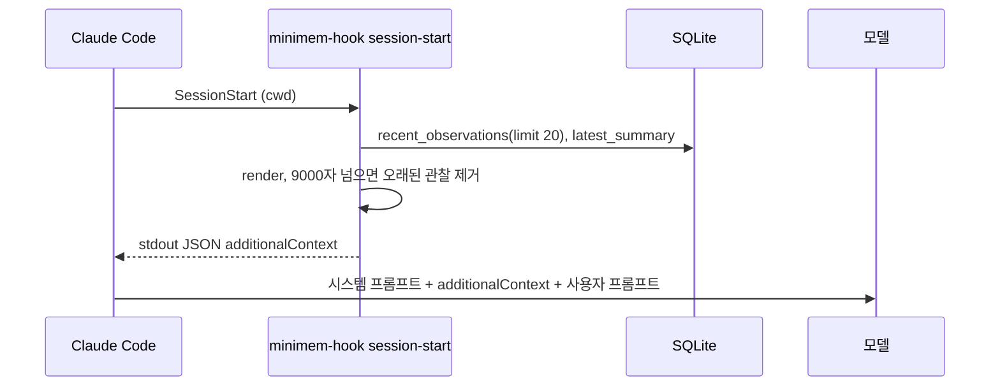

# 시나리오 5. 주입: SessionStart hook으로 컨텍스트에 인덱스 넣기

아무리 좋은 관찰을 DB에 잘 쌓아 두어도, 새 세션이 그 존재를 모른다면 무용지물입니다. 이 시나리오에서는 새 Claude Code 세션이 열릴 때 `SessionStart` hook과 `minimem/context.py`가 직전 세션 요약 1개와 최근 관찰 인덱스(최대 20개)를 `additionalContext`로 모델 입력에 넣어 주는 과정을 살펴봅니다. 주입 분량을 1,000자 안팎으로 가볍게 유지하는 구조와 함께, Claude Code의 hook 출력 한도(10,000자)를 넘겼을 때 어떤 일이 벌어지는지도 `scripts/context_limit.py`로 직접 확인해 봅니다.

## 새 세션이 첫 질문과 함께 받는 기록

[시나리오 1](1-memory-map.md)에서는 질문 세션의 기본 도구와 MCP를 끕니다. 그래도 직원 제외 기준을 답할 수 있는 경로가 남습니다. Claude Code는 새 세션이 시작되면 `SessionStart` hook을 실행하고, hook이 stdout JSON의 `hookSpecificOutput.additionalContext` 필드로 돌려준 텍스트를 모델의 초기 컨텍스트에 붙여 줍니다. 모델 입장에서는 시스템 프롬프트 바로 옆에 놓인 참고 자료처럼 읽게 됩니다.

`minimem`이 세션 시작 시 주입하는 내용은 딱 두 가지로 제한합니다.

| 구성 | 담기는 내용 | 대략적인 크기 |
| --- | --- | --- |
| 지난 세션 요약 | 가장 최근 세션의 요청, 완료 내역, 알게 된 사실, 다음 할 일 | 수백 자 |
| 관찰 인덱스 | `#id [type] 제목 (파일)` 형식의 한 줄 목록 (최신순 최대 20건) | 한 줄당 약 50~100자 |

여기서 중요한 점은 관찰의 상세 본문(`facts`와 `narrative`)은 주입하지 않는다는 것입니다. 일단 가벼운 목차만 먼저 보여주고, 에이전트가 "이 항목은 자세히 봐야겠다"고 판단할 때만 MCP 도구로 본문을 꺼내 보게 합니다([시나리오 6](6-mcp-search.md)).

### 핵심 용어 정리

| 용어 | 의미 | 이 실습에서의 예 |
| --- | --- | --- |
| `additionalContext` | `SessionStart` hook 출력 중 모델 입력으로 전달되는 텍스트 | 놀이공원 요약과 관찰 제목 |
| hook 출력 한도 | Claude Code가 hook 출력을 자르지 않고 그대로 컨텍스트에 넣는 최대 길이 | 10,000자 |
| `persisted-output` | 출력 한도를 넘은 텍스트를 임시 파일로 저장하고 앞부분 미리보기만 넣는 동작 | 10,100자 주입 시 발생 |
| 컨텍스트 예산 | 주입 텍스트가 한도를 넘지 않도록 정해 둔 자체 상한선 | `minimem`의 `CONTEXT_MAX_CHARS = 9000` |

## 주입이 없으면 에이전트는 기록이 있는지조차 모른다

"굳이 세션 시작마다 주입하지 말고, 필요할 때 검색 도구만 쓰게 하면 토큰을 아끼지 않을까?"라는 생각이 들 수 있습니다. 하지만 검색 도구만 열어 두면 에이전트는 매 세션마다 "혹시 이전 기록을 검색해 볼까?"를 스스로 떠올려야 합니다.

새 세션에 “지금 집계를 언제 닫을까?”라고 물으면 모델은 애초에 지난 대화에 기준이 정해져 있었는지 알기 어렵습니다. 요약에 오후 6시가 있다면 검색을 따로 떠올리지 않아도 바로 참고할 수 있습니다.

## 주입량을 hook 출력 한도 안에서 관리하는 이유

주입하는 정보가 많을수록 에이전트가 더 많은 맥락을 알겠지만, 무작정 늘릴 수 없는 현실적인 제약이 두 가지 있습니다. 첫째는 매 턴마다 반복 입력되는 기본 토큰 비용이 커진다는 점이고, 둘째는 Claude Code 자체의 **hook 출력 한도**입니다.

`claude-mem`의 `src/services/context/ContextBudget.ts` 주석에 따르면, hook의 stdout이 10,000자를 넘으면 Claude Code가 전체 내용을 디스크 파일로 빼내고 모델에는 앞부분 약 2KB 미리보기만 넘겨줍니다. 더 까다로운 점은 이때 hook이 실패하지 않고 정상 성공으로 처리된다는 것입니다. 즉, 아무런 에러 메시지 없이 뒷부분 메모리가 조용히 사라집니다. 아래 선택 실험에서 확인할 수 있습니다.

이 때문에 `claude-mem`은 단순히 "최근 N개"로 자르지 않고, 실제로 렌더링한 글자 수를 재면서 예산을 넘기면 가장 큰 항목부터 덜어내고 다시 렌더링하는 방식을 씁니다. `minimem`도 같은 원리를 단순하게 구현해, 렌더링 결과가 9,000자를 넘지 않을 때까지 가장 오래된 관찰을 한 줄씩 빼냅니다.

## 컨텍스트 전달 방식별 대안 비교

| 방식 | 장점 | 단점 |
| --- | --- | --- |
| 인덱스 주입 + 필요 시 본문 조회 (`claude-mem`, `minimem`) | 매 세션 주입 크기가 작고 일정하게 유지됨 | 인덱스 제목이 부실하면 에이전트가 중요한 관찰을 지나칠 수 있음 |
| 관찰 본문 전체 주입 | 추가 조회 없이 모든 세부를 바로 파악 가능 | 관찰이 조금만 쌓여도 출력 한도와 토큰 예산을 금방 초과함 |
| 주입 없이 검색 도구만 제공 | 세션 시작 시 고정 토큰 비용이 0 | 에이전트가 스스로 검색을 떠올리지 않으면 메모리가 활용되지 못함 |
| `CLAUDE.md`에 직접 누적 | 별도 hook 구성 없이 간단함 | 파일이 길어질수록 동일한 컨텍스트 비대화 문제가 생기며 사람이 직접 정리해야 함 |

## 주요 구성 요소와 역할

| 구성 요소 | 역할 |
| --- | --- |
| `on_session_start()` | `cwd`에서 프로젝트 이름을 추출하고 `build_context()` 결과를 `additionalContext` JSON으로 출력 |
| `build_context()` | 직전 요약과 관찰 인덱스를 조합하고 `max_chars`를 넘으면 오래된 관찰부터 제거 |
| `index_row()` | 관찰 1건을 한 줄 인덱스로 포맷하며 관련 파일은 최대 2개까지만 표시 |
| `summary_lines()` | 내용이 비어 있는 요약 항목은 출력에서 생략 |

## 세션 시작 컨텍스트 주입 흐름

새 세션이 열렸을 때 SQLite에서 꺼낸 기록이 모델의 입력 프롬프트에 합쳐지기까지의 순서입니다.



## 실습: 주입될 텍스트 확인

아래 명령은 [시나리오 1](1-memory-map.md)에서 새 세션이 시작할 때 사용한 것과 같은 함수로 컨텍스트를 렌더링합니다. 요약에서 직원 제외와 확정 시각을 찾고, 관찰 인덱스가 제목만 보여 주는지 확인합니다.

```bash
minimem/.venv/bin/minimem context park
```

실제 질문 세션이 받은 길이는 시나리오 1에 출력된 `injected_context_chars`에서 확인합니다. 조회한 텍스트가 있는데 이 값이 0이라면, 세션 시작 당시 observer가 저장을 마쳤는지와 hook 실행 여부를 확인합니다.

## 선택 실험: hook 출력 한도

아래 스크립트는 Haiku 세션 두 개를 추가로 열어 9,900자와 10,100자 끝에 넣은 표식이 모델에 전달되는지 묻습니다. 기존에 Claude Code 2.1.327에서 확인했을 때 9,900자의 표식은 전달됐고 10,100자의 표식은 잘렸습니다. `--ko`를 붙이면 한글로 같은 실험을 합니다.

```bash
minimem/.venv/bin/python scripts/context_limit.py
```

## 실무 관점에서 짚어볼 점

- **출력 한도 초과는 에러 없이 조용히 발생합니다**: 어느 날부터 에이전트가 갑자기 지난 작업 기록을 전혀 모르는 것처럼 행동한다면 hook 출력 한도를 의심해 봐야 합니다. 주입 글자 수(`injected_context_chars`)를 로그 지표로 남겨 두면 이런 조용한 실패를 금방 잡아낼 수 있습니다.
- **앞쪽에 무엇을 배치하느냐가 중요합니다**: `persisted-output`이 발동하면 앞부분 2KB만 미리보기로 살아남습니다. `minimem`과 `claude-mem`이 모두 가장 중요한 '지난 세션 요약'을 맨 앞에 두고 '관찰 인덱스'를 그 아래에 배치하는 이유도, 최악의 경우 잘리더라도 핵심 요약만큼은 모델에 닿도록 하기 위함입니다.
- **요약은 직전 세션 하나만 유지됩니다**: 따라서 실제 코드 작업 없이 메모리만 검색하고 끝난 세션이 직전 작업 요약을 덮어쓰지 않도록 막아야 합니다([시나리오 6](6-mcp-search.md)).
