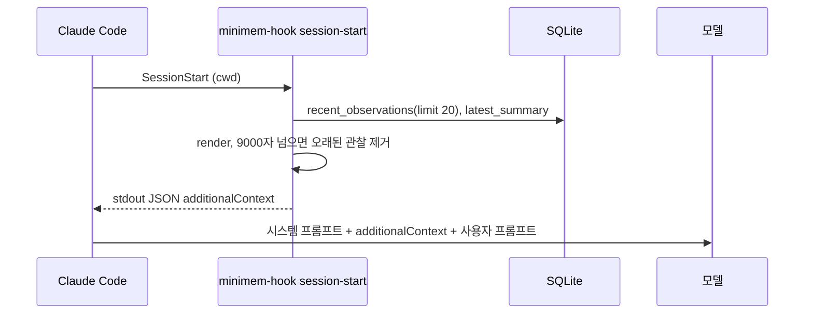

# 시나리오 5. 주입: SessionStart hook이 인덱스를 컨텍스트에 넣는다

## 이 시나리오의 목표

| 항목 | 내용 |
| --- | --- |
| 기능 | 세션 시작 컨텍스트 주입 |
| 쓰는 도구 | `SessionStart` hook의 `additionalContext`, `minimem/context.py`, `scripts/context_limit.py` |
| 입력 | 직전 세션 요약 1개, 최근 관찰 최대 20개 |
| 작업 | 1. 주입될 컨텍스트 확인 2. 세션 B가 받은 컨텍스트 길이 확인 3. hook 출력 길이 한도 확인 |
| 달성할 것 | 주입량이 1,000자 안팎으로 유지되고, Claude Code의 hook 출력 한도(10,000자)를 넘지 않게 자르는 이유를 확인 |

## 주입은 출근한 동료가 책상에서 처음 읽는 노트다

[시나리오 1](1-memory-map.md)의 세션 B가 도구 호출 없이 답할 수 있었던 이유는 첫 턴 전에 이미 지난 기록을 읽었기 때문입니다. Claude Code는 세션이 시작될 때 `SessionStart` hook을 실행하고, hook이 stdout으로 출력한 JSON의 `hookSpecificOutput.additionalContext`를 모델 입력에 넣습니다. 모델은 이것을 시스템 프롬프트 옆의 참고 자료로 받습니다.

minimem이 주입하는 내용은 두 부분입니다.

| 부분 | 내용 | 크기 |
| --- | --- | --- |
| 지난 세션 요약 | 가장 최근 세션의 요청, 완료, 알게 된 것, 다음 할 일 | 수백 자 |
| 관찰 인덱스 | `#id [type] 제목 (파일)` 한 줄씩, 최신순 최대 20개 | 한 줄 약 50~100자 |

관찰의 facts와 narrative는 주입하지 않습니다. 에이전트는 인덱스를 보고 필요한 관찰만 MCP 도구로 가져옵니다([시나리오 6](6-mcp-search.md)).

### 용어

| 용어 | 뜻 | 이 실습의 예 |
| --- | --- | --- |
| `additionalContext` | `SessionStart` hook 출력 중 모델 입력에 들어가는 문자열 | 세션 B에 806자 |
| hook 출력 한도 | Claude Code가 hook 출력을 그대로 넣는 최대 길이 | 10,000자 |
| persisted-output | 한도를 넘은 출력을 파일로 저장하고 앞부분 미리보기만 넣는 동작 | 10,100자에서 발생 |
| 컨텍스트 예산 | 주입 텍스트의 최대 길이 | minimem `CONTEXT_MAX_CHARS = 9000` |

## 주입이 없으면 에이전트는 지난 기록이 있는지조차 모른다

메모리를 검색 도구로만 제공하면, 에이전트는 매 세션 "검색해 볼까"를 스스로 판단해야 합니다. 시나리오 1의 메모리 없는 세션 B는 기록을 찾으려 디렉터리를 뒤졌지만, 질문이 "쿠폰 기능을 구현해라"였다면 지난 기록을 찾을 이유조차 없었습니다. 주입은 에이전트가 묻기 전에 "이런 기록이 있다"를 알려 줍니다.

세션 C(쿠폰 기능, [시나리오 6](6-mcp-search.md))가 이 효과를 보여 줍니다. 주입된 인덱스에 `pytest`가 없다는 관찰이 있었으므로 세션 C는 `pytest`를 시도하지 않고 바로 `python -m unittest discover`로 테스트를 실행했고, 답변에서 "이전 세션에서 정한 정수 내림 정책이 그대로 적용됩니다"라고 언급했습니다.

## 주입량은 hook 출력 한도 안에서 정한다

주입량이 클수록 에이전트가 더 많이 알지만, 두 가지가 크기를 제한합니다. 하나는 매 턴 입력 토큰이 늘어난다는 점이고, 다른 하나는 Claude Code의 hook 출력 한도입니다. claude-mem의 `src/services/context/ContextBudget.ts` 주석은 hook stdout이 10,000자를 넘으면 전체가 디스크에 저장되고 약 2KB 미리보기로 대체되며, hook은 성공으로 보고되므로 조용히 실패한다고 설명합니다. 3단계에서 이 동작을 직접 확인합니다.

그래서 claude-mem은 관찰 개수가 아니라 렌더링한 글자 수로 예산을 맞춥니다. 렌더링하고, 예산을 넘으면 가장 큰 항목을 빼고 다시 렌더링합니다. minimem은 같은 원리를 단순하게 적용해, 9,000자를 넘는 동안 가장 오래된 관찰을 하나씩 뺍니다.

## 대안 비교

| 방식 | 장점 | 단점 |
| --- | --- | --- |
| 인덱스 주입 + 필요 시 조회(claude-mem, minimem) | 주입량이 작고 일정합니다 | 인덱스 제목이 부정확하면 에이전트가 관련 관찰을 놓칩니다 |
| 관찰 본문 전체 주입 | 조회가 필요 없습니다 | 관찰이 쌓이면 한도를 넘습니다 |
| 주입 없이 검색 도구만 제공 | 매 세션 비용이 0입니다 | 에이전트가 검색할지 스스로 판단해야 합니다 |
| `CLAUDE.md`에 기록 | 별도 hook이 필요 없습니다 | 파일이 커지면 같은 크기 문제가 생기고, 사람이 정리해야 합니다 |

## 컴포넌트 역할

| 컴포넌트 | 역할 |
| --- | --- |
| `on_session_start()` | `cwd`로 프로젝트를 정하고 `build_context()` 결과를 `additionalContext` JSON으로 출력 |
| `build_context()` | 요약과 인덱스를 렌더링하고, `max_chars`를 넘으면 오래된 관찰부터 제거 |
| `index_row()` | 관찰 1건을 한 줄로 만들고 파일은 2개까지만 표시 |
| `summary_lines()` | 비어 있는 요약 필드는 건너뜀 |

## 흐름

새 세션이 시작될 때 컨텍스트가 만들어져 모델에 들어가기까지의 순서입니다.



## 실습

명령은 workspace 루트에서 실행합니다.

### 1. 주입될 컨텍스트 확인

`minimem context`는 `SessionStart` hook과 같은 함수로 컨텍스트를 만듭니다. [시나리오 1](1-memory-map.md)의 세션 A 직후에 실행하면 세션 B가 받을 내용과 같습니다.

```bash
uv run --project minimem minimem context shop
```

```text
# minimem: shop 프로젝트의 지난 작업 기록

## 지난 세션 요약
- 요청: tests/test_discount.py 실패 원인을 찾아 고친다. 금액은 원 단위 int만 사용하며 float는 쓰지 않는다. 다음 작업은 쿠폰 중복 적용 금지 기능이다.
- 완료: shop/discount.py의 반환식을 `price - price * rate // 100`으로 수정했다. `python -m unittest tests.test_discount`로 2개 테스트가 모두 통과함을 확인했다.
- 알게 된 것: apply_discount가 정수 퍼센트 rate를 100으로 나누지 않아 할인 금액이 과도하게 계산되었다. 현재 환경에는 pytest가 없어 unittest로 검증해야 한다. 나눗셈은 `//`로 내림 처리된다.
- 다음 할 일: 쿠폰 중복 적용 금지 기능을 구현한다. 내림 방식 할인 반올림 정책이 맞는지 사용자에게 확인하거나 필요하면 문서화한다. pytest를 쓰려면 설치가 필요하다.

## 관찰 인덱스 (최신순, 본문은 mcp__minimem__get_observations로 id를 지정해 조회)
#3 [decision] 할인액 계산에 정수 나눗셈(//) 사용, 부동소수점 미사용 (shop/discount.py)
#2 [discovery] 현재 환경에는 pytest가 없어 unittest로 테스트를 실행함 (tests/test_discount.py)
#1 [bugfix] apply_discount 할인율 계산 누락된 100 나눗셈 수정 (shop/discount.py, tests/test_discount.py)
```

위 출력은 세션 B가 실제로 받은 `additionalContext`를 stream-json 로그에서 꺼낸 것이고, observer 출력이라 실행마다 문장이 다릅니다. 인덱스 머리말에 MCP 도구 이름을 적어 두었으므로, 에이전트는 본문이 필요할 때 어떤 도구를 부를지 압니다.

### 2. 세션이 받은 컨텍스트 길이 확인

`run_session.py`는 stream-json의 `hook_response` 이벤트에서 `additionalContext`를 찾아 길이를 출력합니다. 시나리오 1의 세션 B 출력에서 `injected_context_chars` 줄이 이 값입니다.

```text
injected_context_chars: 806
```

관찰이 6개로 늘어난 세션 C 이후의 컨텍스트는 1,041자입니다. 관찰 한 줄이 약 80자이므로, 기본값 20개를 모두 채워도 요약 포함 약 2,500자로 한도의 4분의 1입니다.

```bash
uv run --project minimem minimem stats shop
```

```text
{"events": 8, "event_chars": 6513, "observations": 6, "observation_chars": 2095, "context_chars": 1041}
```

### 3. hook 출력 한도 확인

`context_limit.py`는 임시 프로젝트에 `SessionStart` hook을 만들고, 지정한 길이의 `additionalContext` 맨 끝에 `MARKER-BLUE-FALCON-7`을 넣은 뒤 새 세션에 그 문자열을 묻습니다. 세션마다 `claude -p`를 haiku로 1번 실행합니다.

```bash
uv run scripts/context_limit.py
uv run scripts/context_limit.py --ko
```

```text
additionalContext 9900자(x): marker 전달됨
additionalContext 10100자(x): marker 전달 안 됨
additionalContext 9900자(가): marker 전달됨
additionalContext 10100자(가): marker 전달 안 됨
```

10,000자를 넘자 끝부분이 모델에 전달되지 않았습니다. 같은 조건에서 모델에게 컨텍스트가 어떻게 보이는지 물었을 때 "persisted-output 형태로 잘려서 파일에 저장돼 있고, 앞부분 2KB 미리보기만 보이는 상태"라고 답했습니다. 한글 9,900자(UTF-8 약 29,700바이트)는 전달됐으므로 한도는 바이트가 아니라 글자 수 기준입니다. Claude Code 2.1.327에서 측정했고, 한도는 버전마다 바뀔 수 있습니다.

## 부록. 실무에서 얻는 것

- hook 출력 한도를 넘으면 오류 없이 컨텍스트가 사라집니다. 메모리가 쌓여 어느 날부터 에이전트가 지난 기록을 모르게 되는 문제는 이 한도에서 시작될 수 있으므로, 주입 길이를 지표로 남겨 두면 원인을 빨리 찾습니다.
- 주입 순서도 판단입니다. persisted-output은 앞부분 2KB만 남기므로, 한도를 넘더라도 가장 중요한 요약을 앞에 두면 일부라도 전달됩니다. minimem과 claude-mem 모두 요약을 앞에, 인덱스를 뒤에 둡니다.
- 요약은 직전 세션 하나만 들어가므로, 조회만 한 세션이 의미 있는 요약을 덮어쓰지 않게 해야 합니다([시나리오 6](6-mcp-search.md) 4단계).
