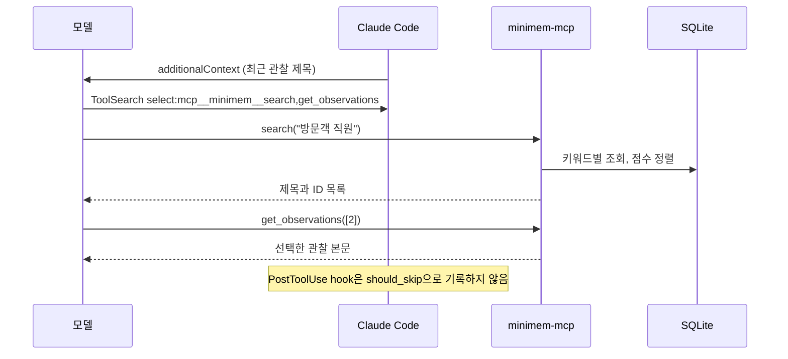

# 시나리오 6. 필요할 때만 본문 조회: MCP 검색과 progressive disclosure

관찰 제목을 보고 어떤 기록을 펼칠지 고를 수 있다면, 새 세션에 기록 본문 전부를 보낼 필요가 없습니다. `minimem-mcp`는 검색으로 관찰 ID를 찾고, 선택한 본문만 가져오는 두 도구를 제공합니다. [시나리오 1](1-memory-map.md)에서 저장한 놀이공원 집계 기록으로 확인합니다.

## progressive disclosure는 목차를 먼저 보고 필요한 장만 펴는 방식

`claude-mem` README는 메모리 검색을 3단계 흐름으로 설계합니다. 먼저 `search`로 ID가 붙은 짧은 인덱스를 훑고, 필요하면 `timeline`으로 그 전후 맥락을 확인한 뒤, 마지막으로 `get_observations`를 호출해 꼭 필요한 ID의 본문만 가져옵니다. README 기준으로 인덱스 한 줄은 약 50~100 토큰, 관찰 본문 하나는 약 500~1,000 토큰이므로 인덱스가 본문의 10분의 1 수준입니다. `minimem`은 원리를 깔끔하게 보여주기 위해 중간 `timeline`을 생략하고 `search`와 `get_observations` 2단계로 구성했습니다.

[시나리오 5](5-context-injection.md)의 `SessionStart` 주입이 "최근 작업의 목차"를 미리 책상에 올려두는 역할이라면, MCP `search`는 오래전에 밀려난 기록까지 찾아보는 "전체 색인 검색"입니다. 어느 쪽에서 찾든 상세 본문은 항상 `get_observations`를 통해서만 꺼내 봅니다.

### 핵심 용어 정리

| 용어 | 의미 | 이 실습에서의 예 |
| --- | --- | --- |
| MCP 서버 | 에이전트에게 외부 도구를 제공하는 프로세스 (stdio 기반 JSON-RPC 통신) | `minimem/.venv/bin/minimem-mcp` |
| `search` | 키워드로 관찰 인덱스를 조회하는 MCP 도구 | `{"query": "방문객 직원"}` |
| `get_observations` | 선택한 ID 목록의 관찰 본문만 반환하는 MCP 도구 | `{"ids": [2]}` |
| 재귀 기록 | 메모리를 읽으려고 호출한 도구가 다시 새 이벤트로 기록되는 현상 | `mcp__minimem__search` 호출이 DB에 쌓이는 문제 |

## 본문을 처음부터 다 주면 왜 문제가 될까

관찰 하나에는 제목 외에도 사실, 설명, 관련 파일이 들어 있습니다. 처음에는 제목과 ID만 보고, 예를 들어 직원 제외 기준을 자세히 볼 때는 그 기록의 본문만 가져옵니다. 관찰이 쌓일수록 한꺼번에 넘기는 본문을 줄이는 효과가 커집니다.

## 조회 인터페이스별 대안 비교

| 방식 | 에이전트 측 준비 | 장점 | 단점 |
| --- | --- | --- | --- |
| MCP 도구 (`claude-mem`, `minimem`) | 별도 설정 없이 도구 설명만 읽고 사용 | Codex, Cursor 등 다른 MCP 클라이언트에서도 같은 서버를 그대로 재사용 | 도구 정의 자체가 컨텍스트를 차지함 (Claude Code는 도구가 많으면 `ToolSearch`로 지연 로드) |
| 에이전트가 `sqlite3` CLI로 직접 조회 | DB 스키마를 알고 있어야 함 | 별도 서버 프로세스가 필요 없음 | 매번 셸 실행 승인이 필요하고, 모델이 직접 SQL을 짜야 해서 오류 위험이 큼 |
| Skill로 검색 절차 안내 | `SKILL.md` 작성 | 검색 순서를 명확히 강제 가능 (`claude-mem`도 `mem-search` skill을 함께 제공) | 결국 실제 조회를 수행할 MCP 도구나 CLI가 밑단에 필요함 |

## 메모리를 읽은 흔적은 메모리에 남기지 않는다

개발 도중 실제로 겪었던 재미있는 버그가 하나 있습니다. 파일 수정 없이 `search`와 `get_observations`로 기억만 조회하고 끝난 세션이 있었습니다. 그런데 이 메모리 도구 호출들이 일반 도구처럼 `PostToolUse` 이벤트로 저장되면서, 세션이 끝날 때 observer가 "사용자가 메모리 검색을 요청함"이라는 새 요약을 만들어 버렸습니다.

문제는 다음 세션에 주입되는 요약이 **가장 마지막 세션 1개**뿐이라는 점입니다. 이런 방식이면 앞 세션의 방문객 집계 요약을 단순 조회 세션이 덮을 수 있습니다.

그래서 `minimem`은 `hook.should_skip()`에서 `mcp__minimem__*`와 `ToolSearch` 호출을 아예 캡처 대상에서 빼도록 고쳤습니다. 저장된 이벤트가 하나도 없는 세션은 observer가 아무것도 쓰지 않고 바로 종료되므로, 직전 작업 요약이 안전하게 보존됩니다. 원본 `claude-mem` 역시 같은 문제를 막기 위해 `src/shared/memory-retrieval-tools.ts`에 `isRecursiveMemoryTool` 필터를 두고 있습니다.

## 주요 구성 요소와 역할

| 구성 요소 | 역할 |
| --- | --- |
| `.mcp.json` | 프로젝트에서 `minimem` MCP 서버를 stdio 방식으로 실행하도록 등록 |
| `mcp_server.search` | `search.search()`를 호출해 OR 검색 기반의 관찰 인덱스 반환 |
| `mcp_server.get_observations` | 요청한 ID 목록의 `facts`, `narrative`, 관련 파일 목록 반환 |
| `current_project()` | Claude Code가 전달한 `CLAUDE_PROJECT_DIR` 환경 변수로 현재 프로젝트 식별 |
| `hook.should_skip()` | 메모리 조회 도구와 `ToolSearch` 호출을 이벤트 캡처에서 제외 |

## MCP 기반 2단계 조회 흐름

아래는 모델이 인덱스를 검색한 뒤 관찰 하나의 본문을 꺼내 오는 순서입니다. 관찰 ID는 실행마다 달라집니다.



## 실습: 제목과 본문 비교

아래 명령으로 같은 기록의 검색 인덱스와 본문을 비교합니다. 두 명령 모두 로컬 SQLite에서 읽으므로 모델 호출이 없습니다.

```bash
minimem/.venv/bin/minimem search park '방문객 직원'
minimem/.venv/bin/minimem observations park
```

검색 결과는 ID와 제목 중심입니다. 본문에서만 보이는 사실이나 설명을 하나 골라 보세요. MCP에서도 `search`는 인덱스를 반환하고, `get_observations`는 고른 ID의 본문을 반환합니다.

## 선택 실험: Claude Code에서 두 MCP 도구 호출

실제 호출까지 확인하려면 아래 명령을 실행합니다. 모델이 검색과 본문 조회를 연이어 호출하므로 기본 실습보다 오래 걸립니다.

```bash
PD='minimem의 search로 "방문객 직원"을 찾고, 직원 제외와 가장 관련 있는 ID 하나를 get_observations로 조회해 줘. 본문 내용을 한 문장으로 알려 줘.'
minimem/.venv/bin/python scripts/run_session.py --tools "" "$LAB_DIR/park" "$PD"
```

`tool_calls`에 MCP 도구 이름이 보이는지 확인합니다. 실행 전후에 아래 이벤트 목록을 비교하면 조회 호출이 새 이벤트를 남기는지도 확인할 수 있습니다.

```bash
minimem/.venv/bin/minimem events park
```

## 실무 관점에서 짚어볼 점

- **검색 도구는 에이전트의 질의 습관에 맞춰 설계해야 합니다**: 에이전트는 키워드를 넉넉하게 나열하는 편입니다. 검색어 중 하나가 관찰에 없어도 OR 검색은 나머지 단어로 후보를 반환합니다([시나리오 4](4-storage-search.md)).
- **도구 docstring 자체가 에이전트에게 주는 사용 설명서입니다**: `search` 도구 설명에 "본문은 `get_observations`로 조회한다"고 적어 두고, `SessionStart` 인덱스 머리말에도 도구 이름을 명시해 두었더니 별도 프롬프트 지시 없이도 에이전트가 자연스럽게 2단계 조회 순서를 따랐습니다.
- **메모리 시스템은 자기 자신의 활동을 반드시 제외해야 합니다**: 캡처(hook), 압축(observer 세션), 조회(MCP 도구) 세 지점 어디서든 재귀 기록이 발생할 수 있습니다. 메모리 파이프라인을 설계할 때는 "메모리를 다루는 행위는 메모리에 넣지 않는다"는 경계를 세 곳 모두에 명확히 그어 두어야 합니다.
