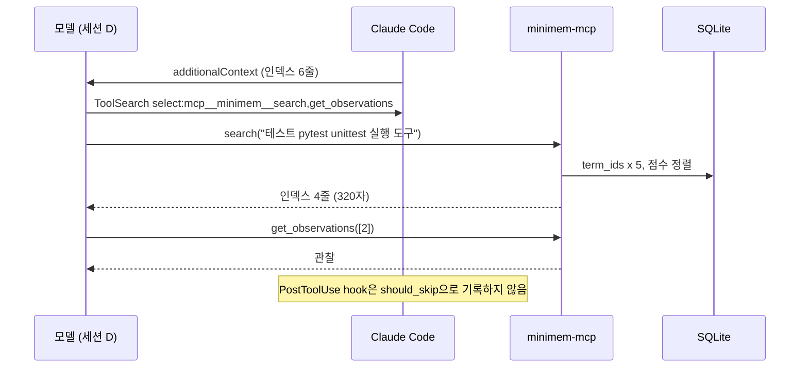

# 시나리오 6. 필요할 때 본문 조회: MCP 검색과 progressive disclosure

## 이 시나리오의 목표

| 항목 | 내용 |
| --- | --- |
| 기능 | 메모리 검색 도구와 progressive disclosure |
| 쓰는 도구 | MCP stdio 서버(`minimem-mcp`), 도구 `search`, `get_observations` |
| 입력 | 세션 C(쿠폰 기능)까지 쌓인 관찰 6개, 세션 D의 질문 |
| 작업 | 1. 세션 C 실행 2. 세션 D에서 검색 도구 사용 확인 3. 인덱스와 본문 크기 비교 4. 메모리 도구 호출이 기록되지 않는지 확인 |
| 달성할 것 | 에이전트가 인덱스로 후보를 고른 뒤 필요한 관찰 본문만 가져오는 흐름과, 그 흐름이 본문 전체 대비 줄이는 크기를 확인 |

## progressive disclosure는 목차를 먼저 보고 필요한 장만 펴는 방식이다

claude-mem README는 검색을 3단계로 설명합니다. `search`로 id가 붙은 짧은 인덱스를 받고, `timeline`으로 앞뒤 맥락을 보고, `get_observations`로 고른 id의 본문만 가져옵니다. 인덱스 한 줄은 50~100 토큰, 본문 하나는 500~1,000 토큰이라 인덱스가 약 10분의 1 크기라고 적습니다. minimem은 `timeline`을 빼고 `search`와 `get_observations` 2단계만 구현했습니다.

SessionStart 주입([시나리오 5](5-context-injection.md))이 최근 관찰의 목차라면, `search`는 오래된 관찰까지 포함한 색인 검색입니다. 두 경로 모두 본문은 `get_observations`로만 가져옵니다.

### 용어

| 용어 | 뜻 | 이 실습의 예 |
| --- | --- | --- |
| MCP 서버 | 에이전트에게 도구를 제공하는 프로세스. stdio로 JSON-RPC를 주고받습니다 | `uv run --project <minimem> minimem-mcp` |
| `search` | 검색어로 관찰 인덱스를 반환하는 도구 | `{"query": "테스트 pytest unittest 실행 도구"}` |
| `get_observations` | id 목록으로 관찰 본문을 반환하는 도구 | `{"ids": [2]}` |
| 재귀 기록 | 메모리를 읽는 도구 호출이 다시 메모리에 기록되는 현상 | `mcp__minimem__search` 이벤트 |

## 본문을 처음부터 모두 주면 관찰이 쌓일수록 컨텍스트가 커진다

관찰 6개의 본문 전체는 2,363자이고, 같은 관찰의 검색 인덱스는 431자입니다. 관찰이 수백 개로 늘면 본문 전체는 hook 출력 한도와 매 턴 입력 토큰을 모두 넘지만, 에이전트가 실제로 필요한 관찰은 질문마다 1~2개입니다. 인덱스로 고르고 본문을 가져오는 2단계로 나누면, 비용이 관찰 총량이 아니라 에이전트가 고른 개수에 비례합니다.

## 대안 비교

| 방식 | 에이전트 쪽 구현 | 장점 | 단점 |
| --- | --- | --- | --- |
| MCP 도구(claude-mem, minimem) | 없음, 도구 설명만 읽음 | 다른 MCP 클라이언트(Codex, Cursor 등)에서도 같은 서버를 씁니다 | 도구 정의가 컨텍스트를 씁니다. Claude Code는 도구가 많으면 `ToolSearch`로 지연 로드합니다 |
| 에이전트가 `sqlite3` CLI로 직접 조회 | 스키마를 알아야 함 | 별도 서버가 없습니다 | 권한 승인이 필요하고, 쿼리를 매번 만들어야 합니다 |
| Skill로 검색 절차 안내 | `SKILL.md` | 검색 순서를 강제할 수 있습니다. claude-mem은 `mem-search` skill을 함께 둡니다 | 결국 MCP 도구나 CLI가 필요합니다 |

## 메모리를 읽은 기록은 메모리에 남기지 않는다

개발 중 실행에서 세션 D는 `search`와 `get_observations`만 호출한 세션이었습니다. 이 호출이 `PostToolUse` 이벤트로 저장되자 observer는 "사용자가 메모리 검색을 요청함"이라는 요약을 만들었고, 이 요약이 세션 C의 의미 있는 요약(쿠폰 기능 완료, 다음 할 일)을 덮어썼습니다. 다음 세션은 직전 요약만 받으므로 쿠폰 작업의 다음 할 일을 잃었습니다.

minimem은 `should_skip()`으로 `mcp__minimem__*`와 `ToolSearch` 호출을 캡처하지 않게 고쳤습니다. 이벤트가 하나도 없는 세션은 observer가 바로 끝나므로 요약도 바뀌지 않습니다. claude-mem은 같은 목적으로 `src/shared/memory-retrieval-tools.ts`의 `isRecursiveMemoryTool`을 둡니다.

## 컴포넌트 역할

| 컴포넌트 | 역할 |
| --- | --- |
| `.mcp.json` | `minimem` 서버를 stdio로 등록 |
| `mcp_server.search` | `search.search()`를 호출해 OR 검색 인덱스 반환 |
| `mcp_server.get_observations` | id 목록의 facts, narrative, 파일 반환 |
| `current_project()` | Claude Code가 넘긴 `CLAUDE_PROJECT_DIR`로 프로젝트를 정함 |
| `hook.should_skip()` | 메모리 도구 호출을 이벤트로 저장하지 않음 |

## 흐름

세션 D가 오래된 관찰을 찾아 답하기까지의 순서입니다.



## 실습

[시나리오 1](1-memory-map.md)의 4단계(minimem을 켜고 세션 B 실행)까지 끝낸 상태에서 시작합니다. 명령은 workspace 루트에서 실행합니다.

### 1. 세션 C로 관찰 추가

다음 할 일이던 쿠폰 기능을 구현하게 해 관찰을 쌓습니다.

```bash
PC="쿠폰 중복 적용 금지 기능을 구현해라. shop/coupon.py에 apply_coupons(price, codes, coupons)를 만들고 같은 쿠폰 코드가 두 번 들어오면 ValueError를 낸다. 테스트도 추가하고 실행해라."
uv run scripts/run_session.py ~/minimem-workspace/shop "$PC"
```

```text
session_id: <실행마다 다름>
injected_context_chars: 806
tool_calls: 5 {'Bash': 3, 'Write': 2}
turns: 6  input_tokens: 107017  output_tokens: 2755  duration_s: 17.0
--- answer ---
`shop/coupon.py`에 `apply_coupons(price, codes, coupons)`를 만들었고, 같은 코드가 두 번 들어오면 `ValueError`를 냅니다. 기존 테스트 2개와 새 테스트 5개, 총 7개가 모두 통과했습니다. pytest가 없어서 `python -m unittest discover -s tests -t .`로 실행했습니다.
```

답변은 첫 문단만 옮겼습니다. 세션 C는 `pytest`를 한 번도 시도하지 않았습니다. 같은 프로젝트에서 메모리 없이 시작한 세션 A는 첫 `Bash` 호출에서 `python -m pytest`를 실행했습니다.

observer가 끝나기를 기다립니다.

```bash
while pgrep -f minimem.observer >/dev/null; do sleep 2; done
```

### 2. 세션 D에서 검색 도구 사용 확인

인덱스 상단에 보이지 않을 수 있는 오래된 사실을 묻고, 검색 도구를 쓰라고 지시합니다. `RUN_SESSION_LOG`를 주면 stream-json 원본을 파일로 남깁니다.

```bash
PD="예전에 테스트 실행 도구 관련해서 겪은 문제가 있었지? 메모리 검색 도구로 찾아서 알려줘."
RUN_SESSION_LOG=/tmp/session_d.jsonl uv run scripts/run_session.py ~/minimem-workspace/shop "$PD"
```

```text
session_id: <실행마다 다름>
injected_context_chars: 1041
tool_calls: 3 {'ToolSearch': 1, 'mcp__minimem__search': 1, 'mcp__minimem__get_observations': 1}
turns: 4  input_tokens: 82536  output_tokens: 476  duration_s: 4.9
--- answer ---
네, 있었습니다. 관찰 #2에 기록돼 있습니다.

- **문제**: `python -m pytest tests/test_discount.py`를 실행하면 `No module named pytest`로 실패했습니다. 이 환경에는 pytest가 설치돼 있지 않습니다.
```

에이전트가 어떤 인자로 도구를 불렀고 무엇을 받았는지 로그에서 꺼냅니다.

```bash
python3 -c "
import json
for line in open('/tmp/session_d.jsonl'):
  e = json.loads(line)
  for b in e.get('message', {}).get('content', []) if e.get('type') in ('assistant', 'user') else []:
    if isinstance(b, dict) and b.get('type') == 'tool_use': print('CALL', b['name'], json.dumps(b['input'], ensure_ascii=False))
    if isinstance(b, dict) and b.get('type') == 'tool_result':
      c = b['content'] if isinstance(b['content'], str) else ''.join(x.get('text', '') for x in b['content'])
      print('RESULT', len(c), 'chars')
"
```

```text
CALL ToolSearch {"query": "select:mcp__minimem__search,mcp__minimem__get_observations", "max_results": 5}
RESULT 0 chars
CALL mcp__minimem__search {"query": "테스트 pytest unittest 실행 도구"}
RESULT 320 chars
CALL mcp__minimem__get_observations {"ids": [2]}
RESULT 359 chars
```

에이전트는 인덱스 4줄(320자)을 받고 `#2` 하나만 본문(359자)으로 가져왔습니다. `ToolSearch`는 Claude Code가 MCP 도구 정의를 처음부터 컨텍스트에 넣지 않고 필요할 때 불러오는 단계입니다.

### 3. 인덱스와 본문 크기 비교

같은 DB에서 넓은 검색어의 인덱스와 관찰 본문 전체를 비교합니다.

```bash
COUNT='import sys;print(len(sys.stdin.read()))'
uv run --project minimem minimem search shop "할인 쿠폰 pytest unittest" | python3 -c "$COUNT"
uv run --project minimem minimem observations shop | python3 -c "$COUNT"
```

```text
431
2363
```

관찰 6개 전체가 검색되는 넓은 질의에서도 인덱스는 본문 전체의 18%입니다. 세션 D처럼 본문을 1개만 가져오면 인덱스와 본문을 합쳐 679자로, 본문 전체를 받는 경우의 29%입니다.

### 4. 메모리 도구 호출이 기록되지 않는지 확인

세션 D는 도구를 3번 호출했지만 모두 메모리 조회였습니다. 이벤트 목록에 세션 D의 행이 없어야 합니다.

```bash
uv run --project minimem minimem events shop
```

```text
1  Bash  379 chars  processed=1  {"command": "ls -R . | head -50 && python -m pytest tests/te
2  Read  392 chars  processed=1  {"file_path": "/root/minimem-workspace/shop/shop/discount.py
3  Read  686 chars  processed=1  {"file_path": "/root/minimem-workspace/shop/tests/test_disco
4  Edit  894 chars  processed=1  {"file_path": "/root/minimem-workspace/shop/shop/discount.py
5  Bash  266 chars  processed=1  {"command": "python -m unittest tests.test_discount 2>&1 | t
6  Write  1321 chars  processed=1  {"file_path": "/root/minimem-workspace/shop/shop/coupon.py",
7  Write  2301 chars  processed=1  {"file_path": "/root/minimem-workspace/shop/tests/test_coupo
8  Bash  274 chars  processed=1  {"command": "python -m unittest discover -s tests -t . 2>&1 
```

1~5번은 세션 A, 6~8번은 세션 C의 이벤트입니다. 세션 C의 `Bash` 3회 중 첫 번째는 아직 없는 `shop/coupon.py`를 `cat`하다 exit 1로 실패했고, 두 번째(heredoc으로 파일 쓰기)는 Claude Code가 승인 필요로 거부했습니다. 실패한 호출은 `PostToolUse`가 아니라 `PostToolUseFailure`로 가므로 기록되지 않았습니다. 세션 D의 메모리 조회는 기록되지 않았고, `minimem context shop`의 "지난 세션 요약"은 세션 C의 쿠폰 작업 내용을 유지합니다.

## 부록. 실무에서 얻는 것

- 에이전트는 검색어를 넉넉하게 만듭니다. AND 검색이었다면 이 실습의 질의는 0건이었고([시나리오 4](4-storage-search.md)), 에이전트는 SessionStart 인덱스에 의존해야 했습니다. 검색 도구의 기본 동작은 에이전트의 질의 습관에 맞춰 정합니다.
- 도구 설명(docstring)이 사용법 문서입니다. `search` 설명에 "본문은 get_observations로 조회한다"를, 인덱스 머리말에 도구 이름을 적어 두자 에이전트는 별도 지시 없이 2단계 순서를 따랐습니다.
- 메모리 시스템은 자기 자신의 활동을 관찰 대상에서 빼야 합니다. 캡처(hook), 압축(observer 세션), 조회(MCP 도구) 세 지점 모두에서 재귀가 생길 수 있습니다.
