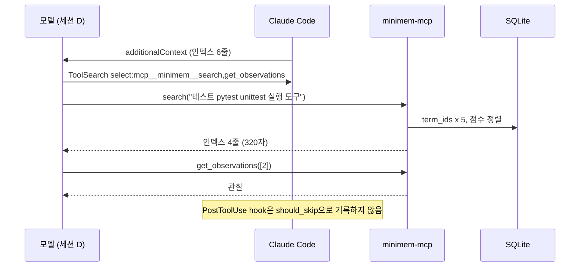

# 시나리오 6. 필요할 때만 본문 조회: MCP 검색과 progressive disclosure

세션 시작 때 주입하는 인덱스는 가볍지만, 오래된 기억이나 세부 코드 변경 내역까지 모두 담을 수는 없습니다. 이 시나리오에서는 MCP stdio 서버(`minimem-mcp`)가 제공하는 `search`와 `get_observations` 두 도구를 통해 에이전트가 **인덱스로 후보를 고르고 필요한 본문만 꺼내 보는(progressive disclosure)** 흐름을 살펴봅니다. 세션 C로 쿠폰 기능을 구현해 관찰을 6개까지 쌓은 뒤, 세션 D에서 오래된 사실을 검색해 답하는 과정을 로그로 추적하고, 본문 전체를 넘길 때와 비교해 토큰을 얼마나 아끼는지 측정합니다. 마지막으로 메모리 조회 도구의 호출 자체가 다시 메모리에 기록되지 않는지 확인합니다.

## progressive disclosure는 목차를 먼저 보고 필요한 장만 펴는 방식

`claude-mem` README는 메모리 검색을 3단계 흐름으로 설계합니다. 먼저 `search`로 ID가 붙은 짧은 인덱스를 훑고, 필요하면 `timeline`으로 그 전후 맥락을 확인한 뒤, 마지막으로 `get_observations`를 호출해 꼭 필요한 ID의 본문만 가져옵니다. README 기준으로 인덱스 한 줄은 약 50~100 토큰, 관찰 본문 하나는 약 500~1,000 토큰이므로 인덱스가 본문의 10분의 1 수준입니다. `minimem`은 원리를 깔끔하게 보여주기 위해 중간 `timeline`을 생략하고 `search`와 `get_observations` 2단계로 구성했습니다.

[시나리오 5](5-context-injection.md)의 `SessionStart` 주입이 "최근 작업의 목차"를 미리 책상에 올려두는 역할이라면, MCP `search`는 오래전에 밀려난 기록까지 찾아보는 "전체 색인 검색"입니다. 어느 쪽에서 찾든 상세 본문은 항상 `get_observations`를 통해서만 꺼내 봅니다.

### 핵심 용어 정리

| 용어 | 의미 | 이 실습에서의 예 |
| --- | --- | --- |
| MCP 서버 | 에이전트에게 외부 도구를 제공하는 프로세스 (stdio 기반 JSON-RPC 통신) | `uv run --project <minimem> minimem-mcp` |
| `search` | 키워드로 관찰 인덱스를 조회하는 MCP 도구 | `{"query": "테스트 pytest unittest 실행 도구"}` |
| `get_observations` | 선택한 ID 목록의 관찰 본문만 반환하는 MCP 도구 | `{"ids": [2]}` |
| 재귀 기록 | 메모리를 읽으려고 호출한 도구가 다시 새 이벤트로 기록되는 현상 | `mcp__minimem__search` 호출이 DB에 쌓이는 문제 |

## 본문을 처음부터 다 주면 왜 문제가 될까

현재 실습 DB에 쌓인 관찰 6건만 비교해 봐도 차이가 뚜렷합니다. 본문 전체를 펼치면 2,363자인 반면, 같은 6건을 검색 인덱스로 줄이면 431자에 불과합니다. 프로젝트가 커져 관찰이 수백 개로 늘어나면 본문 전체는 hook 출력 한도(10,000자)와 매 턴 입력 토큰을 순식간에 넘겨 버립니다. 하지만 실제 질문 하나에 답하는 데 필요한 관찰은 대개 1~2개뿐입니다.

목차 조회와 본문 조회를 2단계로 나누어 두면, 컨텍스트 비용이 **쌓여 있는 전체 관찰 수**가 아니라 **에이전트가 실제로 골라낸 관찰 개수**에만 비례하게 됩니다.

## 조회 인터페이스별 대안 비교

| 방식 | 에이전트 측 준비 | 장점 | 단점 |
| --- | --- | --- | --- |
| MCP 도구 (`claude-mem`, `minimem`) | 별도 설정 없이 도구 설명만 읽고 사용 | Codex, Cursor 등 다른 MCP 클라이언트에서도 같은 서버를 그대로 재사용 | 도구 정의 자체가 컨텍스트를 차지함 (Claude Code는 도구가 많으면 `ToolSearch`로 지연 로드) |
| 에이전트가 `sqlite3` CLI로 직접 조회 | DB 스키마를 알고 있어야 함 | 별도 서버 프로세스가 필요 없음 | 매번 셸 실행 승인이 필요하고, 모델이 직접 SQL을 짜야 해서 오류 위험이 큼 |
| Skill로 검색 절차 안내 | `SKILL.md` 작성 | 검색 순서를 명확히 강제 가능 (`claude-mem`도 `mem-search` skill을 함께 제공) | 결국 실제 조회를 수행할 MCP 도구나 CLI가 밑단에 필요함 |

## 메모리를 읽은 흔적은 메모리에 남기지 않는다

개발 도중 실제로 겪었던 재미있는 버그가 하나 있습니다. 세션 D처럼 실제 코드 수정 없이 `search`와 `get_observations`로 기억만 조회하고 끝난 세션이 있었습니다. 그런데 이 메모리 도구 호출들이 일반 도구처럼 `PostToolUse` 이벤트로 저장되면서, 세션이 끝날 때 observer가 "사용자가 메모리 검색을 요청함"이라는 새 요약을 만들어 버렸습니다.

문제는 다음 세션에 주입되는 요약이 **가장 마지막 세션 1개**뿐이라는 점입니다. 방금 전 세션 C에서 쿠폰 기능을 끝내고 남겨 둔 귀중한 요약과 다음 할 일이, 단순 조회 세션의 요약에 밀려 통째로 덮어씌워진 것입니다.

그래서 `minimem`은 `hook.should_skip()`에서 `mcp__minimem__*`와 `ToolSearch` 호출을 아예 캡처 대상에서 빼도록 고쳤습니다. 저장된 이벤트가 하나도 없는 세션은 observer가 아무것도 쓰지 않고 바로 종료되므로, 직전 작업 요약이 안전하게 보존됩니다. 원본 `claude-mem` 역시 같은 문제를 막기 위해 `src/shared/memory-retrieval-tools.ts`에 `isRecursiveMemoryTool` 필터를 두고 있습니다.

## 주요 구성 요소와 역할

| 구성 요소 | 역할 |
| --- | --- |
| `.mcp.json` | 프로젝트에서 `minimem` MCP 서버를 stdio 방식으로 실행하도록 등록 |
| `mcp_server.search` | `search.search()`를 호출해 OR 검색 기반의 관찰 인덱스 반환 |
| `mcp_server.get_observations` | 요청한 ID 목록의 `facts`, `narrative`, 관련 파일 목록 반환 |
| `current_project()` | Claude Code가 전달한 `CLAUDE_PROJECT_DIR` 환경 변수로 현재 프로젝트 식별 |
| `hook.should_skip()` | 메모리 조회 도구와 `ToolSearch` 호출을 이벤트 캡처에서 제외 |

## MCP 기반 2단계 조회 흐름

세션 D가 `ToolSearch`로 도구를 불러온 뒤, 인덱스를 검색하고 필요한 관찰 `#2`의 본문만 꺼내 오는 전체 순서입니다.



## 실습: 2단계 조회 추적과 재귀 기록 차단 확인

[시나리오 1](1-memory-map.md)의 4단계(`minimem`을 켜고 세션 B 실행)까지 마친 상태에서 이어갑니다. 모든 명령은 workspace 루트에서 실행합니다.

### 1. 세션 C로 쿠폰 기능 구현 및 관찰 추가

먼저 이전 세션의 '다음 할 일'이었던 쿠폰 중복 적용 금지 기능을 구현시켜 DB에 관찰을 더 쌓습니다.

```bash
PC="쿠폰 중복 적용 금지 기능을 구현해라. shop/coupon.py에 apply_coupons(price, codes, coupons)를 만들고 같은 쿠폰 코드가 두 번 들어오면 ValueError를 낸다. 테스트도 추가하고 실행해라."
uv run scripts/run_session.py ~/minimem-workspace/shop "$PC"
```

실행 결과를 보면 세션 C가 기존 규칙과 테스트 환경을 그대로 이어받아 작업한 것을 확인할 수 있습니다.

```text
session_id: <실행마다 다름>
injected_context_chars: 806
tool_calls: 5 {'Bash': 3, 'Write': 2}
turns: 6  input_tokens: 107017  output_tokens: 2755  duration_s: 17.0
--- answer ---
`shop/coupon.py`에 `apply_coupons(price, codes, coupons)`를 만들었고, 같은 코드가 두 번 들어오면 `ValueError`를 냅니다. 기존 테스트 2개와 새 테스트 5개, 총 7개가 모두 통과했습니다. pytest가 없어서 `python -m unittest discover -s tests -t .`로 실행했습니다.
```

답변은 첫 문단만 옮겼습니다. 눈여겨볼 점은 세션 C가 `pytest`를 단 한 번도 시도하지 않았다는 사실입니다. 메모리 없이 시작했던 세션 A는 첫 `Bash` 호출에서 `python -m pytest`를 쳤다가 실패했지만, 세션 C는 주입된 인덱스 덕분에 시행착오를 건너뛰고 바로 `unittest`를 실행했습니다.

이제 백그라운드 observer가 세션 C의 관찰을 저장할 때까지 기다립니다.

```bash
while pgrep -f minimem.observer >/dev/null; do sleep 2; done
```

### 2. 세션 D에서 MCP 검색 도구 사용 추적

이번에는 세션 D를 열어 예전에 겪었던 테스트 도구 문제를 묻되, 메모리 검색 도구를 직접 사용해 찾도록 지시합니다. `RUN_SESSION_LOG` 환경 변수를 지정하면 Claude Code의 stream-json 원본을 파일로 저장해 도구 호출 인자와 응답 크기를 정밀하게 들여다볼 수 있습니다.

```bash
PD="예전에 테스트 실행 도구 관련해서 겪은 문제가 있었지? 메모리 검색 도구로 찾아서 알려줘."
RUN_SESSION_LOG=/tmp/session_d.jsonl uv run scripts/run_session.py ~/minimem-workspace/shop "$PD"
```

세션 D는 세 번의 도구 호출 끝에 관찰 `#2`를 찾아 정확하게 답합니다.

```text
session_id: <실행마다 다름>
injected_context_chars: 1041
tool_calls: 3 {'ToolSearch': 1, 'mcp__minimem__search': 1, 'mcp__minimem__get_observations': 1}
turns: 4  input_tokens: 82536  output_tokens: 476  duration_s: 4.9
--- answer ---
네, 있었습니다. 관찰 #2에 기록돼 있습니다.

- **문제**: `python -m pytest tests/test_discount.py`를 실행하면 `No module named pytest`로 실패했습니다. 이 환경에는 pytest가 설치돼 있지 않습니다.
```

저장된 `/tmp/session_d.jsonl` 로그에서 에이전트가 어떤 인자로 도구를 부르고 몇 글자를 돌려받았는지 추출해 봅니다.

```bash
python3 -c "
import json
for line in open('/tmp/session_d.jsonl'):
  e = json.loads(line)
  for b in e.get('message', {}).get('content', []) if e.get('type') in ('assistant', 'user') else []:
    if isinstance(b, dict) and b.get('type') == 'tool_use': print('CALL', b['name'], json.dumps(b['input'], ensure_ascii=False))
    if isinstance(b, dict) and b.get('type') == 'tool_result':
      c = b['content'] if isinstance(b['content'], str) else ''.join(x.get('text', '') for x in b['content'])
      print('RESULT', len(c), 'chars')
"
```

출력된 호출 기록을 보면 2단계 progressive disclosure가 교과서처럼 동작한 것을 확인할 수 있습니다.

```text
CALL ToolSearch {"query": "select:mcp__minimem__search,mcp__minimem__get_observations", "max_results": 5}
RESULT 0 chars
CALL mcp__minimem__search {"query": "테스트 pytest unittest 실행 도구"}
RESULT 320 chars
CALL mcp__minimem__get_observations {"ids": [2]}
RESULT 359 chars
```

먼저 `ToolSearch`로 지연 로드되어 있던 MCP 도구 정의를 불러온 뒤, `search`로 4줄짜리 인덱스(320자)를 받아 보고, 그중 딱 필요한 `#2` 하나의 본문(359자)만 `get_observations`로 가져왔습니다.

### 3. 인덱스와 본문 전체 크기 비교

같은 DB에서 6개 관찰이 모두 걸리는 넓은 검색어의 인덱스 길이와, 관찰 본문 전체 길이를 직접 비교해 봅니다.

```bash
COUNT='import sys;print(len(sys.stdin.read()))'
uv run --project minimem minimem search shop "할인 쿠폰 pytest unittest" | python3 -c "$COUNT"
uv run --project minimem minimem observations shop | python3 -c "$COUNT"
```

두 출력의 글자 수는 다음과 같습니다.

```text
431
2363
```

관찰 6건이 전부 매칭되는 넓은 질의에서도 인덱스는 본문 전체의 18%(431 / 2,363)에 불과합니다. 세션 D처럼 인덱스를 보고 본문 1개만 꺼내면 인덱스(320자)와 본문(359자)을 합쳐 679자로, 본문 전체를 읽는 것 대비 29% 수준으로 줄어듭니다. 관찰이 수십, 수백 개로 늘어날수록 이 절감 폭은 훨씬 더 벌어집니다.

### 4. 메모리 조회 호출이 이벤트로 기록되지 않는지 확인

세션 D는 도구를 3번 호출했지만 모두 메모리 조회용이었습니다. `minimem events`로 이벤트 테이블을 확인했을 때 세션 D의 흔적이 전혀 남아 있지 않아야 정상입니다.

```bash
uv run --project minimem minimem events shop
```

실행하면 세션 A와 세션 C의 이벤트 8건만 그대로 유지되어 있습니다.

```text
1  Bash  379 chars  processed=1  {"command": "ls -R . | head -50 && python -m pytest tests/te
2  Read  392 chars  processed=1  {"file_path": "/root/minimem-workspace/shop/shop/discount.py
3  Read  686 chars  processed=1  {"file_path": "/root/minimem-workspace/shop/tests/test_disco
4  Edit  894 chars  processed=1  {"file_path": "/root/minimem-workspace/shop/shop/discount.py
5  Bash  266 chars  processed=1  {"command": "python -m unittest tests.test_discount 2>&1 | t
6  Write  1321 chars  processed=1  {"file_path": "/root/minimem-workspace/shop/shop/coupon.py",
7  Write  2301 chars  processed=1  {"file_path": "/root/minimem-workspace/shop/tests/test_coupo
8  Bash  274 chars  processed=1  {"command": "python -m unittest discover -s tests -t . 2>&1 
```

1~5번은 세션 A, 6~8번은 세션 C의 기록입니다. 참고로 세션 C에서 `Bash`를 3번 호출했는데 이벤트가 1건만 남은 이유는, 첫 번째 호출이 아직 없는 `shop/coupon.py`를 `cat`하려다 exit 1로 실패했고 두 번째(heredoc 파일 쓰기)는 승인 필요로 거부되어 `PostToolUse`가 아닌 `PostToolUseFailure`로 빠졌기 때문입니다. 세션 D의 메모리 조회는 `should_skip()`에 의해 깔끔하게 걸러졌고, 덕분에 `minimem context shop`의 "지난 세션 요약"에도 세션 C의 쿠폰 작업 내용이 그대로 살아 있습니다.

## 실무 관점에서 짚어볼 점

- **검색 도구는 에이전트의 질의 습관에 맞춰 설계해야 합니다**: 에이전트는 키워드를 넉넉하게 나열하는 편입니다. 만약 `search`가 AND 검색이었다면 세션 D의 질의는 0건을 돌려주었을 것이고([시나리오 4](4-storage-search.md)), 에이전트는 검색을 포기한 채 `SessionStart` 인덱스에 의존해야 했을 것입니다.
- **도구 docstring 자체가 에이전트에게 주는 사용 설명서입니다**: `search` 도구 설명에 "본문은 `get_observations`로 조회한다"고 적어 두고, `SessionStart` 인덱스 머리말에도 도구 이름을 명시해 두었더니 별도 프롬프트 지시 없이도 에이전트가 자연스럽게 2단계 조회 순서를 따랐습니다.
- **메모리 시스템은 자기 자신의 활동을 반드시 제외해야 합니다**: 캡처(hook), 압축(observer 세션), 조회(MCP 도구) 세 지점 어디서든 재귀 기록이 발생할 수 있습니다. 메모리 파이프라인을 설계할 때는 "메모리를 다루는 행위는 메모리에 넣지 않는다"는 경계를 세 곳 모두에 명확히 그어 두어야 합니다.
