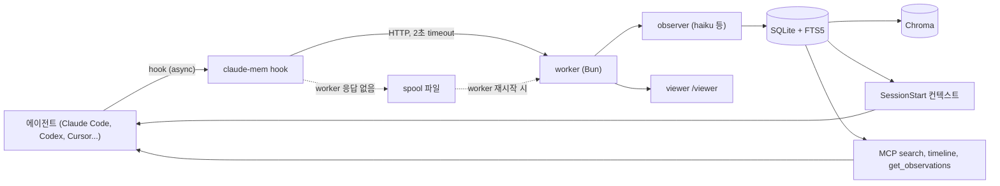

# 시나리오 7. claude-mem 원본과 비교: minimem이 덜어낸 운영 장치들

앞선 시나리오 2~6에서 다룬 `minimem`은 에이전트 메모리의 핵심 데이터 흐름을 약 600줄의 Python 코드로 압축해 본 학습용 구현입니다. 이 마지막 시나리오에서는 실제 운영 도구인 `claude-mem` v16.0.0(commit `c1dc252`)의 소스를 직접 펼쳐 놓고, `minimem`이 의도적으로 생략한 운영 장치들이 무엇이며 왜 그렇게 확장되었는지 비교해 봅니다.

이 문서는 `claude-mem` 소스의 `plugin/hooks/hooks.json`과 `src/` 아래 주요 상수·주석을 읽고 분석한 내용이며, 원본 설치와 실행은 별도로 검증하지 않았습니다.

## minimem은 핵심 데이터 흐름만 남긴 축소판

`minimem`과 `claude-mem`은 **캡처 → 압축 → 저장 → 주입 → 조회**라는 뼈대는 완전히 같습니다. 두 구현이 갈라지는 지점은 이 파이프라인을 여러 코딩 에이전트, 동시다발적인 세션, 수십 분 이상 이어지는 긴 세션에서도 무리 없이 돌리기 위해 덧붙인 운영 장치들입니다.

| 영역 | minimem | claude-mem (v16.0.0) | claude-mem이 확장한 이유 |
| --- | --- | --- | --- |
| 캡처 이벤트 | 4개 | 9개 (`Setup`, `PreToolUse`, `PostToolUseFailure`, `SubagentStop`, `SessionEnd` 추가) | 실패한 시도, 서브에이전트 작업, 세션 종료 시점까지 빠짐없이 포착 |
| hook 실행 방식 | 동기, SQLite에 직접 `INSERT` | 대부분 async, 로컬 worker HTTP 전송 (실패 시 spool 파일) | hook 지연을 작업 에이전트에 전가하지 않고 장애에도 유실 방지 |
| observer 생명주기 | `Stop`마다 `claude -p` 1회 실행 | worker가 세션별 observer 대화를 유지하며 100,000자마다 새 generation 생성 | 긴 세션의 이벤트를 나눠 처리하고 프롬프트 캐시를 재사용 |
| observer 모델 | Claude Code CLI (`haiku`) | `claude`(기본, `haiku`), Codex, Gemini, OpenRouter, OpenAI 호환 | 비용과 팀 환경에 맞춰 가벼운 모델을 자유롭게 교체 |
| 검색 엔진 | FTS5 `trigram` + `LIKE` | FTS5 `unicode61` + Chroma 벡터 의미 검색 | 단어가 달라도 의미가 비슷한 과거 관찰까지 검색 |
| 컨텍스트 주입 | 요약 1개 + 인덱스, 9,000자 예산 | 요약 + timeline, 10,000자 한도에 맞춰 실측하며 항목 제거 | 같은 예산 원리를 더 정교한 우선순위 제거로 구현 |
| 조회 도구 | `search`, `get_observations` | `search`, `timeline`, `get_observations`, `save_memory` 등 | 시간순 전후 맥락 확인과 사용자의 명시적 기억 저장 지원 |
| 파일 읽기 개입 | 없음 | `PreToolUse`에서 큰 파일 `Read`를 막고 관련 관찰을 대신 제공 | 이미 파악한 대용량 파일을 반복해서 읽는 토큰 낭비 절감 |
| 지원 에이전트 | Claude Code 단독 | Claude Code, Codex, Cursor, OpenCode 등 15개 | 에이전트별 hook 어댑터(`src/cli/adapters/`)로 공통 파이프라인 연결 |
| 민감 정보 보호 | 없음 | `<private>` 태그 제거, redaction 마스킹 | API 키나 비밀값이 DB와 observer 프롬프트로 유출되는 것을 방지 |
| 사람용 UI | CLI | 웹 viewer (`/viewer`) | 사람이 쌓인 관찰을 눈으로 확인하고 틀린 내용을 직접 수정 |

### 핵심 용어 정리

| 용어 | 의미 | claude-mem 소스 위치 / 상수 |
| --- | --- | --- |
| worker | 짧은 hook 프로세스를 대신해 상주하며 observer, 검색, viewer를 담당하는 로컬 HTTP 서비스 | `src/services/worker-service.ts` |
| spool | worker가 응답하지 않을 때 hook 이벤트를 임시로 받아 두는 로컬 파일 | `src/shared/hook-spool.ts` |
| generation | observer가 이어 가는 대화 한 묶음. 길이가 상한을 넘으면 새로 시작 | `CLAUDE_MEM_OBSERVER_MAX_CONVERSATION_CHARS` (100,000) |
| File Read Gate | 큰 파일 전체 `Read`를 차단하고 그 파일의 관찰 timeline을 대신 주는 `PreToolUse` 장치 | `FILE_READ_GATE_DENY_MIN_BYTES` (32KB) |

## 운영 규모에서는 hook이 아니라 상주 worker가 중심이 된다

`minimem`은 이벤트마다 뜨고 사라지는 짧은 hook 프로세스와 `Stop` 시점에 띄우는 일회성 observer 프로세스만으로 동작합니다. 에이전트 하나에 도구 호출 수십 번 수준의 짧은 세션이라면 이 단순한 구조로도 충분합니다.

하지만 실제 운영 규모에서는 hook 프로세스의 짧은 수명이 발목을 잡습니다. observer의 대화 컨텍스트를 유지해 프롬프트 캐시를 재활용하고, 벡터 색인과 웹 viewer를 띄워 두고, 여러 에이전트에서 쏟아지는 이벤트를 충돌 없이 하나의 DB로 모으려면 계속 살아 있는 **상주 프로세스(worker)**가 필요합니다.

물론 worker를 도입하면 "worker가 죽어 있거나 바쁠 때 어떻게 할 것인가?"라는 새로운 실패 지점이 따라옵니다. `claude-mem`은 이를 **spool fallback**으로 풀어냅니다. hook이 worker에 HTTP 요청을 보냈는데 응답이 없으면 이벤트를 로컬 spool 파일에 빠르게 적어 두고 종료하며, 나중에 worker가 다시 살아날 때 spool 파일을 수거해 밀린 이벤트를 처리합니다. `src/cli/handlers/observation.ts`에 정의된 `SERVER_OBSERVATION_TIMEOUT_MS = 2_000`은 Codex의 hook timeout(5초) 안에 HTTP 대기와 spool 기록까지 안전하게 끝내도록 계산된 값입니다.

## 상황에 따른 선택 기준

| 선택지 | 잘 맞는 상황 |
| --- | --- |
| `minimem` 같은 단순 구조 | 에이전트 메모리의 동작 원리를 직접 뜯어보거나, 단일 에이전트의 짧은 세션에서 가볍게 실험할 때 |
| `claude-mem` | 여러 코딩 에이전트를 병행하고, 긴 세션과 다수 프로젝트에 걸쳐 본격적으로 메모리를 운영할 때 |
| Claude Code auto memory, `CLAUDE.md` | 별도 백그라운드 프로세스나 observer 모델 비용 없이 사람이나 에이전트가 핵심 규칙만 직접 관리할 때 |

## claude-mem과 minimem 구성 요소 대응표

| claude-mem 컴포넌트 | 소스 위치 | minimem 대응 파일 |
| --- | --- | --- |
| `claude-mem` launcher와 CLI | `src/npx-cli/index.ts` | `minimem` CLI |
| hook 어댑터와 handler | `src/cli/adapters/`, `src/cli/handlers/` | `minimem/hook.py` |
| worker 서비스 | `src/services/worker-service.ts` | 없음 |
| observer 프롬프트와 파서 | `src/sdk/prompts.ts`, `src/sdk/parser.ts` | `minimem/observer.py` |
| SQLite 저장소 | `src/services/sqlite/` | `minimem/db.py` |
| 컨텍스트 빌더 | `src/services/context/` | `minimem/context.py` |
| MCP 서버 | `src/servers/mcp-server.ts` | `minimem/mcp_server.py` |

## claude-mem 전체 데이터 흐름

[시나리오 1](1-memory-map.md)의 `minimem` 흐름에 상주 worker(Bun), spool fallback, Chroma 벡터 DB, 웹 viewer가 더해진 구조입니다.



## 실습: claude-mem 소스에서 설계 흔적 확인하기

### 1. 원본 소스 체크아웃

이 문서의 비교는 `claude-mem` v16.0.0(commit `c1dc252`) 기준입니다. 이후 버전에서는 디렉터리 구조나 상수 이름이 바뀔 수 있으므로 해당 커밋으로 체크아웃해 확인합니다.

```bash
git clone https://github.com/thedotmack/claude-mem.git /tmp/claude-mem
cd /tmp/claude-mem
git checkout c1dc252
```

### 2. hook 등록과 sync/async 구분 확인

`plugin/hooks/hooks.json`을 읽어 `claude-mem`이 Claude Code에 등록하는 모든 hook과 동기/비동기 설정을 출력합니다.

```bash
python3 -c "import json;h=json.load(open('plugin/hooks/hooks.json'))['hooks'];[print(k, x.get('args', ['(shell)'])[-1], 'async' if x.get('async') else 'sync') for k,v in h.items() for g in v for x in g['hooks']]"
```

출력 결과를 보면 동기(sync)와 비동기(async)가 명확한 기준으로 나뉘어 있습니다.

```text
Setup (shell) sync
SessionStart start async
SessionStart context sync
SessionStart ${CLAUDE_PLUGIN_ROOT}/scripts/ensure-launcher.cjs sync
UserPromptSubmit session-init sync
PostToolUse observation async
PostToolUseFailure observation async
PreToolUse file-context sync
Stop summarize async
SubagentStop subagent-stop async
SessionEnd session-end async
```

동기(`sync`)로 남겨 둔 hook은 실행 결과가 에이전트 진행에 즉시 필요한 것들입니다. `SessionStart context`는 주입할 컨텍스트 문자열을 돌려줘야 하고, `PreToolUse file-context`는 파일 읽기를 허용할지 차단할지 답해야 하므로 기다릴 수밖에 없습니다. 반대로 기록과 요약만 수행하는 `PostToolUse`, `PostToolUseFailure`, `Stop` 등은 전부 비동기(`async`)로 돌려 에이전트 지연을 없앴습니다. (`minimem`은 4개 hook을 모두 동기로 두되, hook 안에서 LLM을 호출하지 않는 방식으로 지연을 40~80 ms 선에 묶었습니다([시나리오 2](2-capture-hooks.md)).)

### 3. 운영 제약을 담은 핵심 상수 확인

앞선 `minimem` 시나리오들을 진행하며 직접 부딪혔던 제약들이 `claude-mem` 코드 안에서는 어떤 상수로 다뤄지고 있는지 `grep`으로 찾아봅니다.

```bash
grep -rn "^export const CONTEXT_OUTPUT_LIMIT\|^export const FILE_READ_GATE_DENY_MIN_BYTES\|^const MEMORY_FTS_TOKENIZER\|^const SERVER_OBSERVATION_TIMEOUT_MS" src
```

네 가지 핵심 상수의 위치와 값이 그대로 드러납니다.

```text
src/services/sqlite/SessionSearch.ts:91:const MEMORY_FTS_TOKENIZER = 'unicode61';
src/services/context/ContextBudget.ts:9:export const CONTEXT_OUTPUT_LIMIT = 10_000;
src/cli/handlers/file-context.ts:50:export const FILE_READ_GATE_DENY_MIN_BYTES = 32 * 1024;
src/cli/handlers/observation.ts:28:const SERVER_OBSERVATION_TIMEOUT_MS = 2_000;
```

각 상수가 우리 실습에서 확인한 현상과 어떻게 맞닿아 있는지 정리하면 다음과 같습니다.

| 상수 | minimem 시나리오와의 대응 |
| --- | --- |
| `CONTEXT_OUTPUT_LIMIT = 10_000` | 시나리오 5에서 `additionalContext`가 10,100자일 때 모델에 전달되지 않았던 바로 그 10,000자 한도 |
| `MEMORY_FTS_TOKENIZER = 'unicode61'` | 시나리오 4에서 한국어 조사("방문객을", "직원은")를 놓쳤던 기본 토크나이저 (`claude-mem`은 Chroma로 보완) |
| `SERVER_OBSERVATION_TIMEOUT_MS = 2_000` | 시나리오 2에서 측정한 hook 지연 제약과 같은 문제의식 |
| `FILE_READ_GATE_DENY_MIN_BYTES = 32 * 1024` | `minimem`에는 없는 기능. 소스 주석은 19KB 파일에서는 Opus 토큰이 오히려 20% 늘었고 49KB에서는 32% 줄었다는 내부 평가 결과를 근거로 제시 |

### 4. claude-mem 설치 참고 (미검증)

원본을 직접 설치해 보고 싶다면 README에 안내된 아래 명령을 사용합니다. 설치 과정에서는 PATH에 launcher를 배치하고 Claude Code plugin hook을 자동 등록합니다. README 기준으로 익명 사용 통계가 기본 활성화되어 있어 `npx claude-mem telemetry disable`로 끌 수 있으며, `--provider`를 명시하거나 `CLAUDE_MEM_ONLINE_OPTIN=false`를 넘기면 브라우저 로그인 단계를 건너뜁니다.

```bash
npx claude-mem install
```

이 핸즈온에서는 실제 설치를 실행하지 않았습니다. 설치 후에는 `~/.claude-mem/claude-mem.db`에 기록이 쌓이며 시나리오 1과 같은 두 세션 비교를 원본으로도 해 볼 수 있습니다. 다만 `minimem` hook과 동시에 켜 두면 두 메모리 시스템이 같은 이벤트를 중복 기록하므로, 비교 실험 전에는 `make down`으로 `minimem` 실습 프로젝트를 정리한 뒤 진행하는 것이 좋습니다.

## 실무 관점에서 짚어볼 점

- **축소판을 먼저 만들어 보면 원본 코드의 의도가 선명하게 보입니다**: `claude-mem`의 상수와 주석 곳곳에는 이슈 번호(`#3802`, `#5079` 등)와 실제 측정 근거가 적혀 있습니다. `minimem`을 구현하며 부딪혔던 출력 한도, 재귀 기록, 한국어 검색 같은 문제들이 원본 소스에도 이미 해결 흔적으로 남아 있었습니다.
- **메모리 도입의 최종 판단 기준은 비용과 신뢰성입니다**: 세션마다 가벼운 observer 모델 호출 비용이 추가되고, 요약 과정에서 생긴 오해가 다음 세션에 기정사실처럼 전달될 위험이 늘 존재합니다. 시나리오 3처럼 관찰 `facts`에 원문 코드를 함께 남기고, 웹 viewer로 사람이 언제든 기록을 점검하고 고칠 수 있는 장치가 갖춰져야 실무에서 믿고 운영할 수 있습니다.
