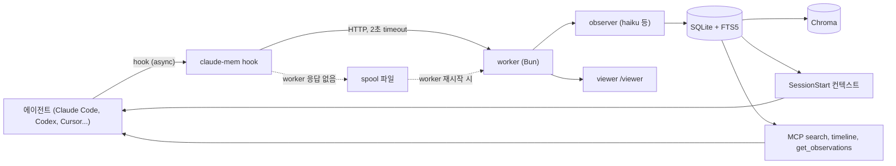

# 시나리오 7. claude-mem 원본과 비교: minimem이 생략한 것

## 이 시나리오의 목표

| 항목 | 내용 |
| --- | --- |
| 기능 | 세션 간 메모리의 운영 수준 구현 |
| 쓰는 도구 | claude-mem v16.0.0 소스(commit `c1dc252`) |
| 입력 | `plugin/hooks/hooks.json`, `src/` 아래 상수와 주석 |
| 작업 | 1. 소스 받기 2. hook 등록 비교 3. 운영 제약을 담은 상수 확인 |
| 달성할 것 | minimem 시나리오 2~6의 각 기능이 claude-mem에서 어떻게 확장되는지, 왜 확장됐는지 설명 |

이 시나리오는 소스를 읽어 비교합니다. claude-mem 설치와 실행은 이 핸즈온에서 검증하지 않았습니다.

## minimem은 claude-mem의 데이터 흐름만 남긴 축소판이다

두 구현은 캡처, 압축, 저장, 주입, 조회라는 같은 데이터 흐름을 가집니다. 차이는 그 흐름을 여러 에이전트, 여러 세션, 긴 세션에서 안정적으로 돌리기 위한 장치에 있습니다.

| 기능 | minimem | claude-mem | claude-mem이 더한 이유 |
| --- | --- | --- | --- |
| 캡처 이벤트 | 4개 | 9개(`Setup`, `PreToolUse`, `PostToolUseFailure`, `SubagentStop`, `SessionEnd` 추가) | 실패한 시도, 서브에이전트 작업, 세션 종료도 기록 |
| hook 처리 | 동기, SQLite에 직접 INSERT | 대부분 async, worker HTTP로 전송, 실패 시 spool 파일 | hook 지연을 에이전트에 전가하지 않음 |
| observer 실행 | `Stop`마다 `claude -p` 1회 | worker가 세션별 observer 대화를 유지, 100,000자마다 새 generation | 긴 세션에서 이벤트를 나눠 처리하고 프롬프트 캐시를 재사용 |
| observer 모델 | Claude Code CLI(haiku) | `claude`(기본, haiku), Codex, Gemini, OpenRouter, OpenAI 호환 | 비용과 사용 환경에 맞게 교체 |
| 검색 | FTS5 `trigram` + `LIKE` | FTS5 `unicode61` + Chroma 의미 검색 | 의미가 비슷한 관찰도 찾음 |
| 주입 | 요약 1개 + 인덱스, 9,000자 예산 | 요약 + timeline, 10,000자 한도에 맞춰 측정하며 제거 | 같은 원리, 더 정교한 제거 순서 |
| 조회 도구 | `search`, `get_observations` | `search`, `timeline`, `get_observations`, `save_memory` 등 | 시간 순 맥락과 명시적 저장 |
| 파일 읽기 개입 | 없음 | `PreToolUse`에서 큰 파일 `Read`를 거부하고 관련 관찰을 대신 제공 | 같은 파일을 다시 읽는 토큰을 줄임 |
| 지원 에이전트 | Claude Code | Claude Code, Codex, Cursor, OpenCode 등 15개 | 에이전트마다 hook 어댑터(`src/cli/adapters/`) |
| 개인정보 | 없음 | `<private>` 태그 제거, redaction | 비밀값이 DB와 observer에 들어가지 않게 함 |
| 사람용 화면 | CLI | 웹 viewer(`/viewer`) | 사람이 관찰을 확인하고 고침 |

### 용어

| 용어 | 뜻 | 이 실습의 예 |
| --- | --- | --- |
| worker | hook 대신 오래 실행되며 observer, 검색, viewer를 맡는 로컬 HTTP 서비스 | `src/services/worker-service.ts` |
| spool | worker에 보내지 못한 hook 이벤트를 임시로 적어 두는 로컬 파일 | `src/shared/hook-spool.ts` |
| generation | observer가 이어 가는 대화 한 묶음. 길이 한도를 넘으면 새로 시작 | `CLAUDE_MEM_OBSERVER_MAX_CONVERSATION_CHARS` 100,000 |
| File Read Gate | 큰 파일 전체 `Read`를 막고 그 파일의 관찰 timeline을 주는 `PreToolUse` 처리 | `FILE_READ_GATE_DENY_MIN_BYTES` 32KB |

## 운영 규모에서는 hook이 아니라 worker가 일한다

minimem은 hook 프로세스와 `Stop` 때 띄우는 observer 프로세스만으로 동작합니다. 세션 하나, 도구 호출 수십 번까지는 이 구조로 충분했습니다. claude-mem이 worker를 따로 둔 이유는 hook 프로세스가 짧게 살고 죽는다는 데 있습니다. observer 대화를 이어 가고, 검색 색인과 viewer를 유지하고, 여러 에이전트의 이벤트를 한 DB로 모으려면 오래 사는 프로세스가 필요합니다.

worker를 두면 새로운 실패 지점이 생깁니다. worker가 꺼져 있거나 응답하지 않으면 hook은 이벤트를 spool 파일에 적고 끝나며, worker가 다시 뜰 때 spool을 읽어 처리합니다. `src/cli/handlers/observation.ts`의 `SERVER_OBSERVATION_TIMEOUT_MS = 2_000`은 Codex hook timeout 5초 안에 이 fallback까지 끝내도록 잡은 값입니다.

## 대안 비교

| 선택지 | 맞는 상황 |
| --- | --- |
| minimem 같은 단순 구조 | 원리를 이해하거나, 에이전트 하나와 짧은 세션에서 동작을 실험할 때 |
| claude-mem | 여러 에이전트를 함께 쓰고, 긴 세션과 많은 프로젝트에서 메모리를 운영할 때 |
| Claude Code auto memory, `CLAUDE.md` | 별도 프로세스와 observer 비용 없이 사람이나 에이전트가 직접 기록할 때 |

## 컴포넌트 역할

| claude-mem 컴포넌트 | 소스 위치 | minimem 대응 |
| --- | --- | --- |
| `claude-mem` launcher와 CLI | `src/npx-cli/index.ts` | `minimem` CLI |
| hook 어댑터와 handler | `src/cli/adapters/`, `src/cli/handlers/` | `minimem/hook.py` |
| worker 서비스 | `src/services/worker-service.ts` | 없음 |
| observer 프롬프트와 파서 | `src/sdk/prompts.ts`, `src/sdk/parser.ts` | `minimem/observer.py` |
| SQLite 저장소 | `src/services/sqlite/` | `minimem/db.py` |
| 컨텍스트 생성 | `src/services/context/` | `minimem/context.py` |
| MCP 서버 | `src/servers/mcp-server.ts` | `minimem/mcp_server.py` |

## 흐름

claude-mem에서 도구 호출 하나가 처리되는 경로입니다. minimem의 경로([시나리오 1](1-memory-map.md))에서 worker와 spool이 추가됐습니다.



## 실습

### 1. 소스 받기

이 문서의 비교는 v16.0.0, commit `c1dc252` 기준입니다. 이후 버전에서는 파일 위치와 상수가 바뀔 수 있습니다.

```bash
git clone https://github.com/thedotmack/claude-mem.git /tmp/claude-mem
cd /tmp/claude-mem
git checkout c1dc252
```

### 2. hook 등록 비교

claude-mem이 Claude Code에 등록하는 hook과 각 hook의 동기 여부를 출력합니다.

```bash
python3 -c "import json;h=json.load(open('plugin/hooks/hooks.json'))['hooks'];[print(k, x.get('args', ['(shell)'])[-1], 'async' if x.get('async') else 'sync') for k,v in h.items() for g in v for x in g['hooks']]"
```

```text
Setup (shell) sync
SessionStart start async
SessionStart context sync
SessionStart ${CLAUDE_PLUGIN_ROOT}/scripts/ensure-launcher.cjs sync
UserPromptSubmit session-init sync
PostToolUse observation async
PostToolUseFailure observation async
PreToolUse file-context sync
Stop summarize async
SubagentStop subagent-stop async
SessionEnd session-end async
```

동기로 남은 hook은 결과가 에이전트에 필요한 것들입니다. `SessionStart context`는 주입할 컨텍스트를, `PreToolUse file-context`는 파일 읽기 허용 여부를 돌려줘야 하므로 기다려야 합니다. 기록만 하는 `PostToolUse`, `Stop`은 모두 async입니다. minimem은 4개 hook을 모두 동기로 등록했고, 대신 hook 안에서 LLM을 부르지 않는 것으로 지연을 40~80 ms에 묶었습니다([시나리오 2](2-capture-hooks.md)).

### 3. 운영 제약을 담은 상수 확인

minimem 시나리오에서 겪은 문제와 같은 문제를 claude-mem이 어떤 값으로 다루는지 찾습니다.

```bash
grep -rn "^export const CONTEXT_OUTPUT_LIMIT\|^export const FILE_READ_GATE_DENY_MIN_BYTES\|^const MEMORY_FTS_TOKENIZER\|^const SERVER_OBSERVATION_TIMEOUT_MS" src
```

```text
src/services/sqlite/SessionSearch.ts:91:const MEMORY_FTS_TOKENIZER = 'unicode61';
src/services/context/ContextBudget.ts:9:export const CONTEXT_OUTPUT_LIMIT = 10_000;
src/cli/handlers/file-context.ts:50:export const FILE_READ_GATE_DENY_MIN_BYTES = 32 * 1024;
src/cli/handlers/observation.ts:28:const SERVER_OBSERVATION_TIMEOUT_MS = 2_000;
```

| 상수 | minimem 시나리오에서 대응하는 관찰 |
| --- | --- |
| `CONTEXT_OUTPUT_LIMIT = 10_000` | 시나리오 5에서 10,100자 `additionalContext`가 전달되지 않은 것과 같은 한도 |
| `MEMORY_FTS_TOKENIZER = 'unicode61'` | 시나리오 4에서 `unicode61`이 "할인율을", "pytest가"를 찾지 못한 토크나이저. claude-mem은 Chroma로 보완 |
| `SERVER_OBSERVATION_TIMEOUT_MS = 2_000` | 시나리오 2의 hook 지연 측정과 같은 관심사 |
| `FILE_READ_GATE_DENY_MIN_BYTES = 32 * 1024` | minimem에는 없음. 소스 주석은 19KB 파일에서 Opus 토큰이 오히려 20% 늘었고 49KB에서 32% 줄었다는 내부 평가를 근거로 듭니다 |

### 4. claude-mem 설치(검증하지 않음)

README의 설치 명령입니다. 설치 프로그램은 PATH에 launcher를 넣고 Claude Code plugin hook을 등록합니다. README에 따르면 익명 사용 통계가 기본으로 켜져 있어 `npx claude-mem telemetry disable`로 끌 수 있고, `--provider`를 명시하거나 `CLAUDE_MEM_ONLINE_OPTIN=false`를 주면 브라우저 로그인 단계를 건너뜁니다.

```bash
npx claude-mem install
```

이 핸즈온에서는 설치를 실행하지 않았습니다. 설치하면 `~/.claude-mem/claude-mem.db`에 기록이 쌓이고, 시나리오 1과 같은 두 세션 비교를 claude-mem으로도 해 볼 수 있습니다. minimem hook과 함께 등록하면 두 시스템이 같은 이벤트를 각각 기록하므로, 비교할 때는 `make down`으로 minimem 실습 프로젝트를 지운 뒤 진행합니다.

## 부록. 실무에서 얻는 것

- claude-mem의 상수와 주석에는 이슈 번호(`#3802`, `#5079` 등)와 측정 근거가 붙어 있습니다. minimem을 만들며 겪은 문제(출력 한도, 재귀 기록, 한국어 검색)는 대부분 claude-mem 소스에 이미 해결 흔적이 있었습니다. 원리 실습을 먼저 하고 원본 소스를 읽으면, 그 코드가 무엇을 막으려 있는지 바로 보입니다.
- 메모리 시스템 도입 판단은 observer 비용과 신뢰 문제로 정해집니다. 세션마다 작은 모델 호출이 추가되고, 틀린 관찰이 다음 세션에 사실로 들어갈 수 있습니다. 시나리오 3처럼 facts에 원문을 남기고 viewer로 사람이 확인할 수 있어야 운영할 수 있습니다.
