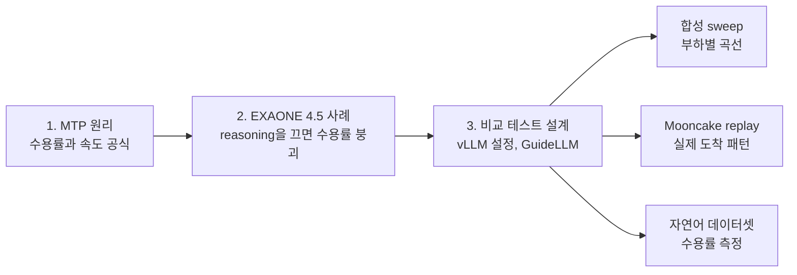
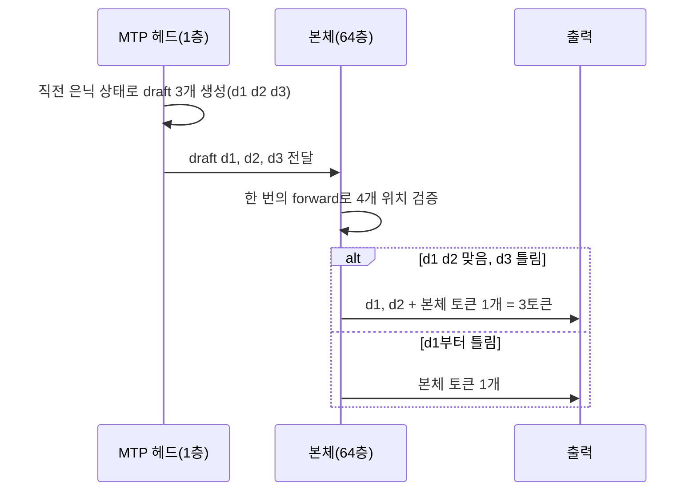

# 1. MTP는 추측이 맞을 때만 빨라진다

이 핸즈온은 GPU 없이 이론과 테스트 설계만 다룹니다. 첫 문서는 MTP(Multi-Token Prediction)가 디코딩을 빠르게 만드는 원리와, 반대로 느리게 만드는 조건을 계산으로 정리합니다.

## 기능 지도

전체 핸즈온은 원리 → EXAONE 4.5 사례 → 비교 테스트 설계 순서로 이어집니다.



| 기능 | 쓰는 도구 | 문서 |
|---|---|---|
| MTP speculative decoding 원리 | 계산 | 1 |
| reasoning on/off와 MTP 수용률 | 공개 실험 수치 | [2](2-reasoning-mtp-acceptance.md) |
| MTP on/off 서버 구성 | vLLM | [3](3-benchmark-design.md) |
| 부하 패턴별 비교 | GuideLLM 합성 데이터, Mooncake trace | [3](3-benchmark-design.md) |

## 이 시나리오의 목표

| 항목 | 내용 |
|---|---|
| 기능 | MTP를 이용한 speculative decoding |
| 쓰는 도구 | 없음(계산) |
| 입력 | draft 수 `k`, 수용률, step당 비용 |
| 작업 | 1. 한 step의 동작 추적 2. 속도 공식 유도 3. 공개 수치 대입 |
| 달성할 것 | MTP를 켜야 할 때와 꺼야 할 때를 수용률로 판단 |

## MTP는 모델 안에 들어 있는 draft 모델이다

LLM은 토큰을 하나씩 생성합니다. 토큰 하나를 만들 때마다 본체 전체를 한 번 통과해야 하므로, 33B 모델이면 토큰마다 33B 가중치를 GPU 메모리에서 읽습니다.

speculative decoding은 싼 모델이 다음 토큰 몇 개를 먼저 추측하고, 본체가 그 추측을 한 번에 검증하는 방식입니다. 추측을 만드는 쪽을 draft, 검증하는 쪽을 target이라고 부릅니다. draft를 별도의 작은 모델로 두는 방식이 처음 나왔고, MTP는 draft를 본체 안에 작은 헤드로 붙여 함께 학습한 방식입니다. EXAONE 4.5 33B는 본체 64층 뒤에 MTP 1층을 둡니다.[^1]

경계를 정리하면 다음과 같습니다.

- MTP는 출력 결과를 바꾸지 않습니다. 본체가 검증해 틀린 추측을 버리므로, 결과 분포는 MTP를 끈 경우와 같습니다. 바뀌는 것은 속도뿐입니다.
- MTP는 디코딩 단계에만 효과가 있습니다. 프롬프트를 처리하는 prefill 단계와 TTFT(Time To First Token)는 빨라지지 않습니다.

### 용어

| 용어 | 뜻 | 이 핸즈온의 예 |
|---|---|---|
| draft | target이 검증할 추측 토큰 | MTP 헤드가 만든 토큰 3개 |
| `num_speculative_tokens` (`k`) | step마다 만드는 draft 수 | `3` |
| 수용률(acceptance rate) | vLLM 기준 `accepted / drafted` | reasoning on 28.3%, off 0.8% |
| 평균 채택 길이 | step 한 번에 얻는 토큰 수 | `1 + k × 수용률` |
| memory-bound | 계산보다 가중치를 읽는 시간이 속도를 정하는 상태 | batch가 작은 디코딩 |

## step 하나의 동작

MTP를 켠 vLLM은 step마다 아래 순서로 동작합니다.



본체는 draft의 앞에서부터 비교해 처음 틀린 위치에서 멈춥니다. 틀린 자리는 본체가 계산한 토큰으로 채우므로, step 한 번에 최소 1개, 최대 `k + 1`개 토큰을 얻습니다.

## 속도 공식

batch가 작을 때 디코딩은 memory-bound입니다. 본체가 토큰 1개를 검증하든 4개를 검증하든 가중치를 한 번 읽는 비용은 거의 같습니다. 그래서 추측이 맞을수록 같은 비용으로 토큰을 더 얻습니다.

vLLM의 수용률은 `accepted / drafted`이고, step마다 `k`개를 만들므로 평균 채택 길이는 정확히 다음과 같습니다.

```text
평균 채택 길이 = 1 + k × 수용률
속도 배수     ≈ 평균 채택 길이 / step당 비용
step당 비용   = 본체 검증(k+1 위치) + MTP 헤드 k회 실행  (MTP를 끈 step = 1)
```

`step당 비용`은 하드웨어와 batch 크기에 따라 달라지는 값이라 공식만으로는 정해지지 않습니다. 공개 실험 수치[^2]를 대입해 거꾸로 추정하면 다음과 같습니다.

| 상황 | 수용률 | 평균 채택 길이 | 실측 배수 | 추정 step당 비용 |
|---|---|---|---|---|
| reasoning on, 원래 MTP | 28.3% | 1 + 3 × 0.283 = 1.85 | 1.51× | 1.85 / 1.51 ≈ 1.22 |
| reasoning off, 원래 MTP | 0.8% | 1 + 3 × 0.008 = 1.02 | 0.85× | 1.02 / 0.85 ≈ 1.20 |

두 행의 추정 비용이 1.2 근처로 같습니다. 이 환경에서는 MTP를 켜는 순간 step당 약 20%의 비용이 붙고, 평균 채택 길이가 1.2를 넘어야, 즉 `k × 수용률`이 0.2를 넘어야 본전입니다. `k = 3`이면 수용률 약 7%가 손익분기점입니다. 이 숫자는 RTX PRO 6000, FP8, 단일 요청 근처라는 한 환경의 추정이므로 다른 장비에서는 다시 재야 합니다.

## batch가 커지면 MTP 이득이 줄어든다

동시 요청이 늘어 batch가 커지면 디코딩은 memory-bound에서 compute-bound로 넘어갑니다. 그러면 검증 위치 `k + 1`개는 공짜가 아니라 실제 계산이 되고, 틀린 draft를 검증한 계산은 다른 요청이 쓸 수 있던 GPU 시간을 빼앗습니다. 같은 실험에서도 동시 요청 8개일 때 요청당 속도는 1.41배였지만 전체 처리량은 1.18배에 그쳤습니다.[^2]

그래서 단일 요청 벤치마크는 MTP를 과대평가합니다. [3번 문서](3-benchmark-design.md)에서 동시성을 바꾸는 sweep과 실제 도착 패턴을 재생하는 Mooncake replay를 함께 설계하는 이유입니다.

## draft 방식 비교

같은 speculative decoding이라도 draft를 어디서 얻느냐에 따라 운영 부담이 다릅니다.

| 방식 | draft 출처 | 장점 | 단점 |
|---|---|---|---|
| MTP | 본체에 붙은 헤드 | 별도 모델 관리 없음, 메모리 추가 적음 | 헤드 품질이 학습 데이터에 묶임 |
| 별도 draft 모델 | 같은 tokenizer의 작은 모델 | 교체 가능 | 모델 두 개를 올리고 맞춰야 함 |
| EAGLE 계열 | 본체 은닉 상태를 읽는 별도 헤드 | 수용률이 높게 나오는 편 | 모델마다 헤드를 따로 학습해야 함 |
| n-gram | 프롬프트 안의 반복 구간 | 학습 불필요 | 입력을 베끼는 작업(요약, 코드 수정)에서만 잘 맞음 |

MTP 헤드는 본체와 함께 학습되므로, 본체가 어떤 상태에서 자주 학습됐는지가 수용률에 그대로 드러납니다. EXAONE 4.5에서 reasoning을 끄면 수용률이 무너지는 현상이 여기서 나옵니다. [2번 문서](2-reasoning-mtp-acceptance.md)에서 이어서 다룹니다.

## 부록. 실무에서 얻는 것

- MTP의 손익은 수용률 하나로 거의 정해집니다. 벤치마크를 돌리기 전에 vLLM `/metrics`에서 수용률부터 확인하면, `k × 수용률`이 손익분기점보다 낮은 조합은 측정 없이도 지울 수 있습니다.
- `num_speculative_tokens`를 늘린다고 빨라지지 않습니다. EXAONE 4.5의 MTP는 1층짜리 헤드를 재귀로 돌려 draft를 만들기 때문에, 뒤쪽 draft일수록 맞을 확률이 떨어지고 비용은 그대로 붙습니다.
- MTP 이득은 단일 요청 지연에서 가장 크고 처리량에서 가장 작습니다. 서비스 목표가 응답 속도인지 GPU당 처리량인지에 따라 같은 수치를 다르게 해석해야 합니다.

## 참고 문서

1. [LGAI-EXAONE/EXAONE-4.5-33B 모델 카드](https://huggingface.co/LGAI-EXAONE/EXAONE-4.5-33B)
2. [EXAONE 4.5 MTP 비추론 실험 블로그](https://blog.gnu.or.kr/posts/exaone45-mtp-non-thinking/)
3. [EXAONE 4.5 Technical Report](https://arxiv.org/abs/2604.08644)

[^1]: [LGAI-EXAONE/EXAONE-4.5-33B 모델 카드](https://huggingface.co/LGAI-EXAONE/EXAONE-4.5-33B)
[^2]: [EXAONE 4.5 MTP 비추론 실험 블로그](https://blog.gnu.or.kr/posts/exaone45-mtp-non-thinking/), RTX PRO 6000, vLLM v0.31.0, EXAONE-4.5-33B-FP8, `num_speculative_tokens=3`
