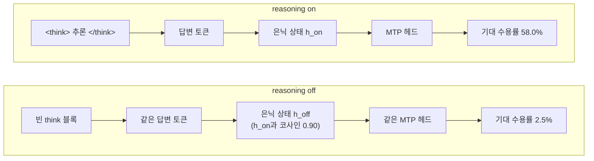

# 2. EXAONE 4.5는 reasoning을 끄면 MTP가 손해다

EXAONE 4.5 33B의 공식 체크포인트에서는 reasoning 모드를 끄면 MTP 수용률이 1% 아래로 떨어지고, MTP를 켜는 쪽이 오히려 느려집니다. 이 문서는 공개 실험[^1]의 수치와 원인 분석을 [1번 문서](1-mtp-theory.md)의 속도 공식으로 읽습니다. 수치는 모두 외부 실험 결과이며 이 핸즈온에서 재현하지 않았습니다.

## 이 시나리오의 목표

| 항목 | 내용 |
|---|---|
| 기능 | reasoning on/off에 따른 MTP 수용률 변화 |
| 쓰는 도구 | 없음(공개 실험 수치) |
| 입력 | RTX PRO 6000, vLLM v0.31.0, EXAONE-4.5-33B-FP8, `num_speculative_tokens=3`, 자연 프롬프트 5개 |
| 작업 | 1. 결과 표 읽기 2. 원인 분석 정리 3. 운영 판단 |
| 달성할 것 | reasoning 모드별로 MTP를 켤지 끌지 판단 |

## reasoning 모드는 요청마다 바뀐다

EXAONE 4.5는 기본으로 reasoning 모드입니다. 답변 앞에 `<think>...</think>` 블록으로 추론 과정을 먼저 생성하고, 이 블록이 끝난 뒤 최종 답변을 씁니다. EXAONE 4.0과 달리 chat template의 기본값이 `enable_thinking=True`라서, 끄려면 요청마다 `enable_thinking=False`를 넘겨야 합니다.[^2] 꺼진 요청은 빈 think 블록 뒤에서 바로 답변을 생성합니다.

여기서 운영상 어긋남이 생깁니다. MTP는 vLLM 서버를 띄울 때 정하는 옵션이고, reasoning은 요청마다 정하는 옵션입니다. 한 서버에 두 모드의 요청이 섞이면, MTP에 유리한 요청과 불리한 요청이 같은 설정으로 처리됩니다.

### 용어

| 용어 | 뜻 | 이 핸즈온의 예 |
|---|---|---|
| reasoning 모드 | 답변 전에 `<think>` 블록으로 추론을 생성하는 모드 | `enable_thinking=True`(기본값) |
| non-reasoning 모드 | think 블록을 비우고 바로 답변하는 모드 | `chat_template_kwargs: {"enable_thinking": false}` |
| 은닉 상태(hidden state) | 본체 마지막 층의 출력 벡터. MTP 헤드의 입력 | 같은 토큰이라도 모드에 따라 달라짐 |
| 기대 수용률 | 학습 코드에서 오프라인으로 계산한 수용률 | vLLM 실측 수용률과는 다른 값 |

## 결과: reasoning off에서 원래 MTP는 0.85배

아래 표는 자연 프롬프트 5개(한국어 대화, 영어 대화, 코드 리뷰, 영문 문서 요약, 코드 생성)를 요청당 최대 400토큰으로 생성한 평균입니다.

| 모드 | MTP 없음 | 원래 MTP | MTP 헤드 재학습 |
|---|---|---|---|
| reasoning on | 36.7 tok/s | 55.4 tok/s (1.51×), 수용률 28.3% | 54.5 tok/s (1.49×), 수용률 27.2% |
| reasoning off | 36.7 tok/s | **31.0 tok/s (0.85×), 수용률 0.8%** | 61.3 tok/s (1.67×), 수용률 33.7% |

reasoning off에서 원래 MTP의 평균 채택 길이는 `1 + 3 × 0.008 ≈ 1.02`입니다. step마다 토큰을 거의 하나만 얻으면서 MTP 헤드 실행과 검증 비용만 더 내므로, MTP를 끈 서버보다 15% 느립니다. 프롬프트별로 봐도 원래 MTP는 다섯 개 모두 0.81~0.87배였고, 수용률은 0.0~1.7%였습니다. 특정 작업만의 문제가 아니라는 뜻입니다.

같은 현상은 다른 환경에서도 보고됐습니다. Hugging Face 모델 토론에는 DGX Spark와 vLLM에서 BF16, NVFP4 체크포인트 모두 MTP 수용률이 0.2~3.9%에 머물러 speculative decoding을 끄기로 했다는 보고가 있습니다.[^3] 이 보고에는 reasoning on/off 구분이 없습니다.

## 원인: MTP 헤드가 reasoning 모드의 은닉 상태에 맞춰져 있다

실험 작성자는 vLLM 구현이 아니라 MTP 헤드 가중치를 원인으로 봤습니다. 근거는 다음 측정입니다.

같은 답변 토큰을 실제 think 블록 뒤에 붙였을 때 원래 MTP의 기대 수용률은 58.0%였고, 빈 think 블록 뒤에 붙였을 때는 2.5%였습니다. 토큰이 같으므로 차이는 입력인 은닉 상태에서만 나옵니다. 두 모드에서 같은 토큰의 마지막 층 은닉 상태는 코사인 유사도 0.90으로 꽤 비슷했습니다. 그런데도 예측이 무너졌으므로, 작성자는 원래 헤드가 은닉 상태가 10% 정도만 달라져도 예측이 무너질 만큼 과민하다고 판단했습니다. 두 모드의 평균 차이만 보정해 보는 시도도 기대 수용률을 6.2~12.2%까지만 올렸습니다. 단순한 평행 이동이 아니라는 뜻입니다.

LG AI연구원이 왜 이렇게 학습했는지는 확인되지 않았습니다. 작성자는 MTP 헤드가 reasoning 데이터 위주로 학습됐을 가능성과, MTP를 고정한 뒤 reasoning 중심 강화학습으로 본체만 바뀌었을 가능성을 가설로 남겼습니다. 기술 보고서는 SFT에 non-reasoning 데이터를 넣었다고 하지만, MTP 손실을 어느 학습 단계에서 켰는지는 밝히지 않습니다. `확인 필요`

## 해결 방향: 헤드만 다시 학습하면 1.67배

작성자는 본체 33B를 고정하고 MTP 모듈(디코더 1층과 입력 projection, 약 5.4억 파라미터)만 다시 학습했습니다. 정답 데이터셋의 응답 대신 EXAONE 본체가 직접 생성한 응답 약 2,600건으로 먼저 학습하고(약 3시간), 한국어 질문을 더해 4,100여 건으로 이어 학습했습니다. reasoning 모드 응답은 약 20%만 섞었습니다. 손실은 본체의 다음 토큰 분포와 MTP 예측 사이의 KL divergence입니다.

결과는 reasoning off에서 0.85배 → 1.67배, reasoning on에서는 1.51배 → 1.49배로 거의 같았습니다. 다만 한국어 일상 대화는 재학습 후에도 1.31배로 다섯 프롬프트 중 가장 낮았습니다. 재학습한 가중치는 EXAONE 라이선스(NC) 때문에 공개되지 않았으므로, 공식 체크포인트를 쓰는 환경에서는 바로 쓸 수 없습니다.

## 운영 판단

공식 체크포인트를 그대로 쓴다면 선택지는 세 가지입니다.

| 트래픽 구성 | 선택 | 근거 |
|---|---|---|
| reasoning 요청이 대부분 | MTP 켬 | 1.51× |
| non-reasoning 요청이 대부분 | MTP 끔 | 원래 MTP는 0.85× |
| 두 모드가 섞임 | 서버를 둘로 나누고 게이트웨이에서 모드별 라우팅 | MTP는 서버 단위 옵션이라 요청별로 바꿀 수 없음 |

이 표는 단일 요청 근처의 수치에서 나온 판단입니다. reasoning on 조건에서 동시성을 바꾼 공개 측정은 없지만, [1번 문서](1-mtp-theory.md#batch가-커지면-mtp-이득이-줄어든다)의 원리대로라면 동시성이 높을 때 reasoning on의 1.51배도 줄어들 것으로 예상합니다. 실제 트래픽 패턴으로 다시 확인해야 합니다. 그 측정을 [3번 문서](3-benchmark-design.md)에서 설계합니다.

## 부록. 실무에서 얻는 것

- MTP 수용률은 모델 이름이 아니라 모델과 요청 모드의 조합에 붙는 숫자입니다. 같은 체크포인트라도 `enable_thinking` 하나로 28%와 0.8%가 갈립니다.
- 모델 카드의 vLLM 예제가 MTP를 켜고 있다고 해서 모든 요청에 유리하다는 뜻은 아닙니다. 서비스 트래픽의 reasoning 비율을 먼저 확인합니다.
- 수치의 한계: 프롬프트 5개, 반복 1~2회, 출력 품질 비교 없음. 기대 수용률은 오프라인 계산값이라 vLLM 실측값과 다릅니다.

## 참고 문서

1. [EXAONE 4.5 MTP 비추론 실험 블로그](https://blog.gnu.or.kr/posts/exaone45-mtp-non-thinking/)
2. [exaone45-mtp-selfdistill 저장소](https://github.com/gnu-gnu/exaone45-mtp-selfdistill)
3. [Transformers EXAONE 4.5 문서](https://huggingface.co/docs/transformers/model_doc/exaone4_5)
4. [Hugging Face 토론: BF16 base does not seem to rescue MTP acceptance](https://huggingface.co/LGAI-EXAONE/EXAONE-4.5-33B/discussions/4)
5. [EXAONE 4.5 Technical Report](https://arxiv.org/abs/2604.08644)

[^1]: [EXAONE 4.5 MTP 비추론 실험 블로그](https://blog.gnu.or.kr/posts/exaone45-mtp-non-thinking/)(2026-10-30)와 [exaone45-mtp-selfdistill 저장소](https://github.com/gnu-gnu/exaone45-mtp-selfdistill). 개인 연구이며 LG AI연구원과 관계없음
[^2]: [Transformers EXAONE 4.5 문서](https://huggingface.co/docs/transformers/model_doc/exaone4_5)
[^3]: [Hugging Face 토론 #4](https://huggingface.co/LGAI-EXAONE/EXAONE-4.5-33B/discussions/4)
