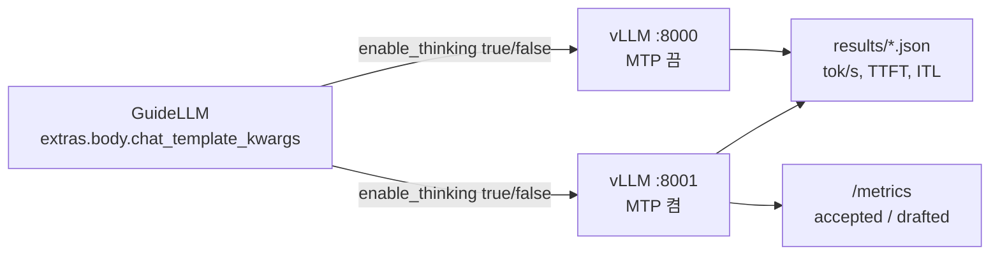

# 3. MTP on/off 비교는 수용률과 부하를 따로 잰다

[2번 문서](2-reasoning-mtp-acceptance.md)의 수치는 단일 요청 근처에서 잰 값입니다. 내 트래픽에서도 같은 판단이 맞는지 보려면, MTP 수용률과 부하에 따른 지연을 따로 측정해야 합니다. 이 문서는 vLLM 서버 구성과 GuideLLM으로 돌릴 비교 테스트를 설계합니다.

GPU가 없어 vLLM과 EXAONE 4.5로는 실행하지 않았습니다. GuideLLM 명령은 0.8.1의 `guidellm mock-server`를 상대로 실행해 문법, 요청 body, replay 타이밍까지만 확인했습니다. 확인 범위는 [검증 범위](#검증-범위)에 정리했습니다.

## 이 시나리오의 목표

| 항목 | 내용 |
|---|---|
| 기능 | MTP on/off × reasoning on/off 성능 비교 |
| 쓰는 도구 | vLLM, GuideLLM 0.8.1 |
| 입력 | 자연 프롬프트 5개(`data/natural-prompts.jsonl`), 합성 데이터, Mooncake trace |
| 작업 | 1. 서버 두 대 구성 2. reasoning off 적용 확인 3. 수용률 측정 4. 합성 sweep 5. Mooncake replay |
| 달성할 것 | 트래픽 모드별로 MTP를 켤지 끌지 수치로 결정 |

## 측정을 셋으로 나누는 이유

수용률은 생성되는 텍스트의 내용에 달려 있습니다. MTP 헤드가 맞히기 쉬운 문장인지가 수용률을 정하기 때문입니다. 반면 Mooncake trace와 GuideLLM 합성 데이터에는 의미 있는 텍스트가 없습니다. Mooncake trace는 `timestamp`, `input_length`, `output_length`, `hash_ids`만 담고, GuideLLM은 이 길이에 맞춰 프롬프트 토큰을 합성합니다. 합성 프롬프트에 대한 답변은 실제 사용자 질문의 답변과 다르므로, 여기서 나온 수용률을 그대로 믿으면 안 됩니다.

그래서 측정을 역할별로 나눕니다.

| 측정 | 데이터 | 답하는 질문 |
|---|---|---|
| ① 수용률 | 자연 프롬프트 | 이 모드에서 MTP 헤드가 얼마나 맞히는가 |
| ② 합성 sweep | `synthetic_text` | 동시성이 오르면 MTP 이득이 어디서 사라지는가 |
| ③ Mooncake replay | 실제 서비스의 도착 시각과 길이 | 실제 도착 패턴에서 TTFT와 ITL이 어떻게 변하는가 |

②와 ③의 수용률은 ①과 비교해 크게 다르면 기록만 하고, MTP 손익 판단은 ①의 수용률과 ②, ③의 지연 변화를 함께 봅니다.

### 용어

| 용어 | 뜻 | 이 핸즈온의 예 |
|---|---|---|
| sweep | 동기 실행, 최대 처리량, 그 사이의 고정 rate를 차례로 재는 GuideLLM profile | `--profile kind=sweep` |
| replay | trace의 timestamp대로 요청을 보내는 GuideLLM profile | `--profile kind=replay` |
| `time_scale` | replay 도착 간격의 배수. 2.0이면 간격이 두 배로 늘어남 | `kind=replay,time_scale=2.0` |
| `hash_ids` | 512토큰 블록 단위 prefix 해시. 앞부분이 같으면 같은 ID | 같은 system prompt를 공유하는 요청 |
| ITL | Inter-Token Latency. 출력 토큰 사이 간격 | GuideLLM `inter_token_latency_ms` |

## 컴포넌트 역할

| 컴포넌트 | 역할 |
|---|---|
| vLLM `:8000` | EXAONE 4.5, MTP 끔 |
| vLLM `:8001` | EXAONE 4.5, MTP 켬(`num_speculative_tokens=3`) |
| GuideLLM | 부하 생성, 요청 body에 `enable_thinking` 주입, 지연과 처리량 기록 |
| vLLM `/metrics` | speculative decoding 카운터로 수용률 계산 |

## 흐름

같은 GuideLLM 명령을 포트와 `enable_thinking`만 바꿔 네 조합으로 실행합니다.



## 실습 설계

설치와 trace 다운로드는 [환경 준비](setup.md)에 있습니다. 명령은 workspace 루트에서 실행합니다.

```bash
cd computer_science/ai/exaone-mtp-reasoning
```

### 1. MTP 끈 서버와 켠 서버 기동

MTP는 서버 단위 옵션이므로 서버를 두 대 띄웁니다. GPU가 하나라면 두 서버를 동시에 띄우지 말고 하나씩 띄워 측정합니다. 두 서버가 GPU 메모리를 나눠 쓰면 KV cache 크기가 달라져 비교가 틀어집니다.

MTP를 끈 기준 서버입니다.

```bash
vllm serve LGAI-EXAONE/EXAONE-4.5-33B-FP8 --port 8000
```

MTP를 켠 서버는 `--speculative-config` 하나만 다릅니다.

```bash
vllm serve LGAI-EXAONE/EXAONE-4.5-33B-FP8 --port 8001 \
  --speculative-config '{"method":"mtp","num_speculative_tokens":3}'
```

Mooncake trace를 그대로 재생하려면 `--max-model-len`이 trace의 최대 입력 길이를 받아야 합니다. 공개 trace의 최대 입력은 125,546토큰입니다. 모델이 지원하는 컨텍스트 길이와 GPU 메모리로 감당할 수 없다면 5단계에서 긴 요청을 걸러 냅니다.

### 2. reasoning off가 실제로 적용되는지 한 건으로 확인

부하를 걸기 전에, `chat_template_kwargs`가 chat template까지 전달되는지 요청 한 건으로 확인합니다. 이 값이 무시되면 네 조합이 사실상 두 조합이 되어 측정 전체가 무의미해집니다.

```bash
curl -s localhost:8001/v1/chat/completions -H 'Content-Type: application/json' -d '{
  "model": "LGAI-EXAONE/EXAONE-4.5-33B-FP8",
  "messages": [{"role": "user", "content": "1+1은?"}],
  "max_tokens": 200,
  "chat_template_kwargs": {"enable_thinking": false}
}' | jq -r '.choices[0].message'
```

reasoning off라면 응답에 추론 과정 없이 바로 답이 나와야 합니다. `enable_thinking`을 `true`로 바꿔 같은 요청을 보내면 추론 과정이 함께 나와야 합니다. vLLM 실행 옵션에 따라 추론 과정이 `content` 안의 `<think>` 블록으로 나오거나 별도 필드로 분리되므로, 어느 쪽이든 두 응답이 달라지는지만 봅니다.

### 3. 자연 프롬프트로 수용률 측정

`data/natural-prompts.jsonl`은 블로그 실험과 같은 다섯 범주(한국어 대화, 영어 대화, 코드 리뷰, 문서 요약, 코드 생성)의 프롬프트입니다. 블로그와 같이 요청당 최대 400토큰으로 자르고, 그 안에서는 모델이 EOS에서 멈추게 합니다.

```bash
guidellm run \
  --backend '{"kind":"openai_http","target":"http://localhost:8001","model":"LGAI-EXAONE/EXAONE-4.5-33B-FP8","extras":{"body":{"max_tokens":400,"ignore_eos":false,"chat_template_kwargs":{"enable_thinking":false}}}}' \
  --profile kind=synchronous \
  --data kind=json_file,path=data/natural-prompts.jsonl \
  --constraint kind=max_requests,count=5 \
  --output kind=json,path=results/mtp-on-think-off-natural.json
```

- `--profile kind=synchronous`는 요청을 하나씩 보냅니다. batch 효과를 빼고 수용률만 보려는 설정입니다.
- GuideLLM은 데이터셋을 반복하지 않으므로 5줄 파일은 `count`를 크게 줘도 5건에서 멈춥니다. 프롬프트마다 여러 번 재려면 파일을 이어 붙여 늘립니다(`cat data/natural-prompts.jsonl{,,,} > data/natural-x4.jsonl`).
- `ignore_eos`는 GuideLLM이 출력 길이를 지정할 때 기본으로 `true`를 붙입니다. EOS 뒤에 억지로 생성한 토큰은 실제 답변과 분포가 달라 수용률을 왜곡하므로, 수용률 측정에서는 `false`로 덮어씁니다.
- reasoning on에서는 400토큰 대부분이 think 블록에 쓰일 수 있습니다. 블로그 조건과 맞추려는 상한이므로, 답변 구간의 수용률을 따로 보려면 상한을 늘립니다.

측정 전후로 MTP 서버의 `/metrics`를 저장하고, speculative decoding의 accepted tokens 카운터 증가량을 draft tokens 카운터 증가량으로 나누면 이 구간의 수용률입니다. 카운터 이름은 vLLM 버전마다 다르므로 `spec_decode`로 찾습니다.

```bash
curl -s localhost:8001/metrics | grep -i spec_decode
```

reasoning on도 같은 명령에서 `enable_thinking`만 `true`로 바꿉니다. 블로그 결과가 재현된다면 reasoning off의 수용률은 1% 근처, reasoning on은 30% 근처입니다.

### 4. 합성 데이터로 동시성 sweep

sweep은 동기 실행과 최대 처리량을 먼저 재고, 그 사이를 고정 rate 여러 단계로 나눠 잽니다. MTP 이득이 동시성의 어느 지점에서 사라지는지 보는 용도입니다.

```bash
guidellm run \
  --backend '{"kind":"openai_http","target":"http://localhost:8001","model":"LGAI-EXAONE/EXAONE-4.5-33B-FP8","extras":{"body":{"chat_template_kwargs":{"enable_thinking":false}}}}' \
  --profile kind=sweep,sweep_size=6 \
  --data kind=synthetic_text,prompt_tokens=512,output_tokens=256 \
  --constraint kind=max_duration,seconds=60 \
  --output kind=json,path=results/mtp-on-think-off-sweep.json
```

이 명령은 출력 길이를 256으로 고정하므로 `ignore_eos: true`가 붙습니다. 네 조합의 출력 토큰 수를 같게 맞춰 지연을 공정하게 비교하려는 설정이고, 여기서 나온 수용률은 3단계 값과 비교만 합니다.

### 5. Mooncake trace replay

Mooncake trace는 원본 timestamp가 밀리초이고, GuideLLM replay는 초 단위를 기대합니다. 변환하지 않으면 1시간짜리 trace가 1,000시간으로 늘어납니다. GPU 한 장에서 처음 돌릴 때는 앞부분만 잘라 씁니다.

```bash
head -500 trace/mooncake_trace.jsonl | jq -c '.timestamp /= 1000' > trace/trace_sec.jsonl
```

공개 trace는 1시간(3,600초) 동안 23,608건, 초당 약 6.6건이고 평균 입력이 8,589토큰입니다. GPU 한 장으로 받기에는 prefill 부하가 크므로, `time_scale`로 도착 간격을 늘려 시작합니다. mock 서버로 확인한 결과 `time_scale=2.0`에서 40건의 도착 구간이 6.11초에서 12.22초로 두 배가 됐습니다.

```bash
guidellm run \
  --backend '{"kind":"openai_http","target":"http://localhost:8001","model":"LGAI-EXAONE/EXAONE-4.5-33B-FP8","extras":{"body":{"chat_template_kwargs":{"enable_thinking":false}}}}' \
  --profile kind=replay,time_scale=4.0 \
  --data kind=mooncake,source.kind=json_file,source.path=trace/trace_sec.jsonl,hash_id_block_size=512 \
  --constraint kind=max_requests,count=500 \
  --output kind=json,path=results/mtp-on-think-off-mooncake.json
```

- `hash_id_block_size=512`는 공개 trace가 512토큰 단위로 해시를 만들었다는 뜻입니다. 값이 다르면 prefix를 공유해야 할 요청이 다른 프롬프트를 받아 prefix cache 효과가 사라집니다.
- 각 요청의 `max_completion_tokens`는 trace의 `output_length`를 따릅니다. mock 서버로 받은 요청 body에서 794, 173, 3이 trace의 값과 같게 들어온 것을 확인했습니다.
- GuideLLM이 `dataset incomplete` 경고를 내면 trace를 다 읽기 전에 재생이 시작돼 뒤쪽 요청이 늦게 도착한 것입니다. 이때는 trace를 더 짧게 자릅니다.

### 6. 네 조합 결과 비교

GuideLLM JSON의 `benchmarks[].metrics`에서 아래 값을 조합별로 모읍니다.

| 지표 | GuideLLM 키 | 보는 이유 |
|---|---|---|
| 출력 처리량 | `output_tokens_per_second` | MTP의 직접 효과 |
| 토큰 간격 | `inter_token_latency_ms` | MTP는 디코딩에만 효과가 있음 |
| 첫 토큰 지연 | `time_to_first_token_ms` | MTP를 켜면 prefill 단계가 조금 무거워질 수 있음 |
| 수용률 | vLLM `/metrics` | 1번 문서의 공식으로 결과를 설명 |

공식 체크포인트라면 다음 결과를 예상합니다. reasoning on에서는 MTP가 이기지만 동시성이 오를수록 격차가 줄어듭니다. reasoning off에서는 모든 부하에서 MTP를 끈 서버가 이기거나 비슷합니다. 예상과 다르면 먼저 2단계로 돌아가 `enable_thinking`이 적용됐는지 확인합니다.

## 검증 범위

| 항목 | 확인 방법 | 결과 |
|---|---|---|
| GuideLLM 0.8.1 CLI 문법 | `guidellm run --help`, mock 서버 실행 | `--backend`, `--profile`, `--data`, `--constraint`, `--output` 모두 `kind=` 형식 |
| `extras.body`로 `enable_thinking` 주입 | mock 서버 앞에 요청 body를 기록하는 프록시 | 모든 요청에 `"chat_template_kwargs": {"enable_thinking": false}` 포함 |
| `ignore_eos` 기본값과 덮어쓰기 | 같은 프록시 | 기본 `true`, `extras.body`로 `false` 적용 |
| Mooncake replay 타이밍 | 40건 trace를 `time_scale` 1.0, 2.0으로 재생 | 도착 구간 6.11초 → 12.22초 |
| vLLM MTP 옵션, `/metrics` 카운터 이름 | 실행하지 않음 | GPU 없음 |
| EXAONE 4.5의 `enable_thinking` 동작 | 실행하지 않음 | GPU 없음 |

## 부록. 실무에서 얻는 것

- 수용률은 텍스트 내용에 달려 있으므로 trace replay로는 잴 수 없습니다. replay는 도착 패턴과 길이 분포를 재현하는 도구이고, 수용률은 실제 서비스 프롬프트의 표본으로 따로 재야 합니다.
- MTP 비교 벤치마크에서 가장 흔한 실패는 reasoning 설정이 적용되지 않은 채 측정하는 것입니다. 부하를 걸기 전에 요청 한 건으로 두 모드의 응답이 다른지부터 확인합니다.
- `ignore_eos`는 지연 비교에는 필요하고 수용률 측정에는 해롭습니다. 측정 목적에 따라 같은 도구의 기본값을 바꿔야 합니다.

## 참고 문서

1. [GuideLLM](https://github.com/vllm-project/guidellm)
2. [GuideLLM trace replay 문서](https://github.com/vllm-project/guidellm/blob/main/docs/en/guides/trace_replay.md)
3. [GuideLLM backend 문서](https://github.com/vllm-project/guidellm/blob/main/docs/en/guides/backends.md)
4. [Mooncake 공개 trace](https://github.com/kvcache-ai/Mooncake/tree/main/FAST25-release)
5. [AIPerf: Trace Replay with Mooncake Traces](https://docs.nvidia.com/aiperf/latest/benchmark-modes/trace-replay-with-mooncake-traces)
6. [LGAI-EXAONE/EXAONE-4.5-33B 모델 카드](https://huggingface.co/LGAI-EXAONE/EXAONE-4.5-33B)
