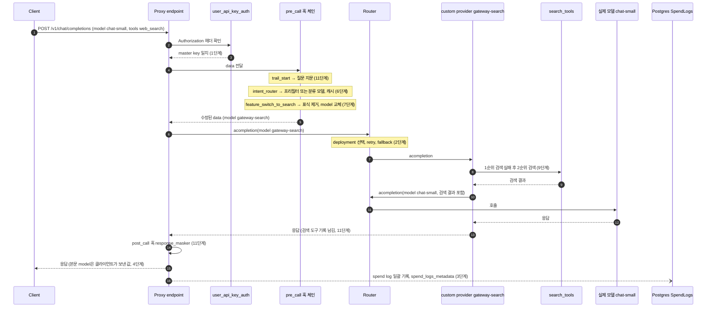

# 12단계. 요청 라이프사이클과 확장 지점 정리

## 이번 단계에서 배울 개념

- LiteLLM Proxy의 요청 하나는 **인증 → pre_call 훅 체인 → Router → provider → post_call 훅 → spend log** 순서로 지나간다. 지금까지 만든 확장 코드는 모두 이 경로의 한 지점에 붙어 있었다.
- 확장 지점마다 볼 수 있는 것과 바꿀 수 있는 것이 다르다. pre_call 훅은 요청을 바꾸고, Router 설정은 deployment 선택과 실패 처리를 바꾸고, custom provider는 응답을 만드는 방식 자체를 바꾸고, post_call 훅은 응답을 바꾼다.
- 어느 지점에 코드를 둘지는 "무엇을 바꾸려는가"와 "스트리밍에서도 동작해야 하는가"로 정한다. 같은 기능이라도 위치에 따라 지연, 관측, 스트리밍 동작이 달라졌다.

## 전체 요청 라이프사이클

11단계 config([config/11-observability.yaml](../config/11-observability.yaml))에 `web_search` 표식을 붙인 비스트리밍 요청이 지나가는 경로다. 괄호 안은 그 동작을 실습한 단계다.



다이어그램에서 Router로 들어가는 화살표는 두 번 나오지만 Proxy endpoint로 들어오는 요청은 하나뿐이다. pre_call 훅 안의 분류 모델 호출과 10번의 `chat-small` 호출은 Router를 다시 거치되 Proxy endpoint는 거치지 않으므로, pre_call 훅이 다시 실행되지 않고 spend log 행도 생기지 않는다(6·8단계).

이 경로는 비스트리밍 요청 기준이라 다른 조건에서는 모양이 달라진다. 스트리밍 요청이면 provider가 `astreaming`으로 상태 청크를 먼저 보내고(8단계), post_call 훅은 실행되지 않는다(11단계). 내장 `websearch_interception`을 쓰면 검색 실행 위치가 provider 안이 아니라 Router 호출 뒤의 agentic loop로 옮겨 가고, 검색 여부도 모델이 정한다(10단계).

## 확장 지점을 언제 쓰는가

| 확장 지점 | 설정 위치 | 볼 수 있는 것 | 바꿀 수 있는 것 | 이럴 때 쓴다 | 주의할 점 | 단계 |
|---|---|---|---|---|---|---|
| model_list 별칭 | `model_list` | 없음 | 별칭과 실제 모델의 대응 | 클라이언트 코드를 고치지 않고 모델을 바꿀 때 | 응답 본문 `model`은 별칭으로 덮어쓰인다 | 1 |
| Router 설정 | `router_settings` | 오류 종류, deployment 상태 | deployment 선택, retry 횟수, fallback 대상 | 장애와 부하를 config로 다룰 때 | 재시도 가능한 오류는 실패한 deployment를 제외하지 않는다 | 2 |
| pre_call 훅 | `litellm_settings.callbacks` | 인증된 요청 전체 | 요청 본문, model, metadata, 거절 | 요청 내용에 따라 라우팅·기능·기록을 정할 때 | 실행 순서가 곧 우선순위다. 메서드를 그 클래스에 직접 선언해야 한다 | 3~7 |
| 훅 안의 Router 호출 | `proxy_server.llm_router` | 다른 별칭의 응답 | 판단에 쓸 부가 정보 | 분류처럼 작은 모델의 판단이 필요할 때 | 사용자 지연에 그대로 더해진다. spend log에 남지 않는다 | 6 |
| custom provider | `custom_provider_map` | 모델에 가는 messages | 응답을 만드는 방법 전체, 스트림 청크 | 검색·도구 실행 후 답하는 가짜 모델을 만들 때 | `tool_calls` 상태 청크는 `finish_reason`을 `tool_calls`로 바꾼다 | 8 |
| search_tools | `search_tools`, `router_settings.fallbacks` | 검색 결과 | 검색 provider와 순서 | 검색 provider를 config로 관리할 때 | `litellm.asearch` 직접 호출에는 Router 폴백이 없다 | 9 |
| websearch_interception | `callbacks: ["websearch_interception"]` | 모델의 tool 호출 | 검색 실행과 모델 재호출 | 검색 여부를 모델이 정해야 할 때 | 스트리밍을 비스트리밍으로 바꿔 처리한다 | 10 |
| post_call 훅 | `litellm_settings.callbacks` | 완성된 응답 | 응답 본문 | 비스트리밍 응답을 후처리할 때 | 스트리밍에서는 실행되지 않는다 | 11 |
| spend_logs_metadata | 요청 `metadata` | 없음 | spend log의 `metadata` 컬럼 | 요청별 판단을 남길 때 | dict는 key 순서를 잃는다. 원문을 넣지 않는다 | 3, 11 |

## 정리

이 핸즈온에서 가장 자주 다시 확인한 것은 "클라이언트가 보는 것과 실제로 일어난 것이 다르다"는 점이다. 4단계에서 모델이 바뀌어도 본문 `model`은 그대로였고, 2단계에서 세 번 실패한 뒤의 fallback 응답도 헤더에는 retry 0회로 찍혔으며, 8단계의 안쪽 모델 호출은 spend log에 남지 않았다. 확장 코드를 붙일수록 이 차이가 커지므로, 확장 지점마다 자기가 내린 판단을 spend log에 남기는 11단계의 decision trail이 사실상 디버깅의 출발점이 된다.

## 확인 방법

이 단계는 새 코드가 없다. 전체 테스트를 한 번 돌려 모든 단계의 동작이 유지되는지 확인한다.

```bash
uv run pytest
```

마지막 줄의 통과 개수로 모든 단계의 테스트가 통과했는지 본다.

```text
...............................                                          [100%]
31 passed
```

## 실험 과제

위 sequenceDiagram을 스트리밍 요청 기준으로 다시 그려 본다. 8단계의 상태 청크가 몇 번 화살표 시점에 클라이언트에 도착하는지, post_call 훅 화살표를 지우면 11단계의 연락처 마스킹은 어디로 옮겨야 하는지 표시한다.
