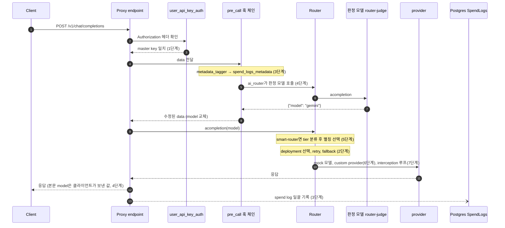

# 8단계. 요청 라이프사이클과 확장 지점 정리

## 이번 단계에서 배울 개념

- LiteLLM Proxy의 요청 하나는 **인증 → pre_call 훅 체인 → Router(분류·deployment 선택) → provider → spend log** 순서로 지나간다. 지금까지 만든 확장 코드와 config는 모두 이 경로의 한 지점에 붙어 있었다.
- 확장 지점마다 볼 수 있는 것과 바꿀 수 있는 것이 다르다. pre_call 훅은 요청을 바꾸고, Router 설정과 `complexity_router`는 어느 모델로 보낼지를 바꾸고, custom provider는 응답을 만드는 방식 자체를 바꾼다.
- 어느 지점에 코드를 둘지는 "무엇을 바꾸려는가"와 "공식 기능이 이미 그 일을 하는가"로 정한다. 같은 라우팅이라도 4단계처럼 훅으로 직접 만들 수 있고, 5단계처럼 config로 끝낼 수도 있다.

## 전체 요청 라이프사이클

아래는 단계별 config를 한 Proxy에 모두 등록했다고 가정한 비스트리밍 요청의 경로다. 실습에서는 단계마다 config를 따로 띄웠으므로 이 조합 자체를 한 번에 실행하지는 않았다. 괄호 안은 그 동작을 실습한 단계다.



Router로 들어가는 화살표는 두 번 나오지만 Proxy endpoint로 들어오는 요청은 하나뿐이다. 4단계 훅의 판정 호출과 6단계 custom provider 안의 `chat-small` 호출은 Router를 다시 거치되 Proxy endpoint는 거치지 않으므로, pre_call 훅이 다시 실행되지 않고 spend log 행도 생기지 않는다. 5단계의 내장 분류기 호출도 Proxy endpoint 밖에서 일어난다.

이 경로는 비스트리밍 기준이라 다른 조건에서는 모양이 달라진다. 스트리밍 요청이면 custom provider가 `astreaming`으로 상태 청크를 먼저 보낸다(6단계). 내장 `websearch_interception`을 쓰면 검색이 provider 호출 뒤의 agentic loop에서 실행되고, 스트리밍 요청도 내부적으로 비스트리밍으로 처리된다(7단계).

## 확장 지점을 언제 쓰는가

| 확장 지점 | 설정 위치 | 볼 수 있는 것 | 바꿀 수 있는 것 | 이럴 때 쓴다 | 주의할 점 | 단계 |
|---|---|---|---|---|---|---|
| model_list 별칭 | `model_list` | 없음 | 별칭과 실제 모델의 대응 | 클라이언트 코드를 고치지 않고 모델을 바꿀 때 | 응답 본문 `model`은 별칭으로 덮어쓰인다 | 1 |
| Router 설정 | `router_settings` | 오류 종류, deployment 상태 | deployment 선택, retry 횟수, fallback 대상 | 장애와 부하를 config로 다룰 때 | 재시도 가능한 오류는 실패한 deployment를 제외하지 않는다 | 2 |
| pre_call 훅 | `litellm_settings.callbacks` | 인증된 요청 전체 | 요청 본문, model, metadata, 거절 | 요청 내용에 따라 라우팅·기록을 정할 때 | 훅 안의 실패가 요청 실패로 번지지 않게 흡수해야 한다 | 3, 4 |
| 훅 안의 Router 호출 | `proxy_server.llm_router` | 다른 별칭의 응답 | 판단에 쓸 부가 정보 | 작은 모델의 판정이 필요할 때 | 사용자 지연에 그대로 더해진다. spend log에 남지 않는다 | 4 |
| complexity_router | `model: auto_router/complexity_router` | 질문 텍스트 | tier와 대상 별칭 | 복잡도 기준 라우팅을 코드 없이 할 때 | 한글 키워드는 단어 경계 비교라 조사에 약하다. 휴리스틱은 어휘만 본다 | 5 |
| custom provider | `custom_provider_map` | 모델에 가는 messages | 응답을 만드는 방법 전체, 스트림 청크 | 검색·도구 실행 후 답하는 가짜 모델을 만들 때 | `tool_calls` 상태 청크는 `finish_reason`을 `tool_calls`로 바꾼다 | 6 |
| websearch_interception | `callbacks: ["websearch_interception"]` | 모델의 tool 호출 | 검색 실행과 모델 재호출 | 검색 여부를 모델이 정해야 할 때 | 스트리밍을 비스트리밍으로 바꿔 처리한다 | 7 |
| spend_logs_metadata | 요청 `metadata` | 없음 | spend log의 `metadata` 컬럼 | 요청별 판단을 남길 때 | 원문 대신 판단 결과만 넣는다 | 3, 4 |

## 정리

이 핸즈온에서 가장 자주 다시 확인한 것은 "클라이언트가 보는 것과 실제로 일어난 것이 다르다"는 점이다. 4단계에서 모델이 바뀌어도 본문 `model`은 그대로였고, 2단계에서 세 번 실패한 뒤의 fallback 응답도 헤더에는 retry 0회로 찍혔으며, 4·6단계의 안쪽 모델 호출은 spend log에 남지 않았다. 그래서 확장 지점마다 자기가 내린 판단을 남겨야 한다. 직접 만든 훅은 `spend_logs_metadata`에, 내장 `complexity_router`는 `x-litellm-complexity-router-*` 응답 헤더에 그 판단이 남는다.

## 확인 방법

이 단계는 새 코드가 없다. 전체 테스트를 한 번 돌려 모든 단계의 동작이 유지되는지 확인한다.

```bash
uv run pytest
```

마지막 줄의 통과 개수로 모든 단계의 테스트가 통과했는지 본다.

```text
.................                                                        [100%]
17 passed
```

## 실험 과제

위 sequenceDiagram을 `smart-router`(5단계, LLM 분류기) 요청 기준으로 다시 그려 본다. 4단계 훅의 판정 화살표를 지우고 Router 안에 분류기 호출 화살표를 넣었을 때, 분류기가 시간 초과되면 어느 화살표가 생략되는지(circuit breaker) 표시한다.
