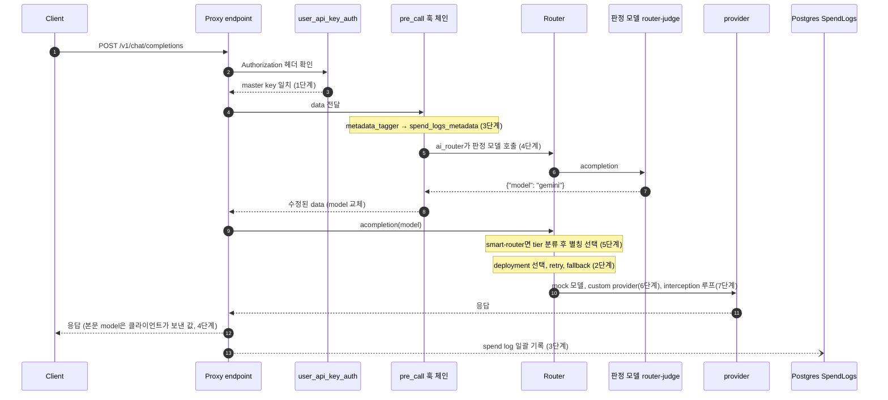

# 8단계. 요청 라이프사이클과 확장 지점 정리

## 이번 단계에서 배울 개념

- **요청 처리 파이프라인**: LiteLLM Proxy로 들어온 요청 하나는 **인증 → pre_call 훅 체인 → Router(분류·deployment 선택) → provider → spend log** 순서로 통과한다. 앞선 단계에서 구현한 확장 코드와 설정은 모두 이 경로의 특정 지점에 연결되어 있었다.
- **확장 지점별 제어 범위**: 각 확장 지점은 접근할 수 있는 데이터와 변경할 수 있는 대상이 다르다. pre_call 훅은 요청 본문과 메타데이터를 수정하고, Router 설정과 `complexity_router`는 대상 모델 선택을 제어하며, custom provider는 응답을 생성하는 방식 자체를 정의한다.
- **선택 기준**: 코드를 어느 지점에 배치할지는 "무엇을 변경하려 하는가"와 "LiteLLM 공식 기능이 해당 요구사항을 이미 지원하는가"에 따라 결정한다. 동일한 라우팅 기능이라도 4단계처럼 훅으로 직접 구현할 수도 있고, 5단계처럼 설정만으로 해결할 수도 있다.

## 전체 요청 라이프사이클

아래 다이어그램은 앞선 단계의 설정들을 하나의 Proxy에 모두 조합했다고 가정했을 때의 비스트리밍 요청 흐름이다(실습에서는 단계별로 설정을 분리해 기동했으며, 괄호 안의 숫자는 해당 동작을 다룬 단계를 뜻한다).



Router로 진입하는 화살표는 두 번 나타나지만 Proxy endpoint를 통과하는 외부 요청은 하나뿐이다. 4단계 훅의 판정 호출과 6단계 custom provider 내부의 `chat-small` 호출은 Proxy endpoint를 거치지 않고 Router를 직접 호출하므로, pre_call 훅이 다시 실행되지 않고 spend log 행도 별도로 생성되지 않는다. 5단계의 내장 분류기 호출 역시 Proxy endpoint 바깥에서 일어난다.

위 흐름은 비스트리밍 요청 기준이므로 조건에 따라 경로가 달라진다. 스트리밍 요청에서는 custom provider가 `astreaming`을 통해 상태 청크를 먼저 전송한다(6단계). 반면 내장 `websearch_interception`을 사용하면 검색이 provider 호출 이후의 agentic loop에서 실행되며, 스트리밍 요청도 내부적으로는 비스트리밍으로 전환되어 처리된다(7단계).

## 확장 지점 선택 기준

| 확장 지점 | 설정 위치 | 접근 가능한 정보 | 변경 가능한 대상 | 적합한 사용 사례 | 주의사항 | 단계 |
| --- | --- | --- | --- | --- | --- | --- |
| `model_list` 별칭 | `model_list` | 없음 | 별칭과 실제 모델 매핑 | 클라이언트 수정 없이 백엔드 모델을 교체할 때 | 응답 본문 `model`은 별칭으로 덮어쓰임 | 1 |
| Router 설정 | `router_settings` | 오류 유형, deployment 상태 | deployment 선택, retry 횟수, fallback 대상 | 장애 대응과 부하 분산을 설정으로 제어할 때 | 재시도 가능한 오류는 실패한 deployment를 후보에서 제외하지 않음 | 2 |
| pre_call 훅 | `litellm_settings.callbacks` | 인증된 요청 전체 | 요청 본문, `model`, `metadata`, 요청 거절 | 요청 내용 기반으로 라우팅·태깅·차단을 수행할 때 | 훅 내부 예외가 전체 요청 실패로 번지지 않도록 방어해야 함 | 3, 4 |
| 훅 내부 Router 호출 | `proxy_server.llm_router` | 다른 별칭의 모델 응답 | 라우팅 판단에 필요한 부가 정보 | 소형 모델의 사전 판정이 필요할 때 | 사용자 응답 지연에 그대로 가산되며 spend log에 남지 않음 | 4 |
| `complexity_router` | `model: auto_router/complexity_router` | 질문 텍스트 | 복잡도 tier와 대상 별칭 | 복잡도 기반 라우팅을 코드 없이 구성할 때 | 한글 키워드는 단어 경계 비교라 조사에 취약하며, 휴리스틱은 어휘만 평가함 | 5 |
| custom provider | `custom_provider_map` | 모델에 전달되는 `messages` | 응답 생성 로직 전체, 스트림 청크 | 검색·전처리 후 응답하는 가상 모델을 구현할 때 | `tool_calls` 상태 청크는 `finish_reason`을 `tool_calls`로 변경시킴 | 6 |
| `websearch_interception` | `callbacks: ["websearch_interception"]` | 모델의 tool 호출 응답 | 검색 실행 및 모델 재호출 루프 | 검색 실행 여부를 모델이 결정해야 할 때 | 스트리밍 요청을 내부적으로 비스트리밍으로 변환해 처리함 | 7 |
| `spend_logs_metadata` | 요청 `metadata` | 없음 | spend log의 `metadata` 컬럼 | 요청별 커스텀 판단 근거를 기록할 때 | 프롬프트 원문 대신 판단 결과 요약만 기록하는 편이 안전함 | 3, 4 |

## 요약

이 핸즈온 전반에서 반복적으로 확인한 핵심은 **"클라이언트에 노출되는 표면 값과 실제 내부 동작이 다를 수 있다"**는 점이다. 4단계에서 훅이 모델을 교체해도 응답 본문의 `model` 필드는 원본 값 그대로였고, 2단계에서 3회 실패 후 fallback이 동작해도 응답 헤더의 retry 횟수는 0으로 기록되었으며, 4·6단계의 내부 모델 호출은 spend log에 남지 않았다. 따라서 확장 지점을 도입할 때는 각 지점이 내린 판단을 관측 가능하게 남기는 설계가 중요하다. 커스텀 훅은 `spend_logs_metadata`에, 내장 `complexity_router`는 `x-litellm-complexity-router-*` 응답 헤더에 그 흔적을 남긴다.

## 전체 단위 테스트 검증

이 단계에는 추가 코드가 없으므로, 전체 단위 테스트를 한 번에 실행해 모든 단계의 동작이 정상 유지되는지 확인한다.

```bash
uv run pytest
```

마지막 줄의 통과 개수를 통해 17개 테스트가 모두 통과했는지 확인한다.

```text
.................                                                        [100%]
17 passed
```

## 실험 과제

위 sequenceDiagram을 `smart-router`(5단계, LLM 분류기) 요청 기준으로 다시 그려 본다. 4단계 훅의 판정 화살표를 제거하고 Router 내부에 분류기 호출 화살표를 배치한 뒤, 분류기가 타임아웃으로 실패했을 때 circuit breaker에 의해 어느 호출 화살표가 생략되는지 표시해 본다.
