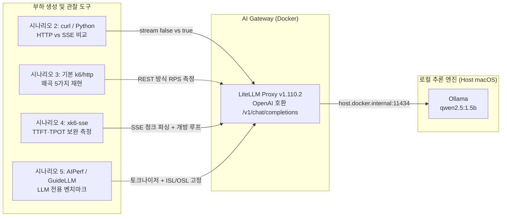

# 시나리오 1. 기능 지도와 LLM 성능 기준표

이 문서는 AI Gateway(LiteLLM)를 거쳐 LLM 채팅 API를 부하테스트할 때 무엇을 어떤 순서로 검증해야 하는지 한눈에 정리합니다. HTTP 스트리밍 원리부터 기본 `k6/http`의 한계, `xk6-sse` 보완, 그리고 LLM 전용 벤치마크 도구(AIPerf, GuideLLM)까지의 전체 지도를 먼저 확인합니다.

## 전체 실험 지도

아래 흐름은 로컬 장비에서 요청이 LiteLLM Proxy를 거쳐 Ollama(`qwen2.5:1.5b`)로 전달되는 구조와, 각 시나리오가 어떤 부하 생성기로 무엇을 측정하는지 보여줍니다.

## 시나리오별 목표와 사용 도구

각 시나리오는 앞 단계에서 드러난 한계를 다음 단계에서 해결하는 순서로 이어집니다.

| 시나리오 | 핵심 기능 및 검증 대상 | 사용 도구 | 문서 |
| --- | --- | --- | --- |
| 준비 | 로컬 Ollama와 안전한 LiteLLM(`v1.110.2`) 환경 구축 | Docker Compose, Ollama, xk6, uv | [setup.md](setup.md) |
| 2 (5~10분) | 일반 HTTP(`stream: false`)와 Chat SSE(`stream: true`) 응답 방식·체감 지표 비교 | `curl`, `scripts/compare_http_sse.py` | [2-sse-vs-http.md](2-sse-vs-http.md) |
| 3 | 기본 `k6/http`로 Chat SSE를 쏠 때 발생하는 5가지 왜곡 실측 | `k6` (`k6/http`) | [3-k6-pitfalls.md](3-k6-pitfalls.md) |
| 4 | k6에서 SSE 청크 파싱과 개방 루프 적용, k6가 맡아야 할 역할 경계 | `xk6-sse` (`k6/x/sse`) | [4-xk6-sse.md](4-xk6-sse.md) |
| 5 | LLMPerf 지원 중단 이후 현역 표준 도구로 토큰 단위 지표·SLO 판정 | NVIDIA AIPerf, GuideLLM | [5-llm-benchmark-tools.md](5-llm-benchmark-tools.md) |
| 6 | GuideLLM 실전: 동시성 스윕(1→2→4), HTML/JSON 리포트, Mooncake Trace 리플레이 | GuideLLM, Mooncake Trace | [6-guidellm-handson.md](6-guidellm-handson.md) |

## 도구별 용어 대조

웹 부하테스트 도구(k6)와 LLM 벤치마크 도구(AIPerf, GuideLLM)는 비슷한 이름을 쓰지만 측정 시점이 다릅니다. 아래 차이를 먼저 구분해야 리포트를 오독하지 않습니다.

| 지표 | 일반 웹 도구(k6 기본)의 의미 | LLM 벤치마크 도구의 의미 | 혼동 시 문제 |
| --- | --- | --- | --- |
| `http_req_waiting` vs TTFT | HTTP 200 응답 헤더 도착 시점(TTFB) | Prefill 완료 후 첫 번째 실제 텍스트 토큰 도착 시점 | 프록시가 헤더를 먼저 열면 TTFB가 10ms로 찍혀 첫 글자 대기를 놓침 |
| `http_req_duration` vs E2E | 요청 시작부터 응답 바디 전체 종료까지 | 첫 토큰부터 마지막 `[DONE]` 청크 완료까지 | 스트리밍 체감 속도(TTFT)가 전체 생성 시간에 가려짐 |
| `http_reqs` (RPS) vs TPS | 1초당 완료한 HTTP 요청 건수 | 1초당 생성한 출력 토큰 수(Output Tokens/sec) | 짧은 답변과 긴 답변의 GPU 비용 차이를 무시함 |
| `vus` vs `request-rate` | 응답을 기다렸다가 다음 요청을 보내는 폐쇄 루프 | 응답 속도와 무관하게 일정 분포로 쏘는 개방 루프 | 서버가 느려지면 부하가 자동 감소해 한계점이 숨겨짐 |

## 사업팀과 입문 엔지니어용 핵심 성능 기준표 (SLO)

평균(Avg) 값은 상위 5%의 느린 대기 시간을 숨깁니다. 실무에서는 모든 지연 지표를 P95 또는 P99로 판정하며, 실시간 대화형과 비실시간 배치형의 합격선을 분리합니다.

| 지표 | 쉬운 설명 | 실시간 챗봇 합격선 (P95) | 배치·요약 합격선 (P95) | 핵심 의미 |
| --- | --- | --- | --- | --- |
| TTFT (Time To First Token) | 질문 후 첫 글자가 뜨기까지 기다리는 시간 | 1.0초 이하 | 3.0초 이하 | 사용자가 느끼는 반응 속도 |
| TPOT / ITL (토큰 간 지연) | 글자가 화면에 타자 치듯 찍히는 간격 | 50ms 이하 (초당 20토큰 이상) | 100ms 이하 (초당 10토큰 이상) | 사람 읽기 속도보다 빠른지 여부 |
| E2E Latency (총 응답 시간) | 답변이 끝까지 완료되는 데 걸린 전체 시간 | 10초 이내 (500토큰 출력 기준) | 업무별 SLA 기준 | 요청 1건의 최종 체감 시간 |
| RPS / TPS (처리량) | 1초당 처리하는 요청 수와 생성 토큰 수 | 목표 동시 사용자 수 충족 | 최대화 목표 | 서버 1대 또는 클라우드 쿼터의 용량 |
| Goodput (유효 처리율) | TTFT와 TPOT 기준을 모두 통과한 요청 비율 | 95% 이상 | 99% 이상 | 실제 서비스 가능한 한계점 판별 |
| Error / 429 Rate | 실패하거나 쿼터 초과로 거절된 비율 | 0.1% 미만 (429 에러 0%) | 1% 미만 (재시도 포함) | 안정성 및 쿼터 증설 필요 여부 |

## 테스트 시나리오 표준 (입출력 길이 고정 규칙)

같은 모델이라도 입력(ISL, Input Sequence Length)과 출력(OSL, Output Sequence Length) 길이에 따라 지연과 메모리 점유율이 수배 차이 납니다. 실무 벤치마크에서는 아래 3가지 표준 프로파일을 고정해 두고 반복 측정합니다.

| 시나리오 유형 | 입력(ISL) / 출력(OSL) | 부하 주입 방식 | 주요 확인 목적 |
| --- | --- | --- | --- |
| 기본 챗봇형 | 512 / 512 토큰 | Poisson (현실 트래픽 모사) | 일반적인 대화 환경의 균형 성능 확인 |
| RAG / 문서 검색형 | 4,000 / 256 토큰 | Poisson | 긴 프롬프트 처리(Prefill) 병목과 TTFT 급증 지점 파악 |
| 코드 / 보고서 생성형 | 1,000 / 2,000 토큰 | 동시성 단계 증분 (1, 8, 32, 64) | 긴 답변 생성(Decode) 시 KV 캐시 메모리 포화 시점 파악 |

> [!NOTE]
> 이 핸즈온은 로컬 macOS 단일 장비에서 빠르게 재현하기 위해 ISL 128 / OSL 64~120 수준의 축소 프로파일을 사용합니다. 운영 환경(AWS Bedrock, GCP Vertex AI, 자체 vLLM)에서 쿼터 증설이나 서버 튜닝 근거를 만들 때는 위 3가지 표준 프로파일로 전환해 측정합니다.

## 참고 문서

1. [LiteLLM Proxy 공식 문서](https://docs.litellm.ai/docs/simple_proxy)
2. [NVIDIA AIPerf 공식 저장소](https://github.com/ai-dynamo/aiperf)
3. [vLLM GuideLLM 공식 저장소](https://github.com/vllm-project/guidellm)
