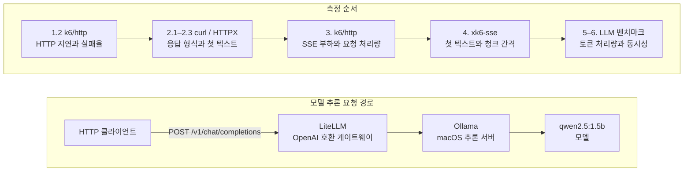

# 시나리오 1.1. 모델 추론 API의 성능 측정 지도

웹 API 성능테스트와 같은 질문에서 시작합니다. 여러 요청이 동시에 들어오면 응답이 얼마나 늦어지고, 요청을 초당 몇 건 처리하며, 몇 건이 실패할까요? 모델이 응답을 생성하는 API에도 같은 HTTP 부하테스트를 적용할 수 있습니다. 채팅이 스트리밍 응답을 반환하면 첫 텍스트 대기와 출력 속도를 별도로 관찰합니다.

## 전체 실험 지도

실습마다 수집하는 지표가 늘어납니다. 각 도구의 Chat Completions 요청은 같은 추론 경로를 따릅니다.

클라이언트에서 잰 지연에는 HTTP 전송, LiteLLM 중계, Ollama의 대기와 모델 생성이 함께 들어갑니다. 지연이 늘어난 구성요소를 특정하려면 각 구간의 서버 측 측정이 필요합니다.

## 시나리오별 목표와 사용 도구

각 시나리오는 앞 단계에서 드러난 한계를 다음 단계에서 해결하는 순서로 이어집니다.

부하를 실행하기 전에 같은 API의 요청과 응답을 한 건 확인합니다. 완성된 답변은 [비스트리밍 curl 호출](1.2-http-baseline.md#1-curl로-요청-한-건-확인)에서, 생성 중 전달되는 조각은 [SSE curl 호출](2.3-sse-vs-http.md#1-curl로-sse-응답-한-건-확인)에서 봅니다. 후속 시나리오는 이 예제를 다시 사용합니다.

| 시나리오 | 핵심 기능 및 검증 대상 | 사용 도구 | 문서 |
| --- | --- | --- | --- |
| 준비 | 로컬 모델과 추론 API 기동 | Ollama, LiteLLM, Docker Compose | [환경 준비](setup.md) |
| 1.2 | 완성 응답의 지연, 실패율, 요청 처리량 측정 | curl, `k6/http` | [기본 HTTP 부하테스트](1.2-http-baseline.md) |
| 2.1 | HTTP 응답 본문의 SSE 형식 읽기 | SSE 이벤트 예시 | [SSE 이론](2.1-sse-theory.md) |
| 2.2 | 응답 수신과 지연을 기록하는 코드 읽기 | HTTPX | [SSE 비교 코드 해설](2.2-sse-code.md) |
| 2.3 | 응답 형식과 첫 텍스트·전체 완료 시각 비교 | curl, HTTPX | [SSE 실습](2.3-sse-vs-http.md) |
| 3 | 스트리밍에서도 HTTP 지표 수집, 부하 모델·답변 길이 비교 | `k6/http` | [SSE에 기본 k6 적용](3-k6-pitfalls.md) |
| 4 | k6에서 SSE 청크 파싱과 개방 루프 적용, k6가 맡아야 할 역할 경계 | `xk6-sse` (`k6/x/sse`) | [4-xk6-sse.md](4-xk6-sse.md) |
| 5 | LLMPerf 지원 중단 이후 현역 표준 도구로 토큰 단위 지표·SLO 판정 | NVIDIA AIPerf, GuideLLM | [5-llm-benchmark-tools.md](5-llm-benchmark-tools.md) |
| 6 | GuideLLM 실전: 동시성 스윕(1→2→4), HTML/JSON 리포트, Mooncake Trace 리플레이 | GuideLLM, Mooncake Trace | [6-guidellm-handson.md](6-guidellm-handson.md) |

## 도구별 용어 대조

웹 부하테스트 도구(k6)와 LLM 벤치마크 도구(AIPerf, GuideLLM)는 비슷한 이름을 쓰지만 측정 시점이 다릅니다. 아래 차이를 먼저 구분해야 리포트를 오독하지 않습니다.

| 지표 | 일반 웹 도구(k6 기본)의 의미 | LLM 벤치마크 도구의 의미 | 혼동 시 문제 |
| --- | --- | --- | --- |
| `http_req_waiting` vs TTFT | 요청 전송 후 응답의 첫 바이트까지(TTFB) | 요청 시작부터 첫 출력 토큰 또는 첫 텍스트 조각까지 | 헤더가 먼저 오면 사용자가 텍스트를 기다린 시간이 가려짐 |
| `http_req_duration` vs E2E | HTTP 전송·대기·수신 시간의 합 | 벤치마크 클라이언트의 요청 시작부터 응답 완료까지 | 도구별 시작점과 완료점, 집계 범위가 다를 수 있음 |
| `http_reqs` (RPS) vs TPS | 1초당 완료한 HTTP 요청 건수 | 1초당 생성한 출력 토큰 수(Output Tokens/sec) | 짧은 답변과 긴 답변의 GPU 비용 차이를 무시함 |
| `vus` vs `request-rate` | 응답을 기다렸다가 다음 요청을 보내는 폐쇄 루프 | 응답 속도와 무관하게 일정 분포로 쏘는 개방 루프 | 서버가 느려지면 부하가 자동 감소해 한계점이 숨겨짐 |

## 실습용 성능 목표 예시 (SLO)

평균과 함께 95번째 백분위수(P95)를 보면 느린 요청도 관찰할 수 있습니다. 아래는 실시간 대화와 배치에 서로 다른 목표를 적용하는 예시입니다. 팀의 서비스 요구에 맞춰 기준을 정합니다.

| 지표 | 쉬운 설명 | 실시간 챗봇 합격선 (P95) | 배치·요약 합격선 (P95) | 핵심 의미 |
| --- | --- | --- | --- | --- |
| TTFT (Time To First Token) | 질문 후 첫 글자가 뜨기까지 기다리는 시간 | 1.0초 이하 | 3.0초 이하 | 사용자가 느끼는 반응 속도 |
| TPOT / ITL (토큰 간 지연) | 글자가 화면에 타자 치듯 찍히는 간격 | 50ms 이하 (초당 20토큰 이상) | 100ms 이하 (초당 10토큰 이상) | 사람 읽기 속도보다 빠른지 여부 |
| E2E Latency (총 응답 시간) | 답변이 끝까지 완료되는 데 걸린 전체 시간 | 10초 이내 (500토큰 출력 기준) | 업무별 SLA 기준 | 요청 1건의 최종 체감 시간 |
| RPS / TPS (처리량) | 1초당 처리하는 요청 수와 생성 토큰 수 | 목표 동시 사용자 수 충족 | 최대화 목표 | 서버 1대 또는 클라우드 쿼터의 용량 |
| Goodput (유효 처리율) | TTFT와 TPOT 기준을 모두 통과한 요청 비율 | 95% 이상 | 99% 이상 | 실제 서비스 가능한 한계점 판별 |
| Error / 429 Rate | 실패하거나 쿼터 초과로 거절된 비율 | 0.1% 미만 (429 에러 0%) | 1% 미만 (재시도 포함) | 안정성 및 쿼터 증설 필요 여부 |

## 토큰 길이와 부하 조건 설정

같은 모델이라도 입력(ISL, Input Sequence Length)과 출력(OSL, Output Sequence Length) 길이에 따라 지연과 메모리 사용량이 달라집니다. 모델 또는 설정을 비교할 때는 서비스에 맞는 입력·출력 길이와 부하 주입 방식을 정하고 같은 조건으로 반복합니다.

| 시나리오 유형 | 입력(ISL) / 출력(OSL) | 부하 주입 방식 | 주요 확인 목적 |
| --- | --- | --- | --- |
| 기본 챗봇형 | 512 / 512 토큰 | Poisson (현실 트래픽 모사) | 일반적인 대화 환경의 균형 성능 확인 |
| RAG / 문서 검색형 | 4,000 / 256 토큰 | Poisson | 긴 프롬프트 처리(Prefill) 병목과 TTFT 급증 지점 파악 |
| 코드 / 보고서 생성형 | 1,000 / 2,000 토큰 | 동시성 단계 증분 (1, 8, 32, 64) | 긴 답변 생성(Decode) 시 KV 캐시 메모리 포화 시점 파악 |

> [!NOTE]
> GuideLLM 동시성 스윕은 실습용으로 입력 128토큰과 출력 목표 48토큰을 사용합니다. 결과에서 실제 출력 토큰 수와 부하 조건도 함께 확인합니다.

## 참고 문서

1. [Grafana k6의 HTTP 기본 지표](https://grafana.com/docs/k6/latest/using-k6/metrics/reference/#http-specific-built-in-metrics)
2. [NVIDIA AIPerf 공식 저장소](https://github.com/ai-dynamo/aiperf)
3. [vLLM GuideLLM 공식 저장소](https://github.com/vllm-project/guidellm)
