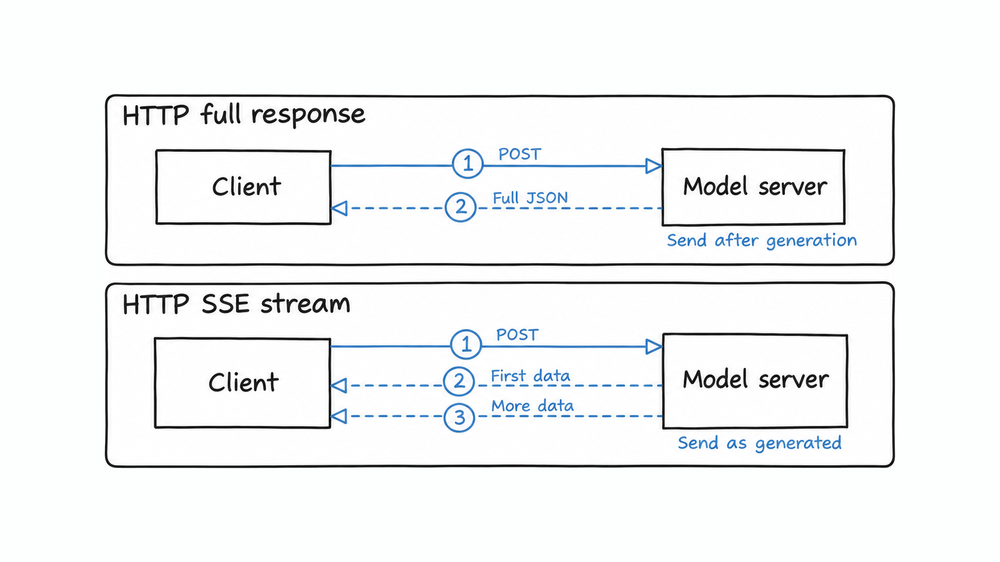
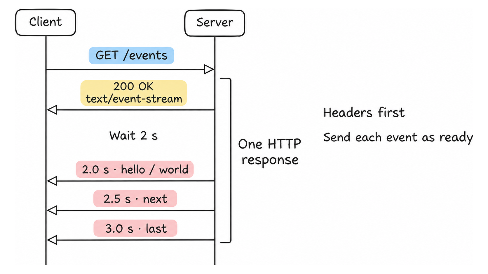
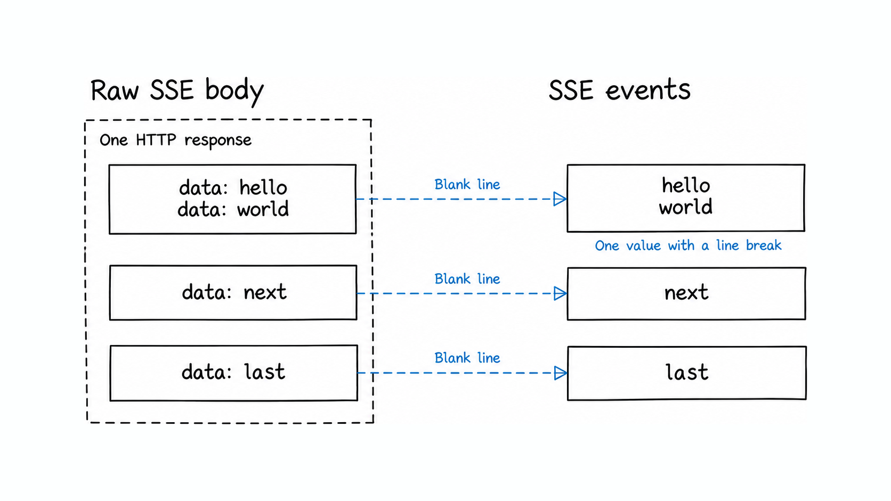

# 시나리오 2.1. SSE 응답의 원리

## 이 시나리오의 목표

| 항목 | 내용 |
| --- | --- |
| 기능 | 생성 중인 답변을 작은 조각으로 전달 |
| 도구 | curl, Python HTTPX, LiteLLM Admin UI |
| 입력 | 시간차를 둔 로컬 SSE 이벤트와 Chat Completions 응답 |
| 작업 | 1. 헤더와 텍스트의 도착 순서 읽기 → 2. 빈 줄로 나뉜 이벤트 해석 → 3. curl로 수신 시각 확인 |
| 달성할 것 | 헤더 수신, 첫 텍스트 수신, 응답 완료 시점을 구분 |

## 하나의 HTTP 응답에 이벤트가 이어집니다

Server-Sent Events(SSE)는 서버가 하나의 HTTP 응답 본문에 여러 이벤트를 연달아 쓰는 형식입니다. 채팅 API를 `stream: true`로 호출하면, 클라이언트는 `Content-Type: text/event-stream` 헤더를 보고 본문을 SSE로 읽습니다. 텍스트가 들어 있는 이벤트를 받을 때마다 화면에 답변을 이어 붙일 수 있습니다.

모델 서버를 직접 호출하는 경우에도 두 방식 모두 POST 한 번에 HTTP 응답 하나를 받습니다. 비스트리밍은 완성된 JSON을 받습니다. SSE 화살표 두 개는 한 응답 본문에 이어지는 이벤트를 나타냅니다.



## 헤더 도착과 첫 텍스트 도착

새 HTTP/1.1 연결을 예로 들면, 먼저 TCP 3-way handshake로 연결을 열고 그 위로 HTTP 요청을 보냅니다. 요청 바이트에 대한 TCP ACK는 상대 TCP가 받은 바이트를 확인합니다. HTTP 상태와 헤더는 서버가 어떤 응답을 시작했는지 알려 줍니다. [TCP 연결 절차](https://www.rfc-editor.org/rfc/rfc9293.html#section-3.5) · [HTTP/1.1 메시지 구조](https://www.rfc-editor.org/rfc/rfc9112.html#section-2.1)

서버는 **첫 출력 토큰이 준비되기 전에도** `200 OK`와 `Content-Type: text/event-stream`을 먼저 보낼 수 있습니다. 아래 실습에서는 그렇게 응답 헤더를 내보낸 뒤 첫 텍스트 조각이 준비될 때까지 2초를 기다립니다. 첫 조각이 준비되면 서버가 그 조각을 전송하고, 이후에도 다음 조각이 준비될 때마다 같은 본문에 씁니다. 실제 모델에서는 대기열과 프롬프트 처리 등이 첫 텍스트까지의 시간에 영향을 주고, 이후 조각 간격도 달라질 수 있습니다.



헤더 전송 시점은 서버와 프록시 구현에 따라 달라집니다. 첫 본문 조각이 준비될 때 헤더도 함께 내보내는 구현에서는 헤더와 첫 텍스트가 거의 같이 도착할 수 있습니다. 위 그림은 헤더를 먼저 보내는 경우를 보여 줍니다.

## 빈 줄이 SSE 이벤트를 나눕니다

여기서 **이벤트 하나**는 스트림을 읽는 클라이언트에 전달되는 메시지 하나입니다. TCP 연결 위에 HTTP 응답이 있고, 그 응답 본문 안에 여러 SSE 이벤트가 들어갑니다. 같은 연결과 응답을 유지하면서 이벤트만 여러 번 전달할 수 있습니다.

클라이언트는 `data:` 줄을 읽을 때마다 값을 모아 둡니다. 빈 줄을 만나면 모아 둔 `data:` 값을 줄바꿈으로 잇고, 한 이벤트의 데이터로 전달한 뒤 다음 이벤트를 읽습니다. 그림의 첫 이벤트에는 `data: hello`와 `data: world`가 들어 있습니다. 빈 줄 뒤의 `data: next`는 두 번째 이벤트입니다. [SSE 이벤트 파싱 규칙](https://html.spec.whatwg.org/multipage/server-sent-events.html#interpreting-an-event-stream)



[Haru 레이아웃 선택 지침과 두 그림의 생성 프롬프트](../imgs/sse-timing-and-events-prompt.md)

`event:`는 이벤트 이름을, `id:`는 이벤트 식별자를 지정합니다. 콜론으로 시작하는 줄은 주석으로 처리합니다. [부록 A의 curl 실습](appendix-a-sse-timing.md)에서 원본 줄과 이벤트로 묶인 결과를 각각 확인할 수 있습니다.

## Chat Completions에서 첫 텍스트 찾기

아래는 Chat Completions 응답 본문을 줄인 예입니다. 빈 줄마다 이벤트 하나가 끝납니다.

```text
data: {"choices":[{"delta":{"role":"assistant"}}]}

data: {"choices":[{"delta":{"content":"안녕"}}]}

data: {"choices":[{"delta":{"content":"하세요"}}]}

data: [DONE]

```

첫 `data:` 이벤트는 역할만 알려 줍니다. 화면에 표시할 첫 텍스트는 다음 이벤트의 `delta.content`에 있는 `안녕`입니다. JSON, `delta.content`, `[DONE]`은 Chat Completions에서 사용하는 형식입니다.

브라우저의 `EventSource`는 보통 GET으로 이벤트 스트림을 엽니다. 이 실습의 Chat Completions 요청은 JSON 본문과 Bearer 인증 헤더를 담는 POST입니다. curl과 HTTPX가 POST를 보내고 같은 SSE 형식의 응답을 읽습니다.

## 같은 API에서 바뀌는 부분

| 요청 본문 | 응답 본문 | 클라이언트에서 텍스트를 쓸 수 있는 시점 |
| --- | --- | --- |
| `stream: false` | JSON 문서 하나의 `choices[0].message.content` | 응답 본문 전체를 받아 JSON을 읽은 뒤 |
| `stream: true` | SSE 이벤트마다 `choices[0].delta.content` | 첫 비어 있지 않은 텍스트 이벤트를 받은 뒤 |

SSE로 첫 텍스트가 오는 시기가 앞당겨져도, 응답 완료 시간은 출력 길이와 모델의 생성 속도에 좌우됩니다. 이벤트 하나에 담긴 텍스트는 한 글자일 수도 있고 여러 글자일 수도 있습니다. SSE 이벤트, 네트워크 수신 조각, 모델 토큰은 각각 다른 단위입니다.

## 측정 시점

| 지표 | 이 실습에서 재는 구간 |
| --- | --- |
| TTFB (Time to First Byte) | 요청 시작부터 HTTPX가 응답 헤더를 사용할 수 있을 때까지. 이 스크립트에서 쓰는 근삿값입니다. |
| TTFT (Time to First Token) | 요청 시작부터 첫 비어 있지 않은 텍스트 조각까지. 비스트리밍에서는 본문 수신 완료 시각을 씁니다. |
| 평균 청크 간격 | 첫 텍스트 조각과 마지막 텍스트 조각 사이의 시간을 조각 사이 간격 수로 나눈 값입니다. |
| E2E (End-to-End) | 요청 시작부터 응답 본문을 끝까지 소비할 때까지입니다. |

헤더와 역할 이벤트가 먼저 도착해도 화면에 표시할 텍스트는 나중에 올 수 있습니다. 이 차이를 기억하고 [비교 코드 해설](2.2-sse-code.md)에서 타이머가 어디에 놓였는지 확인합니다.

## 참고 문서

1. [WHATWG HTML 표준의 SSE 이벤트 스트림 문법](https://html.spec.whatwg.org/multipage/server-sent-events.html#parsing-an-event-stream)
2. [OpenAI Chat Completions 요청과 스트리밍 예시](https://developers.openai.com/api/reference/resources/chat/subresources/completions/methods/create)
3. [OpenAI Chat Completions 스트리밍 이벤트](https://developers.openai.com/api/reference/resources/chat/subresources/completions/streaming-events)
