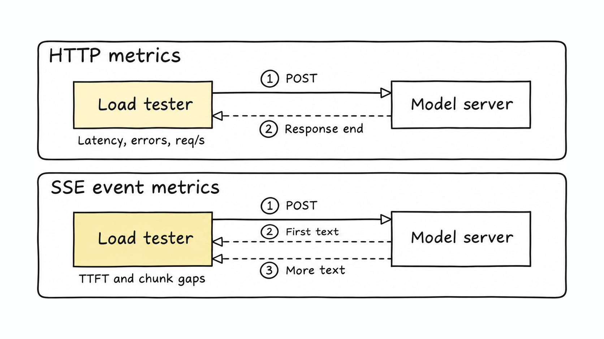
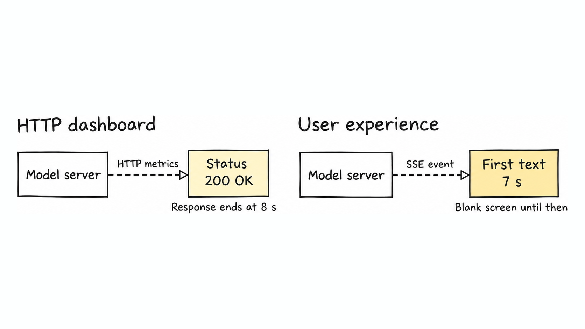
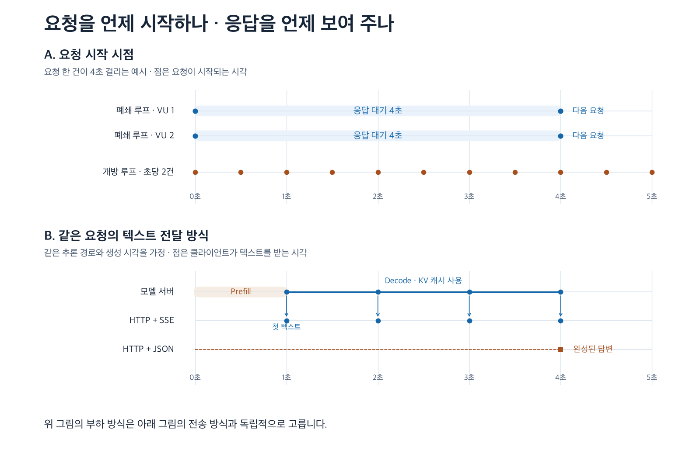
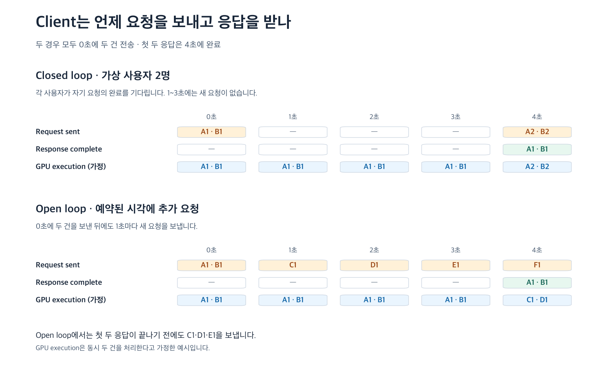
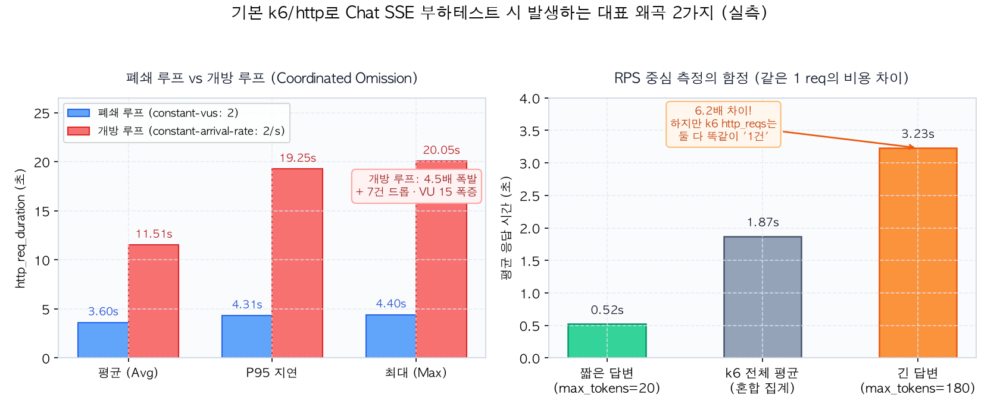

# 시나리오 3. 기본 k6로 SSE 요청 부하테스트

[비스트리밍 기준선](1.2-http-baseline.md)과 같은 HTTP 도구로 SSE 요청을 보냅니다. 기본 k6는 두 응답 형식에서 HTTP 실패율, 요청 수, 본문 수신 완료까지의 지연을 집계합니다. 첫 텍스트가 도착하는 시각과 텍스트 조각 사이 간격도 필요하면 이벤트를 받는 중에 시간을 기록해야 합니다.

## 이 시나리오의 목표

| 항목 | 내용 |
| --- | --- |
| 기능 | 기본 `k6/http`로 Chat SSE(`/v1/chat/completions`, `stream: true`) 호출 및 HTTP 성능 측정 |
| 쓰는 도구 | `k6` (`k6/http`), [01-naive-http-sse.js](../k6/01-naive-http-sse.js), [02-closed-vs-open-loop.js](../k6/02-closed-vs-open-loop.js), [03-rps-token-imbalance.js](../k6/03-rps-token-imbalance.js) |
| 입력 | LiteLLM Proxy(`local-qwen`)에 대한 스트리밍 요청 |
| 작업 | 1. 스트리밍 요청의 HTTP 지표 확인 → 2. 폐쇄 루프와 개방 루프 비교 → 3. 답변 길이와 요청 처리량 해석 |
| 달성할 것 | HTTP 지표가 답하는 성능 질문과 SSE 이벤트·토큰 측정이 필요한 질문을 구분 |

## 이 기능이 무엇인가

SSE 응답도 HTTP 위에서 전달되므로 기존 상태 코드 검사와 요청 지표를 그대로 적용할 수 있습니다. 응답 전체를 읽은 뒤에는 `data:` 줄도 셀 수 있습니다. 스트리밍 화면의 반응을 재려면 그 줄들이 언제 도착했는지 알아야 합니다. 이를 위해 다음 시나리오에서 이벤트 콜백으로 수신 시각을 기록합니다.



### 용어

| 용어 | 뜻 | 이 실습의 예 |
| --- | --- | --- |
| `http_req_waiting` | k6가 요청 전송 후 HTTP 응답 헤더의 첫 바이트를 받기까지 잰 시간(TTFB) | 샘플 1건에서 `274.9 ms` |
| `http_req_receiving` | HTTP 헤더 이후 응답 바디(모든 SSE 청크)가 완전히 닫힐 때까지 잰 시간 | 샘플 1건에서 `1790.9 ms` |
| 폐쇄 루프 (Closed-loop) | 각 가상 사용자(VU)가 자신의 이전 작업을 마친 뒤 다음 요청을 보내는 방식(`constant-vus`) | `MODE=closed`에서 VU 2개의 처리량이 `0.53 req/s`였습니다. |
| 개방 루프 (Open-loop) | 이전 응답과 독립적으로 요청 시작 시각을 예약하는 방식(`constant-arrival-rate`) | `MODE=open`의 목표 도착률은 `2 req/s`입니다. |
| Coordinated Omission | 독립적으로 요청이 도착하는 상황을 재려는데 응답을 기다리도록 부하를 걸면, 느린 동안 도착했을 요청의 대기가 측정에서 빠지는 현상 | 이 실행에서 폐쇄 루프 P95는 `4.31s`, 개방 루프 P95는 `19.25s`였습니다. |

## 이 문제를 이해해야 하는 이유

모델 추론 API의 HTTP 지표를 해석할 때는 응답 형식, 토큰 길이, 부하 조건을 함께 기록합니다.

운영 채팅에서 HTTP 200을 받은 요청이 8초에 끝났다고 가정합니다. 첫 텍스트가 7초에 도착했다면 사용자는 그때까지 빈 화면을 봅니다. 같은 완료 시간 안에서도 첫 텍스트가 언제 도착했는지에 따라 체감이 달라집니다.



1. **TTFB와 TTFT의 혼동 (SSE 청크 파싱 부재)**: 기본 `k6/http`는 응답 바디가 완전히 끝날 때까지 기다린 뒤 메트릭을 집계합니다. `http_req_waiting`은 HTTP 200 헤더가 열린 시점(TTFB)일 뿐 첫 텍스트 토큰(TTFT)이 아니며, 중간 청크별 타임스탬프(TPOT/ITL)는 아예 잴 수 없습니다.
2. **요청 수(RPS) 중심 측정의 함정**: 입력 100토큰·출력 20토큰 요청과 입력 4,000토큰·출력 1,000토큰 요청은 GPU 연산량과 KV 캐시 점유율이 수십 배 차이 납니다. `http_req_duration`과 `http_reqs`만 보면 지연이 튄 원인이 서버 병목인지, 모델이 우연히 긴 답변을 생성해서인지 구분할 수 없습니다.
3. **입출력 토큰 길이(ISL/OSL) 통제와 토크나이저 부재**: 단순 문자열로 프롬프트를 보내면 모델별 실제 토큰 수 기반의 TPS나 SLO 통과율(Goodput)을 계산하지 못합니다.
4. **부하 발생 방식과 운영 트래픽**. 한 사용자가 자기 답변이 끝난 뒤 다음 질문을 보내는 패턴은 폐쇄 루프로 재현할 수 있습니다. 서로 다른 사용자들의 요청이 앞선 응답과 무관하게 들어오는 유입률을 검증하려면 개방 루프를 사용합니다. 두 방식 모두 요청을 반복하며, 다음 요청이 시작되는 조건이 다릅니다.
5. **고정 프롬프트 반복과 캐시**: 추론 서버의 Prefix Cache가 반복 입력에 적중하면 입력 처리 시간이 줄어 TTFT가 달라질 수 있습니다. 실제 사용 패턴을 비교하려면 프롬프트와 캐시 조건을 기록합니다.

## 대안 비교

기본 `k6/http` 측정 방식과 LLM 전용 측정 요건을 대조합니다.

| 측정 항목 | 기본 `k6/http` | LLM 벤치마크 요건 |
| --- | --- | --- |
| 스트림 청크 파싱 | 불가 (전체 바디 완료 후 문자열 반환) | 토큰 청크 단위 실시간 타임스탬프 기록 |
| 첫 응답 지연 | `http_req_waiting` (헤더 TTFB) | 첫 텍스트 토큰 도착 시각(TTFT) |
| 생성 속도 | 측정 불가 | 토큰 간격(TPOT/ITL) 및 초당 출력 토큰(TPS) |
| 부하 주입 방식 | `constant-vus` 또는 `constant-arrival-rate` 선택 | 운영 패턴에 맞춰 동시 사용자 수 또는 요청 도착률을 설정 |
| 프롬프트 다양성 | 스크립트 내 고정 문자열 반복 시 캐시 오염 | 매 요청 고유 랜덤 프리픽스 또는 데이터셋 샘플링 |

## 컴포넌트 역할

| 컴포넌트 | 역할 |
| --- | --- |
| `k6` (`k6/http`) | `stream: true` 요청을 보내고 기본 HTTP 지표 집계 |
| LiteLLM Proxy (`localhost:4000`) | SSE 응답을 클라이언트(k6)로 중계 |
| Ollama (`qwen2.5:1.5b`) | 동시 요청이 몰릴 때 순차·배치 처리하며 큐잉 지연 발생 |

## 요청 시작 시점과 응답 전달 방식

**개방·폐쇄 루프는 다음 요청을 언제 시작하는지** 정합니다. **SSE·비스트리밍 JSON은 한 요청의 응답을 언제 나눠 보내는지** 정합니다. 기본 `k6/http`에서도 둘을 각각 선택할 수 있습니다. 이 실습의 스크립트는 두 루프에서 모두 같은 SSE API를 요청합니다. [두 실행기 설정](../k6/02-closed-vs-open-loop.js#L7-L31) · [SSE 요청](../k6/02-closed-vs-open-loop.js#L42-L53)



위 그림의 폐쇄 루프에서는 VU 1과 VU 2가 0초에 각각 요청을 보냅니다. 각 요청에서 응답 본문을 끝까지 읽는 데 4초가 걸리면, 각 VU는 4초에 다음 요청을 시작합니다. 요청 사이에 별도의 대기가 없을 때 평균 부하는 `2 VU ÷ 4초 = 0.5건/초`입니다. 개방 루프의 예약 시각은 0초, 0.5초, 1초처럼 이전 완료와 별개입니다. 예약 시각에 실행할 VU가 부족하면 k6가 그 반복을 시작하지 못합니다. [k6 개방·폐쇄 루프](https://grafana.com/docs/k6/latest/using-k6/scenarios/concepts/open-vs-closed/)

아래 그림처럼 같은 모델·입력·생성 설정으로 같은 추론 경로를 사용한다면, 두 응답 방식 모두 프롬프트를 처리하는 Prefill과 토큰을 생성하는 Decode를 거칩니다. KV 캐시는 모델의 추론에 쓰입니다. SSE는 생성 중에 텍스트를 보내고, 비스트리밍은 완성된 답변을 보냅니다. 실제 완료 시간에는 출력 길이, 서버의 스케줄링과 전송 방식도 영향을 줍니다. [vLLM의 Prefill·Decode와 Prefix KV 캐시](https://docs.vllm.ai/en/latest/features/automatic_prefix_caching/)

### Client가 관찰하는 요청 전송과 응답 완료

두 경우 모두 Client가 0초에 Model API로 A1과 B1을 보냅니다. 두 응답이 4초에 완료되면 Closed loop의 A와 B는 그때 다음 요청을 보냅니다. Open loop는 그 사이에도 예약된 시각에 C1과 D1 같은 새 요청을 보냅니다.



Client는 실제 전송률, 성공률, 완료 시간, 오류 코드와 유형을 측정합니다. 스트리밍이라면 첫 텍스트까지의 시간과 스트림이 정상 종료됐는지도 확인합니다. 예를 들어 Amazon Bedrock `ConverseStream`의 `429 ThrottlingException`은 계정 quota 초과를 뜻하고, `503 ServiceUnavailableException`은 서비스가 일시적으로 요청을 처리할 수 없는 경우입니다. [Amazon Bedrock ConverseStream 오류](https://docs.aws.amazon.com/bedrock/latest/APIReference/API_runtime_ConverseStream.html#API_runtime_ConverseStream_Errors)

그림의 GPU execution은 Model Provider가 두 요청을 동시에 실행하고, 끝나면 먼저 보낸 요청부터 실행한다고 가정한 예시입니다. Client가 보는 응답 시간만으로 Provider 내부의 Request queue 유무나 대기 시간을 확인하기는 어렵습니다. 구간별 원인을 확인하려면 해당 구간의 metrics나 traces가 필요합니다.

## 실습

[setup.md](setup.md)의 1~2단계를 마쳐 LiteLLM Proxy가 `localhost:4000`에서 실행 중이어야 합니다.

부하를 걸기 전에 [2.3의 SSE curl 요청 한 건](2.3-sse-vs-http.md#1-curl로-sse-응답-한-건-확인)을 확인합니다. 아래 세 실험은 같은 API에 `stream: true`를 보냅니다. curl에서 본 `text/event-stream`, `data:` 줄, `[DONE]`은 k6가 받는 응답 본문의 형식입니다. 이미 확인했다면 그 결과를 바탕으로 부하를 실행합니다.

### 1. SSE 요청의 HTTP 지표 확인

이 스크립트는 `stream: true`로 요청합니다. `http.post()`가 반환한 뒤 `res.body`의 `data:` 줄을 세므로 수신한 줄 수는 알 수 있고, 그 줄이 들어온 시각은 기록하지 않습니다. [요청과 본문 확인 코드](../k6/01-naive-http-sse.js#L22-L47)

```bash
cd computer_science/ai/litellm-sse-load-test
k6 run k6/01-naive-http-sse.js
```

실행 로그와 요약 표를 보면 `http_req_duration`은 스트림이 완전히 끝난 E2E 시간(`avg=3.41s`, `p(95)=3.9s`)만 기록합니다. 샘플 1건 로그에서도 `res.body`에 SSE `data:` 라인 95개가 통째로 모인 뒤에야 측정이 끝났고, 각 토큰 도착 시각(TTFT, TPOT)은 어디에도 남지 않습니다.

```text
level=info msg="[샘플 1건] http_req_waiting(TTFB)=274.9ms, http_req_receiving=1790.9ms, http_req_duration(E2E)=2066.0ms, SSE data 라인 수=95"

    HTTP
    http_req_duration..............: avg=3.41s min=2.06s med=3.59s max=3.95s p(90)=3.84s p(95)=3.9s
    http_req_failed................: 0.00%  0 out of 6
    http_reqs......................: 6      0.539339/s
```

### 2. VU 폐쇄 루프와 constant-arrival-rate 개방 루프 비교

폐쇄 루프는 VU 두 개가 각자 응답이 끝나야 다음 요청을 보냅니다. 개방 루프는 초당 두 번의 시작 시점을 예약하며, 새 요청을 맡을 VU가 없으면 `dropped_iterations`를 기록합니다. 두 모드를 각각 15초 동안 실행합니다. [두 실행기 설정](../k6/02-closed-vs-open-loop.js#L7-L31) · [VU 한 번의 요청](../k6/02-closed-vs-open-loop.js#L42-L57)

먼저 폐쇄 루프(`MODE=closed`)를 실행합니다.

```bash
cd computer_science/ai/litellm-sse-load-test
MODE=closed k6 run k6/02-closed-vs-open-loop.js
```

이어서 개방 루프(`MODE=open`)를 실행합니다.

```bash
cd computer_science/ai/litellm-sse-load-test
MODE=open k6 run k6/02-closed-vs-open-loop.js
```

두 실행 결과를 나란히 놓으면 Coordinated Omission의 착시가 숫자로 드러납니다.

| 지표 | `MODE=closed` (`constant-vus: 2`) | `MODE=open` (`constant-arrival-rate: 2/s`) |
| --- | --- | --- |
| 완료 요청 수 (`http_reqs`) | 9건 (`0.53/s`) | 24건 (`0.68/s`) |
| 시작하지 못한 반복 (`dropped_iterations`) | 0건 | **7건** |
| k6의 최대 VU 지표 (`vus_max`) | 2 | **15** |
| `http_req_duration` 평균 | `3.60s` | **`11.51s`** (3.2배 증가) |
| `http_req_duration` P95 | `4.31s` | **`19.25s`** (4.5배 폭발) |

폐쇄 루프의 P95 4.31초는 두 VU가 이전 응답을 기다리는 조건에서 나온 값입니다. 초당 2건을 목표로 예약한 실행에서는 P95가 19.25초였고, k6가 반복 7건을 시작하지 못했습니다. 서비스 쿼터를 확인할 때는 이 값과 별도로 서버가 실제로 받은 요청과 쿼터 때문에 거절한 응답을 봅니다.

### 3. 짧은 답변과 긴 답변이 섞였을 때 RPS 지표의 함정 확인

반복 번호의 홀짝에 따라 프롬프트와 출력 상한을 바꿉니다. 실행 후에는 각 그룹의 요청 지연을 별도 Trend에 넣어 전체 RPS에 가려진 차이를 드러냅니다. [프롬프트와 출력 상한](../k6/03-rps-token-imbalance.js#L17-L30) · [그룹별 지연 기록](../k6/03-rps-token-imbalance.js#L40-L46)

```bash
cd computer_science/ai/litellm-sse-load-test
k6 run k6/03-rps-token-imbalance.js
```

실측 결과를 보면 짧은 답변과 긴 답변의 소요 시간은 6배 이상 차이 나지만, k6 기본 `http_reqs`는 둘 다 똑같이 "1건"으로 합산합니다.

```text
    CUSTOM
    long_answer_duration...........: avg=3.23s    min=3.19s    med=3.22s    max=3.27s    p(90)=3.26s    p(95)=3.27s
    short_answer_duration..........: avg=519.88ms min=479ms    med=489.46ms max=591.19ms p(90)=570.84ms p(95)=581.02ms

    HTTP
    http_req_duration..............: avg=1.87s    min=479ms    med=1.89s    max=3.27s    p(90)=3.25s    p(95)=3.26s
    http_reqs......................: 6      0.533026/s
```

입력·출력 토큰 길이를 고정하지 않고 `http_req_duration`만 추적하면, 테스트마다 답변 길이가 달라졌을 뿐인데 서버 성능이 변했다고 잘못 해석하게 됩니다.



## 부록. 실무에서 얻는 것

- **RPS 숫자는 LLM 용량 산정의 1차 지표가 아닙니다.** 같은 10 RPS라도 요약(4,000 입력 / 256 출력)과 코드 생성(1,000 입력 / 2,000 출력)은 필요한 GPU 메모리와 클라우드 TPM(Tokens Per Minute) 쿼터가 완전히 다릅니다.
- **k6에서 프롬프트 캐시 오염을 막으려면 매 요청마다 고유 접두사를 넣습니다.** 이번 실습 스크립트도 `[req-${__VU}-${__ITER}]`를 붙여 반복 호출이 캐시에 적중하는 현상을 피했습니다.
- **다음 단계**: 기본 `k6/http`의 한계를 확인했으므로, 시나리오 4에서는 `xk6-sse`로 k6 안에서 SSE 청크를 직접 파싱해 TTFT와 TPOT를 보완 측정해 봅니다.

## 참고 문서

1. [Grafana k6 - Arrival-rate VU allocation (Open vs Closed model)](https://grafana.com/docs/k6/latest/using-k6/scenarios/concepts/open-vs-closed/)
2. [How NOT to Measure Latency (Gil Tene - Coordinated Omission)](https://www.youtube.com/watch?v=lJ8ydIuPFeU)
