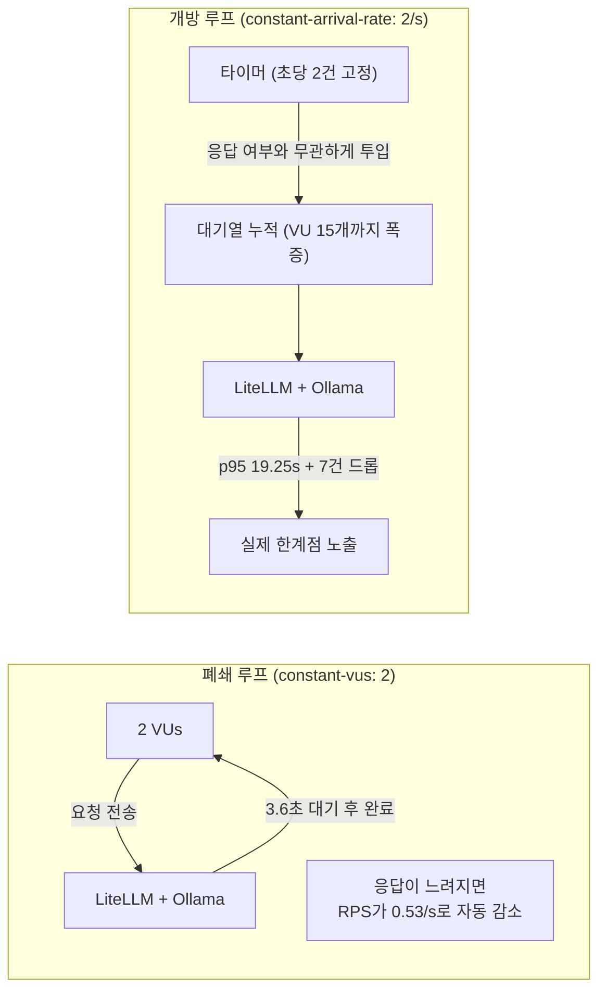

# 시나리오 3. 기본 k6/http로 Chat SSE 부하테스트 시 발생하는 5가지 왜곡

이 문서는 일반 웹 API 부하테스트 패턴(`k6/http` + VU 기반 RPS 측정)을 LLM 채팅 SSE 엔드포인트에 그대로 적용했을 때 지표가 어떻게 왜곡되는지 실제 실행으로 증명합니다.

## 이 시나리오의 목표

| 항목 | 내용 |
| --- | --- |
| 기능 | 기본 `k6/http`로 Chat SSE(`/v1/chat/completions`, `stream: true`) 호출 시 지표 왜곡 재현 |
| 쓰는 도구 | `k6` (`k6/http`), [01-naive-http-sse.js](../k6/01-naive-http-sse.js), [02-closed-vs-open-loop.js](../k6/02-closed-vs-open-loop.js), [03-rps-token-imbalance.js](../k6/03-rps-token-imbalance.js) |
| 입력 | LiteLLM Proxy(`local-qwen`)에 대한 스트리밍 요청 |
| 작업 | 1. TTFB·E2E 혼동 재현 -> 2. 폐쇄 루프와 개방 루프 비교 -> 3. 짧은 답변·긴 답변 RPS 함정 재현 |
| 달성할 것 | 기본 `k6/http`만으로는 TTFT·TPOT·토큰 처리량·실제 한계점을 판정할 수 없음을 숫자로 확인 |

## 이 기능이 무엇인가

웹 API 부하테스트에서 k6는 "요청을 보내고, 응답 바디가 끝날 때까지 기다린 뒤, RPS(초당 요청 수)와 `http_req_duration`을 집계"하는 모델에 최적화되어 있습니다. 이 모델은 1건당 처리 시간이 50~200ms로 균일한 REST API에서는 정확합니다.

그러나 LLM 채팅(SSE)은 요청 1건이 2초에서 20초 이상 열려 있고, 응답 크기가 토큰 수에 비례하며, 사용자 체감 속도는 전체 완료 시간(E2E)이 아니라 첫 토큰 도착(TTFT)과 토큰 간격(TPOT)에 좌우됩니다. 이 차이를 무시하고 기본 `k6/http`를 돌리면 **실제로는 서버가 포화되었는데 정상으로 보이거나, 반대로 사용자가 느끼는 반응 속도를 전혀 잡지 못하는 왜곡**이 발생합니다.

### 용어

| 용어 | 뜻 | 이 실습의 예 |
| --- | --- | --- |
| `http_req_waiting` | k6가 요청 전송 후 HTTP 응답 헤더의 첫 바이트를 받기까지 잰 시간(TTFB) | 샘플 1건에서 `274.9 ms` |
| `http_req_receiving` | HTTP 헤더 이후 응답 바디(모든 SSE 청크)가 완전히 닫힐 때까지 잰 시간 | 샘플 1건에서 `1790.9 ms` |
| 폐쇄 루프 (Closed-loop) | 고정된 VU가 이전 응답을 받은 뒤에야 다음 요청을 보내는 방식(`constant-vus`) | `MODE=closed`에서 2 VU가 `0.53 req/s`만 전송 |
| 개방 루프 (Open-loop) | 응답 속도와 무관하게 정해진 비율로 요청을 계속 투입하는 방식(`constant-arrival-rate`) | `MODE=open`에서 `2 req/s` 고정 투입, p95 `19.25s` 폭발 |
| Coordinated Omission | 서버가 느려지면 부하 생성기도 덩달아 요청을 늦게 보내 실제 지연과 포화가 숨겨지는 현상 | 폐쇄 루프 p95 `4.31s` vs 개방 루프 p95 `19.25s` |

## 이 문제를 이해해야 하는 이유

기본 `k6/http`로 LLM 게이트웨이를 측정할 때 발생하는 구조적 문제는 다섯 가지입니다.

1. **TTFB와 TTFT의 혼동 (SSE 청크 파싱 부재)**: 기본 `k6/http`는 응답 바디가 완전히 끝날 때까지 기다린 뒤 메트릭을 집계합니다. `http_req_waiting`은 HTTP 200 헤더가 열린 시점(TTFB)일 뿐 첫 텍스트 토큰(TTFT)이 아니며, 중간 청크별 타임스탬프(TPOT/ITL)는 아예 잴 수 없습니다.
2. **요청 수(RPS) 중심 측정의 함정**: 입력 100토큰·출력 20토큰 요청과 입력 4,000토큰·출력 1,000토큰 요청은 GPU 연산량과 KV 캐시 점유율이 수십 배 차이 납니다. `http_req_duration`과 `http_reqs`만 보면 지연이 튄 원인이 서버 병목인지, 모델이 우연히 긴 답변을 생성해서인지 구분할 수 없습니다.
3. **입출력 토큰 길이(ISL/OSL) 통제와 토크나이저 부재**: 단순 문자열로 프롬프트를 보내면 모델별 실제 토큰 수 기반의 TPS나 SLO 통과율(Goodput)을 계산하지 못합니다.
4. **VU 기반 폐쇄 루프의 트래픽 왜곡 (Coordinated Omission)**: `vus: 2`처럼 고정 VU로 쏘면, 서버 응답이 4초로 느려지는 순간 부하 주입량도 초당 0.5건으로 알아서 줄어듭니다. 실제 사용자는 앞사람 응답을 기다려 주지 않고 계속 질문을 보내므로, 폐쇄 루프 결과만 믿고 쿼터를 산정하면 운영 트래픽에서 장애가 납니다.
5. **고정 프롬프트 반복에 따른 캐시 오염**: 같은 질문 몇 개를 반복 호출하면 vLLM의 Automatic Prefix Caching이나 Bedrock·Vertex의 Prompt Caching에 100% 적중합니다. 가장 무거운 Prefill 연산이 생략되어 TTFT가 실제보다 비정상적으로 빠르게 측정됩니다.

## 대안 비교

기본 `k6/http` 측정 방식과 LLM 전용 측정 요건을 대조합니다.

| 측정 항목 | 기본 `k6/http` (`constant-vus`) | LLM 벤치마크 요건 |
| --- | --- | --- |
| 스트림 청크 파싱 | 불가 (전체 바디 완료 후 문자열 반환) | 토큰 청크 단위 실시간 타임스탬프 기록 |
| 첫 응답 지연 | `http_req_waiting` (헤더 TTFB) | 첫 텍스트 토큰 도착 시각(TTFT) |
| 생성 속도 | 측정 불가 | 토큰 간격(TPOT/ITL) 및 초당 출력 토큰(TPS) |
| 부하 주입 방식 | 응답 대기 후 재전송(Closed-loop) | 응답 무관 투입(Open-loop, Poisson 등) |
| 프롬프트 다양성 | 스크립트 내 고정 문자열 반복 시 캐시 오염 | 매 요청 고유 랜덤 프리픽스 또는 데이터셋 샘플링 |

## 컴포넌트 역할

| 컴포넌트 | 역할 |
| --- | --- |
| `k6` (`k6/http`) | 일반 REST API 방식으로 LiteLLM에 `stream: true` 부하를 주입해 왜곡 재현 |
| LiteLLM Proxy (`localhost:4000`) | SSE 응답을 클라이언트(k6)로 중계 |
| Ollama (`qwen2.5:1.5b`) | 동시 요청이 몰릴 때 순차·배치 처리하며 큐잉 지연 발생 |

## 흐름

아래 다이어그램은 서버가 느려졌을 때 폐쇄 루프(VU)와 개방 루프(`constant-arrival-rate`)가 부하를 어떻게 다르게 처리하는지 보여줍니다.



## 실습

[setup.md](setup.md)의 1~2단계를 마쳐 LiteLLM Proxy가 `localhost:4000`에서 실행 중이어야 합니다.

### 1. 기본 k6/http로 SSE 호출 시 TTFB·E2E 혼동 확인

[01-naive-http-sse.js](../k6/01-naive-http-sse.js)는 `stream: true`로 요청을 보내지만 기본 `k6/http` 모듈만 사용합니다.

```bash
cd computer_science/ai/litellm-sse-load-test
k6 run k6/01-naive-http-sse.js
```

실행 로그와 요약 표를 보면 `http_req_duration`은 스트림이 완전히 끝난 E2E 시간(`avg=3.41s`, `p(95)=3.9s`)만 기록합니다. 샘플 1건 로그에서도 `res.body`에 SSE `data:` 라인 95개가 통째로 모인 뒤에야 측정이 끝났고, 각 토큰 도착 시각(TTFT, TPOT)은 어디에도 남지 않습니다.

```text
level=info msg="[샘플 1건] http_req_waiting(TTFB)=274.9ms, http_req_receiving=1790.9ms, http_req_duration(E2E)=2066.0ms, SSE data 라인 수=95"

    HTTP
    http_req_duration..............: avg=3.41s min=2.06s med=3.59s max=3.95s p(90)=3.84s p(95)=3.9s
    http_req_failed................: 0.00%  0 out of 6
    http_reqs......................: 6      0.539339/s
```

### 2. VU 폐쇄 루프와 constant-arrival-rate 개방 루프 비교

[02-closed-vs-open-loop.js](../k6/02-closed-vs-open-loop.js)는 `MODE` 환경 변수로 폐쇄 루프(`vus: 2`)와 개방 루프(`rate: 2/s`)를 전환합니다. 두 모드를 순차적으로 실행해 같은 15초 동안 결과가 얼마나 달라지는지 비교합니다.

먼저 폐쇄 루프(`MODE=closed`)를 실행합니다.

```bash
cd computer_science/ai/litellm-sse-load-test
MODE=closed k6 run k6/02-closed-vs-open-loop.js
```

이어서 개방 루프(`MODE=open`)를 실행합니다.

```bash
cd computer_science/ai/litellm-sse-load-test
MODE=open k6 run k6/02-closed-vs-open-loop.js
```

두 실행 결과를 나란히 놓으면 Coordinated Omission의 착시가 숫자로 드러납니다.

| 지표 | `MODE=closed` (`constant-vus: 2`) | `MODE=open` (`constant-arrival-rate: 2/s`) |
| --- | --- | --- |
| 완료 요청 수 (`http_reqs`) | 9건 (`0.53/s`) | 24건 (`0.68/s`) |
| 드롭된 요청 (`dropped_iterations`) | 0건 | **7건** (목표 부하 소화 불가) |
| 최대 동시 VU (`vus_max`) | 2 | **15** (대기열 누적) |
| `http_req_duration` 평균 | `3.60s` | **`11.51s`** (3.2배 증가) |
| `http_req_duration` P95 | `4.31s` | **`19.25s`** (4.5배 폭발) |

폐쇄 루프만 보면 "에러 0%, p95 4.31초로 안정적"이라고 오판하기 쉽습니다. 하지만 실제 트래픽처럼 초당 2건이 계속 들어오는 개방 루프로 바꾸자 대기열이 밀리며 p95가 19.25초까지 치솟고 7건이 드롭됩니다.

### 3. 짧은 답변과 긴 답변이 섞였을 때 RPS 지표의 함정 확인

[03-rps-token-imbalance.js](../k6/03-rps-token-imbalance.js)는 짧은 답변(`max_tokens: 20`)과 긴 답변(`max_tokens: 180`)을 번갈아 요청합니다.

```bash
cd computer_science/ai/litellm-sse-load-test
k6 run k6/03-rps-token-imbalance.js
```

실측 결과를 보면 짧은 답변과 긴 답변의 소요 시간은 6배 이상 차이 나지만, k6 기본 `http_reqs`는 둘 다 똑같이 "1건"으로 합산합니다.

```text
    CUSTOM
    long_answer_duration...........: avg=3.23s    min=3.19s    med=3.22s    max=3.27s    p(90)=3.26s    p(95)=3.27s
    short_answer_duration..........: avg=519.88ms min=479ms    med=489.46ms max=591.19ms p(90)=570.84ms p(95)=581.02ms

    HTTP
    http_req_duration..............: avg=1.87s    min=479ms    med=1.89s    max=3.27s    p(90)=3.25s    p(95)=3.26s
    http_reqs......................: 6      0.533026/s
```

입력·출력 토큰 길이를 고정하지 않고 `http_req_duration`만 추적하면, 테스트마다 답변 길이가 달라졌을 뿐인데 서버 성능이 변했다고 잘못 해석하게 됩니다.


## 부록. 실무에서 얻는 것

- **RPS 숫자는 LLM 용량 산정의 1차 지표가 아닙니다.** 같은 10 RPS라도 요약(4,000 입력 / 256 출력)과 코드 생성(1,000 입력 / 2,000 출력)은 필요한 GPU 메모리와 클라우드 TPM(Tokens Per Minute) 쿼터가 완전히 다릅니다.
- **k6에서 프롬프트 캐시 오염을 막으려면 매 요청마다 고유 접두사를 넣습니다.** 이번 실습 스크립트도 `[req-${__VU}-${__ITER}]`를 붙여 반복 호출이 캐시에 적중하는 현상을 피했습니다.
- **다음 단계**: 기본 `k6/http`의 한계를 확인했으므로, 시나리오 4에서는 `xk6-sse`로 k6 안에서 SSE 청크를 직접 파싱해 TTFT와 TPOT를 보완 측정해 봅니다.

## 참고 문서

1. [Grafana k6 - Arrival-rate VU allocation (Open vs Closed model)](https://grafana.com/docs/k6/latest/using-k6/scenarios/concepts/open-vs-closed/)
2. [How NOT to Measure Latency (Gil Tene - Coordinated Omission)](https://www.youtube.com/watch?v=lJ8ydIuPFeU)
